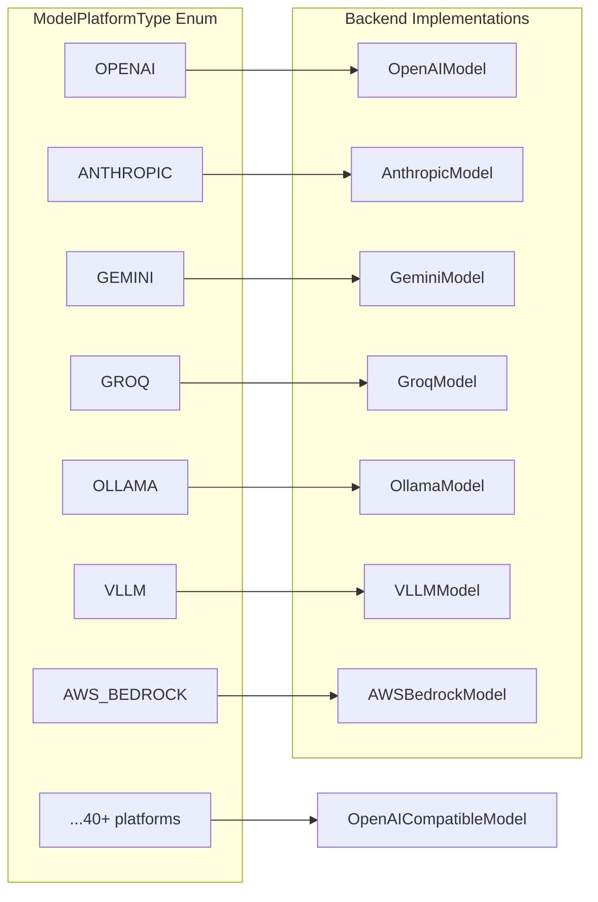
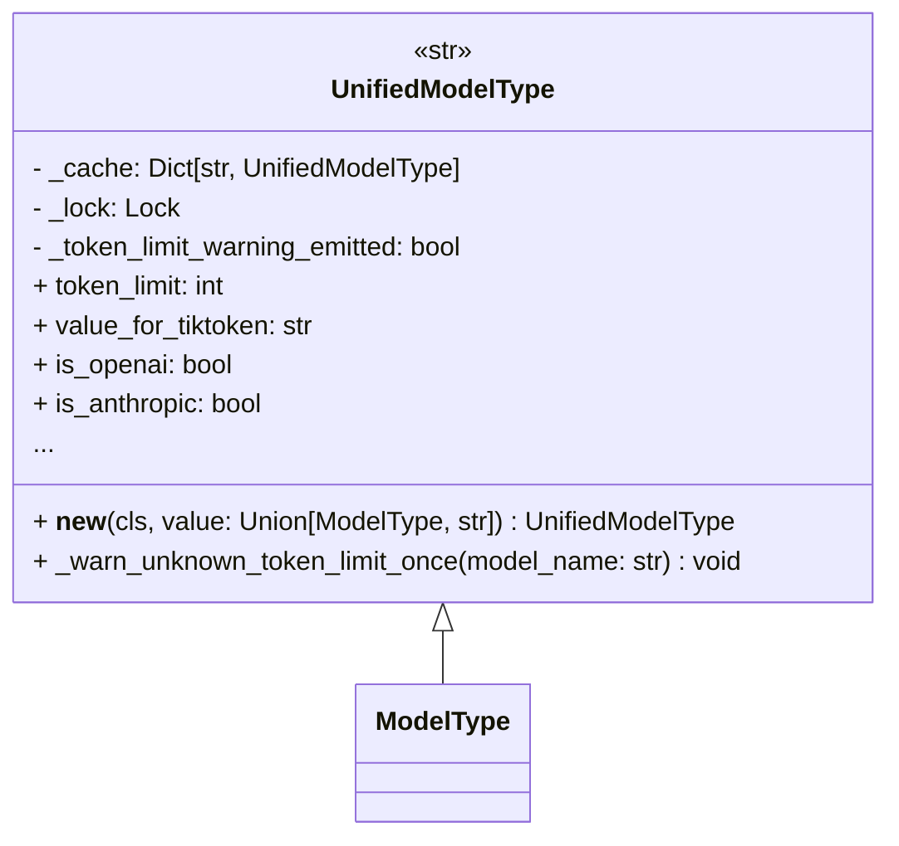
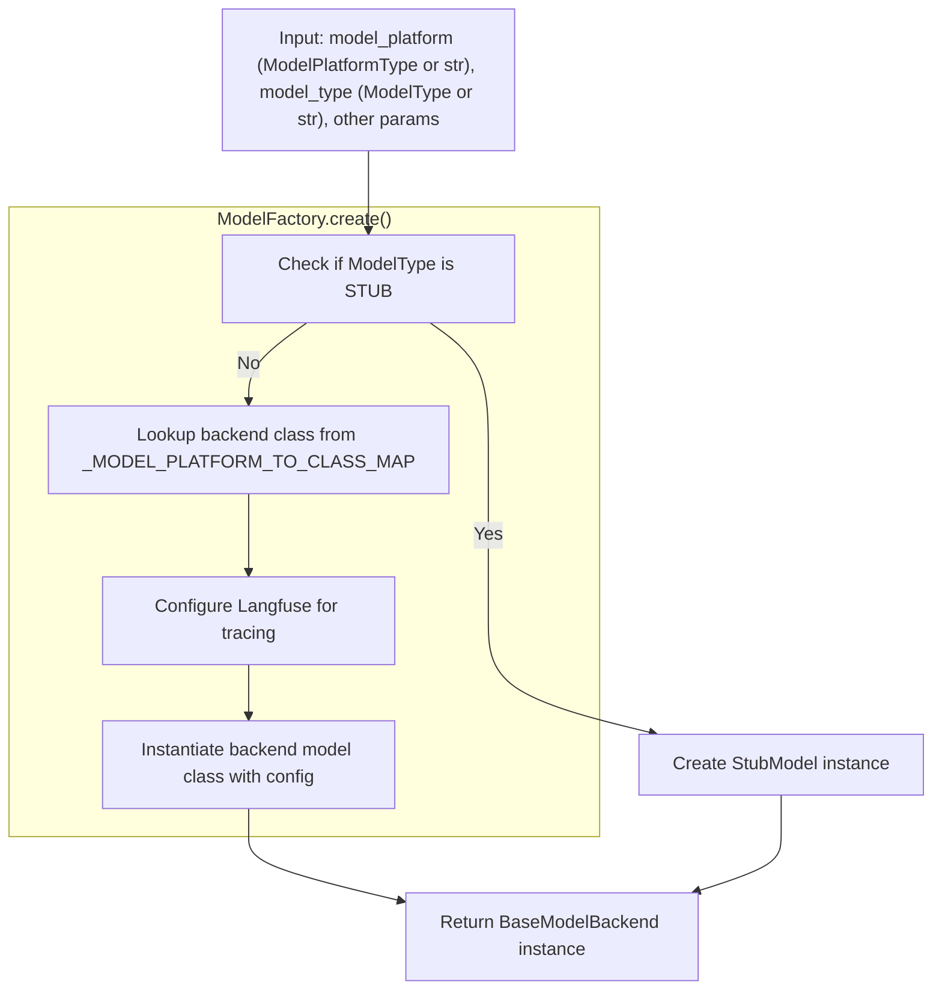

<!-- source: DeepWiki mcp.deepwiki.com · repo camel-ai/camel · page 3.1 Model Types and Factory · fetched 2026-10-29 -->

# Model Types and Factory

<details>
<summary>Relevant source files</summary>

The following files were used as context for generating this wiki page:

- [.github/workflows/build_package.yml](.github/workflows/build_package.yml)
- [.github/workflows/pytest_package.yml](.github/workflows/pytest_package.yml)
- [camel/configs/__init__.py](camel/configs/__init__.py)
- [camel/models/__init__.py](camel/models/__init__.py)
- [camel/models/model_factory.py](camel/models/model_factory.py)
- [camel/models/stub_model.py](camel/models/stub_model.py)
- [camel/types/enums.py](camel/types/enums.py)
- [camel/types/unified_model_type.py](camel/types/unified_model_type.py)
- [docs/key_modules/models.md](docs/key_modules/models.md)
- [docs/mintlify/key_modules/models.mdx](docs/mintlify/key_modules/models.mdx)
- [test/models/test_model_factory.py](test/models/test_model_factory.py)

</details>


This page documents the model type system and factory mechanism that enables CAMEL to support 300+ models across 40+ platforms. The system consists of four core components:

1. **ModelType**: Enum defining 300+ individual model identifiers (e.g., `GPT_4O_MINI`, `CLAUDE_3_5_SONNET`) [[camel/types/enums.py:33-63]]().
2. **ModelPlatformType**: Enum defining 40+ platform identifiers (e.g., `OPENAI`, `ANTHROPIC`, `GROQ`) [[camel/models/model_factory.py:78-128]]().
3. **UnifiedModelType**: String-compatible bridge enabling both enum and string-based model access [[camel/types/unified_model_type.py:25-50]]().
4. **ModelFactory**: Factory class with `create()` method to instantiate model backends [[camel/models/model_factory.py:131-143]]().

For backend implementation details, see **Model Backends (3.2)**.

---

## ModelType Enumeration

The `ModelType` enum declared in `camel/types/enums.py` defines over 300 model identifiers organized by provider and platform. It is a subclass of both `Enum` and `UnifiedModelType` to unify enum and string access.

### Enum Overview and Key Providers

`ModelType` enumerates many models, with popular examples as follows:

- **OpenAI Models**: `GPT_3_5_TURBO`, `GPT_4`, `GPT_4O`, `O1`, `O3_MINI`, `GPT_5_5_PRO` etc.
- **Anthropic Models**: e.g., `AWS_CLAUDE_3_7_SONNET`, `AWS_CLAUDE_3_5_SONNET`.
- **ZhipuAI GLM Models**: e.g., `GLM_5_2`, `GLM_4_7_FLASHX`.
- **Groq Models**: e.g., `GROQ_LLAMA_3_3_70B`.
- **Cerebras Models**: e.g., `CEREBRAS_GPT_OSS_120B`.
- **Nebius AI Studio Models**: e.g., `NEBIUS_GPT_OSS_120B`.
- **CometAPI Models**: e.g., `COMETAPI_GPT_5`, `COMETAPI_GEMINI_2_5_PRO`.
- **OpenRouter Models**: `OPENROUTER_LLAMA_4_MAVERICK`.

Full list spans 300+ models across more than 40 platforms.

### Structure Diagram — ModelType Enum Hierarchy

```mermaid
graph TB
    ModelType["ModelType<br/>(Enum + UnifiedModelType)"]
    
    subgraph "OpenAI Models"
        GPT_3_5_TURBO["GPT_3_5_TURBO = 'gpt-3.5-turbo'"]
        GPT_4["GPT_4 = 'gpt-4'"]
        GPT_4O["GPT_4O = 'gpt-4o'"]
        O1["O1 = 'o1'"]
        O3_MINI["O3_MINI = 'o3-mini'"]
        GPT_5_5_PRO["GPT_5_5_PRO = 'gpt-5.5-pro-2026-04-23'"]
    end
    
    subgraph "Anthropic Models"
        CLAUDE_3_5_SONNET["CLAUDE_3_5_SONNET = 'anthropic.claude-3-5-sonnet-20241022-v2:0'"]
        CLAUDE_3_7_SONNET["CLAUDE_3_7_SONNET = 'anthropic.claude-3-7-sonnet-20250219-v1:0'"]
    end
    
    subgraph "AWS Bedrock Models"
        AWS_CLAUDE_3_7_SONNET["AWS_CLAUDE_3_7_SONNET"]
        AWS_DEEPSEEK_R1["AWS_DEEPSEEK_R1"]
    end
    
    subgraph "Gemini Models"
        GEMINI_2_5_PRO["GEMINI_2_5_PRO = 'gemini-2.5-pro'"]
        GEMINI_2_5_FLASH["GEMINI_2_5_FLASH = 'gemini-2.5-flash'"]
    end
    
    subgraph "Platform Models (40+ Providers)"
        GROQ_LLAMA["GROQ_LLAMA_3_3_70B"]
        CEREBRAS_LLAMA["CEREBRAS_LLAMA_3_3_70B"]
        OPENROUTER_LLAMA["OPENROUTER_LLAMA_4_MAVERICK"]
        MORE["...300+ other models"]
    end
    
    ModelType --> GPT_3_5_TURBO
    ModelType --> CLAUDE_3_5_SONNET
    ModelType --> AWS_CLAUDE_3_7_SONNET
    ModelType --> GEMINI_2_5_PRO
    ModelType --> GROQ_LLAMA
    ModelType --> MORE
```



Sources: [camel/types/enums.py:33-219]()

---

## ModelPlatformType and Registry

The `ModelPlatformType` enum captures the diverse set of model platforms/providers supported (40+). For each platform, CAMEL implements a specific backend inheriting from `BaseModelBackend` for API integration and inference.

The `ModelFactory` maintains a mapping from `ModelPlatformType` to backend class:

| ModelPlatformType                | Backend Class              |
|---------------------------------|----------------------------|
| `OPENAI`                        | `OpenAIModel`              |
| `ANTHROPIC`                    | `AnthropicModel`           |
| `GEMINI`                       | `GeminiModel`              |
| `GROQ`                         | `GroqModel`                |
| `OLLAMA`                       | `OllamaModel`              |
| `VLLM`                         | `VLLMModel`                |
| `AWS_BEDROCK`                  | `AWSBedrockModel`          |
| `AZURE`                        | `AzureOpenAIModel`         |
| `COMETAPI`                     | `CometAPIModel`            |
| `MINIMAX`                      | `MinimaxModel`             |
| and many others (total 40+)    | ...                        |

### Diagram — Platform to Backend Mapping



Sources: [camel/models/model_factory.py:78-128]()

---

## UnifiedModelType Bridge

`UnifiedModelType` is a specialized `str` subclass defined in `camel/types/unified_model_type.py`. It acts as a unified representation for model types regardless of whether they originate from an enum (`ModelType`) or a raw string identifier. This unification enables flexibility in APIs and internal calls, allowing users to specify models as enums or strings interchangeably.

### Implementation Details:

- **Thread-safe Caching:** Uses a class-level dictionary `_cache` guarded by a lock `_lock` to memoize instances, ensuring unique instances for each model string.
- **Enum Conversion:** On creation, converts enum inputs to their underlying string values.
- **Token Limit Defaults:** For unknown model strings not recognized in `ModelType`, it emits a warning once and defaults token limit to a very large value (`999,999,999` tokens).
- **Interface:** Implements properties such as `value_for_tiktoken` with a default return (`"gpt-4o-mini"`), and boolean properties `is_openai`, `is_anthropic`, etc., which can be overloaded for fine-grained behavior (currently return `True`).

### Diagram — Unified Model Type Lifecycle



Sources: [camel/types/unified_model_type.py:25-87]()

---

## ModelFactory.create()

The `ModelFactory` class is the central factory for creating backend model instances suitable for various platforms and model types. It abstracts the complexity of initializing different backend classes with appropriate configurations, token counters, API keys, URLs, and other runtime parameters.

### Data Flow of Model Creation



### Key Behavior:

- Accepts both enum or string identifiers for platform and model type, normalizing them for lookup.
- If model type is `STUB` (used for testing), it returns a `StubModel`.
- Looks up the respective backend class registered for the platform.
- Applies any API key, URL, token counter, timeout, or retries overrides passed in arguments.
- Supports optional `client` or `async_client` injection for advanced usage.
- Integrates automatic Langfuse tracing configuration if enabled in environment.

### Key Methods:

- `create(...)`: Main factory method to instantiate the appropriate backend [[camel/models/model_factory.py:131-196]]().
- `create_from_json(path)`: Reads model config from a JSON file and creates instance [[camel/models/model_factory.py:268-288]]().
- `create_from_yaml(path)`: Reads from YAML config and creates instance [[camel/models/model_factory.py:290-311]]().

### StubModel for Testing:

The factory can create a `StubModel`, a dummy backend used mostly for unit testing. The `StubModel` returns a fixed "Lorem Ipsum" response for all inference calls and provides a simple token counter returning a constant token count (`10`) [[camel/models/stub_model.py:33-184]]().

---

## Summary Table of Key Classes and Enums

| Name              | Type         | Description                                                    | Location                             |
|-------------------|--------------|----------------------------------------------------------------|------------------------------------|
| `ModelType`       | Enum         | Enum of 300+ supported model identifiers                        | `camel/types/enums.py:33-`         |
| `ModelPlatformType`| Enum         | Enum of 40+ supported model platforms/providers                 | `camel/models/model_factory.py:78-`|
| `UnifiedModelType`| Class (str)  | Unified string-based model identifier supporting enum & str    | `camel/types/unified_model_type.py`|
| `ModelFactory`    | Class        | Factory for creating model backend instances                    | `camel/models/model_factory.py`    |
| `StubModel`       | Class        | Dummy model backend used for unit testing                       | `camel/models/stub_model.py`        |

---

# Cross-Domain Diagram

## Natural Language to Code Entity Mapping

This diagram illustrates the journey from a "natural language" description of a model requirement to the actual code entity instantiated via the factory.

```mermaid
flowchart TD
    NLModel["Natural Language:<br/>Request to use GPT-4O Mini"]:::nl
    Input["Inputs:<br/>platform='openai'<br/>model='gpt-4o-mini'"]:::input
    ModelTypeEnum["ModelType.GPT_4O_MINI<br/>'gpt-4o-mini' (Enum)"]:::enum
    UnifiedType["UnifiedModelType('gpt-4o-mini')"]:::class
    PlatformEnum["ModelPlatformType.OPENAI"]:::enum
    BackendClass["OpenAIModel (subclass BaseModelBackend)"]:::class
    ModelInstance["Instance of OpenAIModel"]:::instance

    NLModel --> Input
    Input --> ModelTypeEnum
    Input --> PlatformEnum
    ModelTypeEnum --> UnifiedType
    UnifiedType --> ModelFactoryCreate["ModelFactory.create()"]:::func
    PlatformEnum --> ModelFactoryCreate
    ModelFactoryCreate --> BackendClass
    BackendClass --> ModelInstance

    classDef nl fill:#f3f3f3,stroke:#000,stroke-width:0.5px;
    classDef input fill:#fff,stroke:#000,stroke-width:0.5px;
    classDef enum fill:#e0e0e0,stroke:#000,stroke-width:0.5px;
    classDef class fill:#d0d0d0,stroke:#000,stroke-width:0.5px;
    classDef instance fill:#c8f0c8,stroke:#000,stroke-width:0.5px;
    classDef func fill:#d0e0f0,stroke:#000,stroke-width:0.5px;
```

## Detailed ModelFactory Workflow Mapping

Shows internals of `ModelFactory.create()` from input parameters, configuration, platform-to-class lookup, Langfuse config, to returning a backend instance.

```mermaid
flowchart TD
    Start["Start: create(platform, model_type, config...)"]:::start
    ConvertPlatform["Convert platform param to ModelPlatformType enum"]:::step
    ConvertModelType["Convert model_type param to UnifiedModelType"]:::step
    CheckStub["Is model_type == ModelType.STUB?"]:::decision
    CreateStub["Return StubModel instance"]:::step
    LookupBackend["Lookup backend class in _MODEL_PLATFORM_TO_CLASS_MAP"]:::step
    LangfuseConfig["Configure Langfuse if enabled"]:::step
    InstantiateBackend["Instantiate backend class with config, api_key, token_counter"]:::step
    ReturnInstance["Return model backend instance"]:::end

    Start --> ConvertPlatform
    ConvertPlatform --> ConvertModelType
    ConvertModelType --> CheckStub
    CheckStub -->|Yes| CreateStub
    CheckStub -->|No| LookupBackend
    LookupBackend --> LangfuseConfig
    LangfuseConfig --> InstantiateBackend
    InstantiateBackend --> ReturnInstance

    classDef start fill:#dfd,stroke:#080,stroke-width:1px;
    classDef step fill:#def,stroke:#008,stroke-width:1px;
    classDef decision fill:#fdd,stroke:#800,stroke-width:2px,font-weight:bold;
    classDef end fill:#ffd,stroke:#880,stroke-width:1px;
```

---

# References

- `ModelType` Enum — [camel/types/enums.py:33-219]()
- `ModelPlatformType` and backend map — [camel/models/model_factory.py:78-128]()
- `UnifiedModelType` implementation — [camel/types/unified_model_type.py:25-87]()
- `ModelFactory.create()` method — [camel/models/model_factory.py:131-196]()
- StubModel — [camel/models/stub_model.py:33-184]()

---

This concludes the detailed technical documentation of the CAMEL model type enumeration and factory instantiation subsystem.

---

