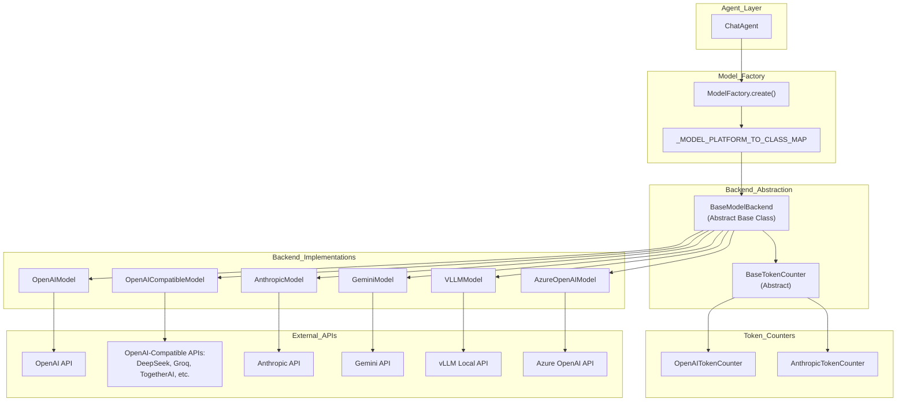
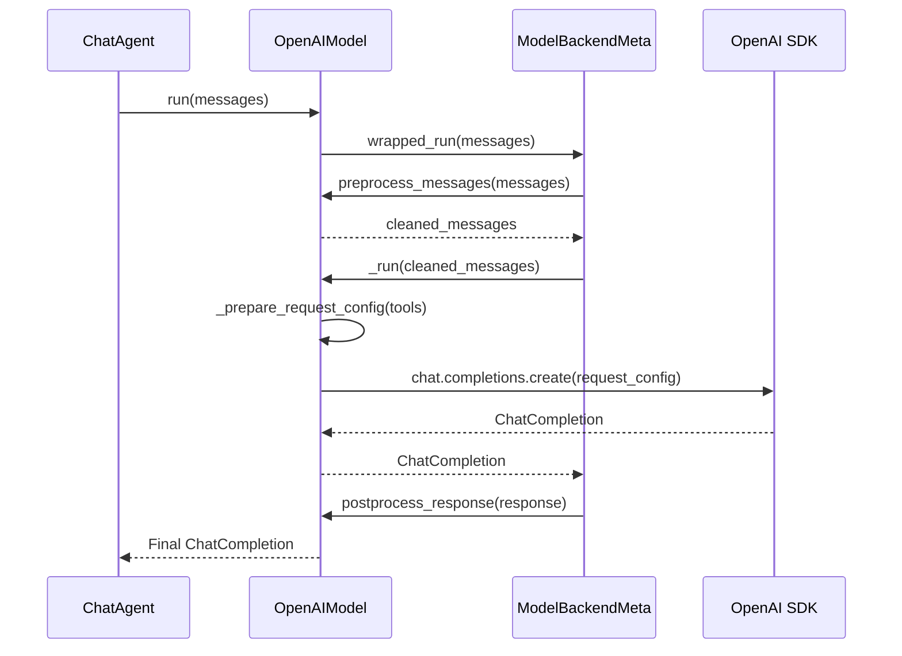
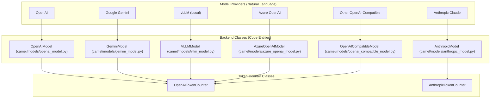

<!-- source: DeepWiki mcp.deepwiki.com · repo camel-ai/camel · page 3.2 Model Backends · fetched 2026-10-29 -->

# Model Backends

Relevant source files

The following files were used as context for generating this wiki page:

- [camel/configs/anthropic_config.py](camel/configs/anthropic_config.py)
- [camel/configs/bedrock_config.py](camel/configs/bedrock_config.py)
- [camel/configs/deepseek_config.py](camel/configs/deepseek_config.py)
- [camel/configs/gemini_config.py](camel/configs/gemini_config.py)
- [camel/configs/samba_config.py](camel/configs/samba_config.py)
- [camel/configs/togetherai_config.py](camel/configs/togetherai_config.py)
- [camel/configs/xai_config.py](camel/configs/xai_config.py)
- [camel/models/anthropic_model.py](camel/models/anthropic_model.py)
- [camel/models/aws_bedrock_converse_model.py](camel/models/aws_bedrock_converse_model.py)
- [camel/models/aws_bedrock_model.py](camel/models/aws_bedrock_model.py)
- [camel/models/azure_openai_model.py](camel/models/azure_openai_model.py)
- [camel/models/base_model.py](camel/models/base_model.py)
- [camel/models/cohere_model.py](camel/models/cohere_model.py)
- [camel/models/deepseek_model.py](camel/models/deepseek_model.py)
- [camel/models/gemini_model.py](camel/models/gemini_model.py)
- [camel/models/groq_model.py](camel/models/groq_model.py)
- [camel/models/litellm_model.py](camel/models/litellm_model.py)
- [camel/models/mistral_model.py](camel/models/mistral_model.py)
- [camel/models/ollama_model.py](camel/models/ollama_model.py)
- [camel/models/openai_compatible_model.py](camel/models/openai_compatible_model.py)
- [camel/models/openai_model.py](camel/models/openai_model.py)
- [camel/models/reka_model.py](camel/models/reka_model.py)
- [camel/models/samba_model.py](camel/models/samba_model.py)
- [camel/models/togetherai_model.py](camel/models/togetherai_model.py)
- [camel/models/vllm_model.py](camel/models/vllm_model.py)
- [camel/models/xai_model.py](camel/models/xai_model.py)
- [camel/models/zhipuai_model.py](camel/models/zhipuai_model.py)
- [docs/mintlify/reference/camel.configs.anthropic_config.mdx](docs/mintlify/reference/camel.configs.anthropic_config.mdx)
- [docs/mintlify/reference/camel.configs.openai_config.mdx](docs/mintlify/reference/camel.configs.openai_config.mdx)
- [docs/mintlify/reference/camel.models._utils.mdx](docs/mintlify/reference/camel.models._utils.mdx)
- [docs/mintlify/reference/camel.models.anthropic_model.mdx](docs/mintlify/reference/camel.models.anthropic_model.mdx)
- [docs/mintlify/reference/camel.models.base_model.mdx](docs/mintlify/reference/camel.models.base_model.mdx)
- [docs/mintlify/reference/camel.models.model_manager.mdx](docs/mintlify/reference/camel.models.model_manager.mdx)
- [docs/reference/camel.configs.anthropic_config.md](docs/reference/camel.configs.anthropic_config.md)
- [docs/reference/camel.models.anthropic_model.md](docs/reference/camel.models.anthropic_model.md)
- [examples/models/anthropic_model_example.py](examples/models/anthropic_model_example.py)
- [examples/models/deepseek_model_example.py](examples/models/deepseek_model_example.py)
- [examples/models/gemini_model_example.py](examples/models/gemini_model_example.py)
- [examples/models/litellm_model_example.py](examples/models/litellm_model_example.py)
- [examples/models/openai_audio_models_example.py](examples/models/openai_audio_models_example.py)
- [examples/models/role_playing_with_claude.py](examples/models/role_playing_with_claude.py)
- [examples/models/role_playing_with_gemini.py](examples/models/role_playing_with_gemini.py)
- [examples/models/samba_model_example.py](examples/models/samba_model_example.py)
- [examples/models/togetherai_model_example.py](examples/models/togetherai_model_example.py)
- [examples/models/xai_model_example.py](examples/models/xai_model_example.py)
- [test/models/test_anthropic_model.py](test/models/test_anthropic_model.py)
- [test/models/test_aws_bedrock_converse_model.py](test/models/test_aws_bedrock_converse_model.py)
- [test/models/test_aws_bedrock_model.py](test/models/test_aws_bedrock_model.py)
- [test/models/test_base_model.py](test/models/test_base_model.py)
- [test/models/test_cohere_model.py](test/models/test_cohere_model.py)
- [test/models/test_deepseek_model.py](test/models/test_deepseek_model.py)
- [test/models/test_gemini_model.py](test/models/test_gemini_model.py)
- [test/models/test_reka_model.py](test/models/test_reka_model.py)
- [test/models/test_samba_model.py](test/models/test_samba_model.py)
- [test/models/test_togetherai_model.py](test/models/test_togetherai_model.py)
- [test/models/test_xai_model.py](test/models/test_xai_model.py)

Model backends are the interface layer between CAMEL agents and large language model (LLM) providers. Each backend implements the `BaseModelBackend` interface, providing a unified API for chat completion requests, token counting, and message preprocessing. This abstraction hides API differences of the underlying providers, offering a consistent interface to the rest of the CAMEL framework.

**Scope**: This page covers the architecture and implementation of model backends. For model instantiation via factory, see [Model Types and Factory](3.1). For message preprocessing, see [Message Processing and Preprocessing](3.3).

---

## Architecture Overview

Model backends are positioned between the agent layer and external LLM APIs, abstracting away provider-specific details. CAMEL supports over 40 platforms via three primary integration patterns:

1. **OpenAI-compatible models**  
   Use the OpenAI client or compatible clients with ability to override base URLs and authentication (including providers like TogetherAI, DeepSeek, Groq).

2. **Native API models**  
   Use provider SDKs with custom message format conversions (e.g., Anthropic models).

3. **Specialized backends**  
   Have unique startup or API interaction logic (e.g., local vLLM servers, Gemini, Azure OpenAI with specific configurations).

The diagram below illustrates key components and their relationships in the model backend system.

**Sources**: [camel/models/base_model.py:172-203](), [camel/models/openai_model.py:82-123](), [camel/models/openai_compatible_model.py:73-150](), [camel/models/anthropic_model.py:101-185](), [camel/models/gemini_model.py:67-151](), [camel/models/vllm_model.py:29-146](), [camel/models/azure_openai_model.py:41-151]()

---

## BaseModelBackend Interface

`BaseModelBackend` is the abstract base class defining the contract for all model backends. It ensures uniformity in model interaction through methods for synchronous and asynchronous invocation, token counting, and message preprocessing. The `ModelBackendMeta` metaclass wraps the `run` and `arun` methods to automatically preprocess messages (e.g., removing `<think>` tags) before sending and postprocess responses (e.g., extracting `<think>` reasoning content) after receiving [camel/models/base_model.py:195-237]().

### Core Attributes

| Attribute                    | Type                      | Description                                   |
|-----------------------------|---------------------------|-----------------------------------------------|
| `model_type`                 | `UnifiedModelType`        | Identifier for the model (e.g., `ModelType.GPT_4O`) |
| `model_config_dict`          | `Dict[str, Any]`          | Model configuration dictionary                  |
| `_api_key`                   | `Optional[str]`           | API key for authentication                      |
| `_url`                      | `Optional[str]`           | Optional custom API endpoint                     |
| `_token_counter`             | `Optional[BaseTokenCounter]` | Token counting implementation                  |
| `_timeout`                   | `float`                   | API request timeout in seconds                   |

### Key Methods

- `run(messages: List[OpenAIMessage], ...)`  
  Synchronous entry point for generating chat completions. Automatically wraps `_run` by performing message preprocessing and postprocessing.  
- `_run(messages: List[OpenAIMessage], ...)`  
  Abstract synchronous method to send requests to the model. Subclasses implement actual calling logic.  
- `_arun(messages: List[OpenAIMessage], ...)`  
  Corresponding asynchronous method for subclasses to implement async calls.  
- `token_counter` (property)  
  Provides a token counting mechanism specialized for the backend's tokenization format.  
- `supports_tool_response_format()`  
  Boolean indicating native support for structured tool responses.

**Sources**: [camel/models/base_model.py:172-268]()

---

## OpenAIModel Implementation

`OpenAIModel` implements the backend interface for the OpenAI API directly. It supports the GPT and O-series models and handles both sync and async clients.

### O-Series Model Restrictions

O-series models (e.g., `o1-mini`) do not support settings like `temperature`, `top_p`, or `logprobs`. To avoid API rejection, `OpenAIModel` maintains a set `UNSUPPORTED_PARAMS` which are filtered out from calls [camel/models/openai_model.py:71-80]().

### Client Initialization and Features

- Supports user-provided custom synchronous and asynchronous clients, enabling compatibility with RL frameworks and proxy clients.
- Defaults to OpenAI's `OpenAI` and `AsyncOpenAI` clients if none provided.
- If enabled, `langfuse` wrappers are integrated for enhanced telemetry.
- Supports two API modes: `"chat_completions"` (standard OpenAI chat completions) and `"responses"` (response chaining with previous response IDs).

### Request Handling Flow

**Sources**: [camel/models/openai_model.py:82-145](), [camel/models/base_model.py:205-237]()

---

## OpenAICompatibleModel

`OpenAICompatibleModel` is a more flexible base class for providers that implement the OpenAI-compatible API. These include providers like TogetherAI, DeepSeek, Groq, and Gemini.

- Supports custom base URLs and API keys.
- Enables reuse of OpenAI client logic with provider-specific overrides.
- Supports `"chat_completions"` and `"responses"` API modes, similar to `OpenAIModel`.
- Allows custom synchronous and asynchronous clients.

### Specialized Compatible Implementations

- **GeminiModel**  
  Inherits from `OpenAICompatibleModel` targeting Google's Gemini API. It adds native Google GenAI client support for caching operations and specialized cache creation methods.

- **VLLMModel**  
  Represents a local vLLM server with OpenAI-compatible APIs. If the URL is not supplied, it automatically launches a local vLLM server subprocess. It also normalizes reasoning fields for compatibility.

- **AzureOpenAIModel**  
  Extends `OpenAIModel` but specifically for Azure OpenAI API with additional parameters like API versioning and optional Azure AD token support.

**Sources**: [camel/models/openai_compatible_model.py:73-175](), [camel/models/gemini_model.py:67-151](), [camel/models/vllm_model.py:29-146](), [camel/models/azure_openai_model.py:41-151]()

---

## AnthropicModel Implementation

`AnthropicModel` integrates with Anthropic's Claude models using Anthropic's native Python SDK, not via OpenAI-compatible interfaces. This allows fine-grained usage of Anthropic-specific features and optimizations.

### Message Sanitization

Anthropic requires message contents to have no trailing whitespace. The helper function `strip_trailing_whitespace_from_messages` cleans message contents before sending [camel/models/anthropic_model.py:60-98]().

### Cache Control

Supports Anthropic's ephemeral prompt caching configured via the `cache_control` parameter in the model config (e.g., `'5m'` or `'1h'` TTL). Invalid TTL values raise exceptions [camel/models/anthropic_model.py:159-169](), [camel/configs/anthropic_config.py:63-65]().

### Token Counter

Defaults to an `AnthropicTokenCounter` implementation specialized for Anthropic's tokenization style.

**Sources**: [camel/models/anthropic_model.py:101-185](), [test/models/test_anthropic_model.py:116-150](), [camel/configs/anthropic_config.py:21-94]()

---

## Token Counting System

CAMEL's model backends provide token counters to help agents manage token budgets for prompt construction.

| Backend Type          | Token Counter Implementation   |
|----------------------|-------------------------------|
| OpenAI & Compatible   | `OpenAITokenCounter` (based on tiktoken) [camel/models/openai_model.py:96-98](), [camel/models/openai_compatible_model.py:84-87]() |
| Anthropic              | `AnthropicTokenCounter` (specialized tokenizer) [camel/models/anthropic_model.py:115-117]() |

**Sources**: [camel/models/openai_model.py:96-98](), [camel/models/anthropic_model.py:115-117](), [test/models/test_anthropic_model.py:27-29]()

---

## Summary Diagram: Natural Language to Code Entities

This diagram bridges from LLM provider names to their concrete backend classes and token counters, making it easy to locate implementations in code.

---

## Summary Table: Model Backends and Key Characteristics

| Backend Class            | API Type                   | Sync/Async Clients Support | Token Counter          | Notable Features                       |
|-------------------------|----------------------------|----------------------------|-----------------------|--------------------------------------|
| `OpenAIModel`            | OpenAI official API        | Yes                        | `OpenAITokenCounter`   | O-series param restrictions, langfuse integration |
| `OpenAICompatibleModel`  | OpenAI-compatible APIs     | Yes                        | `OpenAITokenCounter`   | Used by Gemini, DeepSeek, Groq, TogetherAI |
| `GeminiModel`            | Google Gemini              | Yes                        | `OpenAITokenCounter`   | Native Google GenAI client + cache API |
| `AnthropicModel`         | Native Anthropic API       | Yes                        | `AnthropicTokenCounter`| Strips trailing whitespace, cache control TTL |
| `AzureOpenAIModel`       | Azure OpenAI API           | Yes                        | `OpenAITokenCounter`   | Azure AD token support and versioning |
| `VLLMModel`              | Local vLLM server          | Yes                        | `OpenAITokenCounter`   | Auto-start server if URL missing; normalizes reasoning |

---

# References and Sources

- `camel/models/base_model.py:172-268`  
- `camel/models/openai_model.py:71-179`  
- `camel/models/openai_compatible_model.py:73-176`  
- `camel/models/anthropic_model.py:60-185`  
- `camel/models/gemini_model.py:67-151`  
- `camel/models/vllm_model.py:29-147`  
- `camel/models/azure_openai_model.py:41-151`  
- `camel/configs/anthropic_config.py:21-95`  
- `test/models/test_anthropic_model.py:116-150`

---

