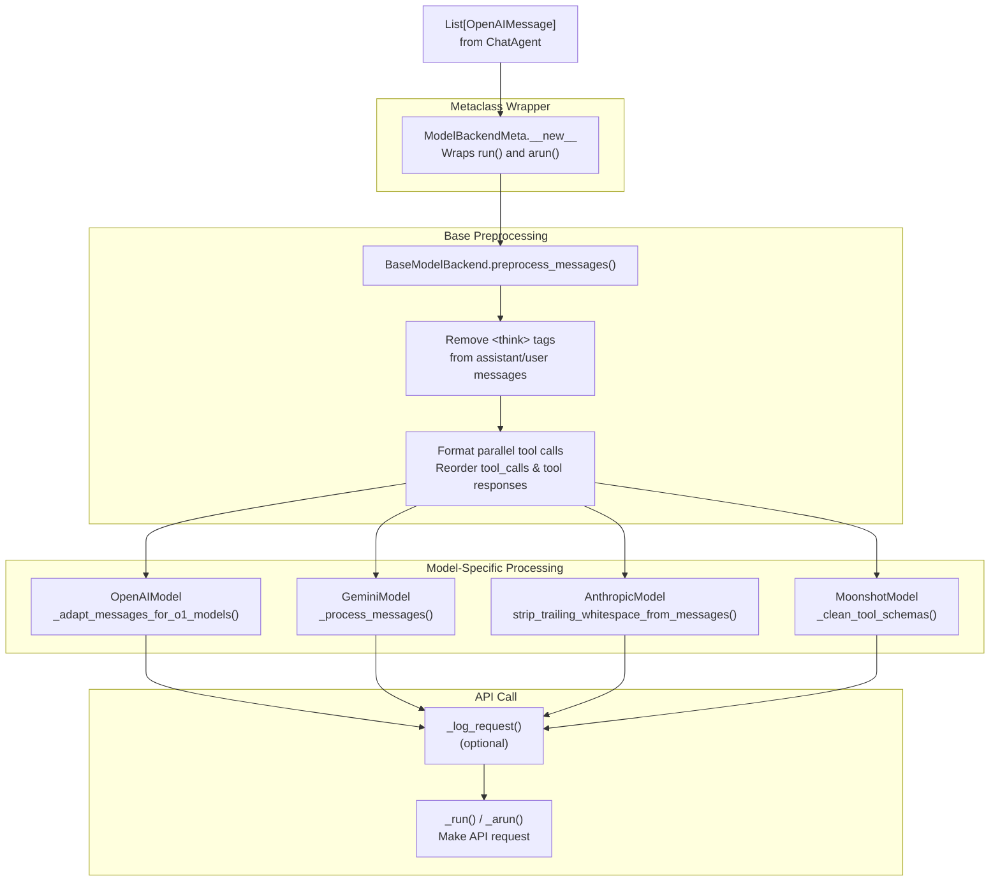
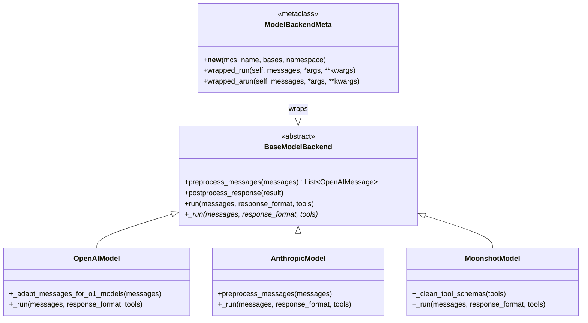
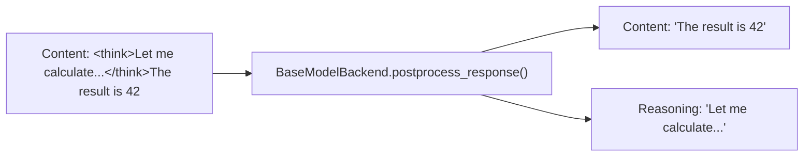
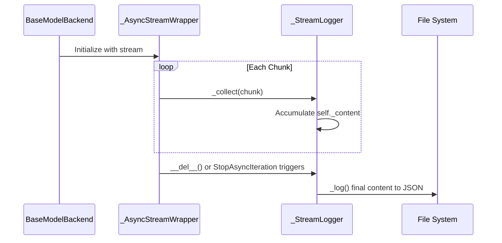

<!-- source: DeepWiki mcp.deepwiki.com · repo camel-ai/camel · page 3.3 Message Processing and Preprocessing · fetched 2026-10-29 -->

# Message Processing and Preprocessing

Relevant source files

The following files were used as context for generating this wiki page:

- [camel/configs/anthropic_config.py](camel/configs/anthropic_config.py)
- [camel/models/anthropic_model.py](camel/models/anthropic_model.py)
- [camel/models/azure_openai_model.py](camel/models/azure_openai_model.py)
- [camel/models/base_model.py](camel/models/base_model.py)
- [camel/models/openai_compatible_model.py](camel/models/openai_compatible_model.py)
- [camel/models/openai_model.py](camel/models/openai_model.py)
- [docs/mintlify/reference/camel.configs.bedrock_config.mdx](docs/mintlify/reference/camel.configs.bedrock_config.mdx)
- [docs/mintlify/reference/camel.configs.gemini_config.mdx](docs/mintlify/reference/camel.configs.gemini_config.mdx)
- [docs/mintlify/reference/camel.configs.minimax_config.mdx](docs/mintlify/reference/camel.configs.minimax_config.mdx)
- [docs/mintlify/reference/camel.configs.moonshot_config.mdx](docs/mintlify/reference/camel.configs.moonshot_config.mdx)
- [docs/mintlify/reference/camel.configs.volcano_config.mdx](docs/mintlify/reference/camel.configs.volcano_config.mdx)
- [docs/mintlify/reference/camel.configs.zhipuai_config.mdx](docs/mintlify/reference/camel.configs.zhipuai_config.mdx)
- [docs/mintlify/reference/camel.messages.func_message.mdx](docs/mintlify/reference/camel.messages.func_message.mdx)
- [docs/mintlify/reference/camel.models._interleaved_thinking_mixin.mdx](docs/mintlify/reference/camel.models._interleaved_thinking_mixin.mdx)
- [docs/mintlify/reference/camel.models.aiml_model.mdx](docs/mintlify/reference/camel.models.aiml_model.mdx)
- [docs/mintlify/reference/camel.models.aws_bedrock_converse_model.mdx](docs/mintlify/reference/camel.models.aws_bedrock_converse_model.mdx)
- [docs/mintlify/reference/camel.models.cohere_model.mdx](docs/mintlify/reference/camel.models.cohere_model.mdx)
- [docs/mintlify/reference/camel.models.gemini_model.mdx](docs/mintlify/reference/camel.models.gemini_model.mdx)
- [docs/mintlify/reference/camel.models.groq_model.mdx](docs/mintlify/reference/camel.models.groq_model.mdx)
- [docs/mintlify/reference/camel.models.internlm_model.mdx](docs/mintlify/reference/camel.models.internlm_model.mdx)
- [docs/mintlify/reference/camel.models.minimax_model.mdx](docs/mintlify/reference/camel.models.minimax_model.mdx)
- [docs/mintlify/reference/camel.models.moonshot_model.mdx](docs/mintlify/reference/camel.models.moonshot_model.mdx)
- [docs/mintlify/reference/camel.models.volcano_model.mdx](docs/mintlify/reference/camel.models.volcano_model.mdx)
- [docs/mintlify/reference/camel.models.zhipuai_model.mdx](docs/mintlify/reference/camel.models.zhipuai_model.mdx)
- [examples/models/anthropic_model_example.py](examples/models/anthropic_model_example.py)
- [test/models/test_anthropic_model.py](test/models/test_anthropic_model.py)
- [test/models/test_base_model.py](test/models/test_base_model.py)

This page documents the message preprocessing pipeline that transforms conversation histories into model-compatible formats before they are sent to LLM APIs. Message preprocessing is a critical step that ensures compatibility across 40+ model providers, handles model-specific requirements, and manages complex message sequences like parallel tool calls.

## Overview

Message preprocessing occurs automatically before every model API call through a metaclass-based system. The preprocessing pipeline consists of:

1.  **Automatic wrapping** via `ModelBackendMeta` metaclass [camel/models/base_model.py:195-216]().
2.  **Base preprocessing** for all models (think tag removal, tool call formatting) [camel/models/base_model.py:277-295]().
3.  **Model-specific adaptations** (role conversions for O1, whitespace stripping for Anthropic, tool sanitization for Gemini/Moonshot) [camel/models/openai_model.py:188-257](), [camel/models/anthropic_model.py:60-98](), [docs/mintlify/reference/camel.models.gemini_model.mdx:209-219,223-239](), [docs/mintlify/reference/camel.models.moonshot_model.mdx:68-86]().
4.  **Request logging** (optional, controlled by environment variables) [camel/models/base_model.py:402-478]().

### Message Preprocessing Pipeline

**Sources:** [camel/models/base_model.py:195-216](), [camel/models/base_model.py:277-400](), [camel/models/anthropic_model.py:60-98](), [camel/models/openai_model.py:188-257]()

---

## Metaclass-Based Preprocessing

The `ModelBackendMeta` metaclass automatically intercepts all `run()` and `arun()` method calls to inject preprocessing. It wraps these methods to ensure that messages are preprocessed before execution and responses are postprocessed (e.g., extracting reasoning content).

### Metaclass Wrapping Details

- The metaclass overrides `__new__` to replace `run` and `arun` with wrappers.
- The wrappers call `preprocess_messages()` before the original `run` or `arun`.
- After obtaining the result, they call `postprocess_response()` for any needed extraction or cleanup.

### Call Flow from Agent to Model

| Step | Action | Location |
|------|--------|----------|
| 1 | Agent calls `model.run(messages)` | [camel/agents/chat_agent.py]() |
| 2 | Metaclass intercepts call and invokes wrapper | [camel/models/base_model.py:210-213]() |
| 3 | Calls `self.preprocess_messages(messages)` to transform inputs | [camel/models/base_model.py:213]() |
| 4 | Calls original `run()` method with preprocessed messages | [camel/models/base_model.py:214]() |
| 5 | Calls `self.postprocess_response(result)` for final output adjustments | [camel/models/base_model.py:215]() |

**Sources:** [camel/models/base_model.py:195-234]()

---

## Base Message Preprocessing

The `BaseModelBackend.preprocess_messages()` method implements transformations applied to all models that include:

- Removal of `` tags is removed before sending to the model. This ensures that intermediate internal reasoning is not sent to the API directly.

### Reasoning Extraction (Postprocessing)

After receiving a model response, the system extracts the content inside `<think>` tags from assistant messages and saves it separately as `reasoning_content`. This helps separate user-facing output from the model's internal thoughts.

### Parallel Tool Call Formatting

If multiple consecutive assistant messages each contain a single tool call, the preprocessing merges these into a single assistant message with multiple tool calls in sequence. This ensures the API receives a correct and expected sequence of assistant messages interfacing with tools in bulk instead of fragmented calls. This reordering also guarantees tool responses are properly paired and ordered after the assistant messages.

**Sources:** [camel/models/base_model.py:277-400]()

---

## Model-Specific Adaptations

Message preprocessing also involves model-specific adaptations to handle unique API requirements and quirks.

### OpenAI O1 Models

The O1 series (e.g., O1_MINI, O1_PREVIEW) require:

- Conversion of all `system` and `developer` roles in messages to `user` role due to interface constraints.
- Warning issued on such role conversions to inform users.
- Unsupported parameters like `temperature`, `top_p`, frequency or presence penalties are filtered out before API calls.

This adaptation occurs in the `_adapt_messages_for_o1_models()` method in `OpenAIModel`.

### Anthropic

Anthropic API enforces strict constraints, notably:

- Trailing whitespace in any message content is disallowed.
- The utility function `strip_trailing_whitespace_from_messages(messages)` is used to preprocess messages by stripping trailing whitespace from string or list content parts before sending [camel/models/anthropic_model.py:60-98]().

### Gemini

The `GeminiModel` implements preprocessing via `_process_messages()` to adapt messages to Google's Gemini API format. Key adaptations include:

- Merging consecutive assistant messages with single tool calls into a single message containing multiple tool calls (required for Gemini's parallel function call feature).
- Preserving special "thought signatures" embedded in messages critical for Gemini function calling semantics.

These behaviors ensure Gemini compatibility, especially for advanced tool call orchestration.

### Moonshot

Moonshot's API rejects schemas with `{"type": "null"}` in anyOf parameters. The `MoonshotModel` provides `_clean_tool_schemas()` that recursively removes null type definitions from tool schemas during preprocessing before request submission.

**Sources:**

- OpenAI O1 adaptations: [camel/models/openai_model.py:188-257]()
- Anthropic whitespace stripping: [camel/models/anthropic_model.py:60-98]()
- Gemini processing: [docs/mintlify/reference/camel.models.gemini_model.mdx:209-219,223-239]()
- Moonshot tool cleaning: [docs/mintlify/reference/camel.models.moonshot_model.mdx:68-86]()

---

## Message Logging and Streaming Support

`BaseModelBackend` optionally logs all requests and responses for debugging and auditing purposes. Logging behavior is controlled via environment variables.

- `_log_request()` writes request messages and config to a JSON file per agent session [camel/models/base_model.py:402-453]().
- `_log_response()` appends response content and metadata.
- Streaming responses are wrapped with `_SyncStreamWrapper` or `_AsyncStreamWrapper` to accumulate streamed chunks and log final content upon stream completion [camel/models/base_model.py:69-120]().

### Streaming Logger Class Diagram

---

## Summary of Key Entities

| Entity                    | Role                                             | File / Location                                      |
|---------------------------|--------------------------------------------------|-----------------------------------------------------|
| `ModelBackendMeta`        | Metaclass for automatic message preprocessing    | [camel/models/base_model.py:195-216]()              |
| `BaseModelBackend.preprocess_messages` | Base logic for think tag removal and tool formatting | [camel/models/base_model.py:277-295]()              |
| `strip_trailing_whitespace_from_messages` | Anthropic-specific message sanitization | [camel/models/anthropic_model.py:60-98]()           |
| `_adapt_messages_for_o1_models` | Role conversion for OpenAI O1 series models | [camel/models/openai_model.py:188-257]()            |
| `_process_messages`        | Gemini-specific message formatting and tool call merging | [docs/mintlify/reference/camel.models.gemini_model.mdx:209-219,223-239]() |
| `_clean_tool_schemas`      | Moonshot-specific null type removal from tool schemas | [docs/mintlify/reference/camel.models.moonshot_model.mdx:68-86]() |
| `_StreamLogger`            | Handles logging facets of streaming LLM outputs | [camel/models/base_model.py:69-120]()                |

---

These mechanisms together ensure that CAMEL-AI agents interact robustly and compatibly with a wide variety of LLM backends, enabling coherent multi-tool orchestration and rich model-specific behavior.

**Sources:**  
[camel/models/base_model.py:195-400](),  
[camel/models/anthropic_model.py:60-98](),  
[camel/models/openai_model.py:188-257](),  
[docs/mintlify/reference/camel.models.gemini_model.mdx:209-239](),  
[docs/mintlify/reference/camel.models.moonshot_model.mdx:68-86]()

---

