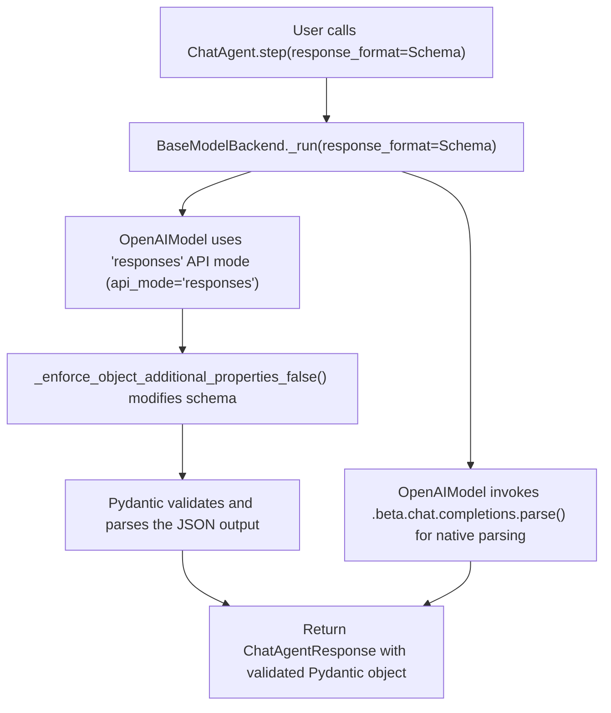
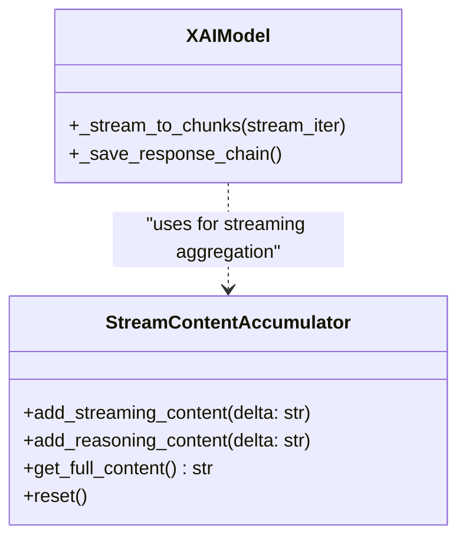
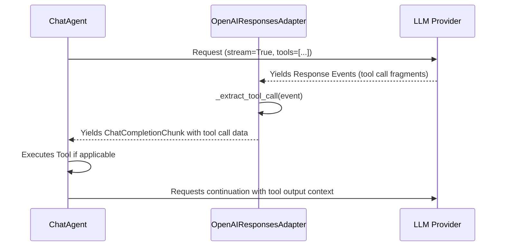

<!-- source: DeepWiki mcp.deepwiki.com · repo camel-ai/camel · page 3.5 Structured Output and Streaming · fetched 2026-10-29 -->

# Structured Output and Streaming

<details>
<summary>Relevant source files</summary>

The following files were used as context for generating this wiki page:

- [camel/configs/anthropic_config.py](camel/configs/anthropic_config.py)
- [camel/configs/vllm_config.py](camel/configs/vllm_config.py)
- [camel/models/anthropic_model.py](camel/models/anthropic_model.py)
- [camel/models/azure_openai_model.py](camel/models/azure_openai_model.py)
- [camel/models/base_model.py](camel/models/base_model.py)
- [camel/models/openai_compatible_model.py](camel/models/openai_compatible_model.py)
- [camel/models/openai_model.py](camel/models/openai_model.py)
- [camel/responses/agent_responses.py](camel/responses/agent_responses.py)
- [docs/cookbooks/data_processing/summarisation_agent_with_mistral_ocr.ipynb](docs/cookbooks/data_processing/summarisation_agent_with_mistral_ocr.ipynb)
- [docs/mintlify/reference/camel.configs.xai_config.mdx](docs/mintlify/reference/camel.configs.xai_config.mdx)
- [docs/mintlify/reference/camel.models.model_factory.mdx](docs/mintlify/reference/camel.models.model_factory.mdx)
- [docs/mintlify/reference/camel.models.openai_compatible_model.mdx](docs/mintlify/reference/camel.models.openai_compatible_model.mdx)
- [docs/mintlify/reference/camel.models.openai_model.mdx](docs/mintlify/reference/camel.models.openai_model.mdx)
- [docs/mintlify/reference/camel.models.openai_responses_adapter.mdx](docs/mintlify/reference/camel.models.openai_responses_adapter.mdx)
- [docs/mintlify/reference/camel.models.samba_model.mdx](docs/mintlify/reference/camel.models.samba_model.mdx)
- [docs/mintlify/reference/camel.models.sglang_model.mdx](docs/mintlify/reference/camel.models.sglang_model.mdx)
- [docs/mintlify/reference/camel.models.xai_model.mdx](docs/mintlify/reference/camel.models.xai_model.mdx)
- [examples/models/anthropic_model_example.py](examples/models/anthropic_model_example.py)
- [test/models/test_anthropic_model.py](test/models/test_anthropic_model.py)
- [test/models/test_base_model.py](test/models/test_base_model.py)

</details>


This document covers CAMEL's support for **structured output** (using Pydantic models to constrain LLM responses) and **streaming responses** (receiving partial results as they are generated). These features are primarily implemented in the `ChatAgent` and its underlying model backends, such as `OpenAIModel` and `OpenAICompatibleModel`.

For general agent concepts, see page [2.1](). For model backends and their capabilities, see page [3.2]().

---

## Overview

CAMEL provides two complementary mechanisms to control and interact with model responses:

| Feature           | Purpose                                               | Primary Parameter        |
|-------------------|-------------------------------------------------------|-------------------------|
| **Structured Output** | Constrain LLM outputs to match a Pydantic schema  | `response_format` (Pydantic model class) |
| **Streaming**         | Receive responses incrementally as they are generated | `stream` (bool flag)    |

Both features can be used in `ChatAgent.step()` and `ChatAgent.astep()` methods to enable output parsing and incremental reception of results, with native support varying across different model backends.

These mechanisms ensure responses that are semantically and syntactically reliable and/or received with low latency.

---

## Structured Output

### Basic Usage

Structured output enforces that a model's response conforms to a specified Pydantic schema, enabling deterministic, machine-readable outputs and simplifying downstream processing.

```python
from pydantic import BaseModel, Field
from camel.agents import ChatAgent

# Define a Pydantic schema for structured output
class JokeResponse(BaseModel):
    joke: str = Field(description="The joke text")
    funny_level: int = Field(description="Funniness rating from 1-10")

agent = ChatAgent()

# Request structured output from the agent with the schema
response = agent.step(
    "Tell me a joke",
    response_format=JokeResponse,
)
```

The resulting content will be a JSON object matching the `JokeResponse` schema. This feature leverages underlying model APIs that support structured output natively, such as OpenAI's `.beta.chat.completions.parse()`.

---

### Implementation Flow



**Key Points:**

- `BaseModelBackend` subclasses such as `OpenAIModel` and `OpenAICompatibleModel` handle the core `_run()` method augmented with `response_format`.
- For OpenAI backends, the SDK method `.beta.chat.completions.parse()` enables native structured output parsing [camel/models/openai_compatible_model.py:93-99]().
- When using the `"responses"` API mode, CAMEL adapts tool schemas and conversation state to the OpenAI Responses API format, enforcing strict JSON object validation to satisfy API constraints [camel/models/openai_model.py:150-157]().
- The strict enforcement helper `_enforce_object_additional_properties_false()` recursively sets `additionalProperties = false` in JSON schemas to ensure exact schema shape matching.
- Model configs like `VLLMConfig` include optional `response_format` dicts to facilitate this integration [camel/configs/vllm_config.py:42-54]().
- Validated Pydantic objects are returned wrapped in `ChatAgentResponse`.

---

### Model-Specific Behavior

| Model Backend          | Native Structured Output Support | Implementation Notes                                         |
|-----------------------|----------------------------------|--------------------------------------------------------------|
| `OpenAIModel`          | ✅ Supports both `chat_completions` and `responses` API modes | Uses `.beta.chat.completions.parse()` for structured output and supports Responses API with adapted tool schemas and strict validation [camel/models/openai_model.py:95-119]() |
| `OpenAICompatibleModel`| ✅ Uses OpenAI-compatible SDK methods | Similar to `OpenAIModel`, adapts for generic OpenAI-compatible backends [camel/models/openai_compatible_model.py:89-112]()   |
| `SambaModel`           | ✅ Wraps OpenAI-compatible streaming/ non-streaming calls | Stream-compatible structured output handlers [camel/models/samba_model.py:63-72]() |
| `VLLMModel`            | ✅ Supported via `VLLMConfig.response_format` parameter | Modeled on OpenAI-compatible schema [camel/configs/vllm_config.py:42-54]()          |
| `XAIModel`             | ✅ Supports advanced structured output including reasoning traces | Integrates encrypted "thinking" content and structured output [docs/mintlify/reference/camel.models.xai_model.mdx:192-207]() |

---

## Streaming Responses

### Basic Usage

Streaming enables applications to receive an LLM response progressively as it is being generated. This reduces latency and allows partial output processing.

```python
agent = ChatAgent()

# Synchronous streaming example
for resp in agent.step("Write a story", stream=True):
    print(resp.msg.content, end="", flush=True)
```

This uses underlying model backend support for streaming APIs typically returning iterators or async generators.

---

### Stream Content Accumulator

The `StreamContentAccumulator` class manages assembling partial streaming updates into coherent full responses. This is essential when handling complex streaming scenarios such as reasoning traces or multi-part tool calls.



- For models like xAI's, streaming responses include encrypted and adaptive reasoning traces, managed by `StreamContentAccumulator`.
- `XAIModel` implements streaming by wrapping incoming content deltas, accumulating full content, and optionally chaining responses via the `previous_response_id` server-side state [docs/mintlify/reference/camel.models.xai_model.mdx:192-207]().

---

### Streaming Wrappers

To unify streaming response processing, CAMEL provides adapter wrappers:

- **OpenAI Responses Adapter**: The function `iter_response_events_to_chat_chunks` converts OpenAI Responses API event streams into standard `ChatCompletionChunk` objects, yielding consistent partial response chunks to callers [camel/models/openai_responses_adapter.py:88-98]().

- **SambaModel Stream Handler**: Implements `_run_streaming` to yield `ChatCompletionChunk` items compatible with CAMEL's response protocol [camel/models/samba_model.py:83-105]().

- **BaseModelBackend Helpers**: `BaseModelBackend` defines `_SyncStreamWrapper` and `_AsyncStreamWrapper` classes to encapsulate logging and chunk accumulation for synchronous and asynchronous streaming flows [camel/models/base_model.py:121-193]().

These wrappers enable both reliable incremental consumption of partial outputs and logging/debugging support.

---

### Tool Calls and Streaming

When streaming with tool-calling enabled, CAMEL carefully reconstructs fragmented tool invocation and output parts:



Key details:
- The function `_convert_messages_to_responses_input` rewrites assistant messages with tool calls into one or more discrete `function_call` items aligned with the Responses API specification [camel/models/openai_model.py:192-204]().

- To generate standard OpenAI-like chunks from provider-specific events, the adapter function `_build_chat_completion_chunk` is used [camel/models/openai_responses_adapter.py:44-58]().

This careful mapping ensures seamless interleaving of tool calls and model generation in streaming contexts.

---

## API Reference Summary

### Data Types for Structured and Streaming Output

| Class                 | Location                                    | Description                                                  |
|-----------------------|---------------------------------------------|--------------------------------------------------------------|
| `ChatAgentResponse`     | [camel/responses/agent_responses.py:21-43]() | The standard container for agent responses, including metadata and termination state. |
| `OpenAIMessage`         | [camel/messages.py (inferred)]               | The unified message format for OpenAI-compatible conversation inputs and outputs. |

### Model Backend Methods Related to Structured Output

| Method                         | Parameters                                   | Purpose                             |
|--------------------------------|---------------------------------------------|-----------------------------------|
| `_request_parse`               | `messages: List[OpenAIMessage], response_format: Type[BaseModel], tools` | Performs a non-streaming structured output request [camel/models/openai_compatible_model.py:93-99]() |
| `_request_stream_parse`        | `messages: List[OpenAIMessage], response_format: Type[BaseModel], tools` | Initiates streaming structured output request and parses chunks [camel/models/openai_compatible_model.py:106-112]() |

### Streaming Wrappers

| Class                     | Location                                   | Purpose                                 |
|--------------------------|---------------------------------------------|-----------------------------------------|
| `_SyncStreamWrapper`      | [camel/models/base_model.py:121-157]()     | Wraps synchronous streams with logging  |
| `_AsyncStreamWrapper`     | [camel/models/base_model.py:158-193]()     | Wraps asynchronous streams with logging |

---

# Summary

CAMEL's structured output system uses Pydantic schemas alongside advanced model integrations to enforce reliable output formats, while streaming support enables low-latency, incremental response handling. Together, these facilitate complex agent workflows that require consistent parsing and responsiveness.

---

**Sources:**  
[camel/models/openai_model.py:82-179]()  
[camel/models/openai_compatible_model.py:73-176]()  
[camel/models/base_model.py:69-193]()  
[camel/models/openai_responses_adapter.py:88-98]()  
[camel/configs/vllm_config.py:42-54]()  
[camel/responses/agent_responses.py:21-43]()  
[docs/mintlify/reference/camel.models.xai_model.mdx:192-207]()  
[docs/mintlify/reference/camel.configs.xai_config.mdx:23-25]()

---

