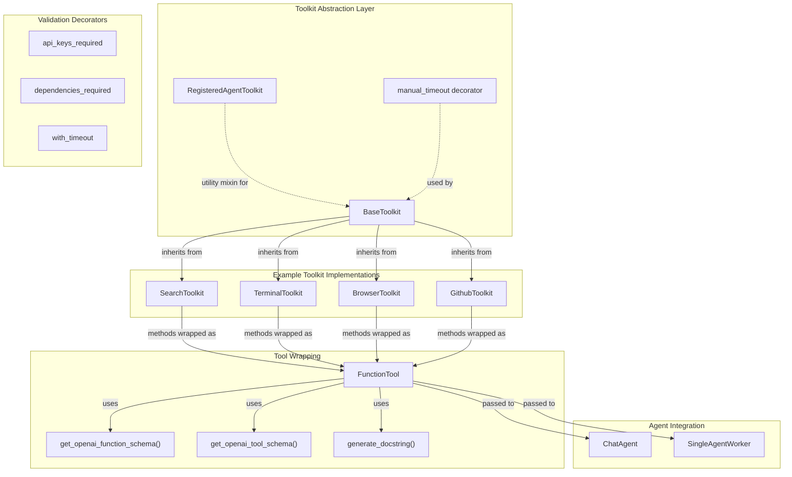
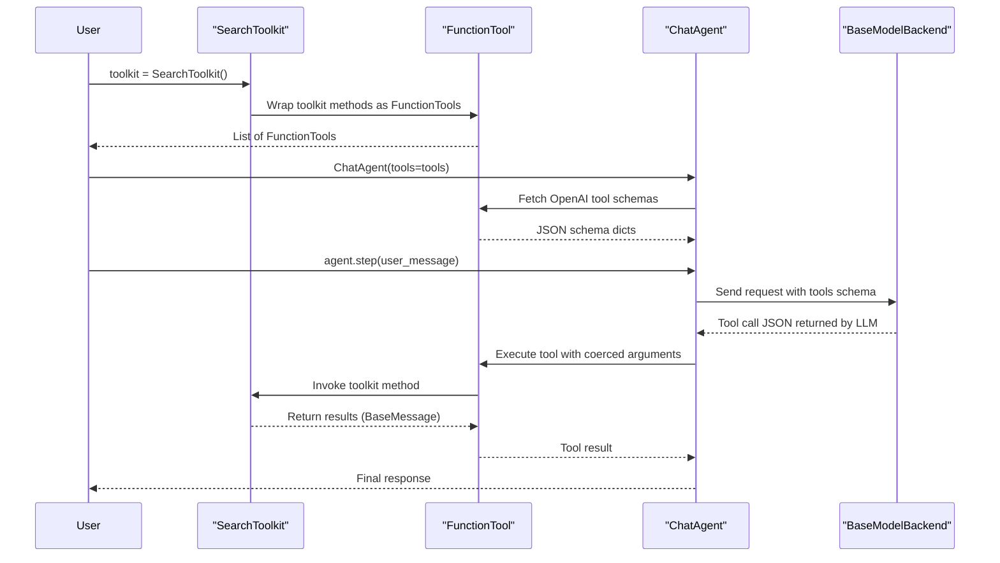

<!-- source: DeepWiki mcp.deepwiki.com · repo camel-ai/camel · page 4 Toolkit Ecosystem · fetched 2026-10-29 -->

# Toolkit Ecosystem

Relevant source files

The following files were used as context for generating this wiki page:

- [camel/toolkits/__init__.py](camel/toolkits/__init__.py)
- [camel/toolkits/function_tool.py](camel/toolkits/function_tool.py)
- [camel/toolkits/google_maps_toolkit.py](camel/toolkits/google_maps_toolkit.py)
- [camel/toolkits/whatsapp_toolkit.py](camel/toolkits/whatsapp_toolkit.py)
- [docs/key_modules/agents.md](docs/key_modules/agents.md)
- [docs/key_modules/datagen.md](docs/key_modules/datagen.md)
- [docs/key_modules/embeddings.md](docs/key_modules/embeddings.md)
- [docs/key_modules/interpreters.md](docs/key_modules/interpreters.md)
- [docs/key_modules/memory.md](docs/key_modules/memory.md)
- [docs/key_modules/messages.md](docs/key_modules/messages.md)
- [docs/key_modules/prompts.md](docs/key_modules/prompts.md)
- [docs/key_modules/retrievers.md](docs/key_modules/retrievers.md)
- [docs/key_modules/runtimes.md](docs/key_modules/runtimes.md)
- [docs/key_modules/society.md](docs/key_modules/society.md)
- [docs/key_modules/storages.md](docs/key_modules/storages.md)
- [docs/key_modules/tasks.md](docs/key_modules/tasks.md)
- [docs/key_modules/tools.md](docs/key_modules/tools.md)
- [docs/key_modules/workforce.md](docs/key_modules/workforce.md)
- [examples/toolkits/generate_openai_tool_schema.py](examples/toolkits/generate_openai_tool_schema.py)
- [examples/toolkits/synthesize_function_execution.py](examples/toolkits/synthesize_function_execution.py)
- [test/toolkits/test_generate_openai_tool_schema.py](test/toolkits/test_generate_openai_tool_schema.py)
- [test/toolkits/test_google_maps_function.py](test/toolkits/test_google_maps_function.py)
- [test/toolkits/test_openai_function.py](test/toolkits/test_openai_function.py)
- [test/toolkits/test_synthesize_output.py](test/toolkits/test_synthesize_output.py)
- [test/toolkits/test_whatsapp_function.py](test/toolkits/test_whatsapp_function.py)

This page provides an overview of the CAMEL-AI toolkit system, which enables agents to interact seamlessly with external services, APIs, and environments. The toolkit ecosystem comprises over 50 curated toolkits—growing to 90+—organized into categories such as search engines, development utilities, communication platforms, media processing, and specialized domains. This system abstracts capabilities as callable functions with rich, automatic schema validation, enabling smooth integration with language models via OpenAI-compatible function calling.

For detailed technical information on the architecture and individual toolkit categories, please see the following child pages:
- [Toolkit System Architecture](#4.1)
- [SearchToolkit](#4.2)
- [TerminalToolkit](#4.3)
- [BrowserToolkit and Web Automation](#4.4)
- [Media and Document Toolkits](#4.5)
- [Communication Toolkits](#4.6)
- [Development and Integration Toolkits](#4.7)
- [Specialized Toolkits](#4.8)

---

## Architecture Overview

The CAMEL toolkit system standardizes wrapping external functions into tools that language models can call during conversations or workflows. At the core:

- Every toolkit derives from `BaseToolkit`.
- Toolkit methods are exposed as `FunctionTool` instances.
- `FunctionTool` generates OpenAI-compatible JSON schemas for LLM function calling.
- Decorators provide validation for API keys, dependencies, and execution timeouts.

This architecture unifies over 50 toolkits under a consistent interface that agents can utilize for diverse tasks.

### Core Components Diagram

**Sources:** [camel/toolkits/__init__.py:15-20,35](), [camel/toolkits/function_tool.py:137-170](), [docs/key_modules/tools.md:11-23]()

---

## BaseToolkit and FunctionTool

- **BaseToolkit** is the abstract foundation for all toolkits. It maintains:
  - a `timeout` attribute to enforce method execution limits,
  - a `get_tools()` method that returns a list of `FunctionTool` instances,
  - integration with decorators for API key and dependency checks.

- **FunctionTool** wraps individual Python functions, automatically:
  - parsing function signatures and docstrings,
  - generating OpenAI-compatible function schemas (JSON Schema),
  - applying argument coercion to convert raw JSON dicts back into Pydantic models for type safety,
  - supporting both synchronous and asynchronous functions, running sync functions in a thread pool to avoid blocking.

This design bridges the natural language space of LLMs with precise code entities and their types.

**Sources:** [camel/toolkits/base.py:27-35](), [camel/toolkits/function_tool.py:137-170](), [camel/toolkits/__init__.py:15-20,35]()

---

## Decorator-Based Validation

CAMEL's toolkit system employs several key decorators to ensure robust execution:

- **`api_keys_required`**: Checks that necessary API keys are present either in function args or environment variables. Provides clear error messages linking to key management sites to assist developers.
- **`dependencies_required`**: Validates the presence of required Python packages before running toolkit methods, enabling graceful handling of optional dependencies.
- **`with_timeout`**: Enforces execution timeouts on toolkit methods, working for both synchronous and asynchronous operations to prevent hangs and ensure responsive behavior.

These decorators are integral to toolkit reliability and developer ergonomics.

**Sources:** [camel/toolkits/function_tool.py:14-49](), [docs/key_modules/tools.md:27-35]()

---

## Toolkit Categories

CAMEL distributes a broad and diversified set of toolkits grouped by primary usage domains:

| Category            | Toolkits                                                                                                  | Description                                                       |
|---------------------|-----------------------------------------------------------------------------------------------------------|-------------------------------------------------------------------|
| **Search & Web**     | `SearchToolkit`, `BrowserToolkit`, `Crawl4AIToolkit`, `SearxNGToolkit`, `WebFetchToolkit`                 | Search engines, web scraping, browsing and automation tools       |
| **Development**     | `TerminalToolkit`, `CodeExecutionToolkit`, `GithubToolkit`, `FileToolkit`, `MCPToolkit`                   | Shell automation, code execution, version control, file handling  |
| **Communication**    | `SlackToolkit`, `GmailToolkit`, `TwitterToolkit`, `WhatsAppToolkit`, `LarkToolkit`, `DingtalkToolkit`     | Messaging, email, and social media platform integrations           |
| **Media & Documents**| `ImageGenToolkit`, `VideoAnalysisToolkit`, `AudioAnalysisToolkit`, `ExcelToolkit`, `MinerUToolkit`, `PPTXToolkit` | Media generation and analysis, document extraction and processing |
| **Specialized**      | `MathToolkit`, `SymPyToolkit`, `NetworkXToolkit`, `ArxivToolkit`, `OpenBBToolkit`, `WolframAlphaToolkit`   | Domain-specific specialized computation and academic research     |
| **Agentic & Logic**  | `HumanToolkit`, `MemoryToolkit`, `ThinkingToolkit`, `SkillToolkit`, `TaskPlanningToolkit`                | Cognitive tools: memory, reasoning, task planning, human-in-the-loop |

This large and growing ecosystem empowers agents to handle a wide spectrum of real-world tasks.

**Sources:** [camel/toolkits/__init__.py:24-110](), [docs/key_modules/tools.md:107-160]()

---

## Integration with Agents

Toolkits integrate seamlessly with CAMEL's agent architecture. The typical pattern:

- Instantiate a toolkit (e.g., `SearchToolkit()`).
- Obtain its `FunctionTool` list via `.get_tools()`.
- Pass the tool list to a `ChatAgent` instance.
- The agent automatically uses the OpenAI-compatible schemas to enable the language model to invoke toolkit functions as tools within conversation flows.

### Agent-Toolkit Integration Flow Diagram

This structure tightly couples natural language requests to typed code entities.

**Sources:** [camel/toolkits/function_tool.py:208-220](), [docs/key_modules/tools.md:90-99](), [camel/agents/chat_agent.py:120-135]()

---

## Common Patterns

### Timeout and Threading

Synchronous toolkit methods run within a shared thread pool executor (`_SYNC_TOOL_EXECUTOR`) to prevent blocking async event loops used by agents. This ensures scalable, responsive execution even for long-running tools.

### API Key Handling

The `api_keys_required` decorator supports multiple ways to supply required keys, including function parameters and environment variables, and produces user-friendly errors with instructional URLs if keys are missing.

### Structured Input Coercion

CAMEL's `FunctionTool` utilizes argument type coercion to convert raw LLM-generated JSON dictionaries into strongly-typed Pydantic models, allowing toolkit authors to define structured input and output schemas easily, enhancing validation and reducing runtime errors.

---

## Summary

The CAMEL-AI toolkit ecosystem is a foundational pillar that equips agents with a vast array of externally callable functions. By structuring tools as `FunctionTool` objects with automatic schema generation and validation, CAMEL provides a robust bridge between natural language model outputs and precise Python code execution. Developers can leverage dozens of built-in toolkits spanning search, code execution, communication, media, specialized domains, and agentic capabilities, or create custom ones following this unified architecture.

For more details on internal implementation and each toolkit category, please refer to the respective child pages.

---

**Sources:**  
[camel/toolkits/__init__.py:1-194]()  
[camel/toolkits/function_tool.py:1-170]()  
[docs/key_modules/tools.md:1-160]()  
[camel/agents/chat_agent.py:120-135]()

---

