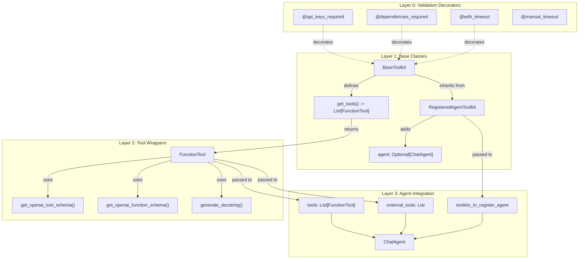
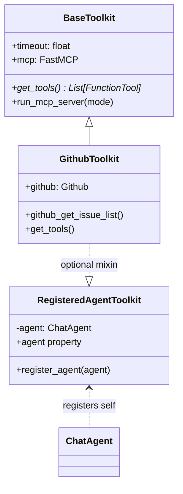
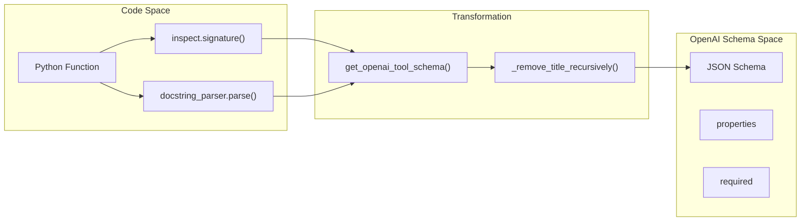
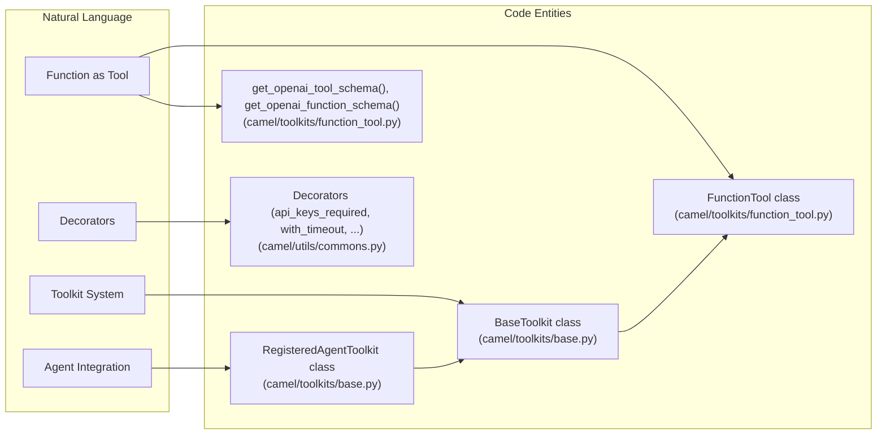
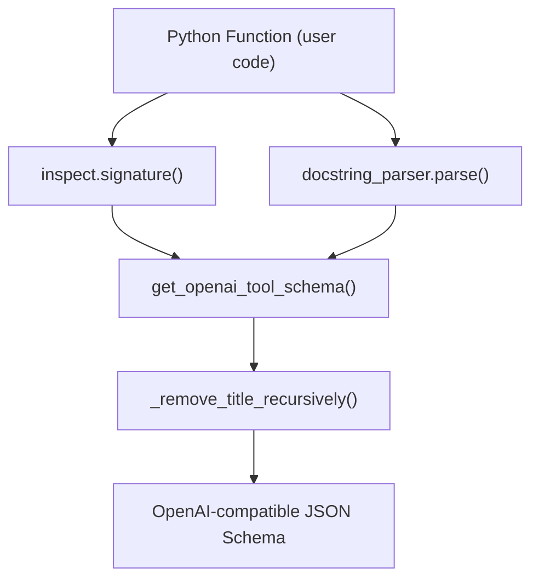

<!-- source: DeepWiki mcp.deepwiki.com · repo camel-ai/camel · page 4.1 Toolkit System Architecture · fetched 2026-10-29 -->

# Toolkit System Architecture

<details>
<summary>Relevant source files</summary>

The following files were used as context for generating this wiki page:

- [camel/configs/sglang_config.py](camel/configs/sglang_config.py)
- [camel/interpreters/__init__.py](camel/interpreters/__init__.py)
- [camel/models/sglang_model.py](camel/models/sglang_model.py)
- [camel/toolkits/base.py](camel/toolkits/base.py)
- [camel/toolkits/dingtalk.py](camel/toolkits/dingtalk.py)
- [camel/toolkits/function_tool.py](camel/toolkits/function_tool.py)
- [camel/toolkits/github_toolkit.py](camel/toolkits/github_toolkit.py)
- [camel/toolkits/google_maps_toolkit.py](camel/toolkits/google_maps_toolkit.py)
- [camel/toolkits/whatsapp_toolkit.py](camel/toolkits/whatsapp_toolkit.py)
- [camel/utils/__init__.py](camel/utils/__init__.py)
- [camel/utils/commons.py](camel/utils/commons.py)
- [camel/utils/token_counting.py](camel/utils/token_counting.py)
- [examples/external_tools/use_external_tools.py](examples/external_tools/use_external_tools.py)
- [examples/interpreters/microsandbox_interpreter_example.py](examples/interpreters/microsandbox_interpreter_example.py)
- [examples/models/sglang_model_example.py](examples/models/sglang_model_example.py)
- [examples/toolkits/dingtalk.py](examples/toolkits/dingtalk.py)
- [examples/toolkits/generate_openai_tool_schema.py](examples/toolkits/generate_openai_tool_schema.py)
- [examples/toolkits/github_toolkit.py](examples/toolkits/github_toolkit.py)
- [examples/toolkits/synthesize_function_execution.py](examples/toolkits/synthesize_function_execution.py)
- [test/interpreters/test_microsandbox_interpreter.py](test/interpreters/test_microsandbox_interpreter.py)
- [test/models/test_sglang_model.py](test/models/test_sglang_model.py)
- [test/runtimes/test_daytona_runtime.py](test/runtimes/test_daytona_runtime.py)
- [test/toolkits/test_dingtalk.py](test/toolkits/test_dingtalk.py)
- [test/toolkits/test_generate_openai_tool_schema.py](test/toolkits/test_generate_openai_tool_schema.py)
- [test/toolkits/test_github_toolkit.py](test/toolkits/test_github_toolkit.py)
- [test/toolkits/test_google_maps_function.py](test/toolkits/test_google_maps_function.py)
- [test/toolkits/test_openai_function.py](test/toolkits/test_openai_function.py)
- [test/toolkits/test_synthesize_output.py](test/toolkits/test_synthesize_output.py)
- [test/toolkits/test_whatsapp_function.py](test/toolkits/test_whatsapp_function.py)
- [test/utils/test_commons.py](test/utils/test_commons.py)

</details>


This document explains the architectural foundations of CAMEL's toolkit system, covering the `BaseToolkit` abstract base class, the `RegisteredAgentToolkit` mixin for agent registration, the `FunctionTool` class that acts as a bridge between Python callable functions and LLM-compatible function schemas, OpenAI schema generation mechanisms, and the common validation and resource management decorators such as `api_keys_required` and `with_timeout`.

This is a foundational layer enabling rich interactions where agents dynamically call Python-implemented capabilities with strict input validation, asynchronous execution control, and schema adherence.

---

## Architectural Overview

The CAMEL toolkit system operates as a multi-layer architecture that cleanly separates concerns from low-level toolkit base classes to high-level integration with agents and LLMs.



- **Layer 3: Agent Integration** — The `ChatAgent` consumes lists of `FunctionTool` objects as `tools` or `external_tools` parameters for enabling LLM function calls. Toolkits needing agent references register via `toolkits_to_register_agent`.

- **Layer 2: Tool Wrappers** — `FunctionTool` instances wrap Python functions, generate OpenAI function call schemas, and handle coercion of LLM JSON outputs to Python argument types.

- **Layer 1: Base Classes** — `BaseToolkit` defines the toolkit interface and automatic timeout decoration. `RegisteredAgentToolkit` mixin enables agent reference registration.

- **Layer 0: Validation Decorators** — Decorators such as `@api_keys_required`, `@dependencies_required`, and `@with_timeout` enforce environment validation and runtime constraints.

Sources: [camel/toolkits/base.py:61-118](), [camel/toolkits/base.py:119-165](), [camel/toolkits/function_tool.py:15-258](), [camel/utils/commons.py:192-403]()

---

## BaseToolkit and RegisteredAgentToolkit

### BaseToolkit

`BaseToolkit` is the base class for all toolkits. It implements automatic timeout management by wrapping all public, callable instance methods with the `with_timeout` decorator unless:

- The method is decorated with `@manual_timeout`.
- The method explicitly has a `timeout` parameter in its signature.

The class uses the metaclass `AgentOpsMeta` for enhanced introspection and operation tracking.

**Key points:**

- `timeout` is stored as a class attribute defaulting to `Constants.TIMEOUT_THRESHOLD`.
- Subclasses must implement `get_tools()`, which returns a list of `FunctionTool` instances representing toolkit functions.
- Provides `run_mcp_server()` for starting Model Context Protocol servers.

```python
class BaseToolkit(metaclass=AgentOpsMeta):
    timeout: Optional[float] = Constants.TIMEOUT_THRESHOLD
    
    def __init__(self, timeout: Optional[float] = Constants.TIMEOUT_THRESHOLD):
        if timeout is not None and timeout <= 0:
            raise ValueError("Timeout must be a positive number.")
        self.timeout = timeout

    # Automatically decorate public methods with timeout, except those:
    # * marked with @manual_timeout
    # * with a 'timeout' argument in their signature
    def __init_subclass__(cls, **kwargs):
        super().__init_subclass__(**kwargs)
        for attr_name, attr_value in cls.__dict__.items():
            if callable(attr_value) and not attr_name.startswith("__"):
                if getattr(attr_value, '_manual_timeout', False):
                    continue
                try:
                    sig = inspect.signature(attr_value)
                    if 'timeout' in sig.parameters:
                        continue
                except (ValueError, TypeError):
                    pass
                setattr(cls, attr_name, with_timeout(attr_value))

    def get_tools(self) -> List[FunctionTool]:
        raise NotImplementedError("Subclasses must implement this method.")

    def run_mcp_server(self, mode: Literal["stdio", "sse", "streamable-http"]) -> None:
        self.mcp.run(mode)
```

### RegisteredAgentToolkit

`RegisteredAgentToolkit` is a mixin designed for toolkits that require a reference to the active `ChatAgent`. During the agent's initialization, toolkits inheriting from this class are automatically registered with the agent instance.

- Provides the `agent` property to access the registered agent.
- Raises warnings if accessed before registration.
- The agent registers itself via `register_agent()`.

```python
class RegisteredAgentToolkit:
    def __init__(self):
        self._agent: Optional["ChatAgent"] = None

    @property
    def agent(self) -> Optional["ChatAgent"]:
        if self._agent is None:
            logger.warning(f"{self.__class__.__name__} does not have a registered ChatAgent.")
        return self._agent

    def register_agent(self, agent: "ChatAgent") -> None:
        self._agent = agent
        logger.info(f"Agent registered with {self.__class__.__name__}")
```

**Class Hierarchy:**



Sources: [camel/toolkits/base.py:61-165](), [camel/toolkits/github_toolkit.py:28-55]()

---

## FunctionTool: The LLM Bridge

`FunctionTool` is the central class that wraps Python functions for use as LLM-invokable tools with OpenAI-compatible function signatures. It manages input coercion, schema generation, docstring extraction, and synchronous/asynchronous invocation.

### Features

- Converts Python function signatures and Pydantic models to JSON schemas compliant with OpenAI function-calling spec.
- Coerces the raw argument dicts from the LLM into typed Python arguments that match the function's type annotations.
- Supports synchronous, asynchronous, and thread-pooled execution paths to avoid blocking event loops.
- Extracts function docstrings and parameter descriptions for schema documentation.

### Argument Coercion Details

The function coercion maps JSON-like dict inputs from LLM calls back into Python objects, especially Pydantic models, lists, dicts, and optional unions.

- `_coerce_arg(value, annotation)` recursively converts dicts to Pydantic instances if appropriate.
- `_coerce_arguments(func, args, kwargs)` applies coercion to all positional and keyword args based on the function's signature.

```python
def _coerce_arg(value: Any, annotation: Any) -> Any:
    if isinstance(annotation, type) and issubclass(annotation, BaseModel):
        if isinstance(value, dict):
            return annotation.model_validate(value)
        return value
    # Handle List, Dict, Optional, and Union recursively...
    return value


def _coerce_arguments(
    func: Callable,
    args: tuple,
    kwargs: Dict[str, Any],
) -> Tuple[tuple, Dict[str, Any]]:
    # Coerce positional and keyword arguments to match function signature and Pydantic models
    ...
```

### Schema Generation

`FunctionTool` generates OpenAI function schemas with the help of `get_openai_tool_schema(func)` that:

- Parses the Python function signature, including type hints.
- Extracts descriptions from the function docstring using `docstring_parser`.
- Produces JSON Schema for parameters and their types.
- Removes redundant `title` fields recursively from the schema to reduce token usage.
- Accounts for Pydantic v1 vs v2 schema differences.

This schema generation is essential for the LLM to understand valid function calls, argument types, and constraints.

### Data Flow Diagram: Coercion and Schema Generation



Sources: [camel/toolkits/function_tool.py:15-258](), [test/toolkits/test_openai_function.py:27-181]()

---

## OpenAI Schema Generation Utilities

The toolkit system provides utility functions like `get_openai_function_schema` and `get_openai_tool_schema` that produce OpenAI-compatible function schemas from Python functions.

Key aspects include:

- Support for primitive Python types (`int`, `str`, `float`), collection types (`List`, `Dict`), `datetime`, and Enum types.
- Strict schema generation for pydantic v2 enforcing `additionalProperties=False`.
- Consolidation of function name, description, parameter details into single JSON schema for the OpenAI function calling format.
- Use of recursive removal of `title` keys from the JSON schema to avoid redundancy without losing parameter names.

This machinery is integrated deeply within `FunctionTool` for seamless runtime schema exposure to LLMs.

Sources: [camel/toolkits/function_tool.py:210-258](), [test/toolkits/test_openai_function.py:27-181]()

---

## Common Decorators

Validation, dependency management, and resource control are implemented through decorators frequently used on toolkits and function tools.

| Decorator              | Module                | Description                                                                                                          |
|------------------------|-----------------------|----------------------------------------------------------------------------------------------------------------------|
| `@api_keys_required`    | `camel.utils.commons` | Checks for required API keys in env or function args, raising informative errors if missing or empty.                 |
| `@dependencies_required`| `camel.utils.commons` | Ensures optional dependencies (libraries) are installed before function execution, raising ImportError if not found. |
| `@with_timeout`         | `camel.utils.commons` | Wraps functions to enforce a runtime timeout, canceling calls exceeding threshold transparently.                      |
| `@manual_timeout`       | `camel.toolkits.base` | Marks toolkit methods as handling their own timeout logic internally, thus exempting them from automatic wrapping.   |
| `@MCPServer`            | `camel.utils.mcp`     | Marks a toolkit class as compatible with running as a Model Context Protocol server.                                 |

### Implementation Notes

- The `BaseToolkit` metaclass automatically applies `@with_timeout` to all non-exempt public callable methods at class initialization.
- `@api_keys_required` validates API keys by checking environment variables or explicit function parameters.
- `@dependencies_required` checks Python imports dynamically to guard optional features.

Example snippet from `BaseToolkit` showing automatic timeout wrapping:

```python
def __init_subclass__(cls, **kwargs):
    for attr_name, attr_value in cls.__dict__.items():
        if callable(attr_value) and not attr_name.startswith("__"):
            if getattr(attr_value, '_manual_timeout', False):
                continue
            try:
                sig = inspect.signature(attr_value)
                if 'timeout' in sig.parameters:
                    continue
            except (ValueError, TypeError):
                pass
            setattr(cls, attr_name, with_timeout(attr_value))
```

Sources: [camel/utils/commons.py:192-403](), [camel/toolkits/base.py:30-95](), [camel/toolkits/github_toolkit.py:27-41]()

---

## Summary of Key Class Relationships and Data Flow

The following diagrams summarize the mappings between natural language concepts, system names, and code entities bridging developer understanding with implementation.

### Natural Language to Code Entities Mapping for BaseToolkit System



### Data Flow from Function Definition to LLM Function Schema



---

This design enables CAMEL agents to expose rich, type-safe, validated, and dynamically invokable toolkits, manifesting as Python classes and functions that LLMs can call as if native capabilities while preserving strong runtime safety and developer ergonomics.

For detailed examples and implementation details, see:

- [BaseToolkit and RegisteredAgentToolkit implementation](camel/toolkits/base.py:15-166)  
- [FunctionTool class and schema generation](camel/toolkits/function_tool.py:15-258)  
- [Common decorators implementation](camel/utils/commons.py:192-403)  
- [GithubToolkit example illustrating RegisteredAgentToolkit usage](camel/toolkits/github_toolkit.py:28-180)  

---

# End of Toolkit System Architecture (4.1)

Sources:  
[camel/toolkits/base.py:15-165](),  
[camel/toolkits/function_tool.py:15-258](),  
[camel/utils/commons.py:192-403](),  
[camel/toolkits/github_toolkit.py:28-180](),  
[test/toolkits/test_openai_function.py:27-181]()

---

