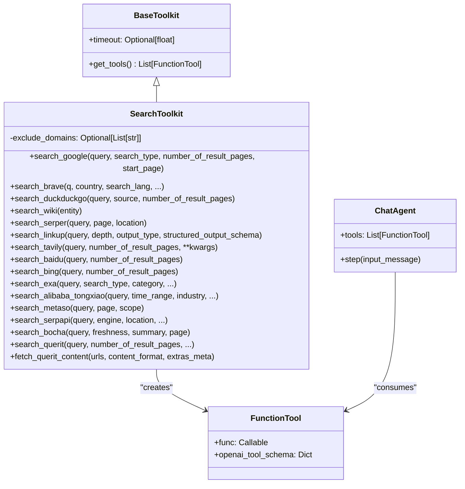
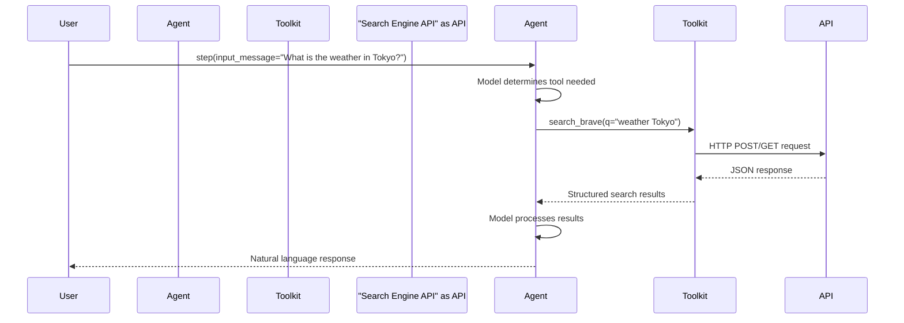
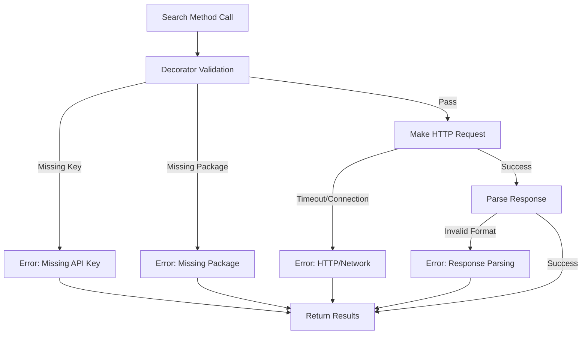

<!-- source: DeepWiki mcp.deepwiki.com · repo camel-ai/camel · page 4.2 SearchToolkit · fetched 2026-10-29 -->

# SearchToolkit

<details>
<summary>Relevant source files</summary>

The following files were used as context for generating this wiki page:

- [camel/toolkits/search_toolkit.py](camel/toolkits/search_toolkit.py)
- [docs/mintlify/reference/camel.toolkits.github_toolkit.mdx](docs/mintlify/reference/camel.toolkits.github_toolkit.mdx)
- [docs/mintlify/reference/camel.toolkits.math_toolkit.mdx](docs/mintlify/reference/camel.toolkits.math_toolkit.mdx)
- [docs/mintlify/reference/camel.toolkits.search_toolkit.mdx](docs/mintlify/reference/camel.toolkits.search_toolkit.mdx)
- [docs/reference/camel.toolkits.github_toolkit.md](docs/reference/camel.toolkits.github_toolkit.md)
- [docs/reference/camel.toolkits.search_toolkit.md](docs/reference/camel.toolkits.search_toolkit.md)
- [examples/toolkits/querit_search_example.py](examples/toolkits/querit_search_example.py)
- [examples/toolkits/search_google_with_exclusion.py](examples/toolkits/search_google_with_exclusion.py)
- [examples/toolkits/search_toolkit.py](examples/toolkits/search_toolkit.py)
- [test/toolkits/test_search_functions.py](test/toolkits/test_search_functions.py)

</details>


The `SearchToolkit` provides a unified interface for performing web searches across 13+ different search engines and services. This toolkit enables CAMEL agents to retrieve information from the web using various search providers including Google, DuckDuckGo, Brave, Wikipedia, and specialized search APIs.

For general toolkit architecture and the `BaseToolkit` interface, see [Toolkit System Architecture](#4.1). For other specialized toolkits, see [Development and Integration Toolkits](#4.7).

---

## Purpose and Scope

`SearchToolkit` is designed to:
- Provide agents with web search capabilities through a consistent API.
- Support multiple search engines with engine-specific features.
- Handle API authentication and rate limiting via environment variables.
- Return structured, parseable search results (often in `List[Dict]` or `Dict` format).
- Support different search modalities (web, images, videos, documents).

The toolkit inherits from `BaseToolkit` and follows the decorator-based validation pattern used throughout the CAMEL toolkit ecosystem.

**Sources:** [camel/toolkits/search_toolkit.py:33-38](), [camel/toolkits/search_toolkit.py:41-57]()

---

## Architecture Overview

### Class Structure



**Diagram: SearchToolkit Class Hierarchy**

The `SearchToolkit` class extends `BaseToolkit` and implements 13+ search methods. Each method is decorated with `@api_keys_required` or `@dependencies_required` to enforce runtime validation.

**Sources:** [camel/toolkits/search_toolkit.py:32-57](), [camel/toolkits/base.py:1-50]()

---

## Supported Search Engines

The toolkit supports the following search engines and services:

| Search Engine | Method Name | API Required | Key Features |
|--------------|-------------|--------------|--------------|
| **Google** | `search_google` | Yes (GOOGLE_API_KEY, SEARCH_ENGINE_ID) | Web & image search, domain exclusion, pagination |
| **Brave** | `search_brave` | Yes (BRAVE_API_KEY) | Advanced filtering, freshness, goggles, multilingual |
| **DuckDuckGo** | `search_duckduckgo` | No | Text, images, videos; privacy-focused |
| **Wikipedia** | `search_wiki` | No | Entity summaries, disambiguation handling |
| **Serper** | `search_serper` | Yes (SERPER_API_KEY) | Google results via Serper.dev API |
| **Linkup** | `search_linkup` | Yes (LINKUP_API_KEY) | Search results, sourced answers, structured output |
| **Tavily** | `search_tavily` | Yes (TAVILY_API_KEY) | Research-focused, configurable depth |
| **Baidu** | `search_baidu` | No | Chinese search engine, web scraping |
| **Bing** | `search_bing` | No | Chinese Bing (cn.bing.com), web scraping |
| **Exa** | `search_exa` | Yes (EXA_API_KEY) | Neural & keyword search, category filtering |
| **Alibaba Tongxiao** | `search_alibaba_tongxiao` | Yes (TONGXIAO_API_KEY) | Chinese language, industry filtering, markdown output |
| **Metaso** | `search_metaso` | Yes (METASO_API_KEY) | Multi-scope search (webpage, document, scholar, etc.) |
| **SerpApi** | `search_serpapi` | Yes (SERPAPI_API_KEY) | Multi-engine proxy (Google, Bing, Yahoo, etc.) |
| **Bocha AI** | `search_bocha` | Yes (BOCHA_API_KEY) | AI-powered search with freshness filtering |
| **Querit** | `search_querit` | Yes (QUERIT_API_KEY) | Advanced geo/time filters, site inclusion/exclusion |

**Sources:** [camel/toolkits/search_toolkit.py:58-190](), [examples/toolkits/querit_search_example.py:46-49]()

---

## Configuration

### Initialization

The `SearchToolkit` constructor accepts optional configuration parameters:

```python
def __init__(
    self,
    timeout: Optional[float] = None,
    exclude_domains: Optional[List[str]] = None,
):
```

**Parameters:**
- `timeout` (Optional[float]): Timeout for API requests in seconds. Applies to all search methods. Default: `None` [camel/toolkits/search_toolkit.py:43-50]()
- `exclude_domains` (Optional[List[str]]): List of domains to exclude from search results. Currently only supported by `search_google`. Default: `None` [camel/toolkits/search_toolkit.py:51-54]()

**Usage Example:**
```python
# Basic initialization
toolkit = SearchToolkit()

# With timeout
toolkit = SearchToolkit(timeout=30.0)

# With domain exclusion (Google only)
toolkit = SearchToolkit(exclude_domains=["wikipedia.org", "reddit.com"])
```

**Sources:** [camel/toolkits/search_toolkit.py:40-56](), [examples/toolkits/search_google_with_exclusion.py:24-41]()

---

## Search Methods

### Google Search

**Method:** `search_google(query, search_type, number_of_result_pages, start_page)`

Google Custom Search API integration supporting web and image search with pagination.

**Parameters:**
- `query` (str): The search query.
- `search_type` (str): Either "web" or "image". Default: "web".
- `number_of_result_pages` (int): Number of results (1-10, capped by Google API). Default: 10.
- `start_page` (int): Starting result index for pagination (≥1). Default: 1.

**Returns:** `List[Dict[str, Any]]`

**Web Search Result Structure:**
```python
{
    'result_id': 1,
    'title': 'Page Title',
    'description': 'Brief description',
    'long_description': 'Detailed og:description or "N/A"',
    'url': 'https://example.com'
}
```

**Domain Exclusion:**
When `exclude_domains` is set during initialization, the method automatically appends `-site:domain.com` operators to the query using Google's search syntax.

**Sources:** [test/toolkits/test_search_functions.py:94-207](), [examples/toolkits/search_google_with_exclusion.py:24-41]()

---

### Brave Search

**Method:** `search_brave(q, country, search_lang, ui_lang, ...)`

Comprehensive search using Brave's API with extensive filtering and customization options.

**Key Parameters:**
- `q` (str): Search query (max 400 chars, 50 words). [docs/mintlify/reference/camel.toolkits.search_toolkit.mdx:176]()
- `country` (str): 2-character country code. Default: "US".
- `search_lang` (str): Search language using Brave-specific codes. Default: "en".
- `freshness` (Optional[str]): Time filter - "pd" (day), "pw" (week), "pm" (month), "py" (year), or date range. [docs/mintlify/reference/camel.toolkits.search_toolkit.mdx:157]()
- `summary` (Optional[bool]): Enable summary generation.
- `number_of_result_pages` (int): Number of results. Default: 10.

**Returns:** `Dict[str, Any]` containing structured results with keys like 'web', 'news', 'videos', etc.

**Sources:** [docs/mintlify/reference/camel.toolkits.search_toolkit.mdx:144-181](), [examples/toolkits/search_toolkit.py:22-53]()

---

## Specialized Retrieval

### Wikipedia Search

**Method:** `search_wiki(entity)`

Retrieves Wikipedia article summaries for named entities with disambiguation handling.

**Parameters:**
- `entity` (str): The entity name to search for.

**Returns:** `str` - A 5-sentence summary or an error message. [camel/toolkits/search_toolkit.py:131]()

**Disambiguation Handling:**
If multiple articles match the entity name, the method automatically selects the first disambiguation option (`e.options[0]`) and retrieves its summary. [camel/toolkits/search_toolkit.py:132-135]()

**Sources:** [camel/toolkits/search_toolkit.py:113-144](), [test/toolkits/test_search_functions.py:30-56]()

### Querit Search & Content Fetching

The toolkit includes specialized methods for `Querit`, which provides both search and full-page content retrieval.

**Methods:**
- `search_querit(...)`: Performs search with granular filters (geo, time, site inclusion).
- `fetch_querit_content(urls, ...)`: Crawls specific URLs and returns content in "text" or "markdown" format. [examples/toolkits/querit_search_example.py:98-102]()

**Sources:** [examples/toolkits/querit_search_example.py:46-129]()

---

## Integration with ChatAgent

### Basic Integration Pattern



**Diagram: Search Integration Flow**

**Sources:** [examples/toolkits/search_toolkit.py:30-53]()

### Code Example: Agent with Search Tools

```python
from camel.agents import ChatAgent
from camel.toolkits import SearchToolkit, FunctionTool

# Create agent with search capability
toolkit = SearchToolkit()
agent = ChatAgent(
    system_message="You are a helpful assistant with web search.",
    tools=[
        FunctionTool(toolkit.search_brave),
        FunctionTool(toolkit.search_wiki)
    ]
)

# Agent automatically uses tools when needed
response = agent.step(input_message="What is CAMEL-AI?")
print(response.msgs[0].content)
```

**Sources:** [examples/toolkits/search_toolkit.py:28-53]()

---

## Decorator-Based Validation

### API Key Enforcement

The `@api_keys_required` decorator validates that necessary environment variables are set before method execution.

```python
@api_keys_required([
    (None, "SERPER_API_KEY"),
])
def search_serper(self, query: str, ...):
    ...
```

**Sources:** [camel/toolkits/search_toolkit.py:59-64](), [camel/toolkits/search_toolkit.py:148-152]()

### Dependency Enforcement

The `@dependencies_required` decorator ensures required packages are installed (e.g., `wikipedia`, `linkup`).

```python
@dependencies_required("wikipedia")
def search_wiki(self, entity: str):
    import wikipedia
    ...
```

**Sources:** [camel/toolkits/search_toolkit.py:113](), [camel/toolkits/search_toolkit.py:147]()

---

## Error Handling

### Flow of Error Resolution



**Diagram: Error Handling Flow**

Most search methods return error information in the result structure (e.g., `{"error": "..."}`) rather than raising exceptions to prevent agent crashes.

**Sources:** [camel/toolkits/search_toolkit.py:97-111](), [camel/toolkits/search_toolkit.py:184-190]()

---

## MCP Server Support

The `SearchToolkit` class is decorated with `@MCPServer()`, enabling integration with Model Context Protocol servers. This allows the toolkit to be exposed as an MCP server for remote tool invocation and discovery.

**Sources:** [camel/toolkits/search_toolkit.py:32-33]()

---

