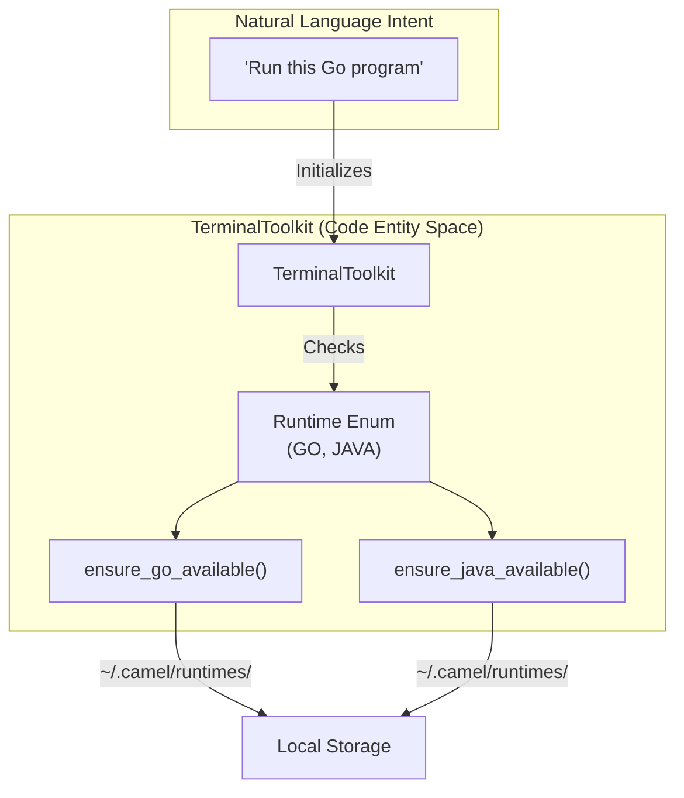

<!-- source: DeepWiki mcp.deepwiki.com · repo camel-ai/camel · page 4.3 TerminalToolkit · fetched 2026-10-29 -->

# TerminalToolkit

<details>
<summary>Relevant source files</summary>

The following files were used as context for generating this wiki page:

- [.github/PULL_REQUEST_TEMPLATE.md](.github/PULL_REQUEST_TEMPLATE.md)
- [CONTRIBUTING.md](CONTRIBUTING.md)
- [camel/benchmarks/ragbench.py](camel/benchmarks/ragbench.py)
- [camel/toolkits/terminal_toolkit/__init__.py](camel/toolkits/terminal_toolkit/__init__.py)
- [camel/toolkits/terminal_toolkit/go_runtime.py](camel/toolkits/terminal_toolkit/go_runtime.py)
- [camel/toolkits/terminal_toolkit/java_runtime.py](camel/toolkits/terminal_toolkit/java_runtime.py)
- [camel/toolkits/terminal_toolkit/runtime_utils.py](camel/toolkits/terminal_toolkit/runtime_utils.py)
- [camel/toolkits/terminal_toolkit/terminal_toolkit.py](camel/toolkits/terminal_toolkit/terminal_toolkit.py)
- [camel/toolkits/terminal_toolkit/utils.py](camel/toolkits/terminal_toolkit/utils.py)
- [docs/index.rst](docs/index.rst)
- [docs/key_modules/Benchmark.md](docs/key_modules/Benchmark.md)
- [docs/key_modules/browsertoolkit.md](docs/key_modules/browsertoolkit.md)
- [docs/key_modules/terminaltoolkit.md](docs/key_modules/terminaltoolkit.md)
- [docs/mintlify/reference/camel.models.base_audio_model.mdx](docs/mintlify/reference/camel.models.base_audio_model.mdx)
- [docs/mintlify/reference/camel.toolkits.base.mdx](docs/mintlify/reference/camel.toolkits.base.mdx)
- [docs/mintlify/reference/camel.toolkits.terminal_toolkit.go_runtime.mdx](docs/mintlify/reference/camel.toolkits.terminal_toolkit.go_runtime.mdx)
- [docs/mintlify/reference/camel.toolkits.terminal_toolkit.java_runtime.mdx](docs/mintlify/reference/camel.toolkits.terminal_toolkit.java_runtime.mdx)
- [docs/mintlify/reference/camel.toolkits.terminal_toolkit.runtime_utils.mdx](docs/mintlify/reference/camel.toolkits.terminal_toolkit.runtime_utils.mdx)
- [docs/mintlify/reference/camel.toolkits.terminal_toolkit.terminal_toolkit.mdx](docs/mintlify/reference/camel.toolkits.terminal_toolkit.terminal_toolkit.mdx)
- [docs/mintlify/reference/camel.toolkits.terminal_toolkit.utils.mdx](docs/mintlify/reference/camel.toolkits.terminal_toolkit.utils.mdx)
- [examples/__init__.py](examples/__init__.py)
- [examples/benchmarks/ragbench.py](examples/benchmarks/ragbench.py)
- [examples/toolkits/terminal_toolkit.py](examples/toolkits/terminal_toolkit.py)
- [examples/toolkits/terminal_toolkit_runtimes.py](examples/toolkits/terminal_toolkit_runtimes.py)
- [test/conftest.py](test/conftest.py)
- [test/toolkits/test_enable_other_runtimes.py](test/toolkits/test_enable_other_runtimes.py)
- [test/toolkits/test_go_runtime.py](test/toolkits/test_go_runtime.py)
- [test/toolkits/test_java_runtime.py](test/toolkits/test_java_runtime.py)
- [test/toolkits/test_runtime_utils.py](test/toolkits/test_runtime_utils.py)
- [test/toolkits/test_terminal_toolkit.py](test/toolkits/test_terminal_toolkit.py)

</details>


## Purpose and Scope

The `TerminalToolkit` provides LLM agents with the ability to execute and interact with terminal commands in either local or sandboxed Docker environments. This toolkit enables agents to perform system administration tasks, file operations, and long-running process management with built-in safety features, session management, and support for multiple language runtimes (Python, Go, Java). It is designed to be exposed as a set of tools for `ChatAgent` or via the Model Context Protocol (MCP).

**Sources**: [camel/toolkits/terminal_toolkit/terminal_toolkit.py:70-103](), [camel/toolkits/terminal_toolkit/terminal_toolkit.py:69-70]()

---

## Architecture Overview

The `TerminalToolkit` implements a dual-backend architecture supporting both local and Docker-based command execution with comprehensive session management and safety features.

### System Architecture

```mermaid
graph TB
    subgraph "ChatAgent Integration"
        Agent["ChatAgent"]
        Tools["FunctionTool[]"]
    end
    
    subgraph "TerminalToolkit Core"
        TT["TerminalToolkit<br/>@MCPServer()"]
        SessionMgr["shell_sessions: Dict<br/>_session_lock: RLock<br/>_output_condition: Condition"]
        SafetyLayer["_sanitize_command()<br/>check_command_safety()"]
    end
    
    subgraph "Execution Backends"
        LocalBackend["Local Backend<br/>subprocess.Popen"]
        DockerBackend["Docker Backend<br/>docker.APIClient"]
    end
    
    subgraph "Environment & Runtimes"
        EnvClone["clone_current_environment()"]
        InitialEnv["setup_initial_env_with_uv()"]
        GoRuntime["ensure_go_available()"]
        JavaRuntime["ensure_java_available()"]
    end
    
    subgraph "Session Types"
        BlockingExec["Blocking Execution<br/>subprocess.communicate()"]
        NonBlockingExec["Non-blocking Session<br/>output_stream: Queue<br/>reader thread"]
    end
    
    Agent -->|tools| Tools
    Tools --> TT
    TT --> SessionMgr
    TT --> SafetyLayer
    
    TT -->|use_docker_backend=False| LocalBackend
    TT -->|use_docker_backend=True| DockerBackend
    
    LocalBackend --> EnvClone
    LocalBackend --> InitialEnv
    LocalBackend --> GoRuntime
    LocalBackend --> JavaRuntime
    
    TT -->|shell_exec(block=True)| BlockingExec
    TT -->|shell_exec(block=False)| NonBlockingExec
    BlockingExec -->|timeout| NonBlockingExec
```

**Sources**: [camel/toolkits/terminal_toolkit/terminal_toolkit.py:105-138](), [camel/toolkits/terminal_toolkit/terminal_toolkit.py:142-163](), [camel/toolkits/terminal_toolkit/terminal_toolkit.py:693-743]()

---

## Execution Backends

The toolkit supports two backend modes controlled by the `use_docker_backend` initialization parameter.

### Backend Comparison

| Feature | Local Backend | Docker Backend |
|---------|---------------|----------------|
| **Execution Environment** | Host system (with optional venv) | Docker container |
| **Working Directory** | `working_dir` (default `./workspace`) | `docker_workdir` (default `/workspace`) |
| **Safety** | Path restrictions, command filtering | Full container isolation |
| **Environment Setup** | `uv` or `venv`-based Python env | Pre-configured container |
| **Runtimes** | Python, Go, Java (auto-install) | Container-provided |

**Sources**: [camel/toolkits/terminal_toolkit/terminal_toolkit.py:142-163](), [camel/toolkits/terminal_toolkit/terminal_toolkit.py:71-103]()

### Runtime Detection

When running inside a CAMEL runtime container (detected via `CAMEL_RUNTIME=true`), the toolkit automatically disables the Docker backend and skips additional sandboxing, as the container already provides isolation.

**Sources**: [camel/toolkits/terminal_toolkit/terminal_toolkit.py:120-129]()

---

## Session Management

The toolkit maintains thread-safe session state for non-blocking processes using `threading.RLock` and `threading.Condition`.

### Session Data Structure

Each session in the `shell_sessions` dictionary contains state for tracking background processes. The `_session_lock` ensures safe concurrent access to these sessions.

```python
{
    "id": str,                        # Session identifier
    "process": Popen | socket,        # Process handle or Docker socket
    "output_stream": Queue,           # Output buffer (maxsize=10000)
    "command_history": List[str],     # Commands executed
    "running": bool,                  # Process state
    "backend": "local" | "docker",    # Backend type
    "timeout_converted": bool,        # True if converted from blocking
}
```

**Sources**: [camel/toolkits/terminal_toolkit/terminal_toolkit.py:132-137](), [camel/toolkits/terminal_toolkit/terminal_toolkit.py:135-137]()

---

## Command Execution Modes

### Blocking Mode

Blocking execution (`block=True`) in `shell_exec` waits for command completion and returns combined output. If the command exceeds the `timeout`, it is automatically converted into a background session to prevent blocking the agent indefinitely.

**Sources**: [camel/toolkits/terminal_toolkit/terminal_toolkit.py:693-743]()

### Non-Blocking Mode

Non-blocking execution (`block=False`) starts a background process. A dedicated reader thread started by `_start_output_reader_thread` monitors the output and populates the `output_stream` queue.

**Sources**: [camel/toolkits/terminal_toolkit/terminal_toolkit.py:179-180](), [camel/toolkits/terminal_toolkit/terminal_toolkit.py:829-840]()

---

## Safety Features

### Command Sanitization

The `sanitize_command` utility in `utils.py` provides comprehensive safety checks. It blocks dangerous commands defined in `DANGEROUS_COMMANDS` and prevents path traversal.

**Blocked Commands Include**:
- System Admin: `sudo`, `su`, `reboot`, `shutdown`, `halt`, `poweroff`, `init`
- File System: `rm`, `chown`, `chgrp`, `umount`, `mount`
- Disk: `dd`, `mkfs`, `fdisk`, `parted`, `fsck`
- Network: `iptables`, `ip6tables`, `ifconfig`, `route`

**Sources**: [camel/toolkits/terminal_toolkit/utils.py:62-112](), [camel/toolkits/terminal_toolkit/utils.py:176-213]()

### Path Validation

In `safe_mode`, the toolkit validates that `cd` commands and file operations do not exit the `working_directory`. It uses regex patterns like `_CD_PATTERN` and `_PUSHD_PATTERN` to identify directory changes and ensures they stay within the sandbox.

**Sources**: [camel/toolkits/terminal_toolkit/utils.py:38-41](), [camel/toolkits/terminal_toolkit/utils.py:46-59]()

---

## Environment and Language Runtimes

### Managed Python Environments

The toolkit manages isolated Python environments using `uv` (preferred) or `venv`.
- **Initial Env**: `_setup_initial_environment` creates a clean Python environment.
- **Cloned Env**: `_setup_cloned_environment` uses `clone_current_environment` to replicate the current environment's packages into the sandbox.

**Sources**: [camel/toolkits/terminal_toolkit/utils.py:138-156](), [camel/toolkits/terminal_toolkit/utils.py:108-132](), [camel/toolkits/terminal_toolkit/terminal_toolkit.py:77-86]()

### Multi-Language Support

The toolkit supports auto-installation of additional runtimes via `enable_other_runtimes`.



- **Go**: `ensure_go_available` handles installation logic for the Go runtime.
- **Java**: `ensure_java_available` handles installation logic for the Java runtime.
- **Path Isolation**: Runtime paths are stored in `_runtime_env_vars` and applied only to subprocesses started by the toolkit via `_get_env_vars`.

**Sources**: [camel/toolkits/terminal_toolkit/terminal_toolkit.py:30-35](), [camel/toolkits/terminal_toolkit/terminal_toolkit.py:87-95](), [camel/toolkits/terminal_toolkit/terminal_toolkit.py:105-117]()

---

## File and Interactive Operations

### File Tools
- `shell_write_content_to_file`: Writes content to a file with path safety checks.
- `file_find_in_content`: Regex search within files.
- `file_find_by_name`: Glob-based file discovery.

**Sources**: [test/toolkits/test_terminal_toolkit.py:164-167](), [examples/toolkits/terminal_toolkit.py:114-117](), [examples/toolkits/terminal_toolkit.py:147-151]()

### Interactive Tools
- `shell_view`: Retrieves new output from background sessions using `_collect_output_until_idle`.
- `shell_write_to_process`: Sends stdin to a running process.
- `ask_user_for_help`: drops into an interactive terminal for human intervention.

**Sources**: [camel/toolkits/terminal_toolkit/terminal_toolkit.py:189-213](), [docs/key_modules/terminaltoolkit.md:103-119](), [docs/key_modules/terminaltoolkit.md:22-24]()

---

## Resource Cleanup

The `cleanup()` method ensures that all background processes, reader threads, and temporary resources are terminated.

**Sources**: [test/toolkits/test_terminal_toolkit.py:32-34](), [test/toolkits/test_terminal_toolkit.py:100-107]()

---

