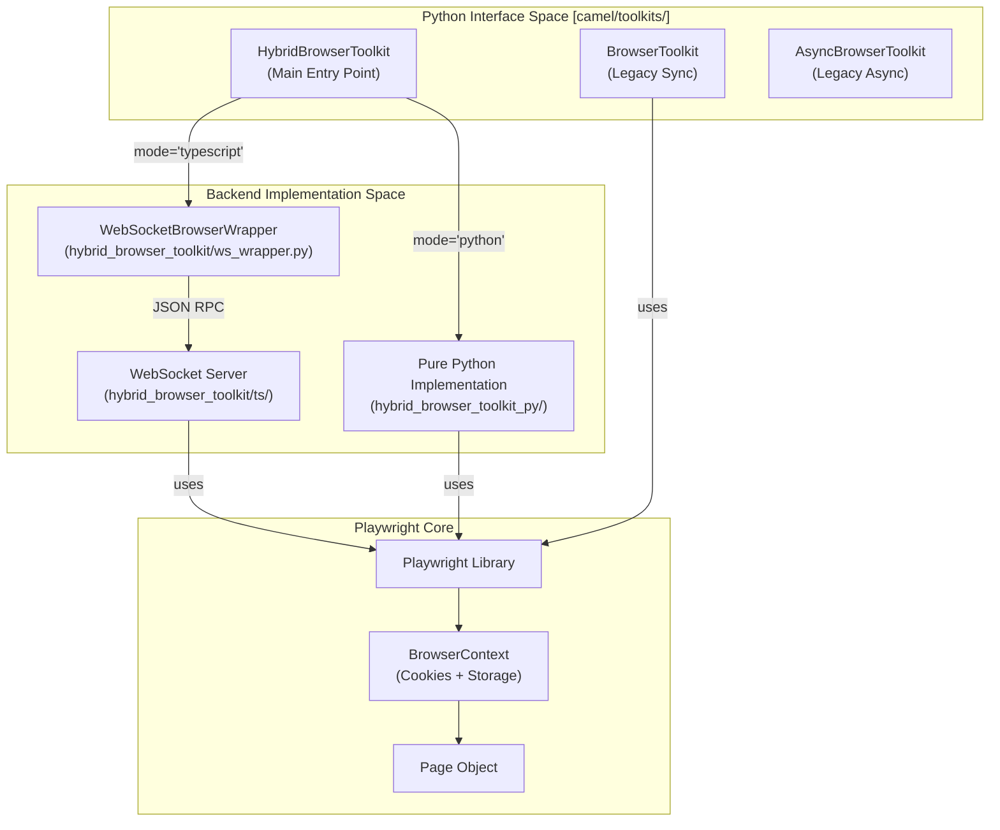
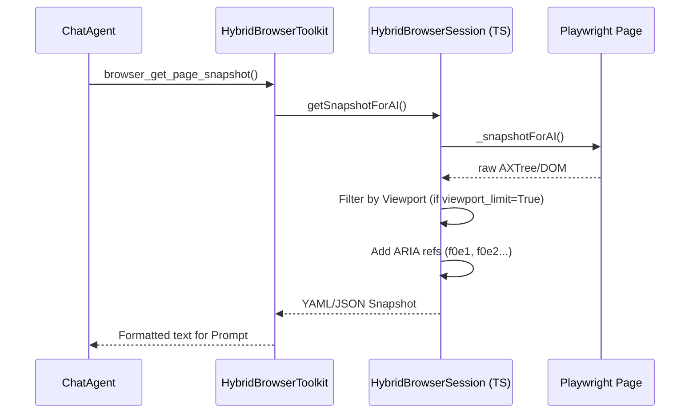
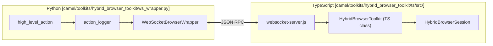

<!-- source: DeepWiki mcp.deepwiki.com · repo camel-ai/camel · page 4.4 BrowserToolkit and Web Automation · fetched 2026-10-29 -->

# BrowserToolkit and Web Automation

<details>
<summary>Relevant source files</summary>

The following files were used as context for generating this wiki page:

- [camel/toolkits/async_browser_toolkit.py](camel/toolkits/async_browser_toolkit.py)
- [camel/toolkits/browser_toolkit.py](camel/toolkits/browser_toolkit.py)
- [camel/toolkits/browser_toolkit_commons.py](camel/toolkits/browser_toolkit_commons.py)
- [camel/toolkits/hybrid_browser_toolkit/config_loader.py](camel/toolkits/hybrid_browser_toolkit/config_loader.py)
- [camel/toolkits/hybrid_browser_toolkit/hybrid_browser_toolkit.py](camel/toolkits/hybrid_browser_toolkit/hybrid_browser_toolkit.py)
- [camel/toolkits/hybrid_browser_toolkit/hybrid_browser_toolkit_ts.py](camel/toolkits/hybrid_browser_toolkit/hybrid_browser_toolkit_ts.py)
- [camel/toolkits/hybrid_browser_toolkit/ts/src/browser-session.ts](camel/toolkits/hybrid_browser_toolkit/ts/src/browser-session.ts)
- [camel/toolkits/hybrid_browser_toolkit/ts/src/config-loader.ts](camel/toolkits/hybrid_browser_toolkit/ts/src/config-loader.ts)
- [camel/toolkits/hybrid_browser_toolkit/ts/src/hybrid-browser-toolkit.ts](camel/toolkits/hybrid_browser_toolkit/ts/src/hybrid-browser-toolkit.ts)
- [camel/toolkits/hybrid_browser_toolkit/ts/src/types.ts](camel/toolkits/hybrid_browser_toolkit/ts/src/types.ts)
- [camel/toolkits/hybrid_browser_toolkit/ts/websocket-server.js](camel/toolkits/hybrid_browser_toolkit/ts/websocket-server.js)
- [camel/toolkits/hybrid_browser_toolkit/ws_wrapper.py](camel/toolkits/hybrid_browser_toolkit/ws_wrapper.py)
- [camel/toolkits/hybrid_browser_toolkit_py/__init__.py](camel/toolkits/hybrid_browser_toolkit_py/__init__.py)
- [camel/toolkits/hybrid_browser_toolkit_py/actions.py](camel/toolkits/hybrid_browser_toolkit_py/actions.py)
- [camel/toolkits/hybrid_browser_toolkit_py/agent.py](camel/toolkits/hybrid_browser_toolkit_py/agent.py)
- [camel/toolkits/hybrid_browser_toolkit_py/browser_session.py](camel/toolkits/hybrid_browser_toolkit_py/browser_session.py)
- [camel/toolkits/hybrid_browser_toolkit_py/config_loader.py](camel/toolkits/hybrid_browser_toolkit_py/config_loader.py)
- [camel/toolkits/hybrid_browser_toolkit_py/hybrid_browser_toolkit.py](camel/toolkits/hybrid_browser_toolkit_py/hybrid_browser_toolkit.py)
- [camel/toolkits/hybrid_browser_toolkit_py/snapshot.py](camel/toolkits/hybrid_browser_toolkit_py/snapshot.py)
- [camel/toolkits/hybrid_browser_toolkit_py/unified_analyzer.js](camel/toolkits/hybrid_browser_toolkit_py/unified_analyzer.js)
- [docs/mintlify/reference/camel.toolkits.arxiv_toolkit.mdx](docs/mintlify/reference/camel.toolkits.arxiv_toolkit.mdx)
- [docs/mintlify/reference/camel.toolkits.async_browser_toolkit.mdx](docs/mintlify/reference/camel.toolkits.async_browser_toolkit.mdx)
- [docs/mintlify/reference/camel.toolkits.browser_toolkit.mdx](docs/mintlify/reference/camel.toolkits.browser_toolkit.mdx)
- [docs/mintlify/reference/camel.toolkits.hybrid_browser_toolkit.config_loader.mdx](docs/mintlify/reference/camel.toolkits.hybrid_browser_toolkit.config_loader.mdx)
- [docs/mintlify/reference/camel.toolkits.hybrid_browser_toolkit.hybrid_browser_toolkit.mdx](docs/mintlify/reference/camel.toolkits.hybrid_browser_toolkit.hybrid_browser_toolkit.mdx)
- [docs/mintlify/reference/camel.toolkits.hybrid_browser_toolkit.hybrid_browser_toolkit_ts.mdx](docs/mintlify/reference/camel.toolkits.hybrid_browser_toolkit.hybrid_browser_toolkit_ts.mdx)
- [docs/mintlify/reference/camel.toolkits.hybrid_browser_toolkit.installer.mdx](docs/mintlify/reference/camel.toolkits.hybrid_browser_toolkit.installer.mdx)
- [docs/mintlify/reference/camel.toolkits.hybrid_browser_toolkit.ws_wrapper.mdx](docs/mintlify/reference/camel.toolkits.hybrid_browser_toolkit.ws_wrapper.mdx)
- [docs/mintlify/reference/camel.toolkits.hybrid_browser_toolkit_py.actions.mdx](docs/mintlify/reference/camel.toolkits.hybrid_browser_toolkit_py.actions.mdx)
- [docs/mintlify/reference/camel.toolkits.hybrid_browser_toolkit_py.agent.mdx](docs/mintlify/reference/camel.toolkits.hybrid_browser_toolkit_py.agent.mdx)
- [docs/mintlify/reference/camel.toolkits.hybrid_browser_toolkit_py.browser_session.mdx](docs/mintlify/reference/camel.toolkits.hybrid_browser_toolkit_py.browser_session.mdx)
- [docs/mintlify/reference/camel.toolkits.hybrid_browser_toolkit_py.config_loader.mdx](docs/mintlify/reference/camel.toolkits.hybrid_browser_toolkit_py.config_loader.mdx)
- [docs/mintlify/reference/camel.toolkits.hybrid_browser_toolkit_py.hybrid_browser_toolkit.mdx](docs/mintlify/reference/camel.toolkits.hybrid_browser_toolkit_py.hybrid_browser_toolkit.mdx)
- [docs/mintlify/reference/camel.toolkits.hybrid_browser_toolkit_py.snapshot.mdx](docs/mintlify/reference/camel.toolkits.hybrid_browser_toolkit_py.snapshot.mdx)
- [docs/mintlify/reference/camel.toolkits.terminal_toolkit.mdx](docs/mintlify/reference/camel.toolkits.terminal_toolkit.mdx)
- [examples/toolkits/browser_toolkit.py](examples/toolkits/browser_toolkit.py)
- [examples/toolkits/browser_toolkit_with_user_data_dir.py](examples/toolkits/browser_toolkit_with_user_data_dir.py)
- [examples/toolkits/hybrid_browser_toolkit_example.py](examples/toolkits/hybrid_browser_toolkit_example.py)
- [test/toolkits/test_async_browser_toolkit.py](test/toolkits/test_async_browser_toolkit.py)
- [test/toolkits/test_browser_toolkit.py](test/toolkits/test_browser_toolkit.py)
- [test/toolkits/test_hybrid_browser_toolkit.py](test/toolkits/test_hybrid_browser_toolkit.py)

</details>


## Purpose and Scope

The BrowserToolkit provides Playwright-based web automation capabilities to CAMEL-AI agents, enabling programmatic control of web browsers for tasks such as navigation, interaction with web elements, and authenticated session management. The toolkit ecosystem includes the **HybridBrowserToolkit**, which offers advanced AI-native features like "Set-of-Mark" (SoM) visual prompting, DOM snapshots optimized for LLMs, and a choice between Python and TypeScript execution backends.

For terminal-based shell execution, see [TerminalToolkit](#4.3). For general toolkit architecture, see [Toolkit System Architecture](#4.1).

---

## Architecture Overview

CAMEL-AI provides several browser automation implementations to suit different performance and capability requirements.



**Diagram: BrowserToolkit Multi-Backend Architecture**

### Key Classes
- `HybridBrowserToolkit`: The modern recommended entry point that can switch between TypeScript and Python implementations [camel/toolkits/hybrid_browser_toolkit/hybrid_browser_toolkit.py:20-85]().
- `WebSocketBrowserWrapper`: A Python bridge that manages a Node.js subprocess and communicates via WebSockets to provide high-performance browser control [camel/toolkits/hybrid_browser_toolkit/ws_wrapper.py:196-223]().
- `BrowserToolkit`: The standard synchronous implementation using Playwright's Python API [camel/toolkits/browser_toolkit.py:121-189]().
- `BaseBrowser`: The base class providing core initialization for the standard Python browser, handling Playwright startup and stealth arguments [camel/toolkits/browser_toolkit.py:121-202]().

Sources: [camel/toolkits/hybrid_browser_toolkit/hybrid_browser_toolkit.py:20-85](), [camel/toolkits/hybrid_browser_toolkit/ws_wrapper.py:196-223](), [camel/toolkits/browser_toolkit.py:121-202]()

---

## HybridBrowserToolkit (TypeScript vs. Python)

The `HybridBrowserToolkit` allows users to select an implementation `mode` during instantiation [camel/toolkits/hybrid_browser_toolkit/hybrid_browser_toolkit.py:87-113]().

### TypeScript Mode (`mode='typescript'`)
This is the default mode. It uses a Node.js backend which is often more stable for Playwright operations and supports advanced features:
- **CDP Connection**: Can connect to an existing Chrome instance via Chrome DevTools Protocol using `connectOverCdp` and `cdpUrl` [camel/toolkits/hybrid_browser_toolkit/ts/src/config-loader.ts:78-80]().
- **Enhanced Stealth**: Includes sophisticated scripts to bypass bot detection by overriding `navigator.webdriver`, faking plugins, and patching hardware fingerprints [camel/toolkits/hybrid_browser_toolkit/ts/src/config-loader.ts:140-220]().
- **AI-Optimized Snapshots**: Uses Playwright's `_snapshotForAI` to generate structured representations of the DOM for model consumption [camel/toolkits/hybrid_browser_toolkit/ts/src/browser-session.ts:51-56]().

### Python Mode (`mode='python'`)
A pure Python implementation that avoids the Node.js dependency. It is suitable for environments where installing Node.js is restricted or for simpler automation tasks.

Sources: [camel/toolkits/hybrid_browser_toolkit/hybrid_browser_toolkit.py:87-113](), [camel/toolkits/hybrid_browser_toolkit/ts/src/config-loader.ts:140-220](), [camel/toolkits/hybrid_browser_toolkit/ts/src/config-loader.ts:78-80](), [camel/toolkits/hybrid_browser_toolkit/ts/src/browser-session.ts:51-56]()

---

## AI-Native Automation Features

Modern browser agents in CAMEL-AI utilize more than just simple selectors; they use visual and structural context.

### Set-of-Mark (SoM) Visuals
The toolkit can generate screenshots with "marks" (labels) on interactive elements, allowing Vision-Language Models (VLMs) to refer to elements by numeric IDs [camel/toolkits/browser_toolkit_commons.py:65](). It also includes a "Ruler" feature that adds pixel-accurate tick marks to the edges of screenshots to help models understand spatial relationships [camel/toolkits/hybrid_browser_toolkit/hybrid_browser_toolkit_ts.py:40-58]().

### Visual Viewport and Interactive Regions
The system tracks the `VisualViewport` and identifies `InteractiveRegion` objects (buttons, links, inputs) [camel/toolkits/browser_toolkit_commons.py:63-64](). This data is used to filter what the agent "sees" via the `viewport_limit` parameter to avoid context window overflow [camel/toolkits/hybrid_browser_toolkit/ts/src/browser-session.ts:168-177]().

### Data Flow for AI Snapshots

**Diagram: Data Flow for AI-Native Snapshots**

Sources: [camel/toolkits/browser_toolkit_commons.py:63-65](), [camel/toolkits/hybrid_browser_toolkit/hybrid_browser_toolkit_ts.py:40-58](), [camel/toolkits/hybrid_browser_toolkit/ts/src/browser-session.ts:168-177]()

---

## Authentication and Cookie Management

Managing authenticated sessions is critical for agents interacting with private data.

### Storage State and Persistence
The toolkit handles authentication by saving and loading browser state files containing cookies and local storage.

- **Cookie Path**: The `cookie_json_path` parameter in `BaseBrowser` allows loading pre-saved authentication states to maintain sessions [camel/toolkits/browser_toolkit.py:127-129]().
- **User Data Directory**: The `user_data_dir` provides persistent context across browser restarts, maintaining logins naturally in a dedicated folder [camel/toolkits/browser_toolkit.py:167-168]().
- **Stealth and Persistence**: The `StealthConfig` in the TypeScript implementation provides platform-aware User-Agents (Windows, Linux, macOS) to ensure that saved sessions remain valid and aren't flagged as suspicious [camel/toolkits/hybrid_browser_toolkit/ts/src/config-loader.ts:114-138]().

Sources: [camel/toolkits/browser_toolkit.py:127-168](), [camel/toolkits/hybrid_browser_toolkit/ts/src/config-loader.ts:114-138]()

---

## Implementation Details: WebSocketWrapper

The `WebSocketBrowserWrapper` manages the lifecycle of the TypeScript backend.

- **Action Logging**: Uses an `@action_logger` decorator to record every browser interaction, including page load times and errors [camel/toolkits/hybrid_browser_toolkit/ws_wrapper.py:79-132]().
- **High-Level Actions**: The `@high_level_action` decorator allows grouping multiple low-level browser calls into a single logical step, suppressing internal low-level logs to keep agent history clean [camel/toolkits/hybrid_browser_toolkit/ws_wrapper.py:135-193]().
- **Memory Safety**: Includes `_create_memory_aware_error` to detect if browser crashes are due to system OOM (Out Of Memory) conditions [camel/toolkits/hybrid_browser_toolkit/ws_wrapper.py:48-59]().


**Diagram: Python-to-TypeScript Execution Bridge**

Sources: [camel/toolkits/hybrid_browser_toolkit/ws_wrapper.py:48-193](), [camel/toolkits/hybrid_browser_toolkit/ts/src/hybrid-browser-toolkit.ts:8-21]()

---

## Usage Example

```python
from camel.toolkits import HybridBrowserToolkit

# Initialize with TypeScript backend and stealth enabled
toolkit = HybridBrowserToolkit(
    mode="typescript",
    headless=False,
    stealth=True,
    viewport_limit=True  # Reduces token usage by only sending visible elements
)

# Get tools for ChatAgent
tools = toolkit.get_tools() 
```

Sources: [camel/toolkits/hybrid_browser_toolkit/hybrid_browser_toolkit.py:87-113](), [examples/toolkits/hybrid_browser_toolkit_example.py:77-85]()

---

