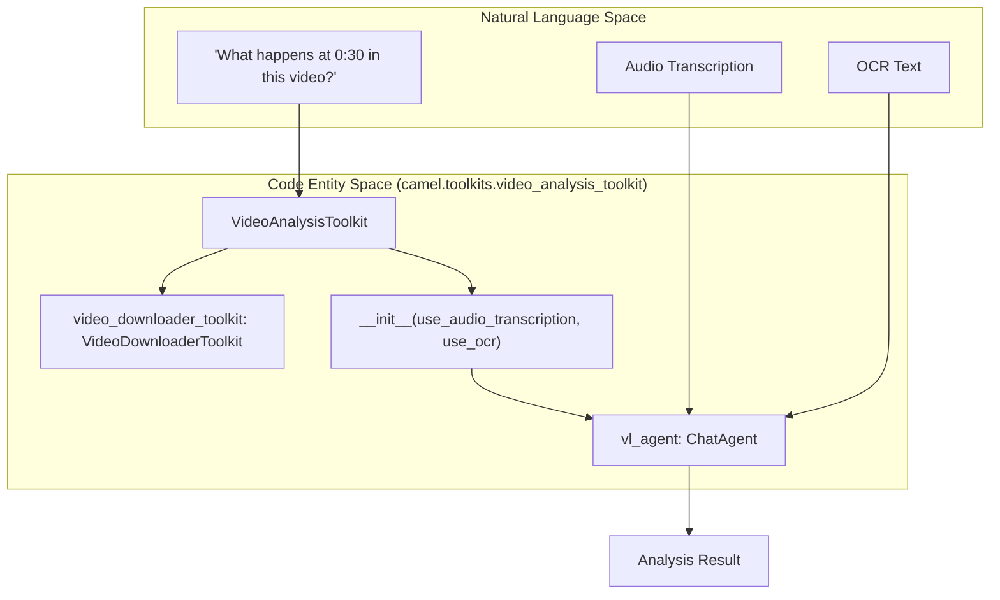
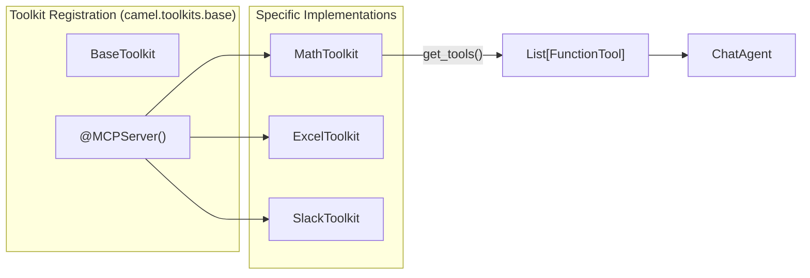

<!-- source: DeepWiki mcp.deepwiki.com · repo camel-ai/camel · page 4.5 Media and Document Toolkits · fetched 2026-10-29 -->

# Media and Document Toolkits

Relevant source files

The following files were used as context for generating this wiki page:

- [camel/toolkits/audio_analysis_toolkit.py](camel/toolkits/audio_analysis_toolkit.py)
- [camel/toolkits/excel_toolkit.py](camel/toolkits/excel_toolkit.py)
- [camel/toolkits/image_analysis_toolkit.py](camel/toolkits/image_analysis_toolkit.py)
- [camel/toolkits/math_toolkit.py](camel/toolkits/math_toolkit.py)
- [camel/toolkits/networkx_toolkit.py](camel/toolkits/networkx_toolkit.py)
- [camel/toolkits/pptx_toolkit.py](camel/toolkits/pptx_toolkit.py)
- [camel/toolkits/slack_toolkit.py](camel/toolkits/slack_toolkit.py)
- [camel/toolkits/twitter_toolkit.py](camel/toolkits/twitter_toolkit.py)
- [camel/toolkits/video_analysis_toolkit.py](camel/toolkits/video_analysis_toolkit.py)
- [camel/toolkits/video_download_toolkit.py](camel/toolkits/video_download_toolkit.py)
- [camel/toolkits/weather_toolkit.py](camel/toolkits/weather_toolkit.py)
- [docs/mintlify/reference/camel.toolkits.agent_toolkit.mdx](docs/mintlify/reference/camel.toolkits.agent_toolkit.mdx)
- [docs/mintlify/reference/camel.toolkits.craw4ai_toolkit.mdx](docs/mintlify/reference/camel.toolkits.craw4ai_toolkit.mdx)
- [docs/mintlify/reference/camel.toolkits.file_toolkit.mdx](docs/mintlify/reference/camel.toolkits.file_toolkit.mdx)
- [docs/mintlify/reference/camel.toolkits.markitdown_toolkit.mdx](docs/mintlify/reference/camel.toolkits.markitdown_toolkit.mdx)
- [docs/mintlify/reference/camel.toolkits.note_taking_toolkit.mdx](docs/mintlify/reference/camel.toolkits.note_taking_toolkit.mdx)
- [docs/mintlify/reference/camel.toolkits.planning_worktree_toolkit.mdx](docs/mintlify/reference/camel.toolkits.planning_worktree_toolkit.mdx)
- [docs/mintlify/reference/camel.toolkits.pptx_toolkit.mdx](docs/mintlify/reference/camel.toolkits.pptx_toolkit.mdx)
- [docs/mintlify/reference/camel.toolkits.screenshot_toolkit.mdx](docs/mintlify/reference/camel.toolkits.screenshot_toolkit.mdx)
- [docs/mintlify/reference/camel.toolkits.todo_toolkit.mdx](docs/mintlify/reference/camel.toolkits.todo_toolkit.mdx)
- [docs/mintlify/reference/camel.toolkits.video_analysis_toolkit.mdx](docs/mintlify/reference/camel.toolkits.video_analysis_toolkit.mdx)
- [docs/mintlify/reference/camel.toolkits.video_download_toolkit.mdx](docs/mintlify/reference/camel.toolkits.video_download_toolkit.mdx)
- [docs/mintlify/reference/camel.toolkits.web_fetch_toolkit.mdx](docs/mintlify/reference/camel.toolkits.web_fetch_toolkit.mdx)
- [docs/reference/camel.toolkits.file_toolkit.md](docs/reference/camel.toolkits.file_toolkit.md)
- [docs/reference/camel.toolkits.note_taking_toolkit.md](docs/reference/camel.toolkits.note_taking_toolkit.md)
- [docs/reference/camel.toolkits.pptx_toolkit.md](docs/reference/camel.toolkits.pptx_toolkit.md)
- [docs/reference/camel.toolkits.video_analysis_toolkit.md](docs/reference/camel.toolkits.video_analysis_toolkit.md)
- [docs/reference/camel.toolkits.video_download_toolkit.md](docs/reference/camel.toolkits.video_download_toolkit.md)
- [examples/toolkits/excel_toolkit.py](examples/toolkits/excel_toolkit.py)
- [examples/toolkits/image_analysis_toolkit.py](examples/toolkits/image_analysis_toolkit.py)
- [examples/toolkits/post_weather_on_twitter.py](examples/toolkits/post_weather_on_twitter.py)
- [examples/toolkits/pptx_toolkit.py](examples/toolkits/pptx_toolkit.py)
- [examples/toolkits/video_analysis_toolkit.py](examples/toolkits/video_analysis_toolkit.py)
- [examples/usecases/chat_with_youtube/README.md](examples/usecases/chat_with_youtube/README.md)
- [examples/usecases/chat_with_youtube/app.py](examples/usecases/chat_with_youtube/app.py)
- [examples/usecases/chat_with_youtube/requirements.txt](examples/usecases/chat_with_youtube/requirements.txt)
- [test/toolkits/test_excel_toolkit.py](test/toolkits/test_excel_toolkit.py)
- [test/toolkits/test_image_analysis_toolkiy.py](test/toolkits/test_image_analysis_toolkiy.py)
- [test/toolkits/test_math_functions.py](test/toolkits/test_math_functions.py)
- [test/toolkits/test_pptx_toolkit.py](test/toolkits/test_pptx_toolkit.py)
- [test/toolkits/test_slack_functions.py](test/toolkits/test_slack_functions.py)
- [test/toolkits/test_video_analysis_toolkit.py](test/toolkits/test_video_analysis_toolkit.py)
- [test/toolkits/test_video_download_function.py](test/toolkits/test_video_download_function.py)

## Purpose and Scope

This document covers CAMEL's media and document processing toolkits, which enable agents to analyze videos, process images, and handle document formats like Excel, PowerPoint, and Markdown. These toolkits bridge natural language instructions to specialized processing libraries.

- **Image Analysis**: `ImageAnalysisToolkit` for visual description and question answering using vision-capable models.
- **Video Processing**: `VideoDownloaderToolkit` for acquisition and `VideoAnalysisToolkit` for multi-modal understanding (visual, audio, and OCR).
- **Document Processing**: `ExcelToolkit`, `PPTXToolkit`, and `NoteTakingToolkit` for structured data extraction, presentation creation, and note management.
- **Unified Document Conversion**: `MarkItDownToolkit` (deprecated in favor of `FileToolkit`) for converting diverse formats to Markdown.
- **Audio Processing**: `AudioAnalysisToolkit` for speech-to-text and audio understanding.

---

## Image and Video Processing Architecture

### ImageAnalysisToolkit

The `ImageAnalysisToolkit` [camel/toolkits/image_analysis_toolkit.py:34-37]() provides comprehensive image understanding by wrapping vision-capable language models. It supports both local file paths and web URLs.

**Key Functions:**
- `image_to_text(image_path, sys_prompt)`: Generates a natural language description of an image [camel/toolkits/image_analysis_toolkit.py:65-91]().
- `ask_question_about_image(image_path, question, sys_prompt)`: Performs targeted visual question answering [camel/toolkits/image_analysis_toolkit.py:93-122]().
- `_load_image(image_path)`: Internal utility to fetch images via `requests` or load from disk into `PIL.Image` [camel/toolkits/image_analysis_toolkit.py:124-154]().

Sources: [camel/toolkits/image_analysis_toolkit.py:34-187]()

### VideoDownloaderToolkit

The `VideoDownloaderToolkit` [camel/toolkits/video_download_toolkit.py:83-94]() provides capabilities for downloading videos and extracting screenshots using `yt_dlp` and `ffmpeg`.

**Key Methods:**
- `download_video(url: str) -> str`: Downloads video and returns the local file path [camel/toolkits/video_download_toolkit.py:142-171]().
- `get_video_bytes(video_path: str) -> bytes`: Returns video content as bytes, downloading it first if a URL is provided [camel/toolkits/video_download_toolkit.py:173-194]().
- `_capture_screenshot(video_file, timestamp)`: A standalone utility that uses `ffmpeg` to extract a single frame at a specific time [camel/toolkits/video_download_toolkit.py:56-80]().

Sources: [camel/toolkits/video_download_toolkit.py:56-194](), [test/toolkits/test_video_download_function.py:20-83]()

---

### VideoAnalysisToolkit Architecture

The `VideoAnalysisToolkit` [camel/toolkits/video_analysis_toolkit.py:96-121]() performs comprehensive video analysis by combining visual frames, audio transcripts, and OCR text. It uses a `ChatAgent` internally to synthesize information based on the `VIDEO_QA_PROMPT` [camel/toolkits/video_analysis_toolkit.py:41-92]().

**Entity Bridge: Natural Language to Code**

Sources: [camel/toolkits/video_analysis_toolkit.py:124-172](), [camel/toolkits/video_analysis_toolkit.py:41-92]()

---

## Document and File Processing

### Excel and PowerPoint Toolkits

| Toolkit | Primary Class | Key Capabilities |
| :--- | :--- | :--- |
| **Excel** | `ExcelToolkit` | Extracting content from `.xlsx`, `.xls`, and `.csv` into Markdown tables [camel/toolkits/excel_toolkit.py:33-40](). |
| **PowerPoint** | `PPTXToolkit` | Creating presentations via `create_presentation` [camel/toolkits/pptx_toolkit.py:184-203](), adding slides, and managing text formatting. |

**Excel Processing Implementation:**
The `ExcelToolkit` uses `pandas`, `openpyxl`, and `xls2xlsx` to parse files. It includes a security check `_validate_file_path` to prevent path traversal [camel/toolkits/excel_toolkit.py:76-90]().
- `extract_excel_content(document_path)`: Returns a comprehensive report with sheet names, markdown tables, and cell metadata [camel/toolkits/excel_toolkit.py:106-123]().

Sources: [camel/toolkits/excel_toolkit.py:33-185](), [camel/toolkits/pptx_toolkit.py:5-179]()

### NoteTaking and File Toolkits

The `NoteTakingToolkit` provides a structured way for agents to maintain persistent Markdown notes within a registry [docs/mintlify/reference/camel.toolkits.note_taking_toolkit.mdx:8-15]().
- `create_note(note_name, content)`: Initializes a new `.md` file [docs/mintlify/reference/camel.toolkits.note_taking_toolkit.mdx:95-122]().
- `append_note(note_name, content)`: Adds information to existing notes or creates them if missing [docs/mintlify/reference/camel.toolkits.note_taking_toolkit.mdx:41-59]().
- `list_note()`: Returns a list of available notes and their sizes [docs/mintlify/reference/camel.toolkits.note_taking_toolkit.mdx:128-135]().

The `FileToolkit` serves as a comprehensive hub for reading and writing across formats, now incorporating `MarkItDown` capabilities for diverse file conversion [docs/mintlify/reference/camel.toolkits.file_toolkit.mdx:11-21]().

Sources: [docs/mintlify/reference/camel.toolkits.note_taking_toolkit.mdx:8-162](), [docs/mintlify/reference/camel.toolkits.file_toolkit.mdx:8-252]()

---

## Implementation Details and Integration

### Resource Cleanup and Safety

- **Cleanup**: `VideoDownloaderToolkit` implements a `__del__` method to remove temporary directories and files if a `working_directory` was not explicitly provided [camel/toolkits/video_download_toolkit.py:124-140]().
- **Path Security**: `ExcelToolkit` and `FileToolkit` use path validation/sanitization to prevent directory traversal attacks [camel/toolkits/excel_toolkit.py:76-90](), [docs/mintlify/reference/camel.toolkits.file_toolkit.mdx:98-116]().

### Dependency Requirements

These toolkits require specific external libraries and system tools, often checked via the `@dependencies_required` decorator.

| Toolkit | Dependencies |
| :--- | :--- |
| **Video** | `ffmpeg`, `yt_dlp`, `scenedetect` [camel/toolkits/video_analysis_toolkit.py:123-134]() |
| **Excel** | `pandas`, `openpyxl`, `xls2xlsx`, `tabulate` [camel/toolkits/excel_toolkit.py:101-127]() |
| **PPTX** | `python-pptx` |
| **Math** | Standard library (rounding, basic arithmetic) [camel/toolkits/math_toolkit.py:31-101]() |

**Tool Registration Diagram**

Sources: [camel/toolkits/math_toolkit.py:23-117](), [camel/toolkits/excel_toolkit.py:32-40](), [camel/toolkits/slack_toolkit.py:31-37]()

---

