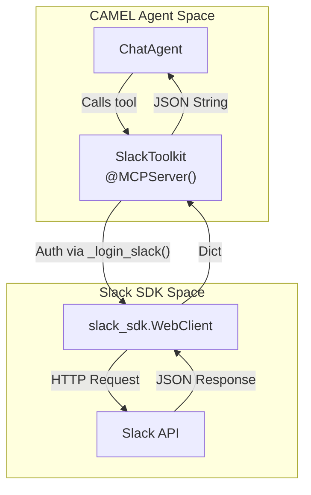
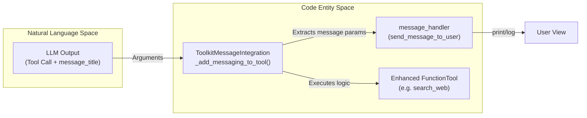

<!-- source: DeepWiki mcp.deepwiki.com · repo camel-ai/camel · page 4.6 Communication Toolkits · fetched 2026-10-29 -->

# Communication Toolkits

Relevant source files

The following files were used as context for generating this wiki page:

- [README.ja.md](README.ja.md)
- [README.zh.md](README.zh.md)
- [camel/toolkits/audio_analysis_toolkit.py](camel/toolkits/audio_analysis_toolkit.py)
- [camel/toolkits/craw4ai_toolkit.py](camel/toolkits/craw4ai_toolkit.py)
- [camel/toolkits/file_toolkit.py](camel/toolkits/file_toolkit.py)
- [camel/toolkits/image_analysis_toolkit.py](camel/toolkits/image_analysis_toolkit.py)
- [camel/toolkits/markitdown_toolkit.py](camel/toolkits/markitdown_toolkit.py)
- [camel/toolkits/math_toolkit.py](camel/toolkits/math_toolkit.py)
- [camel/toolkits/message_integration.py](camel/toolkits/message_integration.py)
- [camel/toolkits/networkx_toolkit.py](camel/toolkits/networkx_toolkit.py)
- [camel/toolkits/slack_toolkit.py](camel/toolkits/slack_toolkit.py)
- [camel/toolkits/twitter_toolkit.py](camel/toolkits/twitter_toolkit.py)
- [camel/toolkits/weather_toolkit.py](camel/toolkits/weather_toolkit.py)
- [docs/mintlify/reference/camel.toolkits.dalle_toolkit.mdx](docs/mintlify/reference/camel.toolkits.dalle_toolkit.mdx)
- [examples/toolkits/file_toolkit.py](examples/toolkits/file_toolkit.py)
- [examples/toolkits/image_analysis_toolkit.py](examples/toolkits/image_analysis_toolkit.py)
- [examples/toolkits/post_weather_on_twitter.py](examples/toolkits/post_weather_on_twitter.py)
- [examples/toolkits/toolkit_message_integration.py](examples/toolkits/toolkit_message_integration.py)
- [test/toolkits/test_file_toolkit.py](test/toolkits/test_file_toolkit.py)
- [test/toolkits/test_image_analysis_toolkiy.py](test/toolkits/test_image_analysis_toolkiy.py)
- [test/toolkits/test_math_functions.py](test/toolkits/test_math_functions.py)
- [test/toolkits/test_message_integration.py](test/toolkits/test_message_integration.py)
- [test/toolkits/test_slack_functions.py](test/toolkits/test_slack_functions.py)

## Purpose and Scope

Communication Toolkits provide agents with the ability to interact with external messaging and collaboration platforms. These toolkits enable agents to send messages, manage users and groups, and automate communication workflows across enterprise platforms like Slack, Gmail, Twitter, and DingTalk. Communication toolkits extend the agent's capabilities beyond text generation to include direct integration with real-world communication systems.

This page focuses on the architecture and usage of communication toolkits, covering integrations for Slack, Gmail, Twitter, WeChat, DingTalk, Lark, and WhatsApp. For general toolkit architecture patterns, see [Toolkit System Overview]().

## Available Communication Toolkits

The CAMEL framework provides a comprehensive set of communication platform integrations:

| Toolkit | Platform | Key Capabilities |
|---------|----------|------------------|
| `SlackToolkit` | Slack | Channel management, joining/leaving, messaging, user discovery |
| `GmailToolkit` | Gmail | Sending emails, searching messages, managing drafts |
| `TwitterToolkit` | Twitter (X) | Posting tweets, searching tweets, user information |
| `WhatsAppToolkit` | WhatsApp | Sending messages via Twilio API |
| `WeChatOfficialToolkit` | WeChat | Official account management, message handling |
| `DingtalkToolkit` | DingTalk | Enterprise messaging, department/group management, webhooks |
| `LarkToolkit` | Lark (Feishu) | Messaging, spreadsheet integration, group management |

Sources: [camel/toolkits/slack_toolkit.py:32-37](), [camel/toolkits/twitter_toolkit.py:40-45](), [camel/toolkits/audio_analysis_toolkit.py:85-96]()

## SlackToolkit Architecture

The `SlackToolkit` provides a high-level interface for interacting with the Slack API using the `slack_sdk` [camel/toolkits/slack_toolkit.py:75-80](). It is decorated with `@MCPServer()` to facilitate Model Context Protocol integration [camel/toolkits/slack_toolkit.py:31-32]().

### Component Interaction

### Key Functions
- `create_slack_channel(name, is_private)`: Creates a new Slack channel [camel/toolkits/slack_toolkit.py:95-125]().
- `join_slack_channel(channel_id)`: Joins an existing channel [camel/toolkits/slack_toolkit.py:126-145]().
- `get_slack_channel_information()`: Discovers available channels and their IDs [camel/toolkits/slack_toolkit.py:166-200]().
- `send_slack_message(message, channel_id)`: Sends a message to a specific channel [camel/toolkits/slack_toolkit.py:228-251]().

Sources: [camel/toolkits/slack_toolkit.py:31-251](), [test/toolkits/test_slack_functions.py:26-163]()

## TwitterToolkit Integration

The `TwitterToolkit` uses OAuth1 authentication to interact with the X (formerly Twitter) API [camel/toolkits/twitter_toolkit.py:80-85]().

### Core Features
- **Tweet Management**: Supports `create_tweet` with optional polls or quotes [camel/toolkits/twitter_toolkit.py:40-77]() and `delete_tweet` [camel/toolkits/twitter_toolkit.py:145-163]().
- **User Discovery**: Provides `get_my_user_profile` [camel/toolkits/twitter_toolkit.py:204-205]() and `get_user_profile_by_username` [camel/toolkits/twitter_toolkit.py:241-242]().
- **Constraint Handling**: Automatically validates the 280-character limit via `TWEET_TEXT_LIMIT` [camel/toolkits/twitter_toolkit.py:27-94]().

Sources: [camel/toolkits/twitter_toolkit.py:27-242]()

## Toolkit Message Integration

The `ToolkitMessageIntegration` class allows agents to send status updates to users while executing toolkit functions in a single step, improving communication and reducing the number of tool calls needed [camel/toolkits/message_integration.py:24-30]().

### Messaging Data Flow

### Key Components
- `register_toolkits(toolkit)`: Wraps all methods in a toolkit to accept `message_title`, `message_description`, and `message_attachment` [camel/toolkits/message_integration.py:151-178]().
- `send_message_to_user(...)`: The default handler that prints tidy status updates to the console and logs [camel/toolkits/message_integration.py:106-138]().
- `register_functions(functions)`: Enhances specific standalone functions with messaging capabilities [camel/toolkits/message_integration.py:192-205]().

Sources: [camel/toolkits/message_integration.py:24-205](), [test/toolkits/test_message_integration.py:75-152]()

## Audio and Image Communication Analysis

Communication toolkits often work alongside media toolkits to process attachments received in messages.

### AudioAnalysisToolkit
This toolkit transcribes audio to text and performs reasoning over audio content [camel/toolkits/audio_analysis_toolkit.py:85-96]().
- `audio2text(audio_path)`: Uses `transcribe_model` (defaulting to `OpenAIAudioModels`) for speech-to-text [camel/toolkits/audio_analysis_toolkit.py:137-159]().
- `ask_question_about_audio(audio_path, question)`: Uses a multimodal `ChatAgent` to answer questions about audio files [camel/toolkits/audio_analysis_toolkit.py:160-205]().

### ImageAnalysisToolkit
Provides visual understanding capabilities for images sent via communication platforms [camel/toolkits/image_analysis_toolkit.py:34-37]().
- `image_to_text(image_path)`: Generates natural language descriptions using vision-capable models [camel/toolkits/image_analysis_toolkit.py:65-92]().
- `ask_question_about_image(image_path, question)`: Performs Visual Question Answering (VQA) [camel/toolkits/image_analysis_toolkit.py:93-123]().

Sources: [camel/toolkits/audio_analysis_toolkit.py:85-205](), [camel/toolkits/image_analysis_toolkit.py:34-123]()

## File Operations in Communication
The `FileToolkit` serves as a foundation for handling documents and archives often shared in communication channels. It provides cross-platform support for reading and writing formats like PDF, DOCX, JSON, and ZIP [camel/toolkits/file_toolkit.py:31-41]().

- **Reading**: Supports multiple formats through `read_file` (replacing the deprecated `MarkItDownToolkit.read_files`) [camel/toolkits/markitdown_toolkit.py:31-45]().
- **Safety**: Includes `_sanitize_filename` to prevent path traversal or invalid characters in communication-based file downloads [camel/toolkits/file_toolkit.py:124-138]().

Sources: [camel/toolkits/file_toolkit.py:31-138](), [camel/toolkits/markitdown_toolkit.py:31-45]()

## Configuration and Credentials

Communication toolkits require specific environment variables or API keys, often enforced by the `@api_keys_required` decorator [camel/toolkits/twitter_toolkit.py:32-39]().

| Variable | Toolkit |
|----------|---------|
| `SLACK_BOT_TOKEN` / `SLACK_USER_TOKEN` | `SlackToolkit` |
| `TWITTER_CONSUMER_KEY` / `TWITTER_ACCESS_TOKEN` | `TwitterToolkit` |
| `OPENWEATHERMAP_API_KEY` | `WeatherToolkit` |

Sources: [camel/toolkits/slack_toolkit.py:82-89](), [camel/toolkits/twitter_toolkit.py:32-39](), [camel/toolkits/weather_toolkit.py:53-61]()

---

