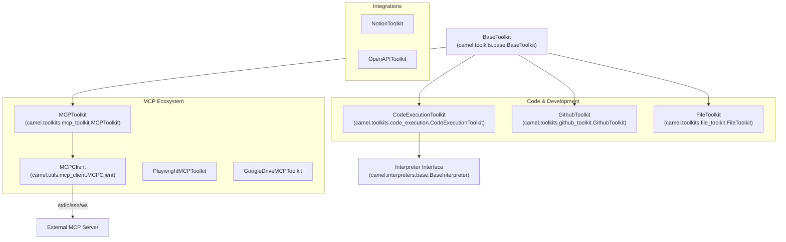
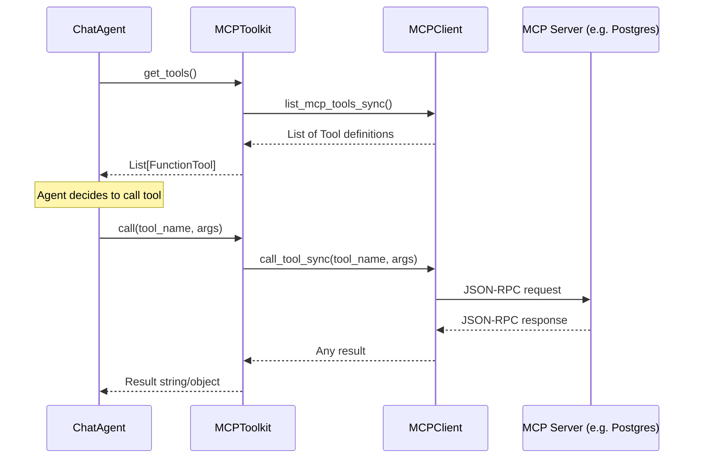
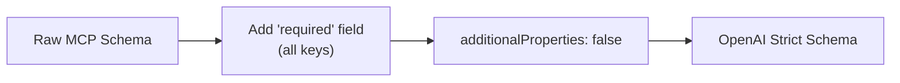

<!-- source: DeepWiki mcp.deepwiki.com · repo camel-ai/camel · page 4.7 Development and Integration Toolkits · fetched 2026-10-29 -->

# Development and Integration Toolkits

Relevant source files

The following files were used as context for generating this wiki page:

- [README.ja.md](README.ja.md)
- [README.zh.md](README.zh.md)
- [camel/agents/mcp_agent.py](camel/agents/mcp_agent.py)
- [camel/configs/sglang_config.py](camel/configs/sglang_config.py)
- [camel/interpreters/internal_python_interpreter.py](camel/interpreters/internal_python_interpreter.py)
- [camel/interpreters/subprocess_interpreter.py](camel/interpreters/subprocess_interpreter.py)
- [camel/models/sglang_model.py](camel/models/sglang_model.py)
- [camel/prompts/base.py](camel/prompts/base.py)
- [camel/toolkits/base.py](camel/toolkits/base.py)
- [camel/toolkits/code_execution.py](camel/toolkits/code_execution.py)
- [camel/toolkits/craw4ai_toolkit.py](camel/toolkits/craw4ai_toolkit.py)
- [camel/toolkits/dingtalk.py](camel/toolkits/dingtalk.py)
- [camel/toolkits/edgeone_pages_mcp_toolkit.py](camel/toolkits/edgeone_pages_mcp_toolkit.py)
- [camel/toolkits/file_toolkit.py](camel/toolkits/file_toolkit.py)
- [camel/toolkits/github_toolkit.py](camel/toolkits/github_toolkit.py)
- [camel/toolkits/google_drive_mcp_toolkit.py](camel/toolkits/google_drive_mcp_toolkit.py)
- [camel/toolkits/markitdown_toolkit.py](camel/toolkits/markitdown_toolkit.py)
- [camel/toolkits/mcp_toolkit.py](camel/toolkits/mcp_toolkit.py)
- [camel/toolkits/notion_mcp_toolkit.py](camel/toolkits/notion_mcp_toolkit.py)
- [camel/toolkits/origene_mcp_toolkit.py](camel/toolkits/origene_mcp_toolkit.py)
- [camel/toolkits/playwright_mcp_toolkit.py](camel/toolkits/playwright_mcp_toolkit.py)
- [camel/utils/mcp_client.py](camel/utils/mcp_client.py)
- [camel/verifiers/math_verifier.py](camel/verifiers/math_verifier.py)
- [docs/mintlify/reference/camel.agents.mcp_agent.mdx](docs/mintlify/reference/camel.agents.mcp_agent.mdx)
- [docs/mintlify/reference/camel.configs.crynux_config.mdx](docs/mintlify/reference/camel.configs.crynux_config.mdx)
- [docs/mintlify/reference/camel.interpreters.microsandbox_interpreter.mdx](docs/mintlify/reference/camel.interpreters.microsandbox_interpreter.mdx)
- [docs/mintlify/reference/camel.interpreters.subprocess_interpreter.mdx](docs/mintlify/reference/camel.interpreters.subprocess_interpreter.mdx)
- [docs/mintlify/reference/camel.models.crynux_model.mdx](docs/mintlify/reference/camel.models.crynux_model.mdx)
- [docs/mintlify/reference/camel.toolkits.code_execution.mdx](docs/mintlify/reference/camel.toolkits.code_execution.mdx)
- [docs/mintlify/reference/camel.toolkits.dalle_toolkit.mdx](docs/mintlify/reference/camel.toolkits.dalle_toolkit.mdx)
- [docs/mintlify/reference/camel.toolkits.function_tool.mdx](docs/mintlify/reference/camel.toolkits.function_tool.mdx)
- [docs/mintlify/reference/camel.toolkits.mcp_toolkit.mdx](docs/mintlify/reference/camel.toolkits.mcp_toolkit.mdx)
- [docs/mintlify/reference/camel.toolkits.microsoft_outlook_mail_toolkit.mdx](docs/mintlify/reference/camel.toolkits.microsoft_outlook_mail_toolkit.mdx)
- [docs/mintlify/reference/camel.utils.mcp_client.mdx](docs/mintlify/reference/camel.utils.mcp_client.mdx)
- [docs/reference/camel.interpreters.subprocess_interpreter.md](docs/reference/camel.interpreters.subprocess_interpreter.md)
- [docs/reference/camel.toolkits.code_execution.md](docs/reference/camel.toolkits.code_execution.md)
- [examples/external_tools/use_external_tools.py](examples/external_tools/use_external_tools.py)
- [examples/interpreters/internal_python_interpreter.py](examples/interpreters/internal_python_interpreter.py)
- [examples/models/sglang_model_example.py](examples/models/sglang_model_example.py)
- [examples/toolkits/dingtalk.py](examples/toolkits/dingtalk.py)
- [examples/toolkits/edgeone_pages_mcp_toolkit.py](examples/toolkits/edgeone_pages_mcp_toolkit.py)
- [examples/toolkits/file_toolkit.py](examples/toolkits/file_toolkit.py)
- [examples/toolkits/github_toolkit.py](examples/toolkits/github_toolkit.py)
- [examples/toolkits/google_drive_mcp_toolkit.py](examples/toolkits/google_drive_mcp_toolkit.py)
- [examples/toolkits/mcp/mcp_arxiv_toolkit/client.py](examples/toolkits/mcp/mcp_arxiv_toolkit/client.py)
- [examples/toolkits/mcp/mcp_arxiv_toolkit/client_sync.py](examples/toolkits/mcp/mcp_arxiv_toolkit/client_sync.py)
- [examples/toolkits/mcp/mcp_origene_toolkit/client.py](examples/toolkits/mcp/mcp_origene_toolkit/client.py)
- [examples/toolkits/mcp/mcp_toolkit.py](examples/toolkits/mcp/mcp_toolkit.py)
- [examples/toolkits/notion_mcp_tookit.py](examples/toolkits/notion_mcp_tookit.py)
- [examples/toolkits/playwright_mcp_toolkit.py](examples/toolkits/playwright_mcp_toolkit.py)
- [test/interpreters/test_python_interpreter.py](test/interpreters/test_python_interpreter.py)
- [test/interpreters/test_subprocess_interpreter.py](test/interpreters/test_subprocess_interpreter.py)
- [test/models/test_sglang_model.py](test/models/test_sglang_model.py)
- [test/prompts/test_prompt_base.py](test/prompts/test_prompt_base.py)
- [test/toolkits/test_code_execution.py](test/toolkits/test_code_execution.py)
- [test/toolkits/test_dingtalk.py](test/toolkits/test_dingtalk.py)
- [test/toolkits/test_file_toolkit.py](test/toolkits/test_file_toolkit.py)
- [test/toolkits/test_github_toolkit.py](test/toolkits/test_github_toolkit.py)
- [test/toolkits/test_mcp_toolkit.py](test/toolkits/test_mcp_toolkit.py)
- [test/utils/test_mcp_client.py](test/utils/test_mcp_client.py)
- [test/utils/test_mcp_server.py](test/utils/test_mcp_server.py)

This page documents the development-focused toolkits in CAMEL, specifically focusing on the Model Context Protocol (MCP) integration, code execution, version control, and cloud productivity tools. These toolkits bridge the gap between Natural Language Space and Code Entity Space, allowing agents to interact with professional development environments and standard protocols.

## Overview

Development and Integration Toolkits provide agents with capabilities to:
- **MCP Integration**: Connect to any MCP-compliant server (e.g., Playwright, Google Drive, Postgres) via a unified client.
- **Code Execution**: Run code in various sandboxed environments (Internal, Docker, Jupyter, E2B, Microsandbox).
- **Version Control**: Manage GitHub repositories, issues, and pull requests.
- **Productivity**: Interact with Notion databases and pages.
- **File Management**: Perform low-level file system operations with strict path controls.

## Toolkit Architecture

The architecture relies on `BaseToolkit` for common lifecycle management and `MCPToolkit` for dynamic tool discovery via the Model Context Protocol.

Title: Toolkit Inheritance and Interaction Architecture

Sources: `[camel/toolkits/base.py:21-21]()`, `[camel/toolkits/mcp_toolkit.py:24-25]()`, `[camel/toolkits/code_execution.py:33-33]()`, `[camel/toolkits/github_toolkit.py:28-28]()`

## Model Context Protocol (MCP) Integration

CAMEL provides a robust implementation of the Model Context Protocol, allowing agents to use tools from any server that implements the MCP specification.

### MCPToolkit and MCPClient
The `MCPToolkit` acts as a manager for multiple `MCPClient` instances. It can load configurations from a dictionary or a JSON file (standard `mcp_config.json` format) `[camel/toolkits/mcp_toolkit.py:46-56]()`.

**Key Components:**
- **`MCPClient`**: Handles the low-level transport (STDIO, SSE, WebSocket, Streamable-HTTP) and session negotiation `[camel/utils/mcp_client.py:190-202]()`.
- **`ServerConfig`**: A Pydantic model that automatically detects transport types based on the presence of a `command` (STDIO) or `url` (SSE/WS/HTTP) `[camel/utils/mcp_client.py:80-98]()`.
- **`ensure_strict_json_schema`**: A utility that mutates standard JSON schemas to conform to OpenAI's "strict" mode requirements by setting `additionalProperties: false` and enforcing `required` fields `[camel/toolkits/mcp_toolkit.py:57-63]()`.

### Data Flow for MCP Tool Execution
The diagram below illustrates how a natural language request is transformed into an MCP tool call.

Title: MCP Tool Discovery and Execution Flow

Sources: `[camel/toolkits/mcp_toolkit.py:27-28]()`, `[camel/utils/mcp_client.py:203-210]()`, `[camel/utils/mcp_client.py:231-235]()`

## Code Execution Toolkit

`CodeExecutionToolkit` provides a unified interface for executing code across different sandboxes. It supports Python by default but can be extended to other languages via specific interpreters.

### Interpreter Backends
The toolkit wraps various interpreter classes defined in `camel.interpreters`:
- **`InternalPythonInterpreter`**: Executes code within the same process. It includes security checks like an `import_white_list` and an `action_space` to restrict available functions `[camel/interpreters/internal_python_interpreter.py:27-32]()`.
- **`SubprocessInterpreter`**: Runs code in a separate local process using the system shell `[camel/toolkits/code_execution.py:113-118]()`.
- **`DockerInterpreter`**: Executes code inside a Docker container for high isolation `[camel/toolkits/code_execution.py:107-112]()`.
- **`E2BInterpreter`**: Uses the E2B cloud sandbox for remote code execution `[camel/toolkits/code_execution.py:119-122]()`.
- **`MicrosandboxInterpreter`**: A specialized lightweight sandbox with configurable server URLs and namespaces `[camel/toolkits/code_execution.py:123-134]()`.

### Tool Methods
- **`execute_code(code, code_type)`**: The primary tool for running snippets. It returns a formatted string containing both the code and its execution results `[camel/toolkits/code_execution.py:140-158]()`.
- **`execute_command(command)`**: Useful for resolving dependencies (e.g., `pip install`) within the sandbox environment `[camel/toolkits/code_execution.py:160-174]()`.

Sources: `[camel/toolkits/code_execution.py:33-54]()`, `[camel/toolkits/code_execution.py:95-138]()`

## Github Toolkit

`GithubToolkit` allows agents to perform complex repository operations. It is decorated with `@MCPServer()`, meaning it can be exposed as an MCP server itself `[camel/toolkits/github_toolkit.py:27-28]()`.

| Function | Role | Source |
| :--- | :--- | :--- |
| `github_create_pull_request` | Creates a new branch, updates a file, and opens a PR. | `[camel/toolkits/github_toolkit.py:84-113]()` |
| `github_get_issue_list` | Retrieves issues with filtering by state (open/closed/all). | `[camel/toolkits/github_toolkit.py:154-179]()` |
| `github_get_issue_content` | Gets detailed text content of a specific issue number. | `[camel/toolkits/github_toolkit.py:181-183]()` |

**Authentication**: The toolkit requires a `GITHUB_ACCESS_TOKEN` environment variable `[camel/toolkits/github_toolkit.py:75-82]()`.

Sources: `[camel/toolkits/github_toolkit.py:42-63]()`, `[camel/toolkits/github_toolkit.py:114-145]()`

## File Toolkit

`FileToolkit` handles fundamental file operations with an emphasis on safety and working directory isolation.

**Key Functions:**
- **`read_file`**: Reads content from a specific path.
- **`write_file`**: Writes content to a path, creating directories if necessary.
- **`list_files`**: Recursively or non-recursively lists files in a directory.

The toolkit ensures that all operations are confined within a `working_directory` to prevent agents from accessing sensitive system files.

Sources: `[camel/toolkits/file_toolkit.py:1-40]()`

## MCP-based Toolkits

CAMEL includes several pre-configured toolkits that leverage the MCP protocol to interact with external services. These toolkits inherit from `MCPToolkit` but are specialized for specific domains.

### Playwright MCP Toolkit
Provides full browser automation (navigation, clicking, typing, screenshotting) by connecting to an MCP-compliant Playwright server `[camel/toolkits/playwright_mcp_toolkit.py:1-40]()`.

### Notion MCP Toolkit
Allows agents to query Notion databases, retrieve page properties, and append content to blocks by wrapping a Notion MCP server `[camel/toolkits/notion_mcp_toolkit.py:1-40]()`.

## Implementation Details: Schema Strictness

OpenAI's "Strict" mode for tool calling requires schemas to have `additionalProperties: false` and all properties listed in the `required` array. `MCPToolkit` uses `ensure_strict_json_schema` to handle this transformation for tools discovered from external servers `[camel/toolkits/mcp_toolkit.py:57-63]()`.

Title: Schema Strictness Transformation Logic

Sources: `[camel/toolkits/mcp_toolkit.py:93-120]()`, `[camel/toolkits/mcp_toolkit.py:189-190]()`

## Summary Table of Key Classes

| Class Name | Primary Responsibility | File Path |
| :--- | :--- | :--- |
| `BaseToolkit` | Abstract base providing timeout and MCP server runners. | `[camel/toolkits/base.py:21]()` |
| `MCPToolkit` | Manager for multiple MCP clients and tool aggregation. | `[camel/toolkits/mcp_toolkit.py:27]()` |
| `MCPClient` | Low-level transport and session handler for MCP. | `[camel/utils/mcp_client.py:190]()` |
| `CodeExecutionToolkit` | Entry point for running code in sandboxes. | `[camel/toolkits/code_execution.py:33]()` |
| `GithubToolkit` | Wrapper for PyGithub repository operations. | `[camel/toolkits/github_toolkit.py:28]()` |
| `InternalPythonInterpreter` | Sandboxed Python execution within the framework. | `[camel/interpreters/internal_python_interpreter.py:27]()` |

Sources: `[camel/toolkits/base.py:21-72]()`, `[camel/toolkits/mcp_toolkit.py:27-198]()`, `[camel/utils/mcp_client.py:80-204]()`, `[camel/interpreters/internal_python_interpreter.py:27-156]()`

---

