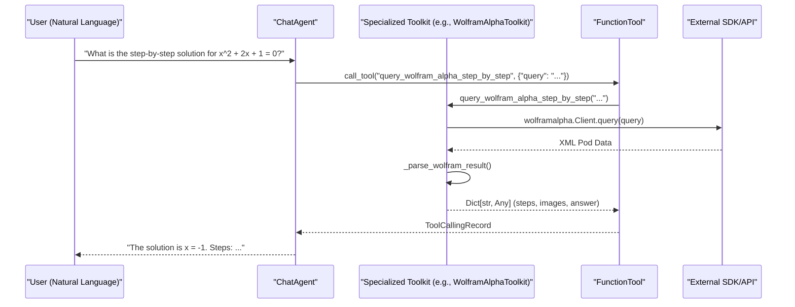

<!-- source: DeepWiki mcp.deepwiki.com · repo camel-ai/camel · page 4.8 Specialized Toolkits · fetched 2026-10-29 -->

# Specialized Toolkits

<details>
<summary>Relevant source files</summary>

The following files were used as context for generating this wiki page:

- [.camel/skills/skill-creator/SKILL.md](.camel/skills/skill-creator/SKILL.md)
- [.camel/skills/skill-creator/references/output-patterns.md](.camel/skills/skill-creator/references/output-patterns.md)
- [.camel/skills/skill-creator/references/workflows.md](.camel/skills/skill-creator/references/workflows.md)
- [.camel/skills/skill-creator/scripts/init_skill.py](.camel/skills/skill-creator/scripts/init_skill.py)
- [.camel/skills/skill-creator/scripts/package_skill.py](.camel/skills/skill-creator/scripts/package_skill.py)
- [.camel/skills/skill-creator/scripts/quick_validate.py](.camel/skills/skill-creator/scripts/quick_validate.py)
- [camel/toolkits/agent_toolkit.py](camel/toolkits/agent_toolkit.py)
- [camel/toolkits/arxiv_toolkit.py](camel/toolkits/arxiv_toolkit.py)
- [camel/toolkits/ask_news_toolkit.py](camel/toolkits/ask_news_toolkit.py)
- [camel/toolkits/dappier_toolkit.py](camel/toolkits/dappier_toolkit.py)
- [camel/toolkits/google_scholar_toolkit.py](camel/toolkits/google_scholar_toolkit.py)
- [camel/toolkits/human_toolkit.py](camel/toolkits/human_toolkit.py)
- [camel/toolkits/linkedin_toolkit.py](camel/toolkits/linkedin_toolkit.py)
- [camel/toolkits/meshy_toolkit.py](camel/toolkits/meshy_toolkit.py)
- [camel/toolkits/notion_toolkit.py](camel/toolkits/notion_toolkit.py)
- [camel/toolkits/openbb_toolkit.py](camel/toolkits/openbb_toolkit.py)
- [camel/toolkits/planning_worktree_toolkit.py](camel/toolkits/planning_worktree_toolkit.py)
- [camel/toolkits/skill_toolkit.py](camel/toolkits/skill_toolkit.py)
- [camel/toolkits/stripe_toolkit.py](camel/toolkits/stripe_toolkit.py)
- [camel/toolkits/todo_toolkit.py](camel/toolkits/todo_toolkit.py)
- [camel/toolkits/web_fetch_toolkit.py](camel/toolkits/web_fetch_toolkit.py)
- [camel/toolkits/wolfram_alpha_toolkit.py](camel/toolkits/wolfram_alpha_toolkit.py)
- [camel/toolkits/zapier_toolkit.py](camel/toolkits/zapier_toolkit.py)
- [camel/utils/mcp.py](camel/utils/mcp.py)
- [docs/cookbooks/advanced_features/agent_generate_structured_output.ipynb](docs/cookbooks/advanced_features/agent_generate_structured_output.ipynb)
- [docs/cookbooks/advanced_features/agents_with_MCP.ipynb](docs/cookbooks/advanced_features/agents_with_MCP.ipynb)
- [docs/cookbooks/advanced_features/agents_with_oceanbase_advanced_usage.ipynb](docs/cookbooks/advanced_features/agents_with_oceanbase_advanced_usage.ipynb)
- [docs/cookbooks/advanced_features/agents_with_oceanbase_advanced_usage.md](docs/cookbooks/advanced_features/agents_with_oceanbase_advanced_usage.md)
- [docs/cookbooks/advanced_features/agents_with_tools_from_ACI.ipynb](docs/cookbooks/advanced_features/agents_with_tools_from_ACI.ipynb)
- [docs/cookbooks/advanced_features/index.rst](docs/cookbooks/advanced_features/index.rst)
- [docs/mcp/connecting_existing_mcp_tools.md](docs/mcp/connecting_existing_mcp_tools.md)
- [docs/mintlify/cookbooks/advanced_features/agents_with_oceanbase_advanced_usage.mdx](docs/mintlify/cookbooks/advanced_features/agents_with_oceanbase_advanced_usage.mdx)
- [docs/mintlify/reference/camel.toolkits.human_toolkit.mdx](docs/mintlify/reference/camel.toolkits.human_toolkit.mdx)
- [examples/models/qwq_model_example.py](examples/models/qwq_model_example.py)
- [examples/toolkits/ask_news_toolkit.py](examples/toolkits/ask_news_toolkit.py)
- [examples/toolkits/dappier_toolkit.py](examples/toolkits/dappier_toolkit.py)
- [examples/toolkits/human_toolkit.py](examples/toolkits/human_toolkit.py)
- [examples/toolkits/meshy_toolkit.py](examples/toolkits/meshy_toolkit.py)
- [examples/toolkits/openbb_toolkit.py](examples/toolkits/openbb_toolkit.py)
- [examples/toolkits/skill_toolkit.py](examples/toolkits/skill_toolkit.py)
- [examples/toolkits/wolfram_alpha_toolkit.py](examples/toolkits/wolfram_alpha_toolkit.py)
- [examples/toolkits/zapier_toolkit.py](examples/toolkits/zapier_toolkit.py)
- [test/toolkits/test_arxiv_functions.py](test/toolkits/test_arxiv_functions.py)
- [test/toolkits/test_asknews_function.py](test/toolkits/test_asknews_function.py)
- [test/toolkits/test_dappier_function.py](test/toolkits/test_dappier_function.py)
- [test/toolkits/test_linkedin_function.py](test/toolkits/test_linkedin_function.py)
- [test/toolkits/test_meshy_function.py](test/toolkits/test_meshy_function.py)
- [test/toolkits/test_notion_toolkit.py](test/toolkits/test_notion_toolkit.py)
- [test/toolkits/test_openbb_functions.py](test/toolkits/test_openbb_functions.py)
- [test/toolkits/test_planning_worktree_toolkit.py](test/toolkits/test_planning_worktree_toolkit.py)
- [test/toolkits/test_skill_toolkit.py](test/toolkits/test_skill_toolkit.py)
- [test/toolkits/test_stripe_function.py](test/toolkits/test_stripe_function.py)
- [test/toolkits/test_wolframalpha_toolkit.py](test/toolkits/test_wolframalpha_toolkit.py)
- [test/toolkits/test_zapier_ai_function.py](test/toolkits/test_zapier_ai_function.py)
- [test/utils/test_mcp.py](test/utils/test_mcp.py)

</details>


## Purpose and Scope

This document covers **specialized toolkits** that provide domain-specific capabilities for mathematical computation, academic research, financial analysis, scientific data processing, human interaction, and planning. These toolkits extend CAMEL-AI's functionality into specialized domains requiring expert knowledge, access to domain-specific APIs, or structured task execution.

**Covered toolkits:**
- **Mathematical/Computational:** `MathToolkit`, `SymPyToolkit`, `NetworkXToolkit`, `WolframAlphaToolkit`
- **Academic Research:** `ArxivToolkit`, `GoogleScholarToolkit`, `SemanticScholarToolkit`, `PubMedToolkit`
- **Financial:** `OpenBBToolkit`
- **Scientific Data:** `DataCommonsToolkit`, `EarthScienceToolkit`
- **Interaction & Workflow:** `SkillToolkit`, `HumanToolkit`
- **Planning & State:** `PlanningWorktreeToolkit`

For general toolkit architecture and base classes, see [Toolkit System Architecture](#4.1).

**Sources:** [camel/toolkits/__init__.py:23-102](), [camel/toolkits/human_toolkit.py:24-30](), [camel/toolkits/skill_toolkit.py:27-31]()

---

## Toolkit Architecture and Integration

### Specialized Toolkit Hierarchy

```mermaid
graph TB
    BaseToolkit["BaseToolkit<br/>(Abstract Base)"]
    
    subgraph "Mathematical Computing"
        MathToolkit["MathToolkit<br/>Basic math operations"]
        SymPyToolkit["SymPyToolkit<br/>Symbolic mathematics"]
        NetworkXToolkit["NetworkXToolkit<br/>Graph algorithms"]
        WolframAlpha["WolframAlphaToolkit<br/>Computational engine API"]
    end
    
    subgraph "Academic Research"
        ArxivToolkit["ArxivToolkit<br/>Preprint search"]
        GoogleScholar["GoogleScholarToolkit<br/>Citation search"]
        SemanticScholar["SemanticScholarToolkit<br/>Semantic paper search"]
        PubMedToolkit["PubMedToolkit<br/>Biomedical literature"]
    end
    
    subgraph "Financial & Scientific"
        OpenBBToolkit["OpenBBToolkit<br/>Market data"]
        DataCommons["DataCommonsToolkit<br/>Public datasets"]
    end

    subgraph "Workflow & Human"
        HumanToolkit["HumanToolkit<br/>Human-in-the-loop"]
        SkillToolkit["SkillToolkit<br/>SKILL.md discovery"]
        PlanningToolkit["PlanningWorktreeToolkit<br/>Git worktree planning"]
    end
    
    BaseToolkit --> MathToolkit
    BaseToolkit --> SymPyToolkit
    BaseToolkit --> NetworkXToolkit
    BaseToolkit --> WolframAlpha
    BaseToolkit --> ArxivToolkit
    BaseToolkit --> GoogleScholar
    BaseToolkit --> SemanticScholar
    BaseToolkit --> PubMedToolkit
    BaseToolkit --> OpenBBToolkit
    BaseToolkit --> DataCommons
    BaseToolkit --> HumanToolkit
    BaseToolkit --> SkillToolkit
    BaseToolkit --> PlanningToolkit
```



**Diagram: Specialized Toolkit Class Hierarchy**

All specialized toolkits inherit from `BaseToolkit` and follow common integration patterns: dependency validation via decorators, function wrapping as `FunctionTool` objects, and integration with `ChatAgent`. Several toolkits are also decorated with `@MCPServer()` to allow exposure via the Model Context Protocol [camel/utils/mcp.py:133-168]().

**Sources:** [camel/toolkits/__init__.py:23-102](), [camel/toolkits/base.py:25-30](), [camel/toolkits/human_toolkit.py:24](), [camel/toolkits/skill_toolkit.py:27](), [camel/toolkits/arxiv_toolkit.py:25-26](), [camel/toolkits/wolfram_alpha_toolkit.py:25-26]()

---

## Mathematical and Computational Toolkits

### WolframAlphaToolkit

`WolframAlphaToolkit` interfaces with the **Wolfram Alpha API** for computational knowledge. It provides three primary methods: `query_wolfram_alpha` for simple answers, `query_wolfram_alpha_step_by_step` for detailed breakdowns including image URLs and subpod data, and `query_wolfram_alpha_llm` for LLM-optimized plaintext responses via the Wolfram LLM-API endpoint [camel/toolkits/wolfram_alpha_toolkit.py:105-132]().

#### Configuration

| Environment Variable | Required | Purpose |
|---------------------|----------|---------|
| `WOLFRAMALPHA_APP_ID` | Yes | API authentication [camel/toolkits/wolfram_alpha_toolkit.py:51-54]() |

```python
# Usage in ChatAgent
tools = [WolframAlphaToolkit().query_wolfram_alpha]
agent = ChatAgent(system_message=msg, model=model, tools=tools)
```

**Sources:** [camel/toolkits/wolfram_alpha_toolkit.py:26-105](), [examples/toolkits/wolfram_alpha_toolkit.py:28-34]()

---

## Interaction and Workflow Toolkits

### HumanToolkit

The `HumanToolkit` enables "Human-in-the-loop" interactions, allowing agents to pause execution to ask for clarification or provide status updates.

| Method | Type | Purpose |
|--------|------|---------|
| `ask_human_via_console` | Two-way | Asks a question and waits for user `input()`. [camel/toolkits/human_toolkit.py:32-53]() |
| `send_message_to_user` | One-way | Prints a tidy message to inform the user of progress without requiring a response. [camel/toolkits/human_toolkit.py:55-77]() |

**Sources:** [camel/toolkits/human_toolkit.py:32-77]()

### SkillToolkit

`SkillToolkit` is designed for the "Code-as-Prompt" philosophy. It scans a `working_directory` for `.camel/skills/` folders containing `SKILL.md` files.

- **Discovery:** Scans filesystem for skill metadata including name, description, and associated files [camel/toolkits/skill_toolkit.py:156-190]().
- **Progressive Disclosure:** Only the skill description is initially in context via `_build_description`. The agent must call `load_skill` to read the full Markdown instructions to keep the context window efficient [camel/toolkits/skill_toolkit.py:52-139]().
- **Bundled Resources:** Skills can reference `scripts/`, `references/`, and `assets/` which are listed in the tool schema [camel/toolkits/skill_toolkit.py:84-100]().

**Sources:** [camel/toolkits/skill_toolkit.py:27-140](), [test/toolkits/test_skill_toolkit.py:77-110](), [.camel/skills/skill-creator/SKILL.md:31-41]()

---

## Planning and State Toolkits

### PlanningWorktreeToolkit

`PlanningWorktreeToolkit` manages a specialized workflow where agents create a plan in a Markdown file and execute it within isolated Git worktrees.

1. **Plan Mode:** Activated via `planning_enter_plan_mode()`, which creates `.camel-plan.md` [camel/toolkits/planning_worktree_toolkit.py:107-134]().
2. **Worktree Isolation:** Uses `git worktree` to create clean environments for task execution, preventing interference with the main branch [camel/toolkits/planning_worktree_toolkit.py:182-220]().
3. **Concurrency Control:** Implements a class-level `_plan_locks` registry to ensure thread-safe writes to the plan file when multiple agents share a directory [camel/toolkits/planning_worktree_toolkit.py:54-86]().

**Sources:** [camel/toolkits/planning_worktree_toolkit.py:32-105]()

---

## Academic Research Toolkits

### ArxivToolkit & GoogleScholarToolkit

These toolkits provide programmatic access to research papers.

| Toolkit | Primary Use Case | Key Method |
|---------|------------------|------------|
| `ArxivToolkit` | Fetching preprints and extracting text from PDFs using `arxiv2text`. | `search_papers` [camel/toolkits/arxiv_toolkit.py:71-126]() |
| `GoogleScholarToolkit` | Retrieving author details and publication lists via `scholarly`. | `get_author_detailed_info` [camel/toolkits/google_scholar_toolkit.py:117-136]() |

`ArxivToolkit` specifically handles PDF extraction to provide `paper_text` to the agent [camel/toolkits/arxiv_toolkit.py:109-122](). `GoogleScholarToolkit` supports proxy usage to handle rate-limiting when scraping citation data [camel/toolkits/google_scholar_toolkit.py:64-74]().

**Sources:** [camel/toolkits/arxiv_toolkit.py:26-37](), [camel/toolkits/google_scholar_toolkit.py:23-45]()

---

## Financial Analysis Toolkits

### OpenBBToolkit

Integrates the **OpenBB Platform** into CAMEL. It provides access to stocks, options, crypto, and fundamental data.


**Sources:** [camel/toolkits/openbb_toolkit.py:23-50](), [examples/toolkits/openbb_toolkit.py:15-30]()

---

## Data Flow: Natural Language to Specialized Code

This diagram illustrates how a natural language request is routed through specialized toolkits to concrete code entities.



**Sources:** [camel/toolkits/wolfram_alpha_toolkit.py:69-98](), [camel/toolkits/wolfram_alpha_toolkit.py:133-191](), [examples/toolkits/wolfram_alpha_toolkit.py:67-71]()

---

## Summary Table of Specialized Features

| Toolkit | Core Dependency | Key Logic |
|---------|-----------------|-----------|
| `SymPyToolkit` | `sympy` | Symbolic algebraic manipulation. |
| `NetworkXToolkit` | `networkx` | Graph construction and pathfinding. |
| `HumanToolkit` | `builtins` | `input()` and `print()` orchestration [camel/toolkits/human_toolkit.py:51-75](). |
| `SkillToolkit` | `pathlib`, `yaml` | Filesystem-based skill discovery and YAML metadata parsing [camel/toolkits/skill_toolkit.py:15-22](). |
| `PlanningWorktreeToolkit` | `git`, `subprocess` | Git worktree lifecycle management via subprocess [camel/toolkits/planning_worktree_toolkit.py:94-105](). |
| `ArxivToolkit` | `arxiv`, `arxiv2text` | PDF extraction and metadata retrieval [camel/toolkits/arxiv_toolkit.py:31-37](). |

**Sources:** [camel/toolkits/skill_toolkit.py:15-22](), [camel/toolkits/planning_worktree_toolkit.py:15-28](), [camel/toolkits/human_toolkit.py:15-21](), [camel/toolkits/arxiv_toolkit.py:31-37]()

---

