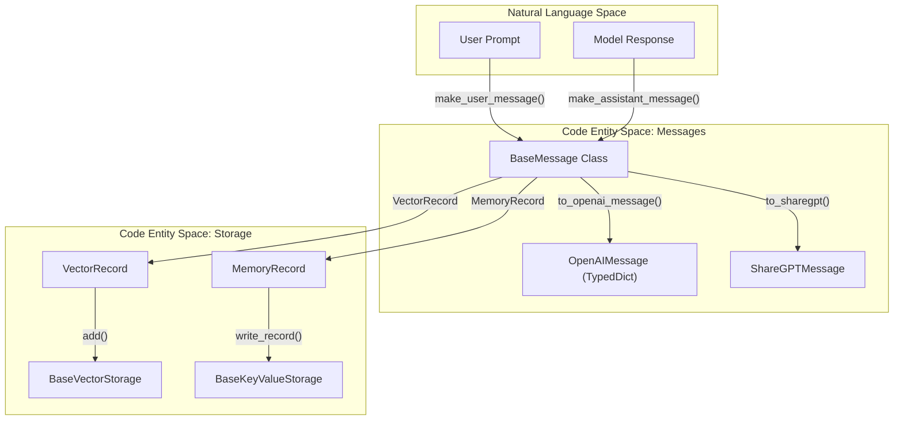
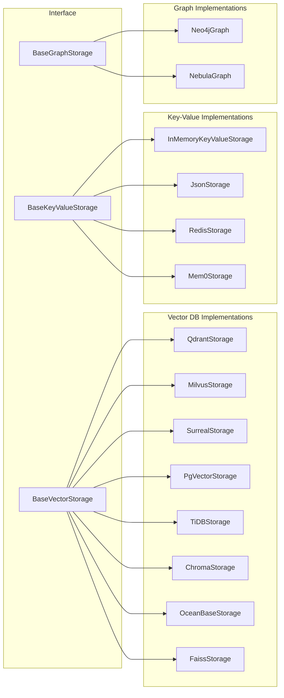

<!-- source: DeepWiki mcp.deepwiki.com · repo camel-ai/camel · page 5 Data and Message Systems · fetched 2026-10-29 -->

# Data and Message Systems

Relevant source files

The following files were used as context for generating this wiki page:

- [camel/caches/__init__.py](camel/caches/__init__.py)
- [camel/caches/base.py](camel/caches/base.py)
- [camel/caches/semantic_cache.py](camel/caches/semantic_cache.py)
- [camel/messages/base.py](camel/messages/base.py)
- [camel/prompts/__init__.py](camel/prompts/__init__.py)
- [camel/prompts/task_prompt_template.py](camel/prompts/task_prompt_template.py)
- [camel/storages/__init__.py](camel/storages/__init__.py)
- [camel/storages/key_value_storages/__init__.py](camel/storages/key_value_storages/__init__.py)
- [camel/storages/vectordb_storages/__init__.py](camel/storages/vectordb_storages/__init__.py)
- [camel/storages/vectordb_storages/faiss.py](camel/storages/vectordb_storages/faiss.py)
- [camel/storages/vectordb_storages/pgvector.py](camel/storages/vectordb_storages/pgvector.py)
- [camel/storages/vectordb_storages/surreal.py](camel/storages/vectordb_storages/surreal.py)
- [camel/types/__init__.py](camel/types/__init__.py)
- [camel/types/openai_types.py](camel/types/openai_types.py)
- [docs/camel.storages.vectordb_storages.rst](docs/camel.storages.vectordb_storages.rst)
- [examples/caches/semantic_cache_example.py](examples/caches/semantic_cache_example.py)
- [examples/storages/surreal_vector_storage.py](examples/storages/surreal_vector_storage.py)
- [examples/vision/video_description.py](examples/vision/video_description.py)
- [test/caches/test_semantic_cache.py](test/caches/test_semantic_cache.py)
- [test/messages/test_chat_message.py](test/messages/test_chat_message.py)
- [test/messages/test_message_base.py](test/messages/test_message_base.py)
- [test/storages/vector_storages/test_faiss.py](test/storages/vector_storages/test_faiss.py)
- [test/storages/vector_storages/test_pgvector.py](test/storages/vector_storages/test_pgvector.py)
- [test/storages/vector_storages/test_surreal.py](test/storages/vector_storages/test_surreal.py)
- [test/utils/test_token_counting.py](test/utils/test_token_counting.py)

This page provides an overview of how the CAMEL framework handles data, structured messages, and knowledge storage. It covers the core message abstractions, the multi-backend storage system, data loading utilities, and the embedding layer.

For details on how these systems integrate with agents, see [Agent Memory System](#2.2). For the underlying LLM communication, see [Model Integration System](#3).

## Overview

The data and message architecture is designed to bridge the gap between "Natural Language Space" (prompts, conversations) and "Code Entity Space" (structured objects, database records).

**Data and Message Architecture**

Sources:
- [camel/messages/base.py:55-90]()
- [camel/types/enums.py:14-32]()
- [camel/messages/base.py:93-106]()
- [camel/messages/base.py:139-152]()

## Message System

The message system is centered around the `BaseMessage` class, which serves as the universal container for text, metadata, and multimodal content. It provides a unified interface for converting between different platform-specific formats.

### Core Message Types
- **BaseMessage**: The primary class used throughout the framework. It supports multimodal data via `image_list` and `video_bytes` [camel/messages/base.py:85-86](). It also handles reasoning traces via `reasoning_content` [camel/messages/base.py:90-90]() and structured data via `parsed` [camel/messages/base.py:89-89]().
- **OpenAIMessage**: A set of `TypedDict` structures (e.g., `ChatCompletionUserMessageParam`) used for direct API communication [camel/types/openai_types.py:39-53]().
- **ShareGPT**: Support for the ShareGPT format, facilitating dataset conversion [camel/messages/conversion.py:43-43]().

### Role Management
Messages are associated with specific roles defined in the `RoleType` enum [camel/types/enums.py:26-26]():
- `RoleType.ASSISTANT`: Messages generated by the AI agent.
- `RoleType.USER`: Messages generated by the human or a calling agent.
- `RoleType.EMBODIMENT`: Role for physical or simulated embodiment agents.

For details, see [Message System](#5.1).

Sources:
- [camel/messages/base.py:55-152]()
- [camel/types/__init__.py:14-32]()
- [test/messages/test_message_base.py:100-143]()

## Storage and Retrieval

CAMEL supports a wide array of storage backends for persistent memory and Retrieval Augmented Generation (RAG). These are split into Key-Value stores for structured metadata and Vector Databases for semantic search.

**Storage Implementation Mapping**

### Key Storage Classes
- **BaseVectorStorage**: Abstract base for similarity-based search. Implementations like `FaissStorage` [camel/storages/vectordb_storages/faiss.py:37-37]() and `SurrealStorage` [camel/storages/vectordb_storages/surreal.py:31-31]() handle semantic retrieval.
- **VectorRecord**: The standard unit of storage containing a `vector` (list of floats) and a `payload` (metadata dictionary) [camel/storages/vectordb_storages/base.py:20-20]().
- **BaseGraphStorage**: Interface for graph databases like `Neo4jGraph` and `NebulaGraph`, supporting triplet-based knowledge management [camel/storages/graph_storages/base.py:15-15]().

For details, see [Storage and Retrieval](#5.2).

Sources:
- [camel/storages/__init__.py:15-59]()
- [camel/storages/vectordb_storages/surreal.py:61-114]()
- [camel/storages/vectordb_storages/faiss.py:74-126]()

## Data Loaders

Data loaders facilitate the ingestion of external information into the CAMEL ecosystem. They transform raw files and web content into structured text or chunks suitable for embedding.

- **File Parsers**: Utilities handle specialized document types, including integration with external toolkits for parsing PDFs, Excel, and Markdown.
- **Web Scrapers**: Components like `Firecrawl` and `JinaURLReader` convert live web pages into LLM-friendly formats.
- **Dataset Generation**: Tools like `Alpaca` and `ShareGPT` collectors allow for the creation of synthetic datasets from agent interactions [camel/messages/conversion.py:43-43]().

For details, see [Data Loaders](#5.3).

Sources:
- [camel/messages/conversion.py:43-43]()
- [camel/types/enums.py:28-28]()

## Embeddings

The embedding system converts text and multimodal data into numerical vectors. This layer is crucial for the retrieval systems to function.

- **Text Embeddings**: Support for `OpenAIEmbedding` and `SentenceTransformersEmbedding` via the `BaseEmbedding` interface.
- **Vision-Language Models (VLM)**: Specialized embedding models for generating representations of images and videos.
- **Semantic Caching**: The `SemanticCache` utilizes embeddings to cache and retrieve responses based on semantic similarity rather than exact string matches [camel/caches/semantic_cache.py:21-21]().

For details, see [Embeddings](#5.4).

Sources:
- [camel/types/__init__.py:16-19]()
- [camel/types/enums.py:16-16]()
- [camel/caches/semantic_cache.py:21-45]()

---

