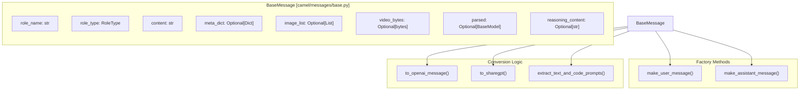
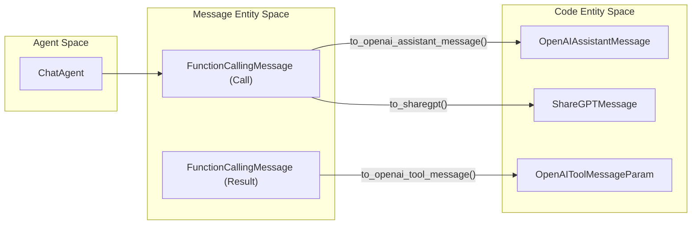
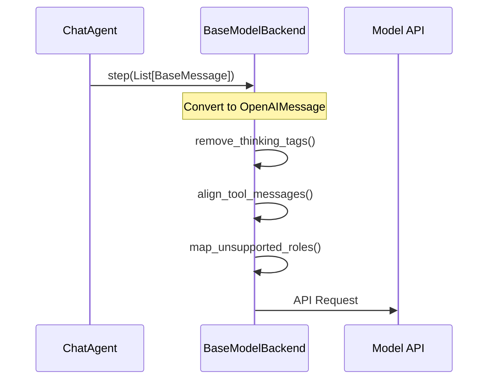

<!-- source: DeepWiki mcp.deepwiki.com · repo camel-ai/camel · page 5.1 Message System · fetched 2026-10-29 -->

# Message System

Relevant source files

The following files were used as context for generating this wiki page:

- [camel/configs/internlm_config.py](camel/configs/internlm_config.py)
- [camel/configs/openrouter_config.py](camel/configs/openrouter_config.py)
- [camel/configs/yi_config.py](camel/configs/yi_config.py)
- [camel/messages/__init__.py](camel/messages/__init__.py)
- [camel/messages/base.py](camel/messages/base.py)
- [camel/messages/conversion/__init__.py](camel/messages/conversion/__init__.py)
- [camel/messages/conversion/alpaca.py](camel/messages/conversion/alpaca.py)
- [camel/messages/conversion/conversation_models.py](camel/messages/conversion/conversation_models.py)
- [camel/messages/conversion/sharegpt/__init__.py](camel/messages/conversion/sharegpt/__init__.py)
- [camel/messages/conversion/sharegpt/function_call_formatter.py](camel/messages/conversion/sharegpt/function_call_formatter.py)
- [camel/messages/conversion/sharegpt/hermes/__init__.py](camel/messages/conversion/sharegpt/hermes/__init__.py)
- [camel/messages/conversion/sharegpt/hermes/hermes_function_formatter.py](camel/messages/conversion/sharegpt/hermes/hermes_function_formatter.py)
- [camel/messages/func_message.py](camel/messages/func_message.py)
- [camel/prompts/__init__.py](camel/prompts/__init__.py)
- [camel/prompts/task_prompt_template.py](camel/prompts/task_prompt_template.py)
- [camel/types/__init__.py](camel/types/__init__.py)
- [camel/types/openai_types.py](camel/types/openai_types.py)
- [examples/conversion.py](examples/conversion.py)
- [examples/vision/video_description.py](examples/vision/video_description.py)
- [test/data_collectors/test_alpaca_collector.py](test/data_collectors/test_alpaca_collector.py)
- [test/data_collectors/test_sharegpt_collector.py](test/data_collectors/test_sharegpt_collector.py)
- [test/messages/test_chat_message.py](test/messages/test_chat_message.py)
- [test/messages/test_func_message.py](test/messages/test_func_message.py)
- [test/messages/test_message_base.py](test/messages/test_message_base.py)
- [test/utils/test_token_counting.py](test/utils/test_token_counting.py)

The CAMEL message system provides a robust framework for handling multi-turn dialogues, tool interactions, and multimodal data. It serves as the bridge between high-level agent logic and low-level model API requirements, ensuring data integrity across memory storage, model inference, and data collection pipelines.

## Core Message Abstractions

The system is built around three primary message representations:
1.  **`BaseMessage`**: The high-level internal representation used by agents [camel/messages/base.py:54-90]().
2.  **`FunctionCallingMessage`**: A specialized subclass for tool execution and results [camel/messages/func_message.py:37-63]().
3.  **`OpenAIMessage`**: The standardized format for model backend communication, defined as a union of OpenAI-compatible `TypedDict` objects [camel/messages/__init__.py:36-44]().

### BaseMessage Structure

`BaseMessage` encapsulates role information, content, and multimedia data. It includes factory methods for creating specific message types and conversion methods for external formats.

**BaseMessage Class Overview**

Sources: [camel/messages/base.py:54-90](), [camel/messages/base.py:93-182]()

### Multimedia and Vision Support
`BaseMessage` supports multimodal inputs including images (PIL or URLs) and video bytes. It manages detail levels for vision models via `image_detail` and `video_detail` attributes.
- **Image Support**: Accepts `PIL.Image` objects or string URLs [camel/messages/base.py:67-69]().
- **Video Support**: Handles raw bytes for video frames [camel/messages/base.py:85]().
- **Detail Levels**: Uses `OpenAIVisionDetailType` (auto, low, high) for granular control over vision processing [camel/messages/base.py:100-105](), [camel/types/__init__.py:78]().

## Function and Tool Messages

Tool interactions are handled by the `FunctionCallingMessage` class. This class tracks function names, arguments, and execution results, facilitating the transition between "assistant" (requesting a tool) and "tool" (providing the result) roles.

**Function Calling Data Flow**

Sources: [camel/messages/func_message.py:37-63](), [camel/messages/func_message.py:125-181]()

### Key Features of FunctionCallingMessage:
- **Masking**: The `mask_output` flag allows sanitizing sensitive tool outputs into `[MASKED]` placeholders in both OpenAI and ShareGPT formats [camel/messages/func_message.py:116-123](), [camel/messages/func_message.py:172-175]().
- **Tool ID Tracking**: Maintains `tool_call_id` to correlate responses with specific requests in parallel execution [camel/messages/func_message.py:48-49]().
- **Extra Content**: Supports `extra_content` for passing non-standard data through tool calls [camel/messages/func_message.py:148-149]().

## Message Conversion and Formatting

### OpenAI Format Conversion
CAMEL standardizes communication using the OpenAI message format. `BaseMessage` and `FunctionCallingMessage` provide specialized methods to generate these structures:
- **`to_openai_assistant_message()`**: In `FunctionCallingMessage`, this structures the `tool_calls` list with the function name and JSON-serialized arguments [camel/messages/func_message.py:125-155]().
- **`to_openai_tool_message()`**: Converts execution results into the OpenAI "tool" role format [camel/messages/func_message.py:157-181]().

### ShareGPT and Data Collection
For training and dataset generation, CAMEL supports the ShareGPT format via `ShareGPTMessage` and `ShareGPTConversation`.
- **Validation**: `ShareGPTConversation` validates the logical flow, ensuring tool responses follow gpt messages containing tool calls [camel/messages/conversion/conversation_models.py:56-88]().
- **Formatting**: The `HermesFunctionFormatter` is the default for converting function calls into XML-like tags (`<tool_call>`) used by models like Hermes [camel/messages/func_message.py:98-111](), [camel/messages/conversion/sharegpt/hermes/hermes_function_formatter.py:114-153]().

Sources: [camel/messages/conversion/conversation_models.py:27-50](), [camel/messages/conversion/conversation_models.py:50-88](), [camel/messages/func_message.py:85-123]()

## Message Preprocessing

Before messages reach the LLM, they pass through a preprocessing pipeline. This step ensures model-specific constraints are met.

### Preprocessing Operations:
1.  **Thinking Tag Removal**: Reasoning models generate internal chains-of-thought wrapped in `<think>` tags. The system can remove these to prevent the model from seeing its own internal trace in history.
2.  **Tool Message Alignment**: Ensures that every `tool` role message is preceded by an `assistant` message containing a matching `tool_call_id`.
3.  **Role Adaptation**: The system maps internal `RoleType` to `OpenAIBackendRole` (system, user, assistant, tool) to ensure API compliance [camel/types/__init__.py:22](), [camel/messages/func_message.py:65-83]().

**Preprocessing Pipeline**

Sources: [camel/messages/func_message.py:65-83](), [camel/types/__init__.py:22-26]()

## Utility Functions

### Prompt Extraction
The `extract_text_and_code_prompts()` method separates natural language instructions from code blocks within a message's content [test/messages/test_message_base.py:61-86](). It returns lists of `TextPrompt` and `CodePrompt` objects. It raises a `ValueError` if it encounters an unclosed code fence [test/messages/test_message_base.py:88-102]().

### Operator Overloading
`BaseMessage` implements Python magic methods to simplify message manipulation:
- **`__add__`**: Concatenates message content [test/messages/test_message_base.py:42-44]().
- **`__mul__`**: Repeats message content [test/messages/test_message_base.py:47-49]().
- **`__contains__`**: Checks for substrings within content [test/messages/test_message_base.py:56-59]().
- **`__len__`**: Returns the length of the content string [test/messages/test_message_base.py:52-53]().

Sources: [test/messages/test_message_base.py:42-102](), [camel/messages/base.py:54-90]()

---

