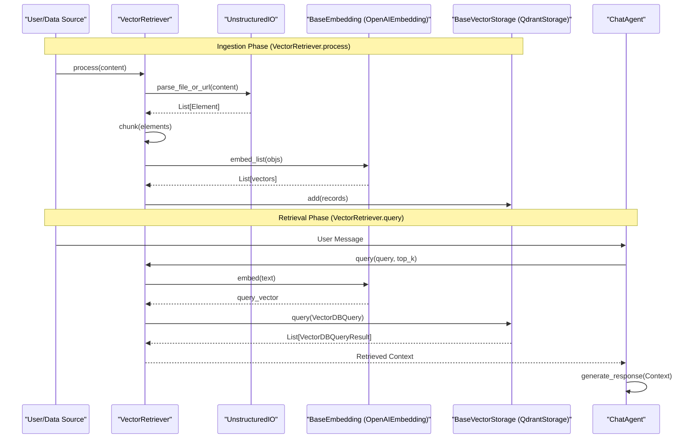

<!-- source: DeepWiki mcp.deepwiki.com · repo camel-ai/camel · page 5.2 Storage and Retrieval · fetched 2026-10-29 -->

# Storage and Retrieval

Relevant source files

The following files were used as context for generating this wiki page:

- [camel/caches/__init__.py](camel/caches/__init__.py)
- [camel/caches/base.py](camel/caches/base.py)
- [camel/caches/semantic_cache.py](camel/caches/semantic_cache.py)
- [camel/retrievers/__init__.py](camel/retrievers/__init__.py)
- [camel/retrievers/auto_retriever.py](camel/retrievers/auto_retriever.py)
- [camel/retrievers/base.py](camel/retrievers/base.py)
- [camel/retrievers/base_rerank.py](camel/retrievers/base_rerank.py)
- [camel/retrievers/bm25_retriever.py](camel/retrievers/bm25_retriever.py)
- [camel/retrievers/cohere_rerank_retriever.py](camel/retrievers/cohere_rerank_retriever.py)
- [camel/retrievers/hybrid_retrival.py](camel/retrievers/hybrid_retrival.py)
- [camel/retrievers/jina_rerank_retriever.py](camel/retrievers/jina_rerank_retriever.py)
- [camel/retrievers/vector_retriever.py](camel/retrievers/vector_retriever.py)
- [camel/storages/__init__.py](camel/storages/__init__.py)
- [camel/storages/key_value_storages/__init__.py](camel/storages/key_value_storages/__init__.py)
- [camel/storages/key_value_storages/mem0_cloud.py](camel/storages/key_value_storages/mem0_cloud.py)
- [camel/storages/key_value_storages/redis.py](camel/storages/key_value_storages/redis.py)
- [camel/storages/object_storages/amazon_s3.py](camel/storages/object_storages/amazon_s3.py)
- [camel/storages/object_storages/azure_blob.py](camel/storages/object_storages/azure_blob.py)
- [camel/storages/object_storages/google_cloud.py](camel/storages/object_storages/google_cloud.py)
- [camel/storages/vectordb_storages/__init__.py](camel/storages/vectordb_storages/__init__.py)
- [camel/storages/vectordb_storages/faiss.py](camel/storages/vectordb_storages/faiss.py)
- [camel/storages/vectordb_storages/milvus.py](camel/storages/vectordb_storages/milvus.py)
- [camel/storages/vectordb_storages/oceanbase.py](camel/storages/vectordb_storages/oceanbase.py)
- [camel/storages/vectordb_storages/pgvector.py](camel/storages/vectordb_storages/pgvector.py)
- [camel/storages/vectordb_storages/qdrant.py](camel/storages/vectordb_storages/qdrant.py)
- [camel/storages/vectordb_storages/surreal.py](camel/storages/vectordb_storages/surreal.py)
- [docs/camel.storages.vectordb_storages.rst](docs/camel.storages.vectordb_storages.rst)
- [docs/cookbooks/multi_agent_society/agents_society.md](docs/cookbooks/multi_agent_society/agents_society.md)
- [docs/mintlify/get_started/installation.mdx](docs/mintlify/get_started/installation.mdx)
- [docs/mintlify/key_modules/society.mdx](docs/mintlify/key_modules/society.mdx)
- [docs/mintlify/key_modules/storages.mdx](docs/mintlify/key_modules/storages.mdx)
- [docs/mintlify/reference/camel.caches.base.mdx](docs/mintlify/reference/camel.caches.base.mdx)
- [docs/mintlify/reference/camel.caches.semantic_cache.mdx](docs/mintlify/reference/camel.caches.semantic_cache.mdx)
- [docs/mintlify/reference/camel.storages.vectordb_storages.chroma.mdx](docs/mintlify/reference/camel.storages.vectordb_storages.chroma.mdx)
- [docs/mintlify/reference/camel.storages.vectordb_storages.pgvector.mdx](docs/mintlify/reference/camel.storages.vectordb_storages.pgvector.mdx)
- [docs/mintlify/reference/camel.storages.vectordb_storages.surreal.mdx](docs/mintlify/reference/camel.storages.vectordb_storages.surreal.mdx)
- [docs/mintlify/reference/camel.storages.vectordb_storages.weaviate.mdx](docs/mintlify/reference/camel.storages.vectordb_storages.weaviate.mdx)
- [examples/caches/semantic_cache_example.py](examples/caches/semantic_cache_example.py)
- [examples/rag/single_agent_with_hybrid_rag.py](examples/rag/single_agent_with_hybrid_rag.py)
- [examples/storages/oceanbase_vector_storage.py](examples/storages/oceanbase_vector_storage.py)
- [examples/storages/redis_storage.py](examples/storages/redis_storage.py)
- [examples/storages/surreal_vector_storage.py](examples/storages/surreal_vector_storage.py)
- [test/caches/test_semantic_cache.py](test/caches/test_semantic_cache.py)
- [test/loaders/test_base_io.py](test/loaders/test_base_io.py)
- [test/retrievers/test_auto_retriever.py](test/retrievers/test_auto_retriever.py)
- [test/retrievers/test_bm25_retriever.py](test/retrievers/test_bm25_retriever.py)
- [test/retrievers/test_cohere_rerank_retriever.py](test/retrievers/test_cohere_rerank_retriever.py)
- [test/retrievers/test_hybrid_retriever.py](test/retrievers/test_hybrid_retriever.py)
- [test/retrievers/test_jina_rerank_retriever.py](test/retrievers/test_jina_rerank_retriever.py)
- [test/retrievers/test_retrievers_decorators.py](test/retrievers/test_retrievers_decorators.py)
- [test/retrievers/test_vector_retriever.py](test/retrievers/test_vector_retriever.py)
- [test/storages/key_value_storages/test_mem0_cloud.py](test/storages/key_value_storages/test_mem0_cloud.py)
- [test/storages/key_value_storages/test_redis.py](test/storages/key_value_storages/test_redis.py)
- [test/storages/test_storages_decorators.py](test/storages/test_storages_decorators.py)
- [test/storages/vector_storages/test_all_vectordbs.py](test/storages/vector_storages/test_all_vectordbs.py)
- [test/storages/vector_storages/test_faiss.py](test/storages/vector_storages/test_faiss.py)
- [test/storages/vector_storages/test_milvus.py](test/storages/vector_storages/test_milvus.py)
- [test/storages/vector_storages/test_oceanbase.py](test/storages/vector_storages/test_oceanbase.py)
- [test/storages/vector_storages/test_pgvector.py](test/storages/vector_storages/test_pgvector.py)
- [test/storages/vector_storages/test_qdrant.py](test/storages/vector_storages/test_qdrant.py)
- [test/storages/vector_storages/test_surreal.py](test/storages/vector_storages/test_surreal.py)

This document covers CAMEL's storage backends and retrieval mechanisms that enable persistent data management and Retrieval-Augmented Generation (RAG) capabilities. These systems allow agents to store and efficiently query structured data, embeddings, and knowledge graphs to enhance their responses with external information.

## Overview

CAMEL provides a unified abstraction layer over multiple storage backends, allowing agents to persist and retrieve information across different data paradigms:

- **Vector Databases**: Store and query high-dimensional embeddings for semantic similarity search.
- **Graph Databases**: Model and traverse relationships between entities in knowledge graphs.
- **Key-Value Stores**: Fast access to structured data, metadata, and configuration.
- **Retrieval Systems**: Higher-level interfaces like `VectorRetriever` and `AutoRetriever` that bridge raw storage with agent logic.

## Storage Backend Architecture

CAMEL defines abstract base classes to ensure a consistent interface across various third-party database integrations.

### Storage Hierarchy and Code Association
The following diagram maps the logical storage types to their specific Python class implementations within the CAMEL codebase.

```mermaid
graph TD
    subgraph "Base Abstractions"
        BKV["BaseKeyValueStorage (camel/storages/key_value_storages/base.py)"]
        BVS["BaseVectorStorage (camel/storages/vectordb_storages/base.py)"]
        BGS["BaseGraphStorage (camel/storages/graph_storages/base.py)"]
    end

    subgraph "Key-Value Implementations"
        IMKV["InMemoryKeyValueStorage"]
        JS["JsonStorage"]
        RS["RedisStorage"]
        M0["Mem0Storage"]
    end

    subgraph "Vector Implementations"
        QS["QdrantStorage"]
        MS["MilvusStorage"]
        OBS["OceanBaseStorage"]
        PGV["PgVectorStorage"]
        SS["SurrealStorage"]
        TIDB["TiDBStorage"]
        CS["ChromaStorage"]
        FS["FaissStorage"]
        WS["WeaviateStorage"]
    end

    BKV --> IMKV
    BKV --> JS
    BKV --> RS
    BKV --> M0

    BVS --> QS
    BVS --> MS
    BVS --> OBS
    BVS --> PGV
    BVS --> SS
    BVS --> TIDB
    BVS --> CS
    BVS --> FS
    BVS --> WS
```

**Sources:** [camel/storages/key_value_storages/base.py:18-21](), [camel/storages/vectordb_storages/base.py:15-21](), [camel/storages/__init__.py:15-59](), [camel/storages/vectordb_storages/__init__.py:22-30]()

### Vector Database Support

Vector databases are central to RAG. All implementations inherit from `BaseVectorStorage` [camel/storages/vectordb_storages/base.py:32-35]() and use standard data structures like `VectorRecord` [camel/storages/vectordb_storages/base.py:27-30]() and `VectorDBQuery` [camel/storages/vectordb_storages/base.py:23-25]().

| Backend | Implementation Class | Primary Use Case |
| :--- | :--- | :--- |
| **Qdrant** | `QdrantStorage` | Fast similarity search with local or remote deployment [camel/storages/vectordb_storages/qdrant.py:36-69]() |
| **Milvus** | `MilvusStorage` | Cloud-native, high-performance vector search [camel/storages/vectordb_storages/milvus.py:27-56]() |
| **OceanBase** | `OceanBaseStorage` | Enterprise-grade distributed vector storage [camel/storages/vectordb_storages/oceanbase.py:33-58]() |
| **PostgreSQL** | `PgVectorStorage` | Vector search integrated with relational data via `pgvector` [camel/storages/vectordb_storages/pgvector.py:28-52]() |
| **SurrealDB** | `SurrealStorage` | Distributed storage with SQL-like syntax and HNSW indexing [camel/storages/vectordb_storages/surreal.py:31-59]() |
| **TiDB** | `TiDBStorage` | Hybrid vector/relational database for cloud-native apps [camel/storages/vectordb_storages/tidb.py:27-51]() |

#### SurrealDB Integration
`SurrealStorage` manages WebSocket connections to SurrealDB via `Surreal(self.url)` [camel/storages/vectordb_storages/surreal.py:110-112](). It automatically creates tables with HNSW indexes using `DEFINE INDEX ... HNSW` queries [camel/storages/vectordb_storages/surreal.py:164-171](). It converts `VectorRecord` objects into SurrealDB-compatible dictionaries for insertion using `_validate_and_convert_records` [camel/storages/vectordb_storages/surreal.py:123-135]().

#### OceanBase Integration
`OceanBaseStorage` utilizes the `pyobvector` client to interact with OceanBase Vector Database [camel/storages/vectordb_storages/oceanbase.py:35-61](). It supports multiple distance metrics including `l2`, `cosine`, and `inner_product` [camel/storages/vectordb_storages/oceanbase.py:72-74]().

### Key-Value Storage
Key-value stores handle non-vector data like metadata or configuration.
- **JsonStorage**: Provides human-readable persistence by saving Python lists of dictionaries to `.json` files [camel/storages/key_value_storages/json.py:23-41]().
- **InMemoryKeyValueStorage**: A non-persistent backend using a Python list, ideal for caching or testing [camel/storages/key_value_storages/in_memory.py:18-24]().
- **Mem0Storage**: A cloud-based memory storage using Mem0's API. It transforms `MemoryRecord` into dictionaries and manages them using `agent_id` and `user_id` filters [camel/storages/key_value_storages/mem0_cloud.py:30-47](), [camel/storages/key_value_storages/mem0_cloud.py:154-177]().

## Retrieval Systems

Retrievers sit between the storage layer and the agent, handling tasks like document chunking, embedding generation, and result ranking.

### VectorRetriever
The `VectorRetriever` uses an embedding model and a vector storage instance to find relevant information [camel/retrievers/vector_retriever.py:36-49]().

**Key Functions:**
- `process()`: Parses content (files, URLs, or strings), chunks it using `UnstructuredIOChunker`, generates embeddings via `embedding_model.embed_list()`, and stores them in the `storage` [camel/retrievers/vector_retriever.py:74-106](), [camel/retrievers/vector_retriever.py:156-160]().
- `query()`: Converts a string query into a vector and performs a similarity search in the storage backend, returning results as a list of dictionaries containing similarity scores and text [camel/retrievers/vector_retriever.py:214-230]().

### HybridRetriever
`HybridRetriever` combines results from `VectorRetriever` and `BM25Retriever` [camel/retrievers/hybrid_retrival.py:23-39](). It uses **Reciprocal Rank Fusion (RRF)** in `_sort_rrf_scores()` to merge and rank results from both semantic and keyword-based searches [camel/retrievers/hybrid_retrival.py:60-100](), [camel/retrievers/hybrid_retrival.py:142-154]().

### AutoRetriever
`AutoRetriever` simplifies the RAG process by automatically initializing the appropriate storage type based on the `StorageType` enum [camel/retrievers/auto_retriever.py:41-54](). It handles automatic collection name generation in `_collection_name_generator()` based on content path or URL hashing [camel/retrievers/auto_retriever.py:121-167]().

## Data Flow: From Content to Context

The following diagram shows how raw data is processed into vector storage and subsequently retrieved to provide context to a `ChatAgent`.

**Sources:** [camel/retrievers/vector_retriever.py:74-106](), [camel/retrievers/vector_retriever.py:214-230](), [camel/retrievers/auto_retriever.py:170-178]()

## Implementation Details

### Vector Storage Interface
All vector databases implement the `BaseVectorStorage` interface, which mandates the following methods:
- `add(records: List[VectorRecord])`: Inserts embeddings and payloads [camel/storages/vectordb_storages/base.py:37-46]().
- `query(query: VectorDBQuery)`: Performs similarity search [camel/storages/vectordb_storages/base.py:48-57]().
- `delete()`: Removes records by ID or clears the collection [camel/storages/vectordb_storages/base.py:59-71]().
- `status()`: Returns metadata like vector count and dimensions [camel/storages/vectordb_storages/base.py:73-77]().

### Embedding Integration
Retrievers rely on `BaseEmbedding` implementations (e.g., `OpenAIEmbedding`) to transform text into vectors before storage or querying [camel/retrievers/vector_retriever.py:63-69](). The vector dimension of the storage must match the output dimension of the embedding model [camel/retrievers/vector_retriever.py:67-69]().

### Storage-to-Code Mapping
The following table maps storage system concepts to specific CAMEL code entities.

| System Concept | Code Entity | File Path |
| :--- | :--- | :--- |
| **Abstract Storage** | `BaseVectorStorage` | `camel/storages/vectordb_storages/base.py` |
| **Data Record** | `VectorRecord` | `camel/storages/vectordb_storages/base.py` |
| **Search Query** | `VectorDBQuery` | `camel/storages/vectordb_storages/base.py` |
| **Search Result** | `VectorDBQueryResult` | `camel/storages/vectordb_storages/base.py` |
| **Retrieval Logic** | `VectorRetriever` | `camel/retrievers/vector_retriever.py` |
| **Cloud Memory** | `Mem0Storage` | `camel/storages/key_value_storages/mem0_cloud.py` |
| **Hybrid Search** | `HybridRetriever` | `camel/retrievers/hybrid_retrival.py` |

**Sources:** [camel/storages/vectordb_storages/base.py:15-30](), [camel/retrievers/vector_retriever.py:36-49](), [camel/storages/key_value_storages/mem0_cloud.py:30-47](), [camel/retrievers/hybrid_retrival.py:23-28]()

## Summary of Storage Backends

| Class | Backend | Persistence | Key Feature |
| :--- | :--- | :--- | :--- |
| `QdrantStorage` | Qdrant | Yes/Memory | Local path support or remote URL [camel/storages/vectordb_storages/qdrant.py:48-52]() |
| `MilvusStorage` | Milvus | Yes | Highly scalable for production [camel/storages/vectordb_storages/milvus.py:27-30]() |
| `SurrealStorage` | SurrealDB | Yes | SQL-like query capability over WebSockets [camel/storages/vectordb_storages/surreal.py:52-54]() |
| `PgVectorStorage`| Postgres | Yes | Relational + Vector hybrid [camel/storages/vectordb_storages/pgvector.py:28-30]() |
| `OceanBaseStorage`| OceanBase | Yes | Distributed HNSW index support [camel/storages/vectordb_storages/oceanbase.py:121-131]() |
| `JsonStorage` | Local File | Yes | Human-readable JSON persistence [camel/storages/key_value_storages/json.py:23-25]() |

**Sources:** [camel/storages/vectordb_storages/__init__.py:15-30](), [camel/storages/key_value_storages/__init__.py:18-22](), [camel/storages/vectordb_storages/oceanbase.py:35-58]()

---

