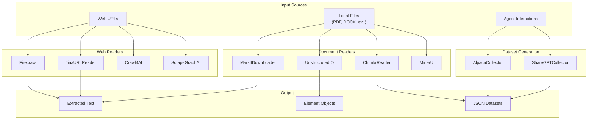
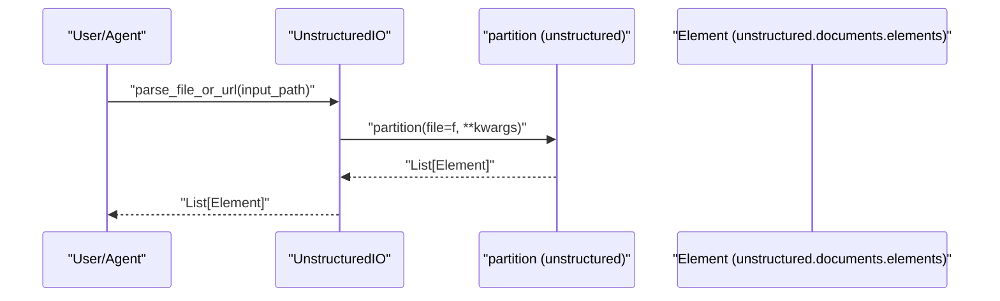
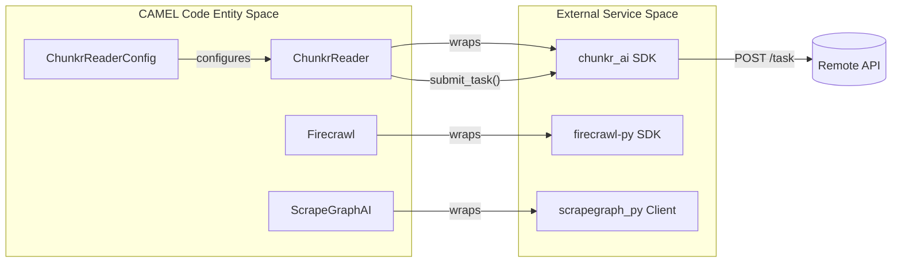

<!-- source: DeepWiki mcp.deepwiki.com · repo camel-ai/camel · page 5.3 Data Loaders · fetched 2026-10-29 -->

# Data Loaders

Relevant source files

The following files were used as context for generating this wiki page:

- [camel/loaders/__init__.py](camel/loaders/__init__.py)
- [camel/loaders/base_io.py](camel/loaders/base_io.py)
- [camel/loaders/chunkr_reader.py](camel/loaders/chunkr_reader.py)
- [camel/loaders/crawl4ai_reader.py](camel/loaders/crawl4ai_reader.py)
- [camel/loaders/firecrawl_reader.py](camel/loaders/firecrawl_reader.py)
- [camel/loaders/markitdown.py](camel/loaders/markitdown.py)
- [camel/loaders/scrapegraph_reader.py](camel/loaders/scrapegraph_reader.py)
- [camel/loaders/unstructured_io.py](camel/loaders/unstructured_io.py)
- [docs/mintlify/reference/camel.configs.deepseek_config.mdx](docs/mintlify/reference/camel.configs.deepseek_config.mdx)
- [docs/mintlify/reference/camel.loaders.chunkr_reader.mdx](docs/mintlify/reference/camel.loaders.chunkr_reader.mdx)
- [docs/mintlify/reference/camel.loaders.firecrawl_reader.mdx](docs/mintlify/reference/camel.loaders.firecrawl_reader.mdx)
- [docs/mintlify/reference/camel.loaders.jina_url_reader.mdx](docs/mintlify/reference/camel.loaders.jina_url_reader.mdx)
- [docs/mintlify/reference/camel.loaders.scrapegraph_reader.mdx](docs/mintlify/reference/camel.loaders.scrapegraph_reader.mdx)
- [docs/mintlify/reference/camel.models.aws_bedrock_model.mdx](docs/mintlify/reference/camel.models.aws_bedrock_model.mdx)
- [docs/mintlify/reference/camel.models.azure_openai_model.mdx](docs/mintlify/reference/camel.models.azure_openai_model.mdx)
- [docs/mintlify/reference/camel.models.deepseek_model.mdx](docs/mintlify/reference/camel.models.deepseek_model.mdx)
- [docs/mintlify/reference/camel.models.ollama_model.mdx](docs/mintlify/reference/camel.models.ollama_model.mdx)
- [docs/mintlify/reference/camel.models.vllm_model.mdx](docs/mintlify/reference/camel.models.vllm_model.mdx)
- [docs/mintlify/reference/camel.retrievers.bm25_retriever.mdx](docs/mintlify/reference/camel.retrievers.bm25_retriever.mdx)
- [docs/reference/camel.loaders.firecrawl_reader.md](docs/reference/camel.loaders.firecrawl_reader.md)
- [examples/loaders/chunkr_example.py](examples/loaders/chunkr_example.py)
- [examples/loaders/crawl4ai_example.py](examples/loaders/crawl4ai_example.py)
- [examples/loaders/firecrawl_example.py](examples/loaders/firecrawl_example.py)
- [examples/loaders/scrapegraph_example.py](examples/loaders/scrapegraph_example.py)
- [examples/models/role_playing_with_sambanova.py](examples/models/role_playing_with_sambanova.py)
- [test/loaders/test_chunkr_reader.py](test/loaders/test_chunkr_reader.py)
- [test/loaders/test_crawl4ai.py](test/loaders/test_crawl4ai.py)
- [test/loaders/test_firecrawl.py](test/loaders/test_firecrawl.py)
- [test/loaders/test_loaders_decorators.py](test/loaders/test_loaders_decorators.py)
- [test/loaders/test_scrapegraph_reader.py](test/loaders/test_scrapegraph_reader.py)

This document covers data loading utilities and dataset generation systems in CAMEL-AI. These utilities handle content acquisition from multiple sources including web URLs, local files, and remote datasets. The system provides specialized readers for modern web scraping, document parsing, and dataset preparation for agent training.

For storage backends and vector databases, see page 5.2. For message structures and processing, see page 5.1.

## Data Loading Architecture

CAMEL-AI provides multiple data loading utilities organized into general-purpose utilities, specialized document readers, and dataset collectors. The `camel.loaders` module acts as a central hub for these implementations.

### Data Loading Utilities Overview

Sources: [camel/loaders/__init__.py:15-42](), [camel/loaders/unstructured_io.py:35-43](), [camel/loaders/chunkr_reader.py:58-69]()

## Web and URL Readers

The framework supports several high-performance web readers for converting URLs into LLM-friendly formats.

### Firecrawl
The `Firecrawl` class allows turning entire websites into LLM-ready markdown. It supports complex operations including crawling subpages and structured scraping.

- **`crawl`**: Crawls a URL and all accessible subpages, returning a crawl job result [camel/loaders/firecrawl_reader.py:66-98]().
- **`scrape`**: Scrapes a single URL and returns full data as a dictionary [camel/loaders/firecrawl_reader.py:120-146]().
- **`structured_scrape`**: Uses an LLM to extract data into a specific Pydantic `response_format` [camel/loaders/firecrawl_reader.py:148-178]().
- **`map_site`**: Retrieves all accessible URLs from a site [camel/loaders/firecrawl_reader.py:179-210]().

### ScrapeGraphAI
The `ScrapeGraphAI` class enables AI-powered web scraping and searching using the ScrapeGraphAI API [camel/loaders/scrapegraph_reader.py:21-31]().

- **`search`**: Performs an AI-powered search using `client.searchscraper` and returns results with reference URLs [camel/loaders/scrapegraph_reader.py:50-70]().
- **`scrape`**: Extracts specific data from a URL using instructions provided in `user_prompt` [camel/loaders/scrapegraph_reader.py:72-100]().

### JinaURLReader and Crawl4AI
- **`JinaURLReader`**: Simple reader that utilizes Jina AI's service to convert web pages into clean markdown [camel/loaders/jina_url_reader.py:24-30]().
- **`Crawl4AI`**: An asynchronous web crawler designed for AI applications, supporting advanced extraction strategies [camel/loaders/crawl4ai_reader.py:24-31]().

Sources: [camel/loaders/firecrawl_reader.py:35-210](), [camel/loaders/scrapegraph_reader.py:21-104](), [camel/loaders/jina_url_reader.py:24-30](), [camel/loaders/crawl4ai_reader.py:24-31]()

## Specialized Document Processing

### UnstructuredIO
The `UnstructuredIO` class provides ETL for parsing, cleaning, and chunking unstructured data using the `unstructured` library [camel/loaders/unstructured_io.py:35-43]().

| Method | Description |
|-----------|----------|
| `create_element_from_text` | Manually creates a `Text` element with metadata and optional embeddings [camel/loaders/unstructured_io.py:47-97](). |
| `parse_file_or_url` | Loads a file or URL and parses it into `Element` objects [camel/loaders/unstructured_io.py:101-163](). |
| `parse_bytes` | Parses a bytes stream into elements using the `partition` function [camel/loaders/unstructured_io.py:166-191](). |

Sources: [camel/loaders/unstructured_io.py:35-191]()

### ChunkrReader
`ChunkrReader` connects to the Chunkr API for high-resolution OCR and layout-aware document segmentation [camel/loaders/chunkr_reader.py:58-69]().

- **`ChunkrReaderConfig`**: Configures `chunk_processing` (target length), `high_resolution` OCR, and `ocr_strategy` [camel/loaders/chunkr_reader.py:28-56]().
- **`submit_task`**: Asynchronously uploads a file to the API and returns a `task_id` [camel/loaders/chunkr_reader.py:86-115]().
- **`get_task_output`**: Polls for completion and returns the formatted JSON result [camel/loaders/chunkr_reader.py:117-154]().

Sources: [camel/loaders/chunkr_reader.py:28-154]()

### MarkItDownLoader
The `MarkItDownLoader` class converts a wide variety of file formats into Markdown format [camel/loaders/markitdown.py:24-43]().

- **Supported Formats**: PDF, Word (.doc, .docx), Excel (.xls, .xlsx), PowerPoint (.ppt, .pptx), EPUB, HTML, Images (OCR), Audio (Transcription), ZIP, and YouTube URLs [camel/loaders/markitdown.py:45-68]().
- **`convert_file`**: Validates the file extension and converts the content to Markdown text [camel/loaders/markitdown.py:107-140]().
- **`convert_files`**: Processes multiple files, supporting `parallel` execution via `ThreadPoolExecutor` [camel/loaders/markitdown.py:142-194]().

Sources: [camel/loaders/markitdown.py:24-194]()

## Data Flow and Entity Mapping

The following diagrams bridge the gap between high-level data loading concepts and the specific code entities responsible for them.

### Document Ingestion Flow
This diagram shows how a raw file (like a PDF) is transformed into structured elements within the `UnstructuredIO` system.

Sources: [camel/loaders/unstructured_io.py:101-163]()

### API-Based Reader Lifecycle
Mapping the interaction between CAMEL loaders and external service APIs (e.g., Firecrawl, Chunkr).

Sources: [camel/loaders/chunkr_reader.py:58-84](), [camel/loaders/firecrawl_reader.py:49-64](), [camel/loaders/scrapegraph_reader.py:39-48]()

## Dataset Generation and Collectors

CAMEL provides collectors to transform agent interactions into training datasets in Alpaca or ShareGPT formats.

### Base IO and File Abstractions
The framework defines a common `File` interface to handle different document types consistently [camel/loaders/base_io.py:66-78]().

- **`create_file`**: Factory function that maps file extensions to specific classes like `DocxFile`, `PdfFile`, `TxtFile`, `JsonFile`, or `HtmlFile` [camel/loaders/base_io.py:25-49]().
- **`PdfFile`**: Uses the `fitz` library to extract text and page numbers from PDF documents [camel/loaders/base_io.py:191-214]().
- **`DocxFile`**: Uses `docx2txt` to extract and clean text from Word documents [camel/loaders/base_io.py:159-188]().

Sources: [camel/loaders/base_io.py:25-214]()

## Summary of Reader Capabilities

| Reader | Primary Input | Output Format | Key Feature |
|--------|---------------|---------------|-------------|
| `UnstructuredIO` | Local/URL | `List[Element]` | Partitioning, cleaning, and metadata handling [camel/loaders/unstructured_io.py:35-43]() |
| `Firecrawl` | URL | Markdown/JSON | Full site crawling and structured LLM extraction [camel/loaders/firecrawl_reader.py:36-46]() |
| `ChunkrReader` | PDF/Images | JSON | High-res OCR and asynchronous task polling [camel/loaders/chunkr_reader.py:58-69]() |
| `ScrapeGraphAI` | URL/Prompt | Dict/JSON | AI-powered search and smart scraping [camel/loaders/scrapegraph_reader.py:21-31]() |
| `MarkItDownLoader` | Office Docs | Markdown | Support for 20+ formats including Audio/Video [camel/loaders/markitdown.py:24-68]() |

Sources: [camel/loaders/__init__.py:27-42](), [camel/loaders/unstructured_io.py:35-43](), [camel/loaders/firecrawl_reader.py:36-46](), [camel/loaders/chunkr_reader.py:58-69](), [camel/loaders/markitdown.py:24-68]()

---

