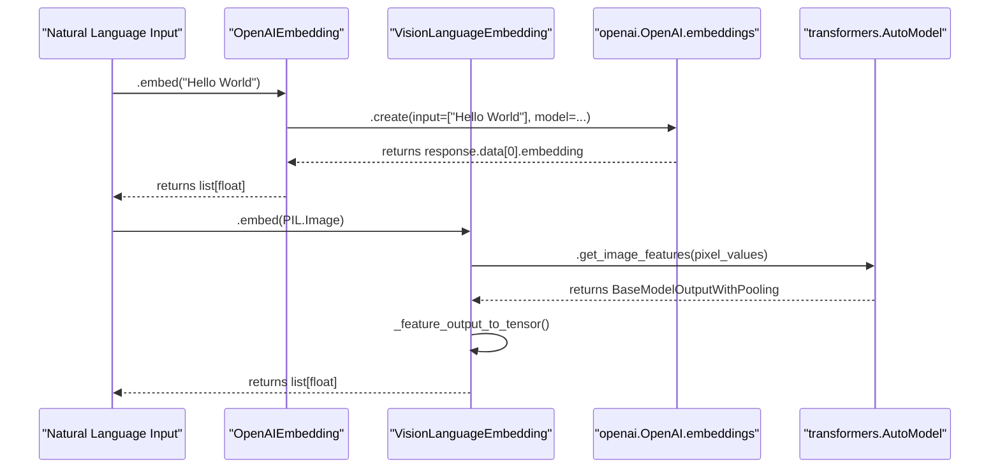
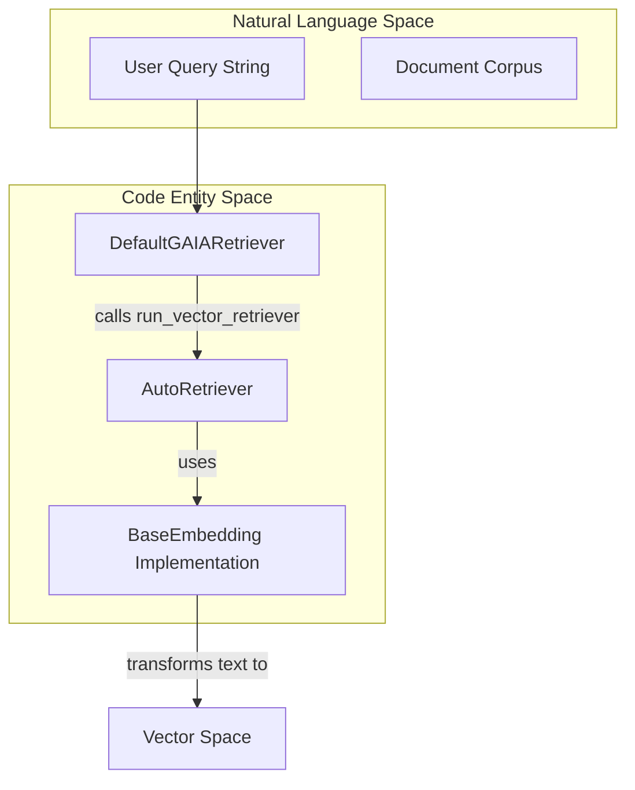

<!-- source: DeepWiki mcp.deepwiki.com · repo camel-ai/camel · page 5.4 Embeddings · fetched 2026-10-29 -->

# Embeddings

<details>
<summary>Relevant source files</summary>

The following files were used as context for generating this wiki page:

- [camel/benchmarks/__init__.py](camel/benchmarks/__init__.py)
- [camel/benchmarks/apibank.py](camel/benchmarks/apibank.py)
- [camel/benchmarks/apibench.py](camel/benchmarks/apibench.py)
- [camel/benchmarks/gaia.py](camel/benchmarks/gaia.py)
- [camel/benchmarks/mock_website/mock_web.py](camel/benchmarks/mock_website/mock_web.py)
- [camel/benchmarks/nexus.py](camel/benchmarks/nexus.py)
- [camel/embeddings/__init__.py](camel/embeddings/__init__.py)
- [camel/embeddings/azure_embedding.py](camel/embeddings/azure_embedding.py)
- [camel/embeddings/base.py](camel/embeddings/base.py)
- [camel/embeddings/gemini_embedding.py](camel/embeddings/gemini_embedding.py)
- [camel/embeddings/jina_embedding.py](camel/embeddings/jina_embedding.py)
- [camel/embeddings/mistral_embedding.py](camel/embeddings/mistral_embedding.py)
- [camel/embeddings/openai_compatible_embedding.py](camel/embeddings/openai_compatible_embedding.py)
- [camel/embeddings/openai_embedding.py](camel/embeddings/openai_embedding.py)
- [camel/embeddings/sentence_transformers_embeddings.py](camel/embeddings/sentence_transformers_embeddings.py)
- [camel/embeddings/together_embedding.py](camel/embeddings/together_embedding.py)
- [camel/embeddings/vlm_embedding.py](camel/embeddings/vlm_embedding.py)
- [camel/models/reward/skywork_model.py](camel/models/reward/skywork_model.py)
- [examples/benchmarks/apibank.py](examples/benchmarks/apibank.py)
- [examples/benchmarks/apibench.py](examples/benchmarks/apibench.py)
- [examples/benchmarks/nexus.py](examples/benchmarks/nexus.py)
- [examples/embeddings/openai_compatible_embedding_example.py](examples/embeddings/openai_compatible_embedding_example.py)
- [test/embeddings/test_embeddings_decorators.py](test/embeddings/test_embeddings_decorators.py)
- [test/embeddings/test_openai_compatible_embedding.py](test/embeddings/test_openai_compatible_embedding.py)
- [test/embeddings/test_openai_embedding.py](test/embeddings/test_openai_embedding.py)

</details>


The embedding system in CAMEL-AI provides a unified interface for transforming various data types—primarily text and images—into high-dimensional numerical vectors. These embeddings are essential for downstream tasks such as semantic search, vector database storage, and retrieval-augmented generation (RAG). The system is built on a generic base class and supports a wide range of providers including OpenAI, Azure, Mistral, Together AI, Gemini, Jina, and local open-source models via Sentence Transformers.

## Architecture and Base Abstraction

The embedding system follows a provider-agnostic design where all specific implementations inherit from `BaseEmbedding`. This class uses Python Generics to define the type of input it can process (e.g., `str` for text models or `Union[str, Image.Image]` for multimodal models).

### BaseEmbedding Interface
The `BaseEmbedding` class defines the core contract for all embedding models:
- `embed_list(objs, **kwargs)`: The primary abstract method that processes a batch of objects and returns a list of float vectors [[camel/embeddings/base.py:25-41]()] .
- `embed(obj, **kwargs)`: A convenience method that wraps `embed_list` to process a single object [[camel/embeddings/base.py:43-58]()] .
- `get_output_dim()`: An abstract method to retrieve the dimensionality of the vectors produced by the model [[camel/embeddings/base.py:60-67]()] .

### Embedding System Class Diagram
The following diagram illustrates the relationship between the base abstraction and its concrete implementations.

**Embedding Class Hierarchy**
```mermaid
classDiagram
    class "BaseEmbedding[T]" {
        <<abstract>>
        +embed_list(objs: list[T]) list[list[float]]
        +embed(obj: T) list[float]
        +get_output_dim() int
    }
    
    class "OpenAIEmbedding" {
        -client: OpenAI
        -output_dim: int
        +embed_list(objs: list[str])
    }
    
    class "VisionLanguageEmbedding" {
        -model: AutoModel
        -processor: AutoProcessor
        +embed_list(objs: list[Union[str, Image.Image]])
    }
    
    class "SentenceTransformerEncoder" {
        -model: SentenceTransformer
        +embed_list(objs: list[str])
    }

    "BaseEmbedding[T]" <|-- "OpenAIEmbedding"
    "BaseEmbedding[T]" <|-- "VisionLanguageEmbedding"
    "BaseEmbedding[T]" <|-- "SentenceTransformerEncoder"
    "BaseEmbedding[T]" <|-- "OpenAICompatibleEmbedding"
    "BaseEmbedding[T]" <|-- "JinaEmbedding"
    "BaseEmbedding[T]" <|-- "AzureEmbedding"
    "BaseEmbedding[T]" <|-- "TogetherEmbedding"
```
Sources: [[camel/embeddings/base.py:22-67]()], [[camel/embeddings/openai_embedding.py:26-58]()], [[camel/embeddings/vlm_embedding.py:58-103]()], [[camel/embeddings/sentence_transformers_embeddings.py:22-47]()], [[camel/embeddings/openai_compatible_embedding.py:25-51]()], [[camel/embeddings/azure_embedding.py:28-65]()], [[camel/embeddings/together_embedding.py:26-69]()]

## Provider-Specific Implementations

### OpenAI and Azure
The `OpenAIEmbedding` class uses the official `openai` Python client to interact with models like `text-embedding-3-small` or `text-embedding-ada-002`. It supports configurable output dimensions for newer models [[camel/embeddings/openai_embedding.py:62-66]()]. It utilizes the `self.client.embeddings.create` method to generate vectors [[camel/embeddings/openai_embedding.py:93-104]()].

`AzureEmbedding` provides a similar interface but utilizes `AzureOpenAI` to connect to Azure-hosted endpoints, requiring an `api_version` and `azure_endpoint` [[camel/embeddings/azure_embedding.py:78-82]()].

### OpenAI Compatible
For local servers (like vLLM, Ollama, or LM Studio) that mimic the OpenAI API, `OpenAICompatibleEmbedding` allows users to specify a custom `url` and `model_type` string [[camel/embeddings/openai_compatible_embedding.py:25-51]()]. If the output dimension is not provided during initialization, it is automatically determined by making a test call during the first embedding request [[camel/embeddings/openai_compatible_embedding.py:99-105]()].

### Multimodal Embeddings (VLM)
The `VisionLanguageEmbedding` class leverages HuggingFace `transformers` to support CLIP-like models. It can process both text and `PIL.Image` objects [[camel/embeddings/vlm_embedding.py:58-72]()].

- **Data Flow**: It uses an `AutoProcessor` to prepare inputs and an `AutoModel` to extract features [[camel/embeddings/vlm_embedding.py:80-86]()].
- **Feature Extraction**: It specifically looks for `pooler_output` or projected features via `_feature_output_to_tensor` to return a flat vector [[camel/embeddings/vlm_embedding.py:32-55]()].
- **Multimodal Logic**: The `embed_list` method checks if the object is a `PIL.Image` to call `self.model.get_image_features` or a `str` to call `self.model.get_text_features` [[camel/embeddings/vlm_embedding.py:137-176]()].

### Local Open-Source Models
The `SentenceTransformerEncoder` provides a wrapper for the `sentence-transformers` library, allowing for local execution of models like `intfloat/e5-large-v2` [[camel/embeddings/sentence_transformers_embeddings.py:22-47]()]. It ensures that embeddings are normalized to unit L2 norm by default [[camel/embeddings/sentence_transformers_embeddings.py:68-70]()].

## Data Flow: From Natural Language to Vector Space

The following diagram bridges the "Natural Language Space" (where users provide text/images) to the "Code Entity Space" (where CAMEL-AI classes process the data into vectors).

**Embedding Data Flow**

Sources: [[camel/embeddings/openai_embedding.py:92-105]()], [[camel/embeddings/vlm_embedding.py:137-157]()], [[camel/embeddings/vlm_embedding.py:32-55]()]

## Benchmark and Retrieval Integration
Embeddings are core to CAMEL's evaluation and retrieval systems. The `DefaultGAIARetriever` inherits from `AutoRetriever` and uses vector embeddings to retrieve content for the GAIA benchmark [[camel/benchmarks/gaia.py:69-89]()].

**Retriever Implementation Flow**

Sources: [[camel/benchmarks/gaia.py:69-89]()], [[camel/benchmarks/gaia.py:35-53]()]

## Summary of Key Classes

| Class | Input Type | Primary Backend | Key Feature |
| :--- | :--- | :--- | :--- |
| `OpenAIEmbedding` | `str` | `openai` API | Supports `dimensions` parameter for v3 models [[camel/embeddings/openai_embedding.py:99]()] |
| `VisionLanguageEmbedding` | `str`, `Image` | `transformers` | Local execution of CLIP-style models [[camel/embeddings/vlm_embedding.py:83]()] |
| `SentenceTransformerEncoder` | `str` | `sentence_transformers` | Local CPU/GPU text embedding [[camel/embeddings/sentence_transformers_embeddings.py:47]()] |
| `OpenAICompatibleEmbedding` | `str` | `openai` API | Dynamic dimension detection [[camel/embeddings/openai_compatible_embedding.py:99-105]()] |
| `TogetherEmbedding` | `str` | `openai` (Together AI) | Integration with Together AI's retrieval models [[camel/embeddings/together_embedding.py:63-68]()] |
| `AzureEmbedding` | `str` | `AzureOpenAI` | Enterprise-grade embedding support [[camel/embeddings/azure_embedding.py:78-82]()] |

Sources: [[camel/embeddings/openai_embedding.py]()], [[camel/embeddings/vlm_embedding.py]()], [[camel/embeddings/sentence_transformers_embeddings.py]()], [[camel/embeddings/openai_compatible_embedding.py]()], [[camel/embeddings/together_embedding.py]()], [[camel/embeddings/azure_embedding.py]()]

---

