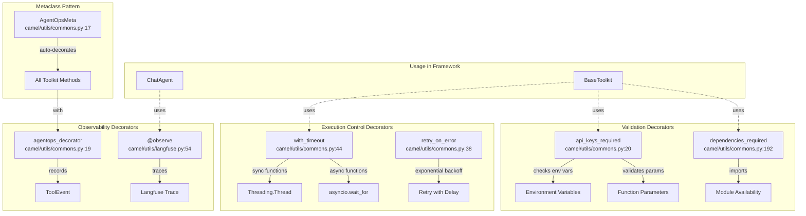
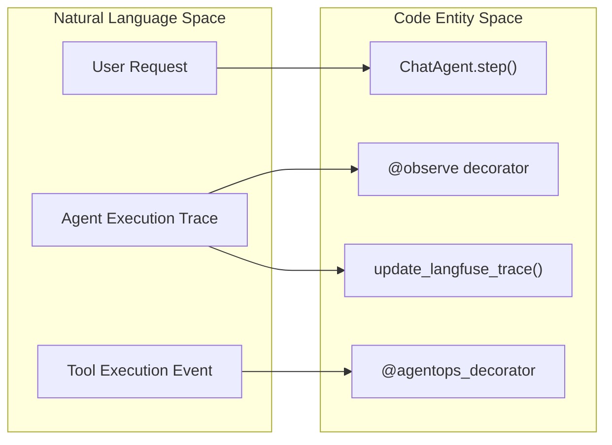

<!-- source: DeepWiki mcp.deepwiki.com · repo camel-ai/camel · page 6 Utilities and Infrastructure · fetched 2026-10-29 -->

# Utilities and Infrastructure

Relevant source files

The following files were used as context for generating this wiki page:

- [camel/interpreters/__init__.py](camel/interpreters/__init__.py)
- [camel/utils/__init__.py](camel/utils/__init__.py)
- [camel/utils/commons.py](camel/utils/commons.py)
- [camel/utils/token_counting.py](camel/utils/token_counting.py)
- [examples/interpreters/microsandbox_interpreter_example.py](examples/interpreters/microsandbox_interpreter_example.py)
- [test/interpreters/test_microsandbox_interpreter.py](test/interpreters/test_microsandbox_interpreter.py)
- [test/runtimes/test_daytona_runtime.py](test/runtimes/test_daytona_runtime.py)
- [test/utils/test_commons.py](test/utils/test_commons.py)

This document covers the common utilities, decorators, and infrastructure helpers that support the CAMEL-AI framework. These include decorator-based validation systems, batch processing utilities, structured output generation tools, async/sync bridging helpers, and observability integrations.

For information about specific toolkit implementations, see [Toolkit Ecosystem](#4). For memory and storage systems, see [Storage and Retrieval](#5.2). For model-specific token counting, see [Token Counting and Context Management](#3.4).

## Overview

The utilities and infrastructure layer provides cross-cutting concerns that are used throughout the CAMEL-AI framework:

| Category | Key Components | Purpose |
|----------|---------------|---------|
| **Decorators** | `api_keys_required`, `dependencies_required`, `with_timeout` | Validation and safety |
| **Batch Processing** | `BatchProcessor`, `run_async` | Resource-aware execution |
| **Structured Output** | `json_to_function_code`, `func_string_to_callable` | Schema-to-code generation |
| **Observability** | Langfuse, AgentOps decorators | Tracking and monitoring |
| **Interpreters** | `MicrosandboxInterpreter`, `DockerInterpreter`, `InternalPythonInterpreter` | Isolated code execution |
| **Token Counting** | `OpenAITokenCounter`, `AnthropicTokenCounter`, `MistralTokenCounter` | Token usage estimation |

**Sources:** [camel/utils/__init__.py:1-129](), [camel/utils/commons.py:1-219](), [camel/interpreters/__init__.py:1-33]()

## Decorator System Architecture

The decorator system provides three categories of functionality: validation, execution control, and observability. Decorators are extensively used throughout the toolkit ecosystem to enforce requirements and add cross-cutting capabilities.

### Framework Decorator Map

**Sources:** [camel/utils/commons.py:17-44](), [camel/utils/commons.py:192-219](), [camel/utils/__init__.py:16-57]()

---

## Common Utilities and Decorators

CAMEL utilizes a robust set of decorators to manage environment requirements and execution safety. The `api_keys_required` decorator [camel/utils/commons.py:20]() ensures that LLM or tool-specific keys are present before execution, while `dependencies_required` [camel/utils/commons.py:192-219]() checks for optional library installations. Execution safety is handled via `with_timeout` [camel/utils/commons.py:44]() and `retry_on_error` [camel/utils/commons.py:38]().

For details, see [Common Utilities and Decorators](#6.1).

---

## Batch Processing and Async Support

The framework provides a `BatchProcessor` [camel/utils/commons.py:18]() designed for high-throughput tasks. It is resource-aware, monitoring system resources to dynamically adjust processing. Additionally, the `run_async` helper [camel/utils/commons.py:39]() facilitates the execution of asynchronous code within synchronous environments by managing event loop lifecycles.

For details, see [Batch Processing and Async Support](#6.2).

---

## Structured Output Generation

To ensure agents return data in predictable formats, CAMEL provides a suite of schema utilities. `get_pydantic_object_schema` [camel/utils/commons.py:31]() extracts JSON schemas from Pydantic models, while `json_to_function_code` [camel/utils/commons.py:36]() generates Python functions that enforce these schemas. These are bridged to callables using `func_string_to_callable` [camel/utils/commons.py:27]().

For details, see [Structured Output Generation](#6.3).

---

## Observability and Tracing

CAMEL supports comprehensive observability through integrations with Langfuse and AgentOps. The `@observe` decorator [camel/utils/langfuse.py:54]() provides detailed tracing of agent steps, while the `AgentOpsMeta` metaclass [camel/utils/commons.py:17]() automatically wraps toolkit methods for event tracking via `agentops_decorator` [camel/utils/commons.py:19]().

### Observability Entity Mapping

For details, see [Observability and Tracing](#6.4).

---

## Code Interpreters and Runtimes

Infrastructure for code execution is abstracted through various interpreter classes defined in `camel/interpreters/` [camel/interpreters/__init__.py:24-33](). These range from the `InternalPythonInterpreter` [camel/interpreters/__init__.py:27]() for local execution to isolated environments like `DockerInterpreter` [camel/interpreters/__init__.py:29]() and `MicrosandboxInterpreter` [camel/interpreters/__init__.py:32](). Cloud-based execution is supported via `E2BInterpreter` [camel/interpreters/__init__.py:31]() and `DaytonaRuntime` [test/runtimes/test_daytona_runtime.py:19]().

For details, see [Code Interpreters and Runtimes](#6.5).

---

## Knowledge Graph and Graph Storage

CAMEL supports structured knowledge management through graph-based storage. This infrastructure includes the `KnowledgeGraphAgent` and integrations with graph databases like `Neo4j` for persistent storage. These utilities allow agents to build and query complex relationships between entities using defined graph models.

For details, see [Knowledge Graph and Graph Storage](#6.6).

**Sources:** [camel/utils/__init__.py:1-129](), [camel/utils/commons.py:1-219](), [camel/interpreters/__init__.py:1-33](), [test/utils/test_commons.py:1-213](), [test/runtimes/test_daytona_runtime.py:19-181]()

---

