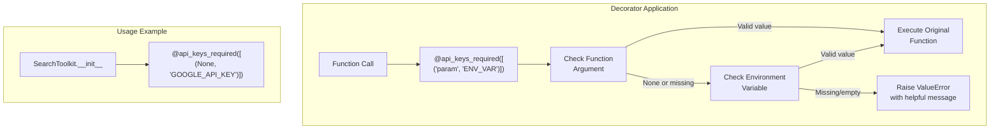
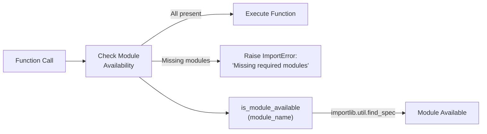
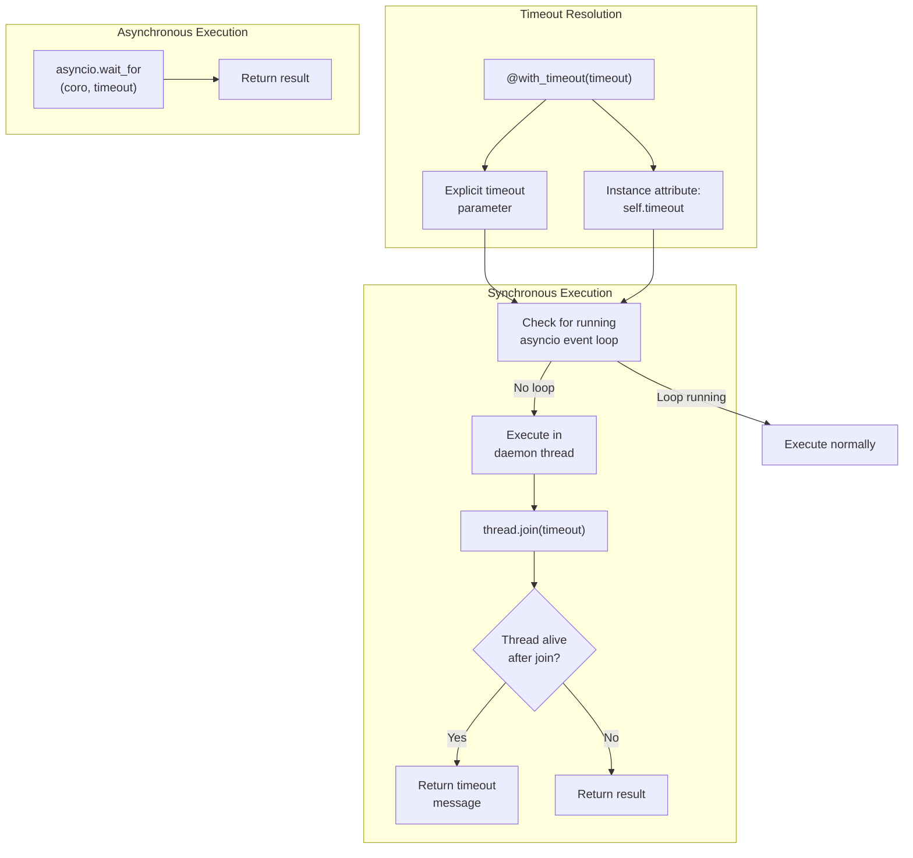
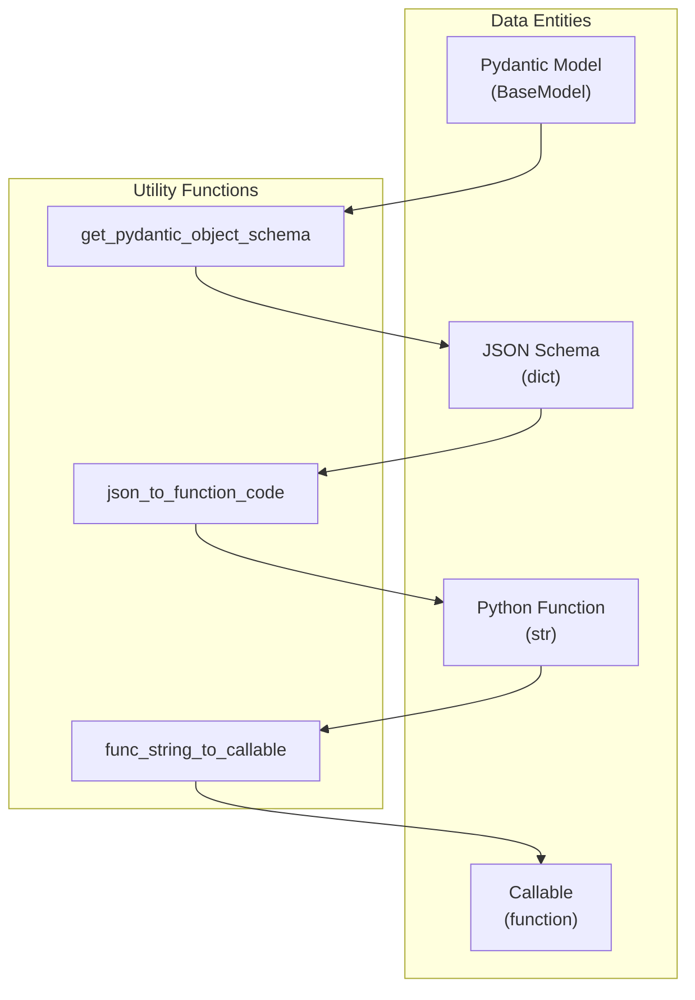
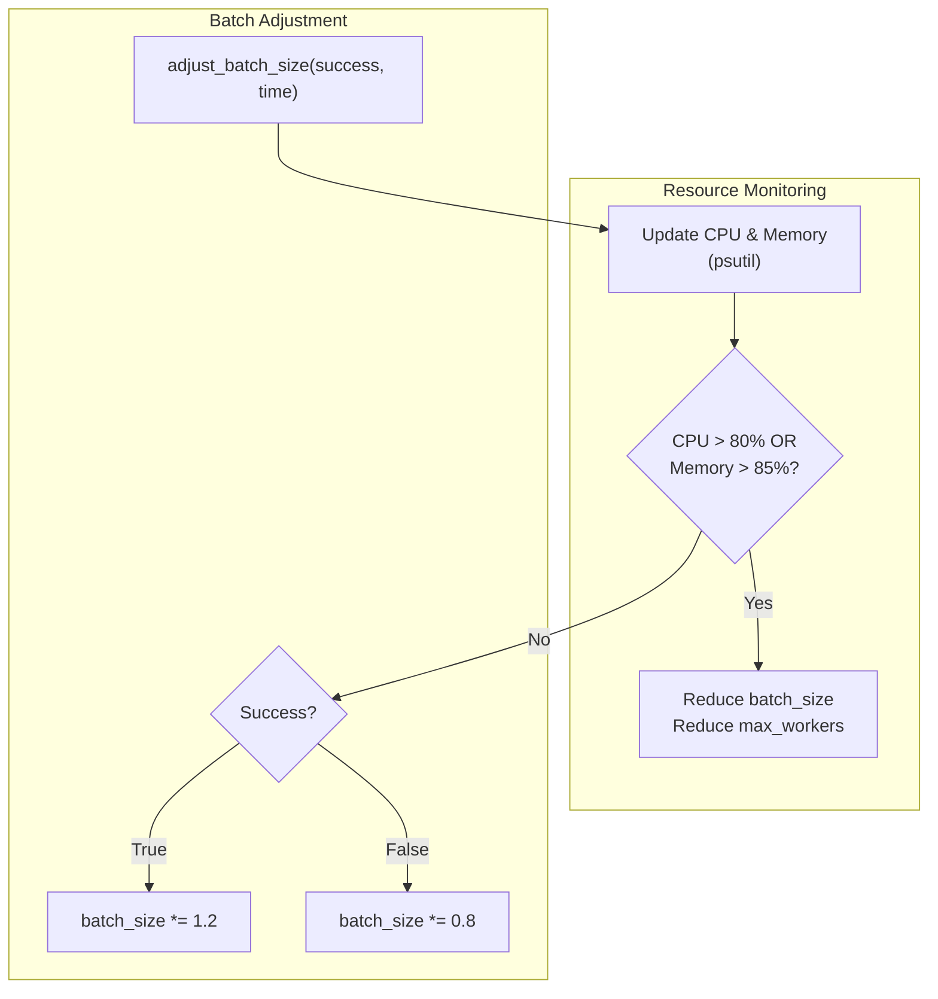
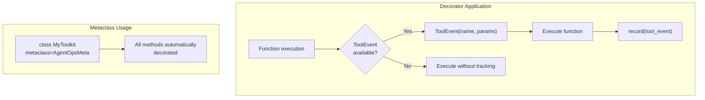

<!-- source: DeepWiki mcp.deepwiki.com · repo camel-ai/camel · page 6.1 Common Utilities and Decorators · fetched 2026-10-29 -->

# Common Utilities and Decorators

<details>
<summary>Relevant source files</summary>

The following files were used as context for generating this wiki page:

- [camel/interpreters/__init__.py](camel/interpreters/__init__.py)
- [camel/utils/__init__.py](camel/utils/__init__.py)
- [camel/utils/commons.py](camel/utils/commons.py)
- [camel/utils/token_counting.py](camel/utils/token_counting.py)
- [examples/interpreters/microsandbox_interpreter_example.py](examples/interpreters/microsandbox_interpreter_example.py)
- [test/interpreters/test_microsandbox_interpreter.py](test/interpreters/test_microsandbox_interpreter.py)
- [test/runtimes/test_daytona_runtime.py](test/runtimes/test_daytona_runtime.py)
- [test/utils/test_commons.py](test/utils/test_commons.py)

</details>


This document covers the utility functions, decorators, and helper classes provided by the CAMEL-AI framework in the `camel.utils` module. These utilities support the core agent system by providing validation, error handling, timeout management, structured output generation, and system integration capabilities.

For information about observability-specific utilities (Langfuse integration and the `@observe` decorator), see [Observability and Tracing](6.4). For batch processing and async execution patterns, see [Batch Processing and Async Support](6.2).

**Sources:** [camel/utils/__init__.py:1-129](), [camel/utils/commons.py:1-219]()

## Overview of Utility Categories

The CAMEL-AI utilities fall into several functional categories:

| Category | Key Functions/Classes | Purpose |
|----------|----------------------|---------|
| **Validation Decorators** | `api_keys_required`, `dependencies_required` | Pre-execution validation of API keys and dependencies |
| **Execution Control** | `with_timeout`, `retry_on_error` | Timeout management and retry logic with exponential backoff |
| **Structured Output** | `json_to_function_code`, `func_string_to_callable`, `get_pydantic_object_schema` | Convert between JSON schemas, Python functions, and Pydantic models |
| **String Processing** | `get_prompt_template_key_words`, `to_pascal`, `create_chunks` | Text manipulation and formatting |
| **System Integration** | `is_docker_running`, `check_server_running`, `get_system_information` | System state detection |
| **Observability** | `agentops_decorator`, `AgentOpsMeta` | Optional AgentOps integration |
| **Resource Management** | `BatchProcessor` | Dynamic batch sizing based on system load |
| **Async/Sync Bridging** | `run_async` | Execute async functions in sync contexts |

**Sources:** [camel/utils/commons.py:1-219](), [camel/utils/__init__.py:16-45]()

## Validation Decorators

### api_keys_required Decorator

The `api_keys_required` decorator ensures that required API keys are provided either as function arguments or environment variables. It's extensively used across toolkits to validate credentials before making external API calls.

**Logic Flow for API Key Validation**


**Implementation Details:**

The decorator accepts a list of tuples where each tuple contains:
1. **Parameter name** (Optional[str]): Function argument to check, or `None` to skip argument checking.
2. **Environment variable name** (str): Corresponding environment variable.

The validation logic follows this precedence:
1. If `param_name` is provided, check the function argument first.
2. If no valid value found in arguments (or `param_name` is `None`), check the environment variable.
3. If both are missing or empty, raise a `ValueError` with a helpful message indicating where to obtain the key.

**Sources:** [camel/utils/commons.py:20-21](), [test/utils/test_commons.py:155-213]()

**Example Usage:**

```python
@api_keys_required([
    ('api_key', 'OPENAI_API_KEY'),
    ('another_key', 'GOOGLE_API_KEY'),
    (None, 'ANTHROPIC_API_KEY'),  # Only checks env var
])
def some_api_function(api_key=None, another_key=None):
    # Function implementation
    pass
```

The decorator includes provider-specific guidance for obtaining API keys. When an API key is missing, the error message includes the appropriate URL for platforms like OpenAI, Anthropic, and Gemini.

**Sources:** [camel/utils/commons.py:20-21](), [test/utils/test_commons.py:155-213]()

### dependencies_required Decorator

The `dependencies_required` decorator validates that specified Python modules are available before function execution. This is used throughout toolkits to provide clear error messages when optional dependencies are missing.

**Dependency Check Flow**


**Implementation Details:**

The decorator uses `is_module_available()` which internally relies on `importlib.util.find_spec()` to check availability without actually importing the modules into the function's namespace [camel/utils/commons.py:218-219](). This allows for early detection of missing dependencies with minimal overhead.

**Sources:** [camel/utils/commons.py:192-219]()

**Example Usage:**

```python
@dependencies_required('numpy', 'pandas', 'scipy')
def data_processing_function():
    import numpy as np
    import pandas as pd
    # Function implementation
    pass
```

When dependencies are missing, the error message clearly lists all missing modules [camel/utils/commons.py:218-219]().

**Sources:** [test/utils/test_commons.py:62-78]()

## Execution Control Decorators

### with_timeout Decorator

The `with_timeout` decorator adds timeout functionality to both synchronous and asynchronous functions. It's used throughout the toolkit system to prevent functions from hanging indefinitely.

**Timeout Execution Logic**


**Implementation Details:**

The decorator handles multiple scenarios:
1. **Timeout Resolution**: Checks explicit timeout parameters or instance attributes.
2. **Async Detection**: Determines if the function is a coroutine.
3. **Event Loop Handling**: For sync functions, it handles execution via threads to avoid blocking the main loop.
4. **Graceful Timeout**: Returns a descriptive message rather than crashing when a timeout occurs.

**Sources:** [camel/utils/commons.py:44-45](), [test/utils/test_commons.py:33-34]()

### retry_on_error Decorator

The `retry_on_error` decorator implements retry logic with exponential backoff for handling transient failures.

**Retry Behavior:**

| Parameter | Default | Description |
|-----------|---------|-------------|
| `max_retries` | 3 | Maximum number of retry attempts |
| `initial_delay` | 1.0 | Initial delay in seconds |
| Backoff Strategy | Exponential | Each retry increases the delay |

**Sources:** [camel/utils/commons.py:38-39](), [test/utils/test_commons.py:31-32]()

## Structured Output Utilities

The structured output utilities bridge between JSON schemas, OpenAI function calling format, and executable Python code.

**Schema Transformation Map**


**Sources:** [camel/utils/__init__.py:27-36]()

### get_pydantic_object_schema

Extracts JSON schema from a Pydantic model. It handles version differences between Pydantic v1 and v2 [camel/utils/__init__.py:30-31]().

### json_to_function_code

Generates executable Python function code from a JSON schema [camel/utils/__init__.py:36-37](). This is used to dynamically create functions that agents can call based on provided schemas.

### func_string_to_callable

Executes a function code string and extracts the callable function object [camel/utils/__init__.py:27-28]().

## Resource Management: BatchProcessor

The `BatchProcessor` class provides dynamic batch processing with resource-aware scaling based on CPU and memory usage.

**Dynamic Batch Scaling Logic**


**Sources:** [camel/utils/commons.py:18-19](), [test/utils/test_commons.py:25-26]()

## AgentOps Integration

The AgentOps integration provides optional observability through automatic event recording when the `AGENTOPS_API_KEY` environment variable is set.

**AgentOps Tracking Mechanism**


**Sources:** [camel/utils/commons.py:17-19](), [camel/utils/__init__.py:99-101]()

## Token Counting Utilities

CAMEL-AI provides specialized token counters for various LLM providers, ensuring accurate context window management.

| Counter Class | Implementation Detail |
|---------------|-----------------------|
| `OpenAITokenCounter` | Uses `tiktoken` with specific handling for GPT-3.5, GPT-4, and O1 models [camel/utils/token_counting.py:118-162]() |
| `AnthropicTokenCounter` | Specialized for Claude models [camel/utils/__init__.py:66-67]() |
| `MistralTokenCounter` | Specialized for Mistral models [camel/utils/__init__.py:69-70]() |
| `LiteLLMTokenCounter` | Generic counter for LiteLLM supported models [camel/utils/__init__.py:68-69]() |

**Sources:** [camel/utils/token_counting.py:77-200](), [camel/utils/__init__.py:65-72]()

## Other Utility Functions

- **`get_first_int`**: Extracts the first integer from a string [camel/utils/commons.py:95-111]().
- **`get_task_list`**: Parses numbered task lists from agent responses [camel/utils/commons.py:147-167]().
- **`check_server_running`**: Checks if a server (e.g., LLM inference service) is reachable at a given URL [camel/utils/commons.py:170-190]().
- **`print_text_animated`**: Prints text with a typewriter effect [camel/utils/commons.py:63-76]().
- **`get_prompt_template_key_words`**: Extracts variables inside curly braces from a string template [camel/utils/commons.py:78-93]().
- **`download_tasks`**: Downloads and extracts task metadata from HuggingFace [camel/utils/commons.py:114-145]().
- **`get_system_information`**: Collects OS, system, release, and processor information for diagnostic logging [test/utils/test_commons.py:79-102]().

**Sources:** [camel/utils/commons.py:63-219](), [test/utils/test_commons.py:37-102]()

---

