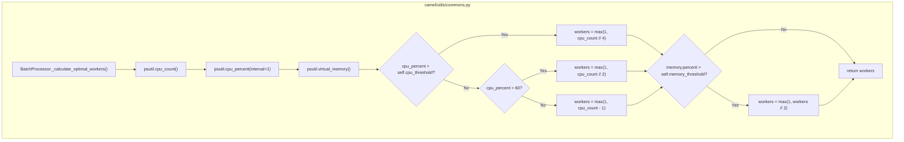
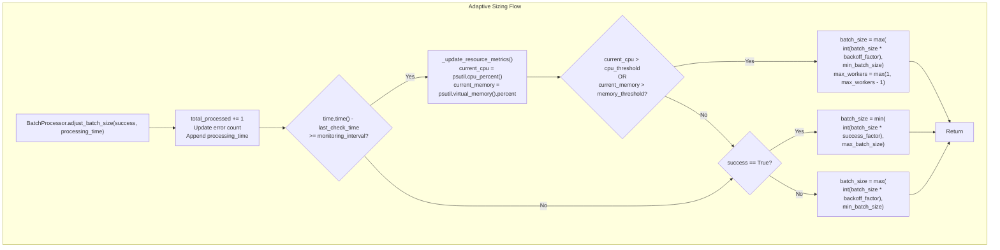
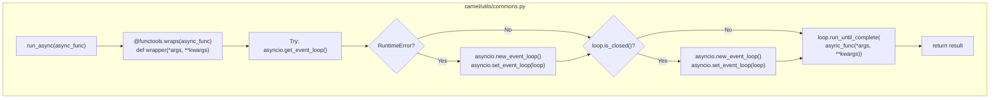
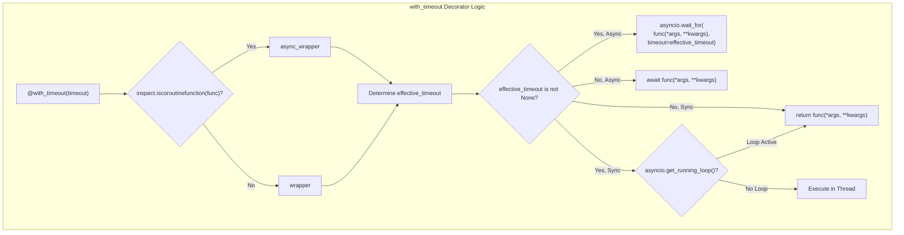

<!-- source: DeepWiki mcp.deepwiki.com · repo camel-ai/camel · page 6.2 Batch Processing and Async Support · fetched 2026-10-29 -->

# Batch Processing and Async Support

<details>
<summary>Relevant source files</summary>

The following files were used as context for generating this wiki page:

- [camel/interpreters/__init__.py](camel/interpreters/__init__.py)
- [camel/toolkits/__init__.py](camel/toolkits/__init__.py)
- [camel/utils/__init__.py](camel/utils/__init__.py)
- [camel/utils/commons.py](camel/utils/commons.py)
- [camel/utils/token_counting.py](camel/utils/token_counting.py)
- [docs/key_modules/agents.md](docs/key_modules/agents.md)
- [docs/key_modules/datagen.md](docs/key_modules/datagen.md)
- [docs/key_modules/embeddings.md](docs/key_modules/embeddings.md)
- [docs/key_modules/interpreters.md](docs/key_modules/interpreters.md)
- [docs/key_modules/memory.md](docs/key_modules/memory.md)
- [docs/key_modules/messages.md](docs/key_modules/messages.md)
- [docs/key_modules/prompts.md](docs/key_modules/prompts.md)
- [docs/key_modules/retrievers.md](docs/key_modules/retrievers.md)
- [docs/key_modules/runtimes.md](docs/key_modules/runtimes.md)
- [docs/key_modules/society.md](docs/key_modules/society.md)
- [docs/key_modules/storages.md](docs/key_modules/storages.md)
- [docs/key_modules/tasks.md](docs/key_modules/tasks.md)
- [docs/key_modules/tools.md](docs/key_modules/tools.md)
- [docs/key_modules/workforce.md](docs/key_modules/workforce.md)
- [examples/interpreters/microsandbox_interpreter_example.py](examples/interpreters/microsandbox_interpreter_example.py)
- [test/interpreters/test_microsandbox_interpreter.py](test/interpreters/test_microsandbox_interpreter.py)
- [test/runtimes/test_daytona_runtime.py](test/runtimes/test_daytona_runtime.py)
- [test/utils/test_commons.py](test/utils/test_commons.py)

</details>


This page documents CAMEL-AI's utilities for resource-aware batch processing and asynchronous execution bridging. The `BatchProcessor` class provides dynamic batch sizing based on system resource availability, while the `run_async` helper enables seamless execution of async functions in synchronous contexts.

These utilities are distinct from the asynchronous agent execution patterns and focus on lower-level execution optimization and context bridging.

---

## BatchProcessor Architecture

The `BatchProcessor` class provides intelligent batch processing with dynamic resource monitoring and adaptive sizing. It monitors CPU and memory usage to automatically adjust batch sizes and worker counts, preventing system overload during intensive processing tasks.

### Initialization and Configuration

The `BatchProcessor` is initialized with configurable thresholds and resource limits:

[camel/utils/commons.py:726-758]()

| Parameter | Type | Default | Description |
|-----------|------|---------|-------------|
| `max_workers` | `Optional[int]` | `None` | Maximum concurrent workers. If `None`, calculated dynamically based on CPU count and current load |
| `initial_batch_size` | `Optional[int]` | `None` | Starting batch size. Defaults to `10` if not specified |
| `monitoring_interval` | `float` | `5.0` | Seconds between resource usage checks |
| `cpu_threshold` | `float` | `80.0` | CPU usage percentage triggering scale-down |
| `memory_threshold` | `float` | `85.0` | Memory usage percentage triggering scale-down |

The processor uses `psutil` for resource monitoring and maintains internal state tracking performance metrics.

**Sources:** [camel/utils/commons.py:726-782]()

### Dynamic Worker Allocation

The processor calculates optimal worker count based on current system state using the `_calculate_optimal_workers` method:

**Natural Language to Code Entity Space: Worker Calculation**



The algorithm progressively reduces worker count as system load increases:
- **High CPU (>80%)**: Use only 25% of available cores [camel/utils/commons.py:791-792]()
- **Medium CPU (>60%)**: Use 50% of available cores [camel/utils/commons.py:793-794]()
- **Low CPU (≤60%)**: Use all cores minus one [camel/utils/commons.py:796]()
- **High Memory (>85%)**: Halve the worker count [camel/utils/commons.py:798-799]()

**Sources:** [camel/utils/commons.py:783-801]()

### Resource Monitoring and Adaptive Batch Sizing

The `adjust_batch_size` method continuously monitors system resources and adjusts batch sizes accordingly:



The system uses scaling factors:
- **backoff_factor** (0.8): Multiplier when reducing batch size due to failure or high resource usage [camel/utils/commons.py:755]()
- **success_factor** (1.2): Multiplier when increasing batch size after successful completion [camel/utils/commons.py:756]()

**Sources:** [camel/utils/commons.py:803-855]()

---

## Async/Sync Execution Bridging

The `run_async` helper function enables calling async functions from synchronous contexts by managing event loop lifecycle:

**Natural Language to Code Entity Space: Async Bridging**



### Event Loop Management

The `run_async` function handles three event loop scenarios:

1. **No event loop exists**: Creates new loop with `asyncio.new_event_loop()` [camel/utils/commons.py:1152-1153]()
2. **Event loop exists but closed**: Creates and sets new loop [camel/utils/commons.py:1156-1157]()
3. **Event loop exists and active**: Uses existing loop [camel/utils/commons.py:1159]()

**Sources:** [camel/utils/commons.py:1139-1163]()

---

## Timeout Support for Async Functions

The `with_timeout` decorator provides timeout functionality for both synchronous and asynchronous functions:



### Async Function Timeout Handling

For async functions, the decorator uses `asyncio.wait_for()` [camel/utils/commons.py:997-1001](). It detects coroutine functions using `inspect.iscoroutinefunction(func)` [camel/utils/commons.py:988]().

### Synchronous Function with Event Loop Preservation

For synchronous functions, the decorator checks for running event loops via `asyncio.get_running_loop()` [camel/utils/commons.py:1018](). If a loop is running, it executes the function directly to avoid threading issues with async-dependent code [camel/utils/commons.py:1027-1029](). Otherwise, it uses a `threading.Thread` to enforce the timeout [camel/utils/commons.py:1040-1064]().

**Sources:** [camel/utils/commons.py:964-1074]()

---

## Usage Patterns

### BatchProcessor Example

```python
from camel.utils import BatchProcessor
import time

# Initialize with resource limits
processor = BatchProcessor(max_workers=4, cpu_threshold=70.0)

# Simulate processing loop
for batch in range(10):
    start = time.time()
    # Perform task...
    success = True 
    # Dynamically adjust sizing based on success and latency
    processor.adjust_batch_size(success, time.time() - start)
```

**Sources:** [camel/utils/commons.py:726-855](), [test/utils/test_commons.py:25]()

### run_async for Toolkit Integration

The `run_async` helper is frequently exported and used to bridge async logic (like `AsyncBrowserToolkit` or `AsyncAskNewsToolkit`) into the primarily synchronous agent interaction loops.

**Sources:** [camel/utils/commons.py:1139-1163](), [camel/utils/__init__.py:39](), [camel/toolkits/__init__.py:28](), [camel/toolkits/__init__.py:70]()

---

