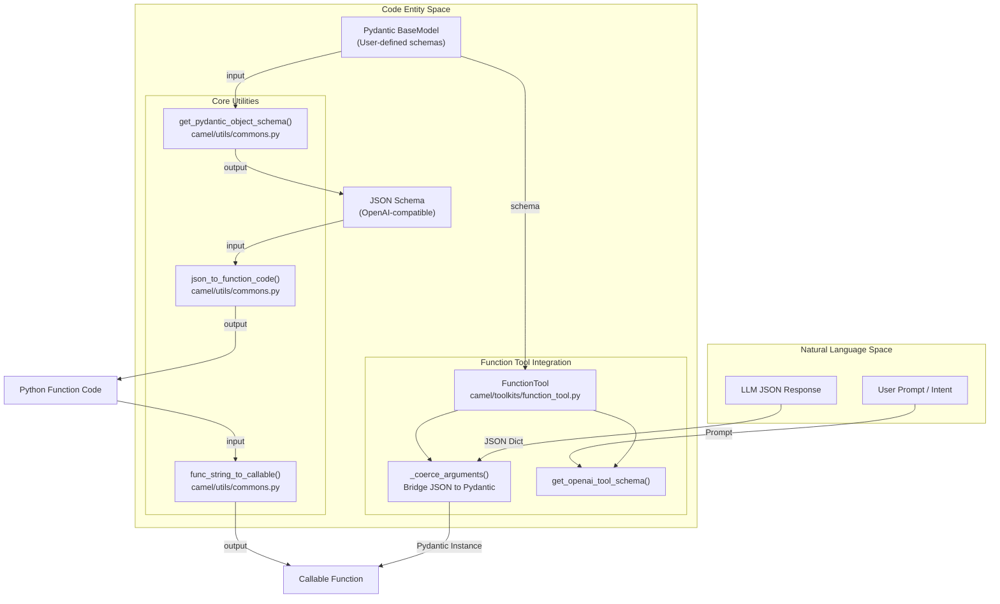
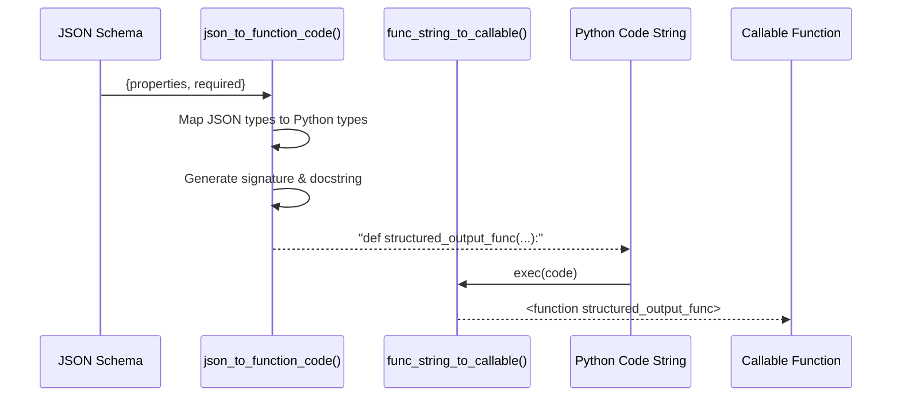
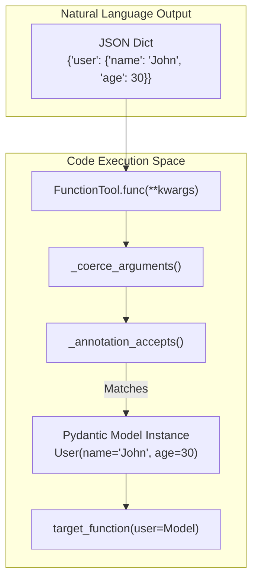

<!-- source: DeepWiki mcp.deepwiki.com · repo camel-ai/camel · page 6.3 Structured Output Generation · fetched 2026-10-29 -->

# Structured Output Generation

<details>
<summary>Relevant source files</summary>

The following files were used as context for generating this wiki page:

- [camel/interpreters/__init__.py](camel/interpreters/__init__.py)
- [camel/utils/__init__.py](camel/utils/__init__.py)
- [camel/utils/commons.py](camel/utils/commons.py)
- [camel/utils/token_counting.py](camel/utils/token_counting.py)
- [docs/cookbooks/advanced_features/agents_tracking.ipynb](docs/cookbooks/advanced_features/agents_tracking.ipynb)
- [docs/cookbooks/advanced_features/agents_with_graph_rag.ipynb](docs/cookbooks/advanced_features/agents_with_graph_rag.ipynb)
- [docs/cookbooks/advanced_features/agents_with_human_in_loop_and_tool_approval.ipynb](docs/cookbooks/advanced_features/agents_with_human_in_loop_and_tool_approval.ipynb)
- [docs/cookbooks/advanced_features/agents_with_rag.ipynb](docs/cookbooks/advanced_features/agents_with_rag.ipynb)
- [docs/cookbooks/advanced_features/critic_agents_and_tree_search.ipynb](docs/cookbooks/advanced_features/critic_agents_and_tree_search.ipynb)
- [docs/cookbooks/applications/roleplaying_scraper.ipynb](docs/cookbooks/applications/roleplaying_scraper.ipynb)
- [docs/cookbooks/data_generation/data_model_generation_and_structured_output_with_qwen.ipynb](docs/cookbooks/data_generation/data_model_generation_and_structured_output_with_qwen.ipynb)
- [docs/mintlify/cookbooks/advanced_features/agents_tracking.mdx](docs/mintlify/cookbooks/advanced_features/agents_tracking.mdx)
- [docs/mintlify/cookbooks/data_processing/agent_with_chunkr_for_pdf_parsing.mdx](docs/mintlify/cookbooks/data_processing/agent_with_chunkr_for_pdf_parsing.mdx)
- [docs/mintlify/cookbooks/mcp/agents_with_sql_mcp.mdx](docs/mintlify/cookbooks/mcp/agents_with_sql_mcp.mdx)
- [docs/mintlify/cookbooks/mcp/camel_aci_mcp_cookbook.mdx](docs/mintlify/cookbooks/mcp/camel_aci_mcp_cookbook.mdx)
- [examples/interpreters/microsandbox_interpreter_example.py](examples/interpreters/microsandbox_interpreter_example.py)
- [test/interpreters/test_microsandbox_interpreter.py](test/interpreters/test_microsandbox_interpreter.py)
- [test/runtimes/test_daytona_runtime.py](test/runtimes/test_daytona_runtime.py)
- [test/utils/test_commons.py](test/utils/test_commons.py)

</details>


## Purpose and Scope

This page documents the utilities and systems for generating structured outputs in CAMEL-AI. Structured output generation enables agents to produce responses conforming to specific JSON schemas, supporting both native model capabilities (via `response_format`) and prompt-based extraction methods. These utilities are fundamental to the toolkit system and the Workforce orchestration system, where coordinator agents, task planners, and workers must produce predictable, parseable outputs for task decomposition, assignment, and tool execution.

## System Architecture



**Diagram: Structured Output Generation System Architecture**

The system provides two parallel approaches: **native structured output** through the `response_format` parameter passed to model backends, and **coercion logic** within the toolkit system to ensure that JSON inputs from LLMs are correctly mapped to Python objects.

Sources: [camel/utils/commons.py:430-516](), [camel/toolkits/function_tool.py:137-170](), [camel/toolkits/function_tool.py:208-250]()

---

## Core Schema Utilities

### get_pydantic_object_schema

This utility leverages Pydantic to generate OpenAI-compatible JSON schemas from model classes. It handles version-specific logic to ensure compatibility between Pydantic v1 and v2.

**Function Definition:**
```python
def get_pydantic_object_schema(pydantic_params: Type[BaseModel]) -> Dict
```
[camel/utils/commons.py:430-440]()

It is used internally by `FunctionTool` to generate schemas for tool calls when the function signature uses Pydantic models as arguments. The utility relies on `get_pydantic_major_version` [camel/utils/commons.py:421-427]() to decide whether to call `.schema()` (v1) or `.model_json_schema()` (v2).

Sources: [camel/utils/commons.py:421-440](), [camel/toolkits/function_tool.py:47-47]()

### json_to_function_code and func_string_to_callable

These functions allow for dynamic generation of Python code from JSON definitions, which is particularly useful for creating "structured output" wrappers around LLM responses.



**Diagram: JSON to Code Pipeline**

**Type Mapping Table:**
| JSON Type | Python Type |
|-----------|-------------|
| `string` | `str` |
| `number` | `float` |
| `integer` | `int` |
| `boolean` | `bool` |

The `json_to_function_code` function [camel/utils/commons.py:443-503]() iterates through properties to build a function signature, while `func_string_to_callable` [camel/utils/commons.py:506-516]() uses `exec()` within a controlled namespace to return the function object.

Sources: [camel/utils/commons.py:443-516](), [test/utils/test_commons.py:327-360]()

---

## FunctionTool and Structured Arguments

`FunctionTool` is the primary interface for bridging Natural Language tool calls to Python execution. It handles the task of coercing the flat JSON dictionary produced by an LLM into the structured types (like nested Pydantic models) expected by Python functions.

### Argument Coercion Logic

When an LLM calls a tool, it provides arguments as a JSON object. `FunctionTool` uses `_coerce_arguments` and `_coerce_arg` to transform these dictionaries into Pydantic model instances.



**Diagram: Tool Argument Coercion**

- **`_coerce_arg`**: Recursively handles `List[Model]`, `Dict[str, Model]`, `Optional`, and `Union` types. [camel/toolkits/function_tool.py:80-134]()
- **`_coerce_arguments`**: Inspects the function signature and applies coercion to both positional and keyword arguments. [camel/toolkits/function_tool.py:137-170]()

Sources: [camel/toolkits/function_tool.py:80-170]()

---

## Response Format and Pydantic Models

The `camel.utils.response_format` module provides utilities for dynamic Pydantic model creation, which is essential for `response_format` support in model backends.

- **`get_pydantic_model`**: Generates a Pydantic model from a list of field definitions. [camel/utils/response_format.py:20-45]()
- **`model_from_json_schema`**: Converts a raw JSON schema into a valid Pydantic `BaseModel` class. [camel/utils/response_format.py:48-75]()

These utilities allow the `ChatAgent` to enforce structure even when the schema is defined at runtime by the agent's logic or a task coordinator.

Sources: [camel/utils/__init__.py:59-59](), [camel/utils/response_format.py:20-75]()

---

## Token Counting for Structured Output

When generating structured outputs, token counting becomes critical for context window management. CAMEL provides specific counters for different model architectures through the `BaseTokenCounter` abstraction [camel/utils/token_counting.py:77-91]().

| Counter Class | Implementation | Model Target |
|---------------|----------------|--------------|
| `OpenAITokenCounter` | Uses `tiktoken` | GPT-3.5, GPT-4, O1, O3 |
| `AnthropicTokenCounter` | Provider-specific | Claude models |
| `MistralTokenCounter` | Uses `mistral_common` | Mistral/Mixtral |

For OpenAI models, the `tokens_per_message` and `tokens_per_name` vary by model type. For example, `gpt-4` uses 3 tokens per message, while `o1` series models use 2 tokens [camel/utils/token_counting.py:136-150]().

Sources: [camel/utils/token_counting.py:77-164]()

---

## Summary of Key Symbols

| Symbol | Role | Location |
|--------|------|----------|
| `get_pydantic_object_schema` | Converts Pydantic models to JSON schemas | `camel/utils/commons.py` |
| `json_to_function_code` | Generates Python function strings from JSON | `camel/utils/commons.py` |
| `func_string_to_callable` | Compiles function strings into executable objects | `camel/utils/commons.py` |
| `FunctionTool` | Wrapper for tool execution and schema generation | `camel/toolkits/function_tool.py` |
| `_coerce_arg` | Transforms LLM JSON dicts into Pydantic objects | `camel/toolkits/function_tool.py` |
| `model_from_json_schema` | Creates Pydantic classes from JSON schemas | `camel/utils/response_format.py` |
| `OpenAITokenCounter` | Manages token limits for OpenAI structured calls | `camel/utils/token_counting.py` |

Sources: [camel/utils/commons.py:430-516](), [camel/toolkits/function_tool.py:15-48](), [camel/utils/token_counting.py:118-120](), [camel/utils/response_format.py:48-75]()

---

