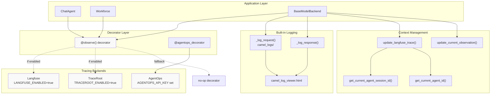
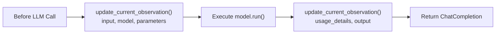
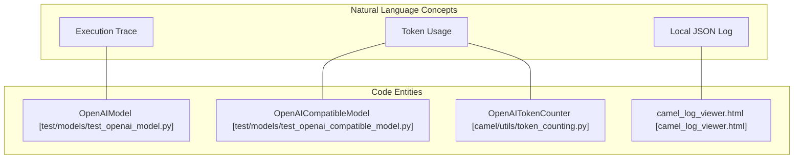
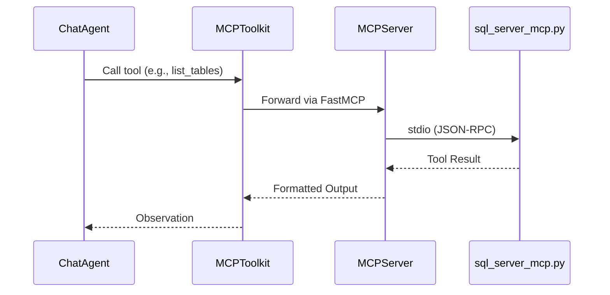

<!-- source: DeepWiki mcp.deepwiki.com · repo camel-ai/camel · page 6.4 Observability and Tracing · fetched 2026-10-29 -->

# Observability and Tracing

<details>
<summary>Relevant source files</summary>

The following files were used as context for generating this wiki page:

- [camel/interpreters/__init__.py](camel/interpreters/__init__.py)
- [camel/utils/__init__.py](camel/utils/__init__.py)
- [camel/utils/agent_context.py](camel/utils/agent_context.py)
- [camel/utils/commons.py](camel/utils/commons.py)
- [camel/utils/langfuse.py](camel/utils/langfuse.py)
- [camel/utils/token_counting.py](camel/utils/token_counting.py)
- [camel_log_viewer.html](camel_log_viewer.html)
- [docs/cookbooks/advanced_features/agents_tracking.ipynb](docs/cookbooks/advanced_features/agents_tracking.ipynb)
- [docs/cookbooks/advanced_features/agents_with_graph_rag.ipynb](docs/cookbooks/advanced_features/agents_with_graph_rag.ipynb)
- [docs/cookbooks/advanced_features/agents_with_human_in_loop_and_tool_approval.ipynb](docs/cookbooks/advanced_features/agents_with_human_in_loop_and_tool_approval.ipynb)
- [docs/cookbooks/advanced_features/agents_with_rag.ipynb](docs/cookbooks/advanced_features/agents_with_rag.ipynb)
- [docs/cookbooks/advanced_features/critic_agents_and_tree_search.ipynb](docs/cookbooks/advanced_features/critic_agents_and_tree_search.ipynb)
- [docs/cookbooks/applications/roleplaying_scraper.ipynb](docs/cookbooks/applications/roleplaying_scraper.ipynb)
- [docs/cookbooks/data_generation/data_model_generation_and_structured_output_with_qwen.ipynb](docs/cookbooks/data_generation/data_model_generation_and_structured_output_with_qwen.ipynb)
- [docs/mintlify/cookbooks/advanced_features/agents_tracking.mdx](docs/mintlify/cookbooks/advanced_features/agents_tracking.mdx)
- [docs/mintlify/cookbooks/data_processing/agent_with_chunkr_for_pdf_parsing.mdx](docs/mintlify/cookbooks/data_processing/agent_with_chunkr_for_pdf_parsing.mdx)
- [docs/mintlify/cookbooks/mcp/agents_with_sql_mcp.mdx](docs/mintlify/cookbooks/mcp/agents_with_sql_mcp.mdx)
- [docs/mintlify/cookbooks/mcp/camel_aci_mcp_cookbook.mdx](docs/mintlify/cookbooks/mcp/camel_aci_mcp_cookbook.mdx)
- [examples/interpreters/microsandbox_interpreter_example.py](examples/interpreters/microsandbox_interpreter_example.py)
- [test/interpreters/test_microsandbox_interpreter.py](test/interpreters/test_microsandbox_interpreter.py)
- [test/models/test_openai_compatible_model.py](test/models/test_openai_compatible_model.py)
- [test/models/test_openai_model.py](test/models/test_openai_model.py)
- [test/runtimes/test_daytona_runtime.py](test/runtimes/test_daytona_runtime.py)
- [test/utils/test_commons.py](test/utils/test_commons.py)

</details>


This document covers CAMEL-AI's observability and tracing infrastructure, including Langfuse integration, TraceRoot support, AgentOps tracking, and request/response logging. These systems enable monitoring, debugging, and analyzing agent behavior across single-agent and multi-agent workflows.

For information about model-specific logging and token counting, see [Token Counting and Context Management](#3.4). For batch processing metrics, see [Batch Processing and Async Support](#6.2).

---

## System Overview

CAMEL-AI provides multiple observability layers that can be enabled independently or together. The framework supports three primary tracing platforms (Langfuse, TraceRoot, AgentOps) plus built-in file-based logging and a web-based log viewer.

**Architecture Diagram**



**Sources**: [camel/utils/langfuse.py:28-35](), [camel/utils/langfuse.py:39-63](), [camel/utils/langfuse.py:123-144](), [docs/mintlify/cookbooks/advanced_features/agents_tracking.mdx:76-84](), [camel_log_viewer.html:6-25]()

---

## Langfuse Integration

Langfuse is the primary observability platform, enabled via `LANGFUSE_ENABLED=true` environment variable. It provides trace-based monitoring with hierarchical observation trees.

### Configuration and Initialization

The framework checks for Langfuse availability and falls back gracefully if unavailable. Configuration is handled via `configure_langfuse()`:

```python
@dependencies_required('langfuse')
def configure_langfuse(
    public_key: Optional[str] = None,
    secret_key: Optional[str] = None,
    host: Optional[str] = None,
    debug: Optional[bool] = None,
    enabled: Optional[bool] = None,
):
    # ... handles environment variable mapping ...
    langfuse_context.configure(...)
```

**Sources**: [camel/utils/langfuse.py:39-117]()

### Context and Session Tracking

CAMEL uses `ContextVar` to manage session IDs across sync and async contexts, ensuring that traces are correctly grouped even in highly concurrent multi-agent environments.

| Code Entity | File Path | Role |
| :--- | :--- | :--- |
| `_agent_session_id_var` | [camel/utils/langfuse.py:23-25]() | `ContextVar` holding the current session ID. |
| `_agent_id_var` | [camel/utils/agent_context.py:17-17]() | `ContextVar` holding the specific agent ID. |
| `set_current_agent_session_id` | [camel/utils/langfuse.py:123-132]() | Updates the session ID in context-local storage. |
| `get_current_agent_session_id` | [camel/utils/langfuse.py:135-144]() | Retrieves the session ID for the current coroutine/thread. |
| `set_current_agent_id` | [camel/utils/agent_context.py:20-29]() | Updates the agent ID in context-local storage. |
| `update_langfuse_trace` | [camel/utils/langfuse.py:147-188]() | Updates the active trace with session/user metadata. |

### Observation Updates

The `update_current_observation` function allows models to enrich traces with specific LLM metadata like usage and parameters.

**Observation Data Flow**



**Sources**: [camel/utils/langfuse.py:191-215]()

---

## AgentOps Tracking

AgentOps provides specialized agent-specific event tracking, capturing tool usage and LLM interactions. It is typically initialized at the start of a script to wrap toolkits and models.

### Initialization and Tool Tracking

To track tool usage, `agentops` must be initialized before importing CAMEL toolkits.

```python
import agentops
agentops.init(os.getenv("AGENTOPS_API_KEY"))

from camel.toolkits import SearchToolkit
# Tool usage is now tracked
```

**Sources**: [docs/mintlify/cookbooks/advanced_features/agents_tracking.mdx:76-84](), [docs/cookbooks/advanced_features/agents_tracking.ipynb:212-246]()

### Tracking Components

| Component | Code Reference | Description |
| :--- | :--- | :--- |
| `agentops.init` | [docs/mintlify/cookbooks/advanced_features/agents_tracking.mdx:81-81]() | Starts the AgentOps session. |
| `agentops.start_session` | [docs/mintlify/cookbooks/advanced_features/agents_tracking.mdx:155-155]() | Begins a specific session with tags. |
| `agentops.end_session` | [docs/mintlify/cookbooks/advanced_features/agents_tracking.mdx:124-124]() | Finalizes tracking and uploads data. |

---

## Built-in Logging System

CAMEL-AI maintains a local logging system that captures raw requests and responses in JSON format, facilitating offline debugging.

### Model Execution and Logging

The `BaseModelBackend` (and implementations like `OpenAIModel` or `OpenAICompatibleModel`) interacts with the logging system during the `run()` lifecycle.

**Natural Language to Code Mapping**



**Sources**: [test/models/test_openai_model.py:21-56](), [test/models/test_openai_compatible_model.py:20-48](), [camel/utils/token_counting.py:118-162](), [camel_log_viewer.html:6-25]()

### API Caching and Tracing

Tracing also extends to performance optimizations. For instance, the `OpenAIModel` supports passing a `prompt_cache_key` to the API, which is tracked in the request payload.

| Entity | Location | Purpose |
| :--- | :--- | :--- |
| `test_prompt_cache_key_passed_to_api` | [test/models/test_openai_model.py:58-90]() | Validates that cache keys are correctly logged and passed. |
| `OpenAITokenCounter` | [camel/utils/token_counting.py:118-118]() | Attached to models to track cost/usage metrics. |
| `set_current_agent_session_id` | [camel/utils/langfuse.py:123-132]() | Used to verify session scoping for response chains. |

---

## MCP Observability

When using the Model Context Protocol (MCP), CAMEL manages the lifecycle of external tool servers. Tracking here involves monitoring the communication over `stdio` or other transports.

**MCP Integration Diagram**



**Sources**: [camel/utils/mcp.py:58-58](), [docs/mintlify/cookbooks/mcp/agents_with_sql_mcp.mdx:20-30](), [docs/mintlify/cookbooks/mcp/agents_with_sql_mcp.mdx:83-94]()

---

## Decorator Summary

| Decorator | Source | Purpose |
| :--- | :--- | :--- |
| `@observe()` | [camel/utils/langfuse.py:31-35]() | Wraps functions for Langfuse tracing. |
| `@dependencies_required('langfuse')` | [camel/utils/langfuse.py:38-38]() | Ensures Langfuse is installed before configuration. |
| `@agentops_decorator` | [camel/utils/commons.py:19-19]() | Metadata-driven decorator for AgentOps tracking. |

**Sources**: [camel/utils/langfuse.py:31-38](), [camel/utils/commons.py:19-19](), [docs/mintlify/cookbooks/advanced_features/agents_tracking.mdx:76-84]()

---

