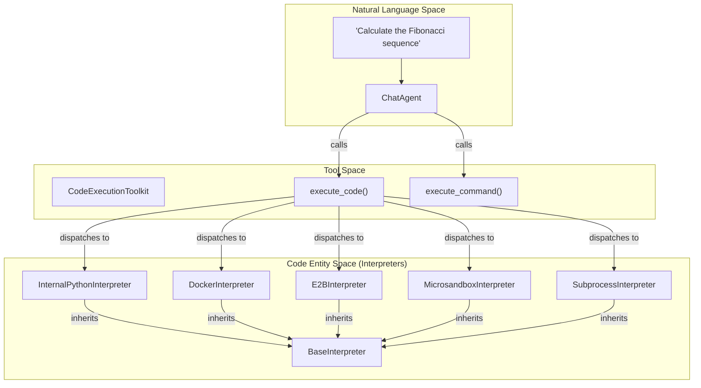
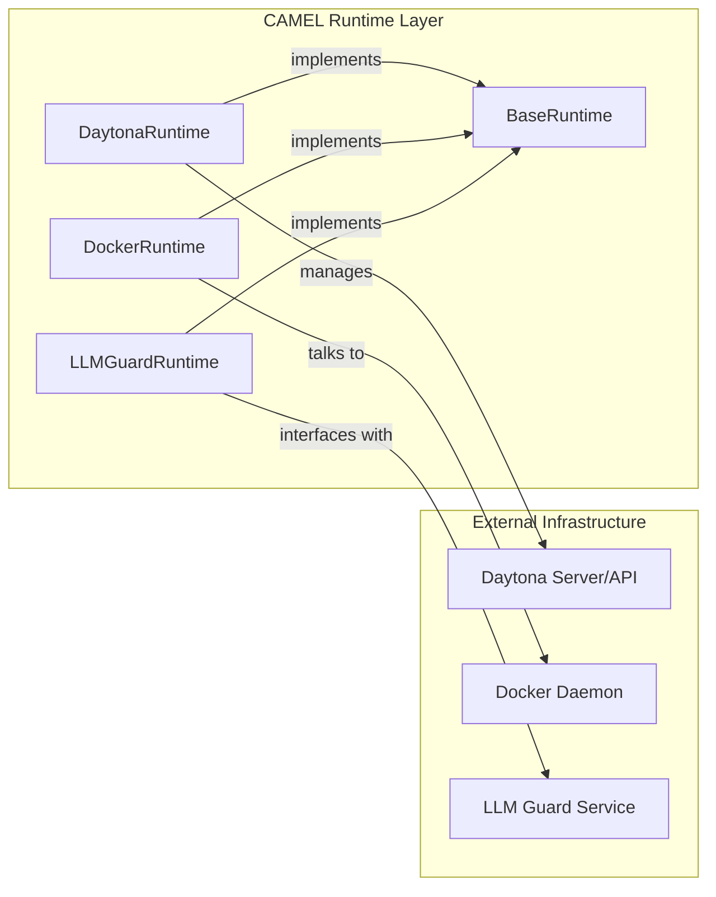

<!-- source: DeepWiki mcp.deepwiki.com · repo camel-ai/camel · page 6.5 Code Interpreters and Runtimes · fetched 2026-10-29 -->

# Code Interpreters and Runtimes

Relevant source files

The following files were used as context for generating this wiki page:

- [camel/datagen/self_improving_cot.py](camel/datagen/self_improving_cot.py)
- [camel/interpreters/base.py](camel/interpreters/base.py)
- [camel/interpreters/docker_interpreter.py](camel/interpreters/docker_interpreter.py)
- [camel/interpreters/e2b_interpreter.py](camel/interpreters/e2b_interpreter.py)
- [camel/interpreters/internal_python_interpreter.py](camel/interpreters/internal_python_interpreter.py)
- [camel/interpreters/ipython_interpreter.py](camel/interpreters/ipython_interpreter.py)
- [camel/interpreters/microsandbox_interpreter.py](camel/interpreters/microsandbox_interpreter.py)
- [camel/interpreters/subprocess_interpreter.py](camel/interpreters/subprocess_interpreter.py)
- [camel/prompts/base.py](camel/prompts/base.py)
- [camel/runtimes/base.py](camel/runtimes/base.py)
- [camel/runtimes/configs.py](camel/runtimes/configs.py)
- [camel/runtimes/daytona_runtime.py](camel/runtimes/daytona_runtime.py)
- [camel/runtimes/docker_runtime.py](camel/runtimes/docker_runtime.py)
- [camel/runtimes/llm_guard_runtime.py](camel/runtimes/llm_guard_runtime.py)
- [camel/runtimes/remote_http_runtime.py](camel/runtimes/remote_http_runtime.py)
- [camel/toolkits/code_execution.py](camel/toolkits/code_execution.py)
- [docs/mintlify/reference/camel.interpreters.base.mdx](docs/mintlify/reference/camel.interpreters.base.mdx)
- [docs/mintlify/reference/camel.interpreters.docker_interpreter.mdx](docs/mintlify/reference/camel.interpreters.docker_interpreter.mdx)
- [docs/mintlify/reference/camel.interpreters.e2b_interpreter.mdx](docs/mintlify/reference/camel.interpreters.e2b_interpreter.mdx)
- [docs/mintlify/reference/camel.interpreters.internal_python_interpreter.mdx](docs/mintlify/reference/camel.interpreters.internal_python_interpreter.mdx)
- [docs/mintlify/reference/camel.interpreters.ipython_interpreter.mdx](docs/mintlify/reference/camel.interpreters.ipython_interpreter.mdx)
- [docs/mintlify/reference/camel.interpreters.microsandbox_interpreter.mdx](docs/mintlify/reference/camel.interpreters.microsandbox_interpreter.mdx)
- [docs/mintlify/reference/camel.interpreters.subprocess_interpreter.mdx](docs/mintlify/reference/camel.interpreters.subprocess_interpreter.mdx)
- [docs/mintlify/reference/camel.toolkits.code_execution.mdx](docs/mintlify/reference/camel.toolkits.code_execution.mdx)
- [docs/reference/camel.interpreters.subprocess_interpreter.md](docs/reference/camel.interpreters.subprocess_interpreter.md)
- [docs/reference/camel.toolkits.code_execution.md](docs/reference/camel.toolkits.code_execution.md)
- [examples/interpreters/internal_python_interpreter.py](examples/interpreters/internal_python_interpreter.py)
- [test/interpreters/test_docker_interpreter.py](test/interpreters/test_docker_interpreter.py)
- [test/interpreters/test_interpreters_decorators.py](test/interpreters/test_interpreters_decorators.py)
- [test/interpreters/test_python_interpreter.py](test/interpreters/test_python_interpreter.py)
- [test/interpreters/test_subprocess_interpreter.py](test/interpreters/test_subprocess_interpreter.py)
- [test/prompts/test_prompt_base.py](test/prompts/test_prompt_base.py)
- [test/runtimes/test_base_runtime.py](test/runtimes/test_base_runtime.py)
- [test/toolkits/test_code_execution.py](test/toolkits/test_code_execution.py)

The CAMEL-AI framework provides a robust infrastructure for executing code generated by LLMs across various environments. This system is divided into **Interpreters**, which handle the logic of parsing and running code snippets, and **Runtimes**, which provide the underlying infrastructure or sandboxing layers.

## Architecture Overview

The system bridges Natural Language Space (where the LLM generates instructions) to Code Entity Space (where actual execution occurs) through the `CodeExecutionToolkit` and the `BaseInterpreter` abstraction.

### Natural Language to Code Entity Mapping

The following diagram illustrates how a user's request for code execution is routed through the CAMEL system to specific code entities.

**Code Execution Flow Diagram**

Sources: `camel/toolkits/code_execution.py:33-129` [33-129](), `camel/interpreters/base.py:23-23` [23-23](), `camel/toolkits/code_execution.py:140-177` [140-177]()

## Code Interpreters

Interpreters are the primary interface for executing code strings. All interpreters inherit from `BaseInterpreter` and implement the `run()` method.

### InternalPythonInterpreter
The `InternalPythonInterpreter` is a highly controlled environment adapted from Hugging Face's implementation. It uses Python's `ast` (Abstract Syntax Tree) module to parse code and execute it node-by-node, ensuring that only allowed functions and modules are accessed.

- **Action Space**: A dictionary mapping allowed function names to callable objects `[camel/interpreters/internal_python_interpreter.py:101-102]()`.
- **Import White List**: A strict list of modules that the LLM is permitted to import. Any other import statements will be rejected `[camel/interpreters/internal_python_interpreter.py:104-104]()`.
- **Fuzzy Matching**: Supports `fuzz_state` to match variables with similar names if the LLM makes minor naming errors `[camel/interpreters/internal_python_interpreter.py:103-103]()`.
- **Safe Built-ins**: Includes a default set of safe functions like `print`, `len`, `sum`, and `range` added via `_add_safe_builtins()` `[camel/interpreters/internal_python_interpreter.py:113-154]()`.
- **Unsafe Mode**: If enabled, it bypasses security checks and uses standard `eval()` or `exec()` `[camel/interpreters/internal_python_interpreter.py:163-164]()` (implied behavior from documentation).

### DockerInterpreter
The `DockerInterpreter` provides a secure, isolated environment by spawning a temporary Docker container for every execution session.

- **Container Management**: Uses the `docker` Python library. It builds a custom image tagged `camel-interpreter:latest` which includes Python and R `[camel/interpreters/docker_interpreter.py:126-136]()`.
- **Execution Mechanism**: 
    1. Content is written to a temporary file inside the container using `put_archive` `[camel/interpreters/docker_interpreter.py:148-162]()`.
    2. The file is executed via `exec_run` using language-specific commands mapped in `_CODE_EXECUTE_CMD_MAPPING` `[camel/interpreters/docker_interpreter.py:171-183]()`.
- **Cleanup**: The `cleanup()` method ensures containers are stopped and removed after use `[camel/interpreters/docker_interpreter.py:197-207]()` (implied behavior from `__del__`).

### E2BInterpreter
This interpreter utilizes the E2B (Execution-to-Browser) cloud sandboxing service. It is ideal for long-running tasks or environments requiring complex dependencies without local overhead.

- **Sandbox Creation**: Initializes a remote `Sandbox` using an `E2B_API_KEY` and optional `E2B_DOMAIN` for custom endpoints `[camel/interpreters/e2b_interpreter.py:65-81]()`.
- **Multi-language Support**: Maps code types like `python`, `bash`, `java`, `javascript`, and `r` to E2B supported languages `[camel/interpreters/e2b_interpreter.py:38-49]()`.
- **Rich Output Handling**: Processes `execution.results` to extract base64 encoded PNG, JPEG, SVG, or HTML data generated during execution `[camel/interpreters/e2b_interpreter.py:168-192]()`.

### SubprocessInterpreter
A lightweight interpreter that runs code in a local subprocess.

- **AST Transformation**: For Python code, it uses `ast` to wrap the final expression in a `print(repr())` call, allowing it to behave like a REPL `[camel/interpreters/subprocess_interpreter.py:116-156]()`.
- **Safety**: Includes a `require_confirm` flag that pauses execution for user approval `[camel/interpreters/subprocess_interpreter.py:78-78]()`.
- **Timeout**: Enforces an `execution_timeout` (default 60s) on the subprocess `[camel/interpreters/subprocess_interpreter.py:81-81]()`.

### MicrosandboxInterpreter
Provides integration with a specialized microsandbox server for execution.

- **Configuration**: Requires `server_url`, `api_key`, and `namespace` `[camel/toolkits/code_execution.py:127-134]()`.

Sources: `camel/interpreters/internal_python_interpreter.py:27-154` [27-154](), `camel/interpreters/docker_interpreter.py:35-207` [35-207](), `camel/interpreters/e2b_interpreter.py:25-192` [25-192](), `camel/interpreters/subprocess_interpreter.py:31-163` [31-163](), `camel/toolkits/code_execution.py:123-134` [123-134]()

## Runtime Backends

Runtimes represent the infrastructure layer where code entities (functions/tools) are deployed and executed.

### DaytonaRuntime
`DaytonaRuntime` integrates with the Daytona open-source development environment manager.

- **Sandbox Initialization**: Creates a sandbox from a specified Docker image (defaults to `python:3.11`) `[camel/runtimes/daytona_runtime.py:29-73]()`.
- **Function Injection**: Functions are serialized and uploaded to the sandbox as `.py` files `[camel/runtimes/daytona_runtime.py:164-173]()`.
- **Remote Execution**: Uses the Daytona SDK to execute the script and capture results `[camel/runtimes/daytona_runtime.py:183-195]()`.

### LLMGuard
`LLMGuardRuntime` acts as a security runtime layer to validate generated code against safety policies or scanning tools before it reaches an interpreter.

### Runtime Infrastructure Mapping

**Runtime Infrastructure Mapping**

Sources: `camel/runtimes/daytona_runtime.py:36-79` [36-79](), `camel/runtimes/base.py:24-24` [24-24](), `camel/runtimes/docker_runtime.py:26-26` [26-26](), `camel/runtimes/llm_guard_runtime.py:26-26` [26-26]()

## Implementation Details

### Data Flow in CodeExecutionToolkit
The `CodeExecutionToolkit` acts as the dispatcher. It initializes the requested interpreter in its `__init__` method and exposes `execute_code` and `execute_command` as tools for the agent.

| Component | Role | Primary Class |
| :--- | :--- | :--- |
| **Toolkit** | Interface for Agents | `CodeExecutionToolkit` |
| **Interpreter** | Logic Execution | `InternalPythonInterpreter`, `DockerInterpreter`, `E2BInterpreter`, `MicrosandboxInterpreter`, `SubprocessInterpreter`, `JupyterKernelInterpreter` |
| **Error Handling** | Exception Management | `InterpreterError` |
| **Environment** | Infrastructure | `Sandbox` (E2B), `Container` (Docker), `Subprocess`, `Microsandbox` |

### Key Functions
- `execute_code(code, code_type)`: The primary entry point for LLM-generated snippets `[camel/toolkits/code_execution.py:140-158]()`.
- `execute_command(command)`: Used to resolve dependencies or run shell commands `[camel/toolkits/code_execution.py:160-177]()`.
- `run(code, code_type)`: The core method implemented by all interpreters to process code strings `[camel/interpreters/internal_python_interpreter.py:156-162]()`, `[camel/interpreters/docker_interpreter.py:165-195]()`.
- `run_file(file, code_type)`: Method in `SubprocessInterpreter` to execute a script file `[camel/interpreters/subprocess_interpreter.py:88-103]()`.
- `CodePrompt.execute(interpreter)`: Allows executing a prompt directly if it contains code `[camel/prompts/base.py:168-194]()`.

Sources: `camel/toolkits/code_execution.py:56-177` [56-177](), `camel/interpreters/internal_python_interpreter.py:156-162` [156-162](), `camel/interpreters/subprocess_interpreter.py:88-103` [88-103](), `camel/prompts/base.py:168-194` [168-194]()

---

