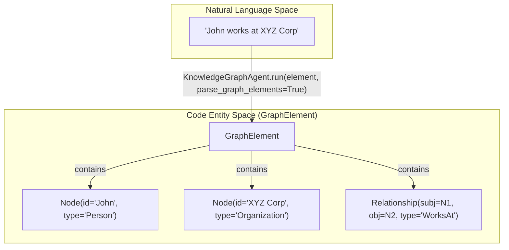
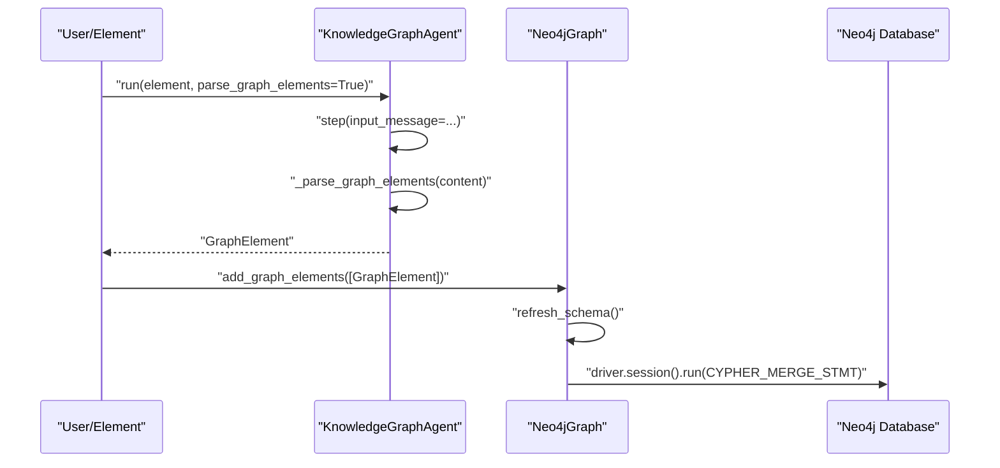

<!-- source: DeepWiki mcp.deepwiki.com · repo camel-ai/camel · page 6.6 Knowledge Graph and Graph Storage · fetched 2026-10-29 -->

# Knowledge Graph and Graph Storage

Relevant source files

The following files were used as context for generating this wiki page:

- [camel/agents/knowledge_graph_agent.py](camel/agents/knowledge_graph_agent.py)
- [camel/agents/role_assignment_agent.py](camel/agents/role_assignment_agent.py)
- [camel/agents/search_agent.py](camel/agents/search_agent.py)
- [camel/storages/graph_storages/graph_element.py](camel/storages/graph_storages/graph_element.py)
- [camel/storages/graph_storages/neo4j_graph.py](camel/storages/graph_storages/neo4j_graph.py)
- [docs/cookbooks/advanced_features/agents_with_dkg.ipynb](docs/cookbooks/advanced_features/agents_with_dkg.ipynb)
- [test/storages/graph_storages/test_neo4j_graph.py](test/storages/graph_storages/test_neo4j_graph.py)

The CAMEL-AI framework provides a comprehensive system for constructing, storing, and querying Knowledge Graphs (KGs). This system enables Graph-based Retrieval-Augmented Generation (GraphRAG) by transforming unstructured text into structured entities and relationships. The core of this system is the `KnowledgeGraphAgent`, which works in tandem with specialized graph storage backends like Neo4j.

## Core Data Models

The graph system is built upon three primary Pydantic models defined in the `graph_element.py` module. These models ensure type safety and structure for all graph operations.

### GraphElement Models
- **`Node`**: Represents an entity in the graph. It includes a unique `id`, a `type` (label, defaulting to "Node"), and a dictionary of `properties` for metadata [camel/storages/graph_storages/graph_element.py:26-39]().
- **`Relationship`**: Represents a directed edge between two `Node` objects. It includes a `subj` (source), `obj` (target), a `type` (predicate, defaulting to "Relationship"), an optional `timestamp`, and additional `properties` [camel/storages/graph_storages/graph_element.py:41-58]().
- **`GraphElement`**: A container object that holds lists of nodes and relationships extracted from a specific source `Element` (typically a document chunk from the `unstructured` library) [camel/storages/graph_storages/graph_element.py:60-75]().

### Mapping Natural Language to Graph Entities
The following diagram illustrates how the system bridges the gap between unstructured natural language and the structured `GraphElement` code entities.

**Entity Extraction Mapping**

Sources: [camel/agents/knowledge_graph_agent.py:88-106](), [camel/storages/graph_storages/graph_element.py:60-75]()

## KnowledgeGraphAgent

The `KnowledgeGraphAgent` is a specialized `ChatAgent` designed to parse unstructured content and return structured graph data [camel/agents/knowledge_graph_agent.py:116-123]().

### Key Functionality
- **Information Extraction**: It uses a predefined `text_prompt` that instructs the LLM to identify entities as `Node` objects and their connections as `Relationship` objects [camel/agents/knowledge_graph_agent.py:42-112]().
- **Parsing**: The `run()` method can return either a raw string or a structured `GraphElement` object if `parse_graph_elements` is set to `True` [camel/agents/knowledge_graph_agent.py:148-186]().
- **Validation**: Internal methods like `_validate_node` ensure that the LLM's output matches the required schema before processing [camel/agents/knowledge_graph_agent.py:188-191]().

Sources: [camel/agents/knowledge_graph_agent.py:116-186]()

## Neo4j Graph Storage

CAMEL supports Neo4j as a primary graph storage backend through the `Neo4jGraph` class, which implements the `BaseGraphStorage` interface [camel/storages/graph_storages/neo4j_graph.py:66-84]().

### Storage Features
- **Connection Management**: The class initializes a `neo4j.GraphDatabase.driver` using environment variables or provided parameters and verifies connectivity [camel/storages/graph_storages/neo4j_graph.py:99-124]().
- **Schema Management**: The storage automatically manages graph schemas using Neo4j's APOC (Awesome Procedures on Cypher) plugin. It provides methods like `refresh_schema()` to synchronize the local representation with the database [camel/storages/graph_storages/neo4j_graph.py:126-133]().
- **Data Ingestion**: The `add_graph_elements()` method iterates through `GraphElement` objects and generates Cypher queries to `MERGE` nodes and relationships into the database [test/storages/graph_storages/test_neo4j_graph.py:158-167]().
- **Source Tracking**: If `include_source` is enabled, the storage creates an `Element` node for the document chunk and links extracted entities back to their source using the `INCLUDE_DOCS_QUERY` [camel/storages/graph_storages/neo4j_graph.py:56-61](), [test/storages/graph_storages/test_neo4j_graph.py:178-187]().
- **Data Truncation**: To prevent context overflow in RAG applications, the `_value_truncate` method removes oversized lists (exceeding `LIST_LIMIT`) or embedding-like structures from query results [camel/storages/graph_storages/neo4j_graph.py:167-185]().

### Graph Data Flow
The diagram below shows the data flow from raw text to the `Neo4jGraph` storage.

**Graph Ingestion Workflow**

Sources: [camel/agents/knowledge_graph_agent.py:148-186](), [camel/storages/graph_storages/neo4j_graph.py:103-133](), [test/storages/graph_storages/test_neo4j_graph.py:167-167]()

## Graph-Based RAG Patterns

CAMEL enables advanced RAG patterns by combining graph storage with agentic reasoning.

| Pattern | Description | Implementation |
| :--- | :--- | :--- |
| **Dynamic KG Construction** | Building a graph incrementally as new documents are processed. | `KnowledgeGraphAgent` + `Neo4jGraph.add_graph_elements()` |
| **Schema-Aware Querying** | Using the graph schema to help LLMs generate valid Cypher queries. | `Neo4jGraph.get_schema` [camel/storages/graph_storages/neo4j_graph.py:141-156]() |
| **Sub-graph Retrieval** | Fetching specific neighborhoods of nodes to provide context for a query. | `Neo4jGraph.query()` with Cypher `MATCH` patterns |
| **Deduplication** | Ensuring unique entities across different document chunks. | Handled by Cypher `MERGE` logic in `add_graph_elements` |

### Querying and Schema
The `Neo4jGraph` class provides structured access to the database schema, which is essential for agents to understand the types of nodes and relationships available for querying. It uses `NODE_PROPERTY_QUERY`, `REL_PROPERTY_QUERY`, and `REL_QUERY` to build a map of the graph's structure, which is stored in `structured_schema` [camel/storages/graph_storages/neo4j_graph.py:28-54](), [camel/storages/graph_storages/neo4j_graph.py:109-110]().

Sources: [camel/storages/graph_storages/neo4j_graph.py:28-54](), [docs/cookbooks/advanced_features/agents_with_dkg.ipynb:33-46]()

---

