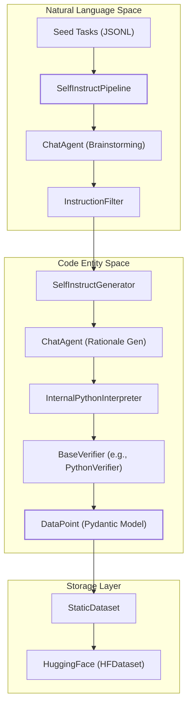
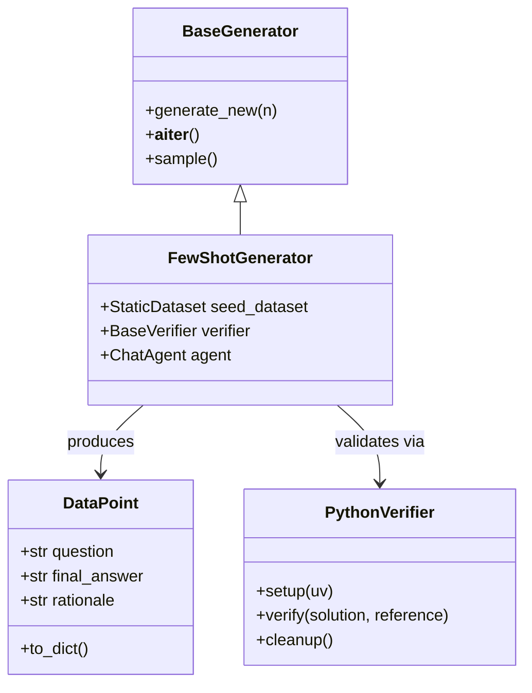

<!-- source: DeepWiki mcp.deepwiki.com · repo camel-ai/camel · page 7 Data Generation and Synthetic Datasets · fetched 2026-10-29 -->

# Data Generation and Synthetic Datasets

Relevant source files

The following files were used as context for generating this wiki page:

- [camel/datagen/__init__.py](camel/datagen/__init__.py)
- [camel/datagen/self_instruct/__init__.py](camel/datagen/self_instruct/__init__.py)
- [camel/datagen/self_instruct/filter/__init__.py](camel/datagen/self_instruct/filter/__init__.py)
- [camel/datagen/self_instruct/filter/filter_function.py](camel/datagen/self_instruct/filter/filter_function.py)
- [camel/datagen/self_instruct/filter/filter_registry.py](camel/datagen/self_instruct/filter/filter_registry.py)
- [camel/datagen/self_instruct/filter/instruction_filter.py](camel/datagen/self_instruct/filter/instruction_filter.py)
- [camel/datagen/self_instruct/self_instruct.py](camel/datagen/self_instruct/self_instruct.py)
- [camel/datagen/self_instruct/templates.py](camel/datagen/self_instruct/templates.py)
- [camel/datasets/__init__.py](camel/datasets/__init__.py)
- [camel/datasets/base_generator.py](camel/datasets/base_generator.py)
- [camel/datasets/few_shot_generator.py](camel/datasets/few_shot_generator.py)
- [camel/datasets/models.py](camel/datasets/models.py)
- [camel/datasets/self_instruct_generator.py](camel/datasets/self_instruct_generator.py)
- [camel/environments/models.py](camel/environments/models.py)
- [camel/environments/single_step.py](camel/environments/single_step.py)
- [camel/verifiers/__init__.py](camel/verifiers/__init__.py)
- [camel/verifiers/base.py](camel/verifiers/base.py)
- [camel/verifiers/models.py](camel/verifiers/models.py)
- [camel/verifiers/python_verifier.py](camel/verifiers/python_verifier.py)
- [examples/datagen/self_instruct/data_output.json](examples/datagen/self_instruct/data_output.json)
- [examples/datagen/self_instruct/seed_tasks.jsonl](examples/datagen/self_instruct/seed_tasks.jsonl)
- [examples/datagen/self_instruct/self_instruct.py](examples/datagen/self_instruct/self_instruct.py)
- [examples/dataset/few_shot_generator.py](examples/dataset/few_shot_generator.py)
- [examples/dataset/self_instruct_generator.py](examples/dataset/self_instruct_generator.py)
- [test/datagen/self_instruct/filter/instruction_filter_tests.py](test/datagen/self_instruct/filter/instruction_filter_tests.py)
- [test/datasets/test_base_dataset.py](test/datasets/test_base_dataset.py)
- [test/datasets/test_self_instruct_generator.py](test/datasets/test_self_instruct_generator.py)
- [test/environments/test_single_step_env.py](test/environments/test_single_step_env.py)
- [test/verifiers/test_base_verifier.py](test/verifiers/test_base_verifier.py)
- [test/verifiers/test_python_verifier.py](test/verifiers/test_python_verifier.py)

CAMEL provides a robust suite of tools for generating high-quality synthetic datasets, ranging from simple few-shot generation to complex self-improving pipelines. This system bridges the gap between raw data and structured training sets by utilizing communicative agents to brainstorm, evolve, and verify instructions and their corresponding rationales.

## Overview of Data Generation Capabilities

The data generation ecosystem in CAMEL is built around the concept of a `DataPoint` [camel/datasets/models.py:27-27](), which encapsulates a question, a final answer, and the logical rationale or code used to derive that answer [test/datasets/test_base_dataset.py:38-52]().

### Core Components
*   **Generators**: Abstracted by `BaseGenerator` [camel/datasets/base_generator.py:32-37](), these classes handle the logic of creating new `DataPoint` instances using either synchronous or asynchronous iterators [camel/datasets/base_generator.py:103-168]().
*   **Pipelines**: High-level orchestrators like `SelfInstructPipeline` [camel/datagen/self_instruct/self_instruct.py:33-54]() that manage the flow from seed tasks to filtered, machine-generated instructions.
*   **Verifiers**: Specialized classes such as `PythonVerifier` [camel/verifiers/python_verifier.py:34-47]() that ensure the correctness of synthetic answers by executing code in isolated environments.
*   **Environments**: The `SingleStepEnv` [camel/environments/single_step.py:32-50]() provides a lightweight wrapper for Reinforcement Learning (RL) scenarios, treating LLM responses as `Action` [camel/environments/models.py:21-34]() objects verified against a dataset.

### System Architecture: From Generation to Dataset
The following diagram illustrates how generation entities interact with core agent logic and execution components.

**Data Generation Flow Architecture**

Sources: [camel/datagen/self_instruct/self_instruct.py:33-54](), [camel/datasets/models.py:27-27](), [camel/verifiers/python_verifier.py:34-47](), [camel/environments/single_step.py:32-50](), [camel/datasets/base_generator.py:32-37]()

---

## Self-Instruct and Evol-Instruct (#7.1)

The **Self-Instruct** framework allows agents to bootstrap a small set of human-written "seed" instructions into a large-scale synthetic dataset. The `SelfInstructPipeline` uses a `ChatAgent` to generate new tasks based on a configurable `human_to_machine_ratio` [camel/datagen/self_instruct/self_instruct.py:60-70](). 

Key features include:
*   **Instruction Filtering**: The `InstructionFilter` [camel/datagen/self_instruct/self_instruct.py:90-92]() applies various checks to ensure diversity and quality, including `RougeSimilarityFilter` [camel/datagen/self_instruct/self_instruct.py:26-26]().
*   **Template-Based Generation**: Utilizes `SelfInstructTemplates` [camel/datagen/self_instruct/templates.py:19-20]() to classify tasks and produce labeled examples via prompts like `clf_template` [camel/datagen/self_instruct/templates.py:22-117]().
*   **Few-Shot Bootstrapping**: The `FewShotGenerator` [camel/datasets/few_shot_generator.py:60-65]() leverages existing `StaticDataset` examples to prompt agents for similar high-quality data points [camel/datasets/few_shot_generator.py:109-121]().

For details, see [Self-Instruct and Evol-Instruct](#7.1).

Sources: [camel/datagen/self_instruct/self_instruct.py:148-181](), [camel/datagen/self_instruct/templates.py:22-55](), [camel/datasets/few_shot_generator.py:99-121]()

---

## Dataset Management and Verifiers (#7.2)

CAMEL provides a structured way to handle generated data through the `StaticDataset` [camel/datasets/static_dataset.py:38-47](), which can be initialized from Hugging Face `HFDataset` objects [test/datasets/test_base_dataset.py:123-144]().

The generation process often involves a "generate-then-verify" loop:
1.  **Generation**: `FewShotGenerator` or `SelfInstructGenerator` uses an agent to create a question and a rationale (often Python code) [camel/datasets/few_shot_generator.py:130-140]().
2.  **Verification**: The `BaseVerifier` [camel/verifiers/base.py:28-44]() executes the solution. The `PythonVerifier` specifically sets up isolated virtual environments (optionally using `uv`) to run code safely [camel/verifiers/python_verifier.py:87-107]().

**Entity Mapping: Generation to Code Execution**

Sources: [camel/datasets/base_generator.py:32-37](), [camel/datasets/few_shot_generator.py:67-74](), [camel/verifiers/python_verifier.py:49-69](), [camel/verifiers/base.py:165-185]()

For details, see [Dataset Management and Verifiers](#7.2).

---

## DataHubs and Benchmarks (#7.3)

Once datasets are generated and verified, CAMEL facilitates their export and evaluation. The `StaticDataset` class supports filtering and strict validation of `DataPoint` schemas [test/datasets/test_base_dataset.py:171-189]().

The framework supports advanced benchmarking through specialized environments. The `SingleStepEnv` [camel/environments/single_step.py:32-50]() allows datasets to be used as evaluation environments for RL-tuned policies, providing `StepResult` [camel/environments/models.py:67-87]() objects containing rewards and verification feedback [camel/environments/single_step.py:40-43]().

For details, see [DataHubs and Benchmarks](#7.3).

Sources: [camel/environments/single_step.py:141-166](), [test/datasets/test_base_dataset.py:123-144](), [camel/environments/models.py:89-94]()

---

