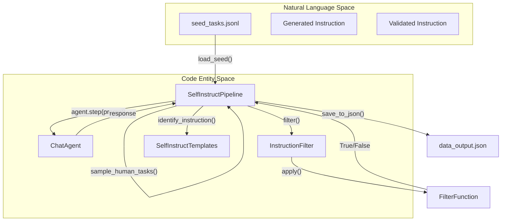
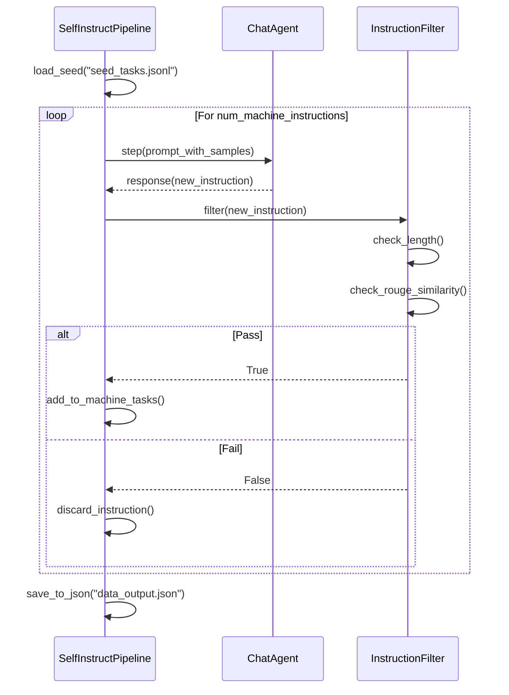

<!-- source: DeepWiki mcp.deepwiki.com · repo camel-ai/camel · page 7.1 Self-Instruct and Evol-Instruct · fetched 2026-10-29 -->

# Self-Instruct and Evol-Instruct

<details>
<summary>Relevant source files</summary>

The following files were used as context for generating this wiki page:

- [camel/datagen/__init__.py](camel/datagen/__init__.py)
- [camel/datagen/self_instruct/__init__.py](camel/datagen/self_instruct/__init__.py)
- [camel/datagen/self_instruct/filter/__init__.py](camel/datagen/self_instruct/filter/__init__.py)
- [camel/datagen/self_instruct/filter/filter_function.py](camel/datagen/self_instruct/filter/filter_function.py)
- [camel/datagen/self_instruct/filter/filter_registry.py](camel/datagen/self_instruct/filter/filter_registry.py)
- [camel/datagen/self_instruct/filter/instruction_filter.py](camel/datagen/self_instruct/filter/instruction_filter.py)
- [camel/datagen/self_instruct/self_instruct.py](camel/datagen/self_instruct/self_instruct.py)
- [camel/datagen/self_instruct/templates.py](camel/datagen/self_instruct/templates.py)
- [docs/cookbooks/applications/dynamic_travel_planner.ipynb](docs/cookbooks/applications/dynamic_travel_planner.ipynb)
- [docs/cookbooks/applications/finance_discord_bot.ipynb](docs/cookbooks/applications/finance_discord_bot.ipynb)
- [docs/cookbooks/applications/index.rst](docs/cookbooks/applications/index.rst)
- [docs/cookbooks/applications/pptx_toolkit.ipynb](docs/cookbooks/applications/pptx_toolkit.ipynb)
- [docs/cookbooks/basic_concepts/agents_message.ipynb](docs/cookbooks/basic_concepts/agents_message.ipynb)
- [docs/cookbooks/basic_concepts/agents_prompting.ipynb](docs/cookbooks/basic_concepts/agents_prompting.ipynb)
- [docs/cookbooks/basic_concepts/create_your_first_agent.ipynb](docs/cookbooks/basic_concepts/create_your_first_agent.ipynb)
- [docs/cookbooks/basic_concepts/create_your_first_agents_society.ipynb](docs/cookbooks/basic_concepts/create_your_first_agents_society.ipynb)
- [docs/cookbooks/data_generation/cot_data_gen_sft_qwen_unsolth_upload_huggingface.ipynb](docs/cookbooks/data_generation/cot_data_gen_sft_qwen_unsolth_upload_huggingface.ipynb)
- [docs/cookbooks/data_generation/data_gen_with_real_function_calls_and_hermes_format.ipynb](docs/cookbooks/data_generation/data_gen_with_real_function_calls_and_hermes_format.ipynb)
- [docs/cookbooks/data_generation/distill_math_reasoning_data_from_deepseek_r1.ipynb](docs/cookbooks/data_generation/distill_math_reasoning_data_from_deepseek_r1.ipynb)
- [docs/cookbooks/data_generation/index.rst](docs/cookbooks/data_generation/index.rst)
- [docs/cookbooks/data_generation/self_improving_math_reasoning_data_distillation_from_deepSeek_r1.ipynb](docs/cookbooks/data_generation/self_improving_math_reasoning_data_distillation_from_deepSeek_r1.ipynb)
- [docs/cookbooks/data_generation/self_instruct_data_generation.ipynb](docs/cookbooks/data_generation/self_instruct_data_generation.ipynb)
- [docs/cookbooks/data_generation/sft_data_generation_and_unsloth_finetuning_Qwen2_5_7B.ipynb](docs/cookbooks/data_generation/sft_data_generation_and_unsloth_finetuning_Qwen2_5_7B.ipynb)
- [docs/cookbooks/data_generation/sft_data_generation_and_unsloth_finetuning_mistral_7b_instruct.ipynb](docs/cookbooks/data_generation/sft_data_generation_and_unsloth_finetuning_mistral_7b_instruct.ipynb)
- [docs/cookbooks/data_generation/sft_data_generation_and_unsloth_finetuning_tinyllama.ipynb](docs/cookbooks/data_generation/sft_data_generation_and_unsloth_finetuning_tinyllama.ipynb)
- [docs/cookbooks/data_generation/synthetic_dataevaluation&filter_with_reward_model.ipynb](docs/cookbooks/data_generation/synthetic_dataevaluation&filter_with_reward_model.ipynb)
- [docs/cookbooks/data_processing/agent_with_chunkr_for_pdf_parsing.ipynb](docs/cookbooks/data_processing/agent_with_chunkr_for_pdf_parsing.ipynb)
- [docs/cookbooks/data_processing/ingest_data_from_websites_with_Firecrawl.ipynb](docs/cookbooks/data_processing/ingest_data_from_websites_with_Firecrawl.ipynb)
- [docs/cookbooks/data_processing/video_analysis.ipynb](docs/cookbooks/data_processing/video_analysis.ipynb)
- [docs/cookbooks/multi_agent_society/workforce_judge_committee.ipynb](docs/cookbooks/multi_agent_society/workforce_judge_committee.ipynb)
- [docs/cookbooks/multi_agent_society/workforce_judge_committee.md](docs/cookbooks/multi_agent_society/workforce_judge_committee.md)
- [docs/mintlify/cookbooks/multi_agent_society/workforce_judge_committee.mdx](docs/mintlify/cookbooks/multi_agent_society/workforce_judge_committee.mdx)
- [examples/datagen/self_instruct/data_output.json](examples/datagen/self_instruct/data_output.json)
- [examples/datagen/self_instruct/seed_tasks.jsonl](examples/datagen/self_instruct/seed_tasks.jsonl)
- [examples/datagen/self_instruct/self_instruct.py](examples/datagen/self_instruct/self_instruct.py)
- [test/datagen/self_instruct/filter/instruction_filter_tests.py](test/datagen/self_instruct/filter/instruction_filter_tests.py)

</details>


This page documents the synthetic data generation capabilities of the CAMEL framework, focusing on the **Self-Instruct** pipeline for automated instruction dataset creation, the **Evol-Instruct** methodology for evolving instruction complexity, and **Self-Improving Chain-of-Thought (CoT)** generation. These tools allow developers to bootstrap high-quality instruction-tuning datasets from a small set of seed tasks using LLMs.

## Self-Instruct Data Generation Pipeline

The `Self-Instruct` pipeline is an implementation of the technique used to automatically generate instruction datasets for Large Language Models (LLMs). It reduces the human effort required to build diverse datasets by using an agent to generate new tasks based on a small pool of "seed" tasks.

### Core Architecture and Data Flow

The pipeline is managed by the `SelfInstructPipeline` class [camel/datagen/self_instruct/self_instruct.py:33](). It maintains two pools of tasks: `human_tasks` (loaded from a seed file) and `machine_tasks` (generated during the process) [camel/datagen/self_instruct/self_instruct.py:71-72]().

1.  **Seed Loading**: Human-written instructions are loaded from a `.jsonl` file via `load_seed()` [camel/datagen/self_instruct/self_instruct.py:94-112]().
2.  **Task Sampling**: For each generation step, the pipeline samples a mix of human and machine tasks based on a configurable `human_to_machine_ratio` (default is 6:2) [camel/datagen/self_instruct/self_instruct.py:62]().
3.  **Instruction Generation**: A `ChatAgent` [camel/agents/chat_agent.py]() is prompted with these samples to produce exactly one new task that fits the style of the examples via `generate_machine_instruction()` [camel/datagen/self_instruct/self_instruct.py:148-189]().
4.  **Classification & Instance Generation**: The pipeline identifies if the task is a classification task using `identify_instruction()` [camel/datagen/self_instruct/self_instruct.py:191-224](). Depending on the type, it generates input-output instances using specific templates from `SelfInstructTemplates` [camel/datagen/self_instruct/templates.py:19-20]().

### Pipeline Implementation Diagram

The following diagram illustrates the interaction between the pipeline, the agent, and the filtering system.

**Self-Instruct Data Flow**

**Sources:** [camel/datagen/self_instruct/self_instruct.py:33-224](), [camel/datagen/self_instruct/filter/instruction_filter.py:24-97]()

## Instruction Filtering

To ensure the quality and diversity of the machine-generated dataset, CAMEL implements a robust filtering system. The `InstructionFilter` class applies a series of validation checks to every generated instruction.

### Filter Registry and Functions
Filters are registered in the `FILTER_REGISTRY` [camel/datagen/self_instruct/filter/filter_registry.py:19](). Standard filters include:
*   **Length Filter**: Ensures instructions are within a specific character or word count range.
*   **Keyword Filter**: Blocks instructions containing specific "forbidden" keywords (e.g., "image", "video" if the model is text-only) [camel/datagen/self_instruct/filter/instruction_filter.py:76]().
*   **Language Filter**: Detects and removes non-English instructions [camel/datagen/self_instruct/filter/instruction_filter.py:78]().
*   **ROUGE Similarity Filter**: Compares the new instruction against existing ones to prevent redundancy. If the ROUGE score exceeds a threshold (e.g., 0.7), the instruction is discarded [camel/datagen/self_instruct/filter/instruction_filter.py:79]().

### Technical Implementation
The `InstructionFilter` can be configured to `stop_on_first_failure` to optimize processing time [camel/datagen/self_instruct/filter/instruction_filter.py:65]().

| Class | Purpose | Key Method |
| :--- | :--- | :--- |
| `InstructionFilter` | Orchestrates multiple filter functions. | `filter(instruction)` [camel/datagen/self_instruct/filter/instruction_filter.py:67-97]() |
| `FilterFunction` | Abstract base class for individual filters. | `apply(instruction)` [camel/datagen/self_instruct/filter/filter_function.py:24]() |
| `RougeSimilarityFilter` | Measures text overlap with existing tasks. | `apply(instruction)` [camel/datagen/self_instruct/filter/filter_function.py:80]() |

**Sources:** [camel/datagen/self_instruct/filter/instruction_filter.py:24-97](), [camel/datagen/self_instruct/filter/filter_function.py:18-100]()

## Evol-Instruct and CoT Generation

CAMEL extends basic self-instruction with advanced reasoning data generation techniques, including **Evol-Instruct** and **Self-Improving CoT**.

### Self-Improving CoT Pipeline
The `SelfImprovingCoTPipeline` [camel/datagen/self_improving_cot.py:16]() (referenced in [docs/cookbooks/data_generation/index.rst:24]()) is designed to generate high-quality Chain-of-Thought (CoT) data. It operates by:
1.  Generating an initial reasoning path for a given instruction.
2.  Using a critic-like mechanism or internal validation to identify flaws in the reasoning.
3.  Refining the CoT until it meets accuracy and clarity standards.

### Data Generation Classes

| Class | File Path | Role |
| :--- | :--- | :--- |
| `CoTDataGenerator` | `camel/datagen/cot_datagen.py` | Generates basic step-by-step reasoning for instructions [camel/datagen/__init__.py:15](). |
| `SelfImprovingCoTPipeline` | `camel/datagen/self_improving_cot.py` | Iteratively improves generated reasoning paths [camel/datagen/__init__.py:16](). |
| `SelfInstructPipeline` | `camel/datagen/self_instruct/self_instruct.py` | Manages the end-to-end generation of tasks and instances [camel/datagen/__init__.py:17](). |

**Sources:** [camel/datagen/__init__.py:15-23](), [camel/datagen/self_instruct/self_instruct.py:33-70](), [docs/cookbooks/data_generation/index.rst:23-24]()

## Implementation Example: Running a Pipeline

The pipeline is typically initialized with a `ChatAgent` and a path to seed tasks.

```python
from camel.agents import ChatAgent
from camel.datagen.self_instruct import SelfInstructPipeline
from camel.models import ModelFactory
from camel.types import ModelType

# Initialize the agent
model = ModelFactory.create(model_type=ModelType.GPT_4O)
agent = ChatAgent(system_message=BaseMessage.make_assistant_message(role_name="Assistant", content="You are a helpful assistant."), model=model)

# Initialize the pipeline
pipeline = SelfInstructPipeline(
    agent=agent,
    seed="examples/datagen/self_instruct/seed_tasks.jsonl",
    num_machine_instructions=50
)

# Run generation
# pipeline.generate_machine_instruction() is called internally during execution
```
**Sources:** [camel/datagen/self_instruct/self_instruct.py:56-72](), [docs/cookbooks/data_generation/self_instruct_data_generation.ipynb:9-50]()

### System Interaction Diagram

**Agent and Filter Integration**

**Sources:** [camel/datagen/self_instruct/self_instruct.py:148-189](), [camel/datagen/self_instruct/filter/instruction_filter.py:67-97]()

---

