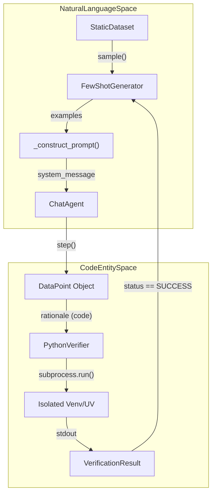
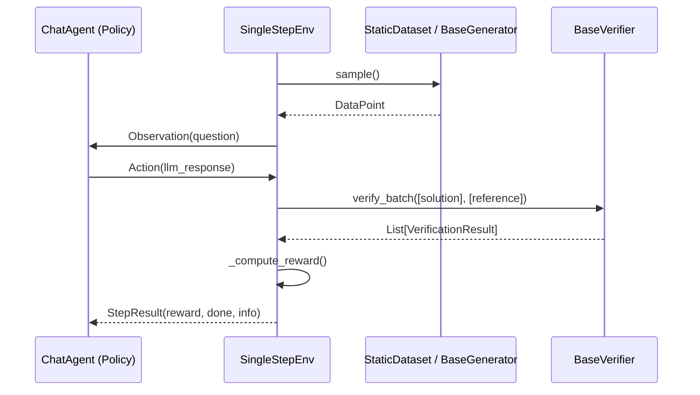

<!-- source: DeepWiki mcp.deepwiki.com · repo camel-ai/camel · page 7.2 Dataset Management and Verifiers · fetched 2026-10-29 -->

# Dataset Management and Verifiers

Relevant source files

The following files were used as context for generating this wiki page:

- [camel/configs/qwen_config.py](camel/configs/qwen_config.py)
- [camel/datasets/__init__.py](camel/datasets/__init__.py)
- [camel/datasets/base_generator.py](camel/datasets/base_generator.py)
- [camel/datasets/few_shot_generator.py](camel/datasets/few_shot_generator.py)
- [camel/datasets/models.py](camel/datasets/models.py)
- [camel/datasets/self_instruct_generator.py](camel/datasets/self_instruct_generator.py)
- [camel/environments/models.py](camel/environments/models.py)
- [camel/environments/single_step.py](camel/environments/single_step.py)
- [camel/models/_utils.py](camel/models/_utils.py)
- [camel/models/aiml_model.py](camel/models/aiml_model.py)
- [camel/models/qwen_model.py](camel/models/qwen_model.py)
- [camel/models/siliconflow_model.py](camel/models/siliconflow_model.py)
- [camel/verifiers/__init__.py](camel/verifiers/__init__.py)
- [camel/verifiers/base.py](camel/verifiers/base.py)
- [camel/verifiers/models.py](camel/verifiers/models.py)
- [camel/verifiers/python_verifier.py](camel/verifiers/python_verifier.py)
- [docs/cookbooks/loong/batched_single_step_env.ipynb](docs/cookbooks/loong/batched_single_step_env.ipynb)
- [docs/cookbooks/loong/multi_step_rl.ipynb](docs/cookbooks/loong/multi_step_rl.ipynb)
- [docs/cookbooks/loong/single_step_env.ipynb](docs/cookbooks/loong/single_step_env.ipynb)
- [examples/dataset/few_shot_generator.py](examples/dataset/few_shot_generator.py)
- [examples/dataset/self_instruct_generator.py](examples/dataset/self_instruct_generator.py)
- [examples/models/qwen_model_example.py](examples/models/qwen_model_example.py)
- [test/datasets/test_base_dataset.py](test/datasets/test_base_dataset.py)
- [test/datasets/test_self_instruct_generator.py](test/datasets/test_self_instruct_generator.py)
- [test/environments/test_single_step_env.py](test/environments/test_single_step_env.py)
- [test/models/test_aiml_model.py](test/models/test_aiml_model.py)
- [test/models/test_qwen_model.py](test/models/test_qwen_model.py)
- [test/verifiers/test_base_verifier.py](test/verifiers/test_base_verifier.py)
- [test/verifiers/test_python_verifier.py](test/verifiers/test_python_verifier.py)

The CAMEL framework provides a robust infrastructure for managing static datasets, generating synthetic data through LLM-based agents, and verifying the correctness of model outputs. These components are essential for Reinforcement Learning from AI Feedback (RLAIF) and supervised fine-tuning pipelines.

## Dataset Management

CAMEL distinguishes between static datasets and dynamic generators. All data units are encapsulated in the `DataPoint` model, which ensures consistency across the ecosystem.

### DataPoint Model
The `DataPoint` class is the fundamental unit of data in CAMEL. It requires a `question` and a `final_answer`, with an optional `rationale` (often used for Chain-of-Thought or code-based reasoning) and `metadata`.
- **Definition**: [camel/datasets/models.py:22-54]()
- **Validation**: Uses Pydantic for strict type checking [camel/datasets/models.py:22-22]().
- **Conversion**: Supports dictionary conversion via `to_dict()` [test/datasets/test_base_dataset.py:72-88]() and `from_dict()` [test/datasets/test_base_dataset.py:90-104]().

### StaticDataset
`StaticDataset` is a PyTorch-compatible dataset designed for fixed-size data. It can ingest data from Hugging Face `datasets.Dataset`, JSONL files, or lists of dictionaries.
- **Initialization**: Validates integrity and can filter out malformed samples if `strict=False` [test/datasets/test_base_dataset.py:183-189](). It requires a minimum number of samples specified by `min_samples` [test/datasets/test_base_dataset.py:192-196]().
- **Sampling**: Supports deterministic sampling via a local random number generator [camel/environments/single_step.py:185-189]().

### BaseGenerator
`BaseGenerator` is an abstract base class for infinite or on-demand data generation. It implements the PyTorch `IterableDataset` interface [camel/datasets/base_generator.py:32-37]().
- **Interface**: Requires subclasses to implement `generate_new(n)` [camel/datasets/base_generator.py:78-101]().
- **Caching**: Automatically caches generated points to a JSONL file every 100 iterations if a `cache` path is provided [camel/datasets/base_generator.py:123-129]().
- **Iteration**: Supports both asynchronous (`__aiter__`) [camel/datasets/base_generator.py:103-131]() and synchronous (`__iter__`) [camel/datasets/base_generator.py:133-168]() iteration. Synchronous iteration raises a `RuntimeError` if called within an active event loop [camel/datasets/base_generator.py:145-152]().

### Self-Instruct and Few-Shot Generation
CAMEL provides specialized generators for synthetic data:
- **FewShotGenerator**: Leverages a seed dataset, a `ChatAgent`, and a `BaseVerifier` to generate new samples by providing examples in the system prompt [camel/datasets/few_shot_generator.py:60-93](). It uses a strict output format requirement in its `SYSTEM_PROMPT` [camel/datasets/few_shot_generator.py:32-57]().
- **SelfInstructGenerator**: Implements the self-instruct pipeline to generate diverse instructions and rationales [camel/datasets/self_instruct_generator.py:63-63]().

### Synthetic Data Generation Flow

The following diagram illustrates how `BaseGenerator` subclasses like `FewShotGenerator` bridge the gap between abstract dataset definitions and concrete code execution for validation.

**Data Generation and Validation Flow**

Sources: [camel/datasets/few_shot_generator.py:60-121](), [camel/datasets/base_generator.py:32-77](), [camel/verifiers/python_verifier.py:34-47]()

---

## Verifiers

Verifiers are responsible for evaluating the correctness of a "solution" against a "reference answer". They are used both during data generation and during RL training.

### BaseVerifier Architecture
All verifiers inherit from `BaseVerifier`, which provides:
- **Batch Processing**: Uses `BatchProcessor` to handle multiple verifications efficiently [camel/verifiers/base.py:88-88]().
- **Retry Logic**: Configurable `max_retries` and `retry_delay` for handling transient failures [camel/verifiers/base.py:51-52]().
- **Resource Monitoring**: Optional CPU and memory thresholds to prevent system exhaustion during heavy verification tasks [camel/verifiers/base.py:54-55]().

### PythonVerifier
The `PythonVerifier` executes code-based rationales in isolated environments to verify logic.
- **Isolation**: Creates temporary virtual environments using `venv.create` [camel/verifiers/python_verifier.py:99-102]() or `uv` [camel/verifiers/python_verifier.py:142-169]().
- **Package Management**: Installs `required_packages` using `pip` or `uv` in the isolated environment [camel/verifiers/python_verifier.py:110-118]().
- **Float Tolerance**: Supports fuzzy matching for numerical outputs using `_is_equal_with_tolerance` [camel/verifiers/python_verifier.py:174-179]().
- **Verification Logic**: Compares execution output against a `reference_answer` [test/verifiers/test_python_verifier.py:94-107]().

### MathVerifier
Specialized for mathematical expressions, the `MathVerifier` uses symbolic manipulation or canonicalization to compare equations that may be formatted differently but are mathematically equivalent.
- **Definition**: [camel/verifiers/math_verifier.py]()

| Verifier Type | Core Functionality | Primary Use Case |
| :--- | :--- | :--- |
| `PythonVerifier` | Subprocess execution of Python code | Verifying code generation or algorithmic reasoning |
| `MathVerifier` | Mathematical equivalence checking | Verifying symbolic math or numeric answers |
| `BaseVerifier` | Abstract verification interface | Custom logic (e.g., regex matching, LLM-as-a-judge) |

Sources: [camel/verifiers/base.py:28-44](), [camel/verifiers/python_verifier.py:34-80](), [test/verifiers/test_python_verifier.py:46-58]()

---

## RL Environments

CAMEL provides environments that wrap datasets and verifiers into an interface compatible with Reinforcement Learning, mimicking the OpenAI Gym API.

### SingleStepEnv
This environment models a single interaction where an agent receives a question, provides a response, and receives a reward based on verification [camel/environments/single_step.py:32-50]().
- **Reset**: Samples a new batch of `Observation` objects from the dataset [camel/environments/single_step.py:141-184]().
- **Step**: Takes an `Action` (LLM response), calls `verifier.verify_batch()`, and returns a `StepResult` containing the reward [camel/environments/single_step.py:241-314]().
- **Reward Logic**: Defaults to `ACCURACY_REWARD` (1.0) for successful verification [camel/environments/single_step.py:56-56]() but can be extended via `_compute_custom_reward` [test/environments/test_single_step_env.py:31-37]().

### MultiStepEnv
Used for tasks requiring multiple turns or state changes, such as games or complex tool-use scenarios [docs/cookbooks/loong/multi_step_rl.ipynb:11-15]().
- **TicTacToeEnv**: A concrete example using an `Opponent` class to simulate an adversary [docs/cookbooks/loong/multi_step_rl.ipynb:65-67]().

**RL Environment Data Flow**

Sources: [camel/environments/single_step.py:32-50](), [camel/environments/models.py:27-27](), [test/environments/test_single_step_env.py:92-112]()

## Key Classes and Functions Summary

| Class/Function | File Path | Role |
| :--- | :--- | :--- |
| `DataPoint` | `camel/datasets/models.py` | Schema for a single training/evaluation unit. |
| `StaticDataset` | `camel/datasets/static_dataset.py` | Fixed-size data container for SFT/RL. |
| `FewShotGenerator` | `camel/datasets/few_shot_generator.py` | Generates new data using an agent and seed examples. |
| `PythonVerifier` | `camel/verifiers/python_verifier.py` | Executes code in venv to check correctness. |
| `SingleStepEnv` | `camel/environments/single_step.py` | RL environment for single-turn Q&A tasks. |
| `BatchProcessor` | `camel/utils/batch_processor.py` | Manages parallel execution of verifier tasks. |

Sources: [camel/datasets/models.py:22-22](), [camel/datasets/static_dataset.py:38-38](), [camel/datasets/few_shot_generator.py:60-60](), [camel/verifiers/python_verifier.py:34-34](), [camel/environments/single_step.py:32-32]()

---

