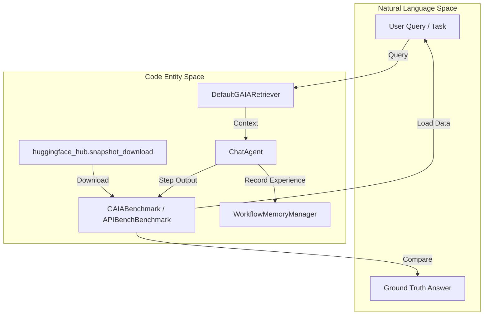
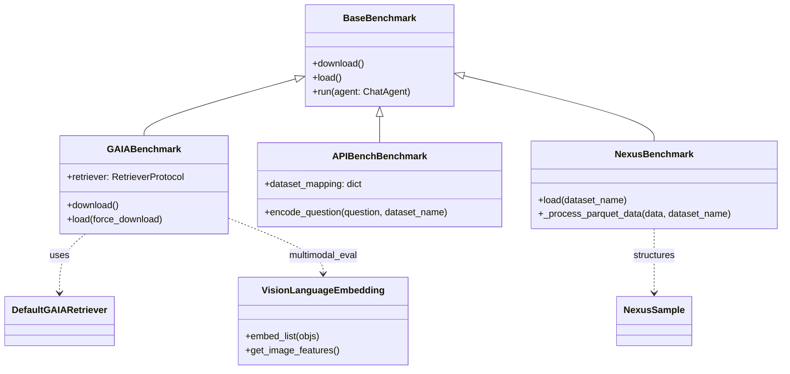

<!-- source: DeepWiki mcp.deepwiki.com · repo camel-ai/camel · page 7.3 DataHubs and Benchmarks · fetched 2026-10-29 -->

# DataHubs and Benchmarks

Relevant source files

The following files were used as context for generating this wiki page:

- [.github/PULL_REQUEST_TEMPLATE.md](.github/PULL_REQUEST_TEMPLATE.md)
- [CONTRIBUTING.md](CONTRIBUTING.md)
- [camel/benchmarks/__init__.py](camel/benchmarks/__init__.py)
- [camel/benchmarks/apibank.py](camel/benchmarks/apibank.py)
- [camel/benchmarks/apibench.py](camel/benchmarks/apibench.py)
- [camel/benchmarks/browsecomp.py](camel/benchmarks/browsecomp.py)
- [camel/benchmarks/gaia.py](camel/benchmarks/gaia.py)
- [camel/benchmarks/mock_website/mock_web.py](camel/benchmarks/mock_website/mock_web.py)
- [camel/benchmarks/nexus.py](camel/benchmarks/nexus.py)
- [camel/benchmarks/ragbench.py](camel/benchmarks/ragbench.py)
- [camel/embeddings/vlm_embedding.py](camel/embeddings/vlm_embedding.py)
- [camel/models/reward/skywork_model.py](camel/models/reward/skywork_model.py)
- [camel/societies/workforce/workflow_memory_manager.py](camel/societies/workforce/workflow_memory_manager.py)
- [camel/storages/vectordb_storages/tidb.py](camel/storages/vectordb_storages/tidb.py)
- [camel/toolkits/context_summarizer_toolkit.py](camel/toolkits/context_summarizer_toolkit.py)
- [camel/utils/context_utils.py](camel/utils/context_utils.py)
- [docs/index.rst](docs/index.rst)
- [docs/key_modules/Benchmark.md](docs/key_modules/Benchmark.md)
- [docs/key_modules/browsertoolkit.md](docs/key_modules/browsertoolkit.md)
- [docs/key_modules/terminaltoolkit.md](docs/key_modules/terminaltoolkit.md)
- [examples/__init__.py](examples/__init__.py)
- [examples/benchmarks/apibank.py](examples/benchmarks/apibank.py)
- [examples/benchmarks/apibench.py](examples/benchmarks/apibench.py)
- [examples/benchmarks/nexus.py](examples/benchmarks/nexus.py)
- [examples/benchmarks/ragbench.py](examples/benchmarks/ragbench.py)
- [examples/workforce/workforce_workflow_memory_example.py](examples/workforce/workforce_workflow_memory_example.py)
- [test/conftest.py](test/conftest.py)
- [test/models/test_cerebras_model.py](test/models/test_cerebras_model.py)
- [test/toolkits/test_context_summarizer_toolkit.py](test/toolkits/test_context_summarizer_toolkit.py)
- [test/utils/test_context_utils.py](test/utils/test_context_utils.py)
- [test/workforce/test_workflow_memory.py](test/workforce/test_workflow_memory.py)

This page documents the integration of external data sources via HuggingFace DataHubs and the comprehensive suite of benchmarks supported by the CAMEL-AI framework. These systems allow for standardized evaluation of agent capabilities across tasks such as general reasoning, API usage, retrieval-augmented generation (RAG), and web navigation.

## HuggingFace DataHub Integration

CAMEL provides a structured interface for interacting with HuggingFace datasets. This integration allows agents to pull data records, manage metadata, and utilize external datasets for training or evaluation.

### Implementation and Data Flow

The data hub system is built on a base abstraction that defines how records are fetched and structured. The `Record` model ensures that data retrieved from external hubs follows a consistent schema including an ID, metadata, and the core content.

The `HuggingFaceHub` implementation facilitates:
1.  **Dataset Connection**: Authenticating and connecting to specific HuggingFace repositories.
2.  **Record Retrieval**: Mapping dataset rows to CAMEL `Record` objects.
3.  **Local Caching**: Leveraging the HuggingFace Hub's local caching mechanisms for performance.

**Sources:**
- [camel/benchmarks/gaia.py:152-158]()
- [camel/benchmarks/nexus.py:111-119]()

---

## Benchmark Suites

CAMEL integrates several industry-standard and custom benchmarks to evaluate agent performance. These benchmarks are managed under the `camel.benchmarks` module and inherit from `BaseBenchmark` [camel/benchmarks/base.py:17-48]().

### GAIA (General AI Assistants)
The GAIA benchmark evaluates agents on tasks that are conceptually simple for humans but challenging for AI, often requiring tool use and multi-modality.

*   **Retriever Protocol**: GAIA in CAMEL uses a `RetrieverProtocol` [camel/benchmarks/gaia.py:35-54]() to allow flexible search implementations.
*   **Default Retriever**: The `DefaultGAIARetriever` [camel/benchmarks/gaia.py:69-114]() extends `AutoRetriever` to handle vector-based content retrieval for benchmark tasks. It uses `run_vector_retriever` [camel/benchmarks/gaia.py:89-89]() and supports resetting storage paths per task [camel/benchmarks/gaia.py:101-112]().
*   **Data Handling**: It automatically downloads datasets from HuggingFace (`gaia-benchmark/GAIA`) using `snapshot_download` [camel/benchmarks/gaia.py:152-158]() and processes validation/test splits, converting metadata such as difficulty levels into integers [camel/benchmarks/gaia.py:183-195]().

### APIBench (Gorilla)
Focuses on evaluating the agent's ability to generate correct API calls for various domains like TorchHub, HuggingFace, and TensorFlowHub.

*   **Prompt Encoding**: The `encode_question` function [camel/benchmarks/apibench.py:59-134]() transforms raw questions into structured prompts that specify the required output format (e.g., `<<<api_call>>>`, `<<<explanation>>>`, `<<<code>>>`).
*   **Domain Mapping**: It includes extensive mappings for different API providers (HuggingFace, TensorFlowHub, TorchHub) to ensure the model understands the available search space [camel/benchmarks/apibench.py:35-54]().

### Nexus (Function Calling)
Evaluates function-calling capabilities, specifically focusing on zero-shot, nested, and parallel tool invocations.

*   **Sample Structure**: Uses `NexusSample` and `NexusTool` dataclasses to manage input-output pairs and tool descriptions [camel/benchmarks/nexus.py:36-51]().
*   **Dataset Mapping**: Supports multiple sub-datasets including `NVDLibrary`, `VirusTotal`, and `ClimateAPI` [camel/benchmarks/nexus.py:52-61]().
*   **Specialized Handlers**: Contains specific logic for processing different data formats, such as `_process_nvdlibrary`, `_process_nested_calls`, and `_process_parallel_calls` [camel/benchmarks/nexus.py:171-192]().
*   **Tooling Prompt**: Uses a specific `TOOL_CALLING_PROMPT` to instruct the agent to respond with executable function calls separated by semicolons if multiple [camel/benchmarks/nexus.py:63-77]().

### Workflow Memory and Persona Generation
CAMEL enables agents to generate "workflow memories" during benchmark execution or task solving, which can be reused by future agents.

*   **Workflow Summarization**: The `WorkflowSummary` Pydantic model [camel/utils/context_utils.py:32-136]() captures the agent's role, task description, tools used, steps taken, and failure recovery strategies [camel/utils/context_utils.py:85-93]().
*   **Memory Management**: The `WorkflowMemoryManager` handles saving and loading these structured memories to a local work directory, often organized by `agent_title` [camel/utils/context_utils.py:39-49]().
*   **Context Injection**: Loaded workflows are injected into the agent's system message via `ContextUtility` to provide few-shot examples or procedural guidance [examples/workforce/workforce_workflow_memory_example.py:173-189]().

**Sources:**
- [camel/benchmarks/gaia.py:35-196]()
- [camel/benchmarks/apibench.py:35-134]()
- [camel/benchmarks/nexus.py:36-192]()
- [camel/utils/context_utils.py:32-151]()
- [camel/benchmarks/__init__.py:15-32]()

---

## Persona Generation and Multimodality

CAMEL supports advanced data generation that bridges different modalities, critical for benchmarks that include visual assets.

*   **VLM Support**: The `VisionLanguageEmbedding` class [camel/embeddings/vlm_embedding.py:58-183]() generates embeddings for both `PIL.Image` and `str` using models like CLIP. It utilizes `AutoModel` and `AutoProcessor` [camel/embeddings/vlm_embedding.py:80-86]() and extracts features via `get_image_features` and `get_text_features` [camel/embeddings/vlm_embedding.py:150-173]().
*   **Persona Identification**: Workflows are categorized by concise roles (e.g., `data_analyst`, `python_developer`) to build a library of agent capabilities [camel/utils/context_utils.py:39-49]().

**Sources:**
- [camel/embeddings/vlm_embedding.py:58-183]()
- [camel/utils/context_utils.py:39-49]()

---

## Architectural Diagrams

### Data Flow: Benchmark Execution
This diagram shows how a `BaseBenchmark` implementation interacts with a `ChatAgent` and external data sources.

**Sources:**
- [camel/benchmarks/gaia.py:150-160]()
- [camel/benchmarks/base.py:17-48]()
- [camel/agents/chat_agent.py]()
- [camel/societies/workforce/workflow_memory_manager.py]()

### Benchmark Component Association
This diagram bridges the conceptual benchmark tasks to the specific classes and methods in the codebase.

**Sources:**
- [camel/benchmarks/base.py:17-48]()
- [camel/benchmarks/gaia.py:116-149]()
- [camel/benchmarks/apibench.py:137-156]()
- [camel/benchmarks/nexus.py:80-107]()
- [camel/embeddings/vlm_embedding.py:58-72]()

---

## Summary Table of Supported Benchmarks

| Benchmark | Target Capability | Primary Source | Implementation Class |
| :--- | :--- | :--- | :--- |
| **GAIA** | General Assistant Tasks | HuggingFace | `GAIABenchmark` [camel/benchmarks/gaia.py:116]() |
| **APIBench** | API Generation | Gorilla LLM | `APIBenchBenchmark` [camel/benchmarks/apibench.py:137]() |
| **Nexus** | Function Calling | NexusRaven | `NexusBenchmark` [camel/benchmarks/nexus.py:80]() |
| **RAGBench** | RAG Evaluation | RAGBench | `RAGBenchBenchmark` [camel/benchmarks/ragbench.py:32]() |
| **BrowseComp** | Web Browsing | CAMEL-AI | `BrowseCompBenchmark` [camel/benchmarks/browsecomp.py:18]() |
| **APIBank** | Tool-use Systems | API-Bank | `APIBankBenchmark` [camel/benchmarks/apibank.py:34]() |

**Sources:**
- [camel/benchmarks/__init__.py:15-32]()
- [camel/benchmarks/gaia.py:116-120]()
- [camel/benchmarks/apibench.py:137-140]()
- [camel/benchmarks/nexus.py:80-83]()
- [camel/benchmarks/ragbench.py:32-35]()
- [camel/benchmarks/browsecomp.py:18-22]()
- [camel/benchmarks/apibank.py:34-38]()

---

