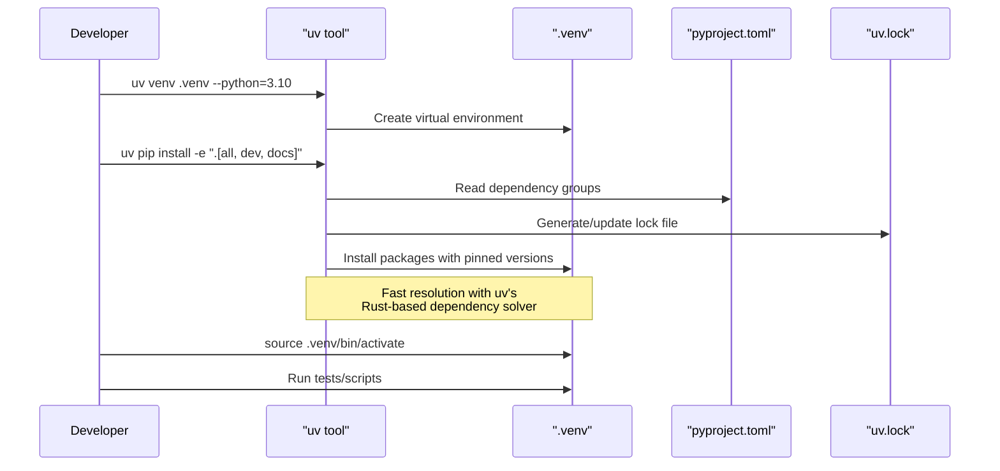
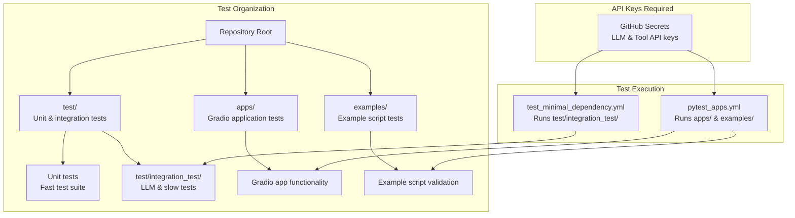
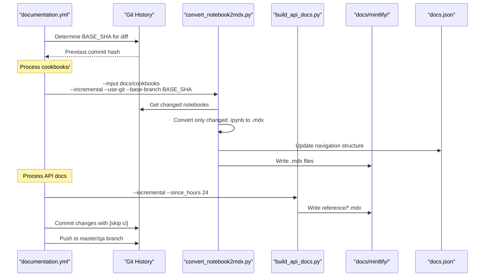

<!-- source: DeepWiki mcp.deepwiki.com · repo camel-ai/camel · page 8 Development and Contribution · fetched 2026-10-29 -->

# Development and Contribution

Relevant source files

The following files were used as context for generating this wiki page:

- [.github/PULL_REQUEST_TEMPLATE.md](.github/PULL_REQUEST_TEMPLATE.md)
- [.github/workflows/codeql.yml](.github/workflows/codeql.yml)
- [.github/workflows/dependency-review.yml](.github/workflows/dependency-review.yml)
- [.github/workflows/documentation.yml](.github/workflows/documentation.yml)
- [.github/workflows/pr-label-automation.yml](.github/workflows/pr-label-automation.yml)
- [.github/workflows/pre_commit.yml](.github/workflows/pre_commit.yml)
- [.github/workflows/publish_release.yml](.github/workflows/publish_release.yml)
- [.github/workflows/pytest_apps.yml](.github/workflows/pytest_apps.yml)
- [.github/workflows/scorecard.yml](.github/workflows/scorecard.yml)
- [.github/workflows/test_minimal_dependency.yml](.github/workflows/test_minimal_dependency.yml)
- [CONTRIBUTING.md](CONTRIBUTING.md)
- [camel/benchmarks/ragbench.py](camel/benchmarks/ragbench.py)
- [docs/index.rst](docs/index.rst)
- [docs/key_modules/Benchmark.md](docs/key_modules/Benchmark.md)
- [docs/key_modules/browsertoolkit.md](docs/key_modules/browsertoolkit.md)
- [docs/key_modules/terminaltoolkit.md](docs/key_modules/terminaltoolkit.md)
- [examples/__init__.py](examples/__init__.py)
- [examples/benchmarks/ragbench.py](examples/benchmarks/ragbench.py)
- [test/conftest.py](test/conftest.py)

This page provides an overview of CAMEL-AI's development infrastructure, including the CI/CD pipeline, testing system, documentation generation, and release process. It serves as a guide for contributors who want to understand how the codebase is maintained, tested, and deployed.

For detailed guidance on contributing code and following coding standards, see [Contributing Guidelines](#8.1). For in-depth information about the testing infrastructure and running tests, see [Testing Infrastructure](#8.2). For details on CI/CD workflows, see [CI/CD Pipelines](#8.3). For documentation generation processes, see [Documentation System](#8.4). For information on the MCP server and agent services, see [MCP Server and Agent Services](#8.5).

## Development Infrastructure Overview

CAMEL-AI uses a comprehensive GitHub Actions-based CI/CD system with multiple workflows that handle code quality, testing, security scanning, documentation generation, and releases. All workflows begin with `step-security/harden-runner` for egress auditing, demonstrating a security-first approach [[.github/workflows/publish_release.yml:21-24](), [.github/workflows/pre_commit.yml:24-27]()].

### CI/CD Workflow Architecture

```mermaid
graph TB
    subgraph "Quality Gates"
        PreCommit["pre_commit.yml<br/>Code quality checks"]
        MinimalDeps["test_minimal_dependency.yml<br/>Integration tests"]
    end
    
    subgraph "Testing Pipelines"
        PytestApps["pytest_apps.yml<br/>Apps & examples"]
    end
    
    subgraph "Security Scanning"
        CodeQL["codeql.yml<br/>Code analysis"]
        Scorecard["scorecard.yml<br/>Supply chain security"]
        DepReview["dependency-review.yml<br/>Dependency scanning"]
    end
    
    subgraph "Documentation"
        DocWorkflow["documentation.yml<br/>Notebook→MDX + API docs"]
        ConvertScript["convert_notebook2mdx.py"]
        BuildAPI["build_api_docs.py"]
    end
    
    subgraph "Release Pipeline"
        Publish["publish_release.yml<br/>Triggered on v* tags"]
        PyPI["PyPI package"]
        Docker["Docker images<br/>ghcr.io/camel-ai/camel"]
        GitHubRelease["GitHub Releases"]
    end
    
    subgraph "PR Automation"
        PRLabel["pr-label-automation.yml<br/>Auto-label PRs"]
    end
    
    Push["Git Push<br/>(master/qa)"] --> PreCommit
    Push --> PytestApps
    Push --> DocWorkflow
    Push --> CodeQL
    
    PR["Pull Request"] --> PreCommit
    PR --> PytestApps
    PR --> MinimalDeps
    PR --> DepReview
    PR --> CodeQL
    PR --> PRLabel
    
    VersionTag["Version Tag<br/>(v*)"] --> Publish
    
    DocWorkflow --> ConvertScript
    DocWorkflow --> BuildAPI
    
    Publish --> PyPI
    Publish --> Docker
    Publish --> GitHubRelease
    
    Schedule["Scheduled<br/>(weekly)"] --> Scorecard
```

**Sources:** [.github/workflows/publish_release.yml:1-140](), [.github/workflows/documentation.yml:1-130](), [.github/workflows/pytest_apps.yml:1-77](), [.github/workflows/pre_commit.yml:1-38](), [.github/workflows/scorecard.yml:1-83](), [.github/workflows/test_minimal_dependency.yml:1-47](), [.github/workflows/pr-label-automation.yml:1-30]()

### Workflow Triggers and Purposes

| Workflow | File | Triggers | Purpose |
|----------|------|----------|---------|
| **Pre-commit** | `pre_commit.yml` | Push/PR to master/qa | Code formatting, linting, type checking |
| **Apps Tests** | `pytest_apps.yml` | Push/PR to master/qa | Gradio apps and example scripts |
| **Minimal Deps** | `test_minimal_dependency.yml` | PR (pyproject.toml changes) | Integration tests with minimal dependencies |
| **Documentation** | `documentation.yml` | Push to master/qa | Incremental notebook→MDX conversion and API docs |
| **Scorecard** | `scorecard.yml` | Push to master, weekly | OpenSSF supply chain security checks |
| **Release** | `publish_release.yml` | Version tags (v*) | Build and publish to PyPI, Docker, GitHub |

**Sources:** [.github/workflows/pre_commit.yml:3-15](), [.github/workflows/pytest_apps.yml:6-18](), [.github/workflows/documentation.yml:3-6](), [.github/workflows/publish_release.yml:3-8](), [.github/workflows/scorecard.yml:6-15](), [.github/workflows/test_minimal_dependency.yml:3-10]()

## Package Management and Build System

CAMEL-AI uses `uv` as the primary package manager for fast, reproducible builds [[.github/workflows/publish_release.yml:34-45]()]. The project enforces high standards for code quality and human-verified testing [[CONTRIBUTING.md:23-31]()].

### Build Process Flow

**Sources:** [.github/workflows/publish_release.yml:34-45]()

### AI-Generated Code Policy

CAMEL-AI maintains a strict policy regarding AI-generated code to ensure quality and reduce maintenance costs:
*   **Prior Discussion Required**: Every PR must link to a previously discussed issue or Discord thread [[CONTRIBUTING.md:27]()].
*   **No Unreviewed LLM Submissions**: PRs primarily generated by LLMs without human review will be closed [[CONTRIBUTING.md:28]()].
*   **Human-Verified Testing**: Proof of testing (screenshots, logs) is mandatory for every PR [[CONTRIBUTING.md:29]()].

**Sources:** [CONTRIBUTING.md:7-38]()

## Testing System Overview

The testing infrastructure is designed to validate the framework across various dependency levels and API integrations.

### Test Directory Structure

**Sources:** [.github/workflows/pytest_apps.yml:39-47](), [.github/workflows/pytest_apps.yml:64-77](), [.github/workflows/test_minimal_dependency.yml:40-46]()

### Testing Specific Components

The framework includes specific integration tests for minimal dependency environments to ensure core functionality works without optional extras [[.github/workflows/test_minimal_dependency.yml:40-47]()].

| Key Category | Examples | Usage |
|--------------|----------|-------|
| **LLM Providers** | `OPENAI_API_KEY`, `COHERE_API_KEY` | Testing model backends |
| **Search Engines** | `GOOGLE_API_KEY`, `SEARCH_ENGINE_ID` | SearchToolkit validation |
| **Platform APIs** | `MOONSHOT_API_KEY`, `SILICONFLOW_API_KEY` | Platform-specific model tests |

**Sources:** [.github/workflows/pytest_apps.yml:40-73](), [.github/workflows/test_minimal_dependency.yml:41-47]()

## Documentation Generation Pipeline

The documentation system uses an incremental build process that converts Jupyter notebooks to MDX format and generates API documentation via Mintlify.

### Documentation Build Flow

**Sources:** [.github/workflows/documentation.yml:34-112]()

## Release Pipeline

The release process is triggered by version tags (e.g., `v0.1.0`) and automates publishing to PyPI, Docker Hub (GHCR), and GitHub Releases [[.github/workflows/publish_release.yml:3-8]()].

### Release Job Details

| Job | Purpose | Key Steps |
|-----|---------|-----------|
| `build-and-publish-pypi` | Build Python package | `python -m build`, `twine upload dist/*` |
| `create-release` | Create GitHub release | Check for pre-release, upload artifacts |
| `build-and-publish-image` | Build Docker images | Multi-platform build for `ghcr.io` |

**Sources:** [.github/workflows/publish_release.yml:14-140]()

## Security Infrastructure

CAMEL-AI implements security scanning via `harden-runner` in all workflows [[.github/workflows/publish_release.yml:21-24]()] and utilizes the OpenSSF Scorecard for supply-chain security analysis [[.github/workflows/scorecard.yml:5-15]()].

**Sources:** [.github/workflows/scorecard.yml:1-83](), [.github/workflows/publish_release.yml:21-24]()

---

