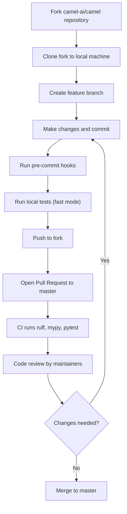
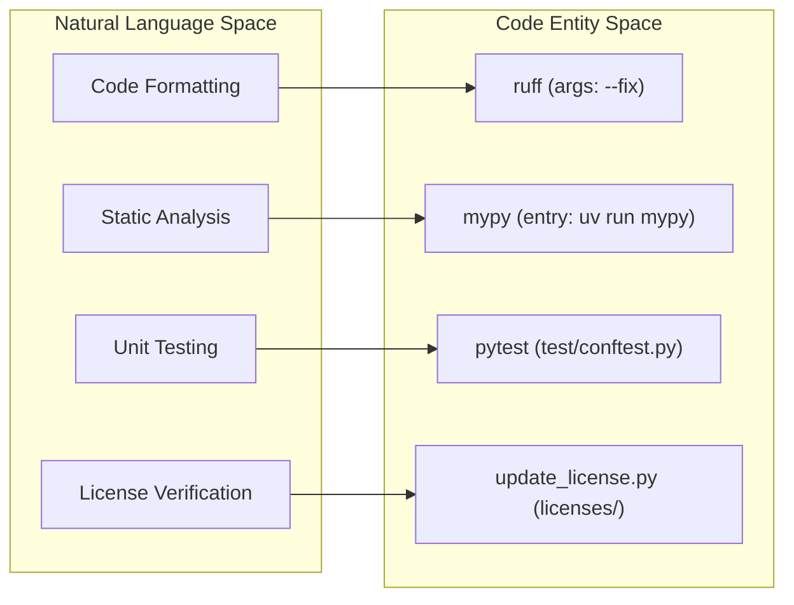

<!-- source: DeepWiki mcp.deepwiki.com · repo camel-ai/camel · page 8.1 Contributing Guidelines · fetched 2026-10-29 -->

# Contributing Guidelines

<details>
<summary>Relevant source files</summary>

The following files were used as context for generating this wiki page:

- [.github/PULL_REQUEST_TEMPLATE.md](.github/PULL_REQUEST_TEMPLATE.md)
- [.pre-commit-config.yaml](.pre-commit-config.yaml)
- [.style.yapf](.style.yapf)
- [CONTRIBUTING.md](CONTRIBUTING.md)
- [camel/benchmarks/ragbench.py](camel/benchmarks/ragbench.py)
- [docs/cookbooks/loong/index.rst](docs/cookbooks/loong/index.rst)
- [docs/cookbooks/mcp/agents_with_sql_mcp.ipynb](docs/cookbooks/mcp/agents_with_sql_mcp.ipynb)
- [docs/cookbooks/mcp/camel_aci_mcp_cookbook.ipynb](docs/cookbooks/mcp/camel_aci_mcp_cookbook.ipynb)
- [docs/cookbooks/mcp/index.rst](docs/cookbooks/mcp/index.rst)
- [docs/cookbooks/multi_agent_society/azure_openai_claude_society.ipynb](docs/cookbooks/multi_agent_society/azure_openai_claude_society.ipynb)
- [docs/cookbooks/multi_agent_society/azure_openai_claude_society.md](docs/cookbooks/multi_agent_society/azure_openai_claude_society.md)
- [docs/cookbooks/multi_agent_society/index.rst](docs/cookbooks/multi_agent_society/index.rst)
- [docs/index.rst](docs/index.rst)
- [docs/key_modules/Benchmark.md](docs/key_modules/Benchmark.md)
- [docs/key_modules/browsertoolkit.md](docs/key_modules/browsertoolkit.md)
- [docs/key_modules/terminaltoolkit.md](docs/key_modules/terminaltoolkit.md)
- [docs/mintlify/cookbooks/multi_agent_society/azure_openai_claude_society.mdx](docs/mintlify/cookbooks/multi_agent_society/azure_openai_claude_society.mdx)
- [examples/__init__.py](examples/__init__.py)
- [examples/benchmarks/ragbench.py](examples/benchmarks/ragbench.py)
- [test/conftest.py](test/conftest.py)
- [test/models/test_model_manager.py](test/models/test_model_manager.py)

</details>


## Purpose and Scope

This document describes the contribution process, code quality standards, and development workflow for the CAMEL-AI project. It covers the mandatory AI-generated code policy, the fork-and-pull-request workflow for community contributors, code quality requirements, and the CI/CD pipeline that validates contributions. CAMEL-AI emphasizes quality over quantity and requires human-verified testing for all submissions.

## AI-Generated Code Policy

CAMEL-AI maintains a strict policy regarding AI-generated content to preserve the integrity of the repository and minimize maintenance costs associated with "vibe-coded" or unreviewed submissions.

- **Mandatory Discussion**: Every PR must link to a previously discussed and accepted issue, Discord thread, or equivalent `[CONTRIBUTING.md:23-27]()`.
- **Human Review Required**: Submissions primarily generated by LLMs without meaningful human review will be closed `[CONTRIBUTING.md:28-28]()`.
- **Human-Verified Testing**: Code that is "theoretically correct but untested" is not accepted. PRs must include proof of testing, such as logs, screenshots, or screen recordings `[CONTRIBUTING.md:29-29]()`.
- **Abuse Policy**: Inauthentic contribution activity or bulk low-quality AI content results in an immediate ban `[CONTRIBUTING.md:32-38]()`.

**Sources:** `[CONTRIBUTING.md:7-40]()`

## Contribution Workflows

CAMEL uses different workflows depending on contributor status to handle security and testing requirements.

### Fork-and-Pull-Request Workflow (Community Contributors)



**Sources:** `[CONTRIBUTING.md:62-63]()`, `[CONTRIBUTING.md:23-31]()`

### Checkout-and-Pull-Request Workflow (Organization Members)

Organization members follow the checkout workflow to ensure PRs pass tests requiring [GitHub Secrets](https://docs.github.com/en/actions/security-guides/encrypted-secrets) `[CONTRIBUTING.md:64-65]()`.

**Sources:** `[CONTRIBUTING.md:64-67]()`

## Development Environment Setup

### Local Installation and Pre-commit Hooks

CAMEL uses `uv` for dependency management. Pre-commit hooks are enforced to maintain code style and catch errors early.

```bash
# Install pre-commit hooks
pre-commit install

# Run hooks manually
pre-commit run --all-files
```

The `.pre-commit-config.yaml` defines several critical checks:
- **Ruff**: Handles linting and formatting `[.pre-commit-config.yaml:2-10]()`.
- **Mypy**: Performs static type checking on `camel`, `test`, and `apps` packages `[.pre-commit-config.yaml:13-20]()`.
- **License Check**: Ensures the CAMEL-AI copyright header is present in Python files using `licenses/update_license.py` `[.pre-commit-config.yaml:24-30]()`.
- **Codespell**: Checks for common misspellings `[.pre-commit-config.yaml:31-38]()`.
- **Gitleaks**: Scans for accidental secret leaks `[.pre-commit-config.yaml:39-43]()`.

**Sources:** `[.pre-commit-config.yaml:1-50]()`, `[CONTRIBUTING.md:69-70]()`

## Code Quality and Style

### Formatting and Type Checking

CAMEL adheres to strict formatting rules defined in `.style.yapf` (based on PEP8) and uses `Ruff` for enforcement `[.pre-commit-config.yaml:5-9]()`.

### Docstring Standards

Docstrings must use raw string literals (`r"""`) to prevent escape character issues and follow a structured format including `Args` and `Returns` sections.

```python
def annotate_dataset(
    dataset: Dataset,
    context_call: Optional[Callable[[Dict[str, Any]], List[str]]],
    answer_call: Optional[Callable[[Dict[str, Any]], str]],
) -> Dataset:
    r"""Annotate the dataset by adding context and answers using the provided
    functions.

    Args:
        dataset (Dataset): The input dataset to annotate.
        context_call (Optional[Callable[[Dict[str, Any]], List[str]]]):
            Function to generate context for each example.
        answer_call (Optional[Callable[[Dict[str, Any]], str]]): Function to
            generate answer for each example.

    Returns:
        Dataset: The annotated dataset with added contexts and/or answers.
    """
```

**Sources:** `[camel/benchmarks/ragbench.py:36-53]()`, `[camel/benchmarks/ragbench.py:65-77]()`

## Testing Infrastructure

CAMEL utilizes `pytest` with custom markers to manage test execution time and resource usage.

### Test Modes

The `test/conftest.py` file defines several modes for running tests via `pytest_addoption` `[test/conftest.py:24-48]()`:
- `--fast-test-mode`: Runs only tests that do not require LLM inference. It skips tests marked with `optional` or `model_backend` `[test/conftest.py:34-37]()`, `[test/conftest.py:69-74]()`.
- `--llm-test-only`: Runs only tests involving LLM inference (marked with `model_backend`) `[test/conftest.py:39-42]()`, `[test/conftest.py:51-56]()`.
- `--very-slow-test-only`: Runs only tests marked as `very_slow` `[test/conftest.py:43-47]()`, `[test/conftest.py:57-62]()`.
- `--full-test-mode`: Runs the entire test suite `[test/conftest.py:24-27]()`, `[test/conftest.py:64-65]()`.

### Example: Model Manager Testing

Tests for core components like `ModelManager` use `pytest.mark.model_backend` to signify they require model interaction and use `mock` to simulate backend responses `[test/models/test_model_manager.py:25-43]()`.

**Sources:** `[test/conftest.py:1-82]()`, `[test/models/test_model_manager.py:1-113]()`

## Pull Request Process

### Submission Requirements

Every Pull Request must satisfy the checklist in the PR template `[.github/PULL_REQUEST_TEMPLATE.md:21-29]()`:
1. **AI-Generated Code Policy**: Must agree to the policy `[.github/PULL_REQUEST_TEMPLATE.md:23-23]()`.
2. **Issue Linking**: Must link to a resolved issue (e.g., `Closes #123`) `[.github/PULL_REQUEST_TEMPLATE.md:8-9]()`.
3. **Dependencies**: Update `pyproject.toml` and run `uv lock` if new dependencies are added `[.github/PULL_REQUEST_TEMPLATE.md:25-25]()`.
4. **Testing**: Update tests for any bug fix or new feature `[.github/PULL_REQUEST_TEMPLATE.md:26-26]()`.

### Documentation and Cookbook Contributions

- **Cookbooks**: Must use the provided Google Colab template and ensure LLM-generated responses are verified for correctness `[CONTRIBUTING.md:84-97]()`.
- **Interactive Elements**: Interactive code cells should be added in Colab so users can directly run and modify them `[CONTRIBUTING.md:98-99]()`.
- **Version Pinning**: For cookbook examples, specific versions should be used for reproducibility, e.g., `!pip install "camel-ai[all]==0.2.62"` `[docs/cookbooks/mcp/agents_with_sql_mcp.ipynb:78-78]()`.

**Sources:** `[.github/PULL_REQUEST_TEMPLATE.md:1-30]()`, `[CONTRIBUTING.md:71-100]()`, `[docs/cookbooks/mcp/agents_with_sql_mcp.ipynb:78-78]()`

## Code Entity Mapping

The following diagram bridges high-level contribution requirements to the specific code entities that enforce them.

```mermaid
classDiagram
    class ContributionRequirements {
        <<Interface>>
        +LinkIssue()
        +HumanVerifiedTest()
        +NoUnreviewedAI()
    }
    class PreCommitHooks {
        +ruff()
        +mypy()
        +check-license()
        +codespell()
    }
    class TestSuites {
        +fast_test_mode()
        +llm_test_only()
        +very_slow_test_only()
    }
    
    ContributionRequirements <.. PR_Template : enforces
    PreCommitHooks <.. .pre-commit-config.yaml : configures
    TestSuites <.. test/conftest.py : implements logic
    
    PR_Template : .github/PULL_REQUEST_TEMPLATE.md
    .pre-commit-config.yaml : .pre-commit-config.yaml
    test/conftest.py : pytest_addoption()
    test/conftest.py : pytest_collection_modifyitems()
```

**Sources:** `[.github/PULL_REQUEST_TEMPLATE.md:1-30]()`, `[.pre-commit-config.yaml:1-50]()`, `[test/conftest.py:24-82]()`

### Workflow to Code Entity Space

This diagram maps the natural language "Contribution Workflow" to the specific scripts and configurations in the codebase.



**Sources:** `[.pre-commit-config.yaml:5-26]()`, `[test/conftest.py:24-47]()`

---

