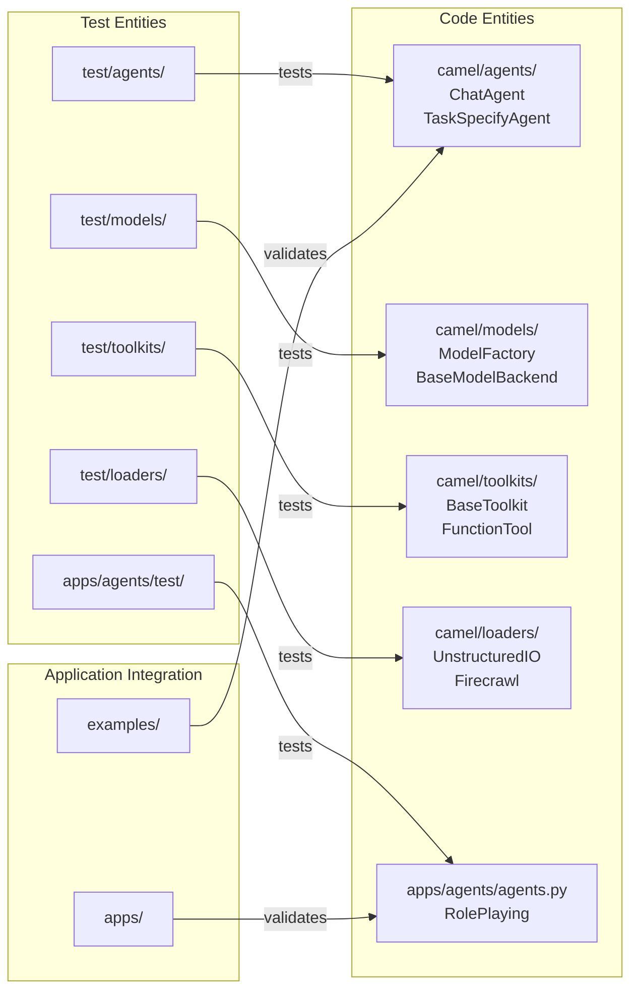
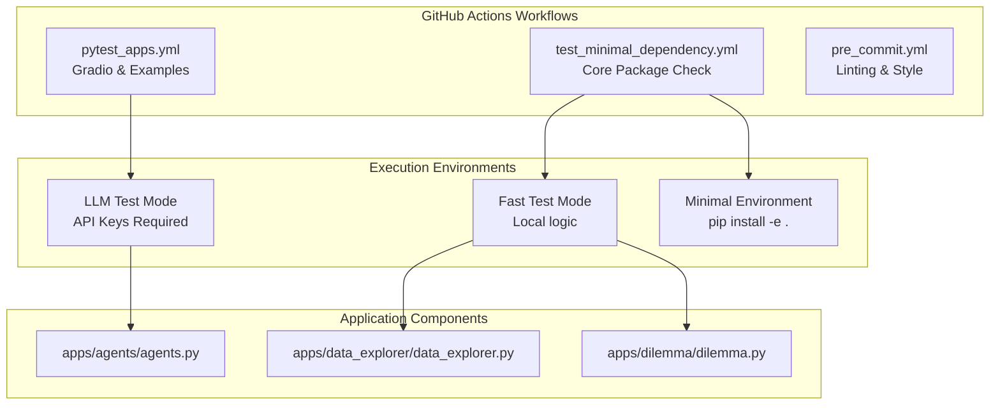

<!-- source: DeepWiki mcp.deepwiki.com · repo camel-ai/camel · page 8.2 Testing Infrastructure · fetched 2026-10-29 -->

# Testing Infrastructure

<details>
<summary>Relevant source files</summary>

The following files were used as context for generating this wiki page:

- [.github/PULL_REQUEST_TEMPLATE.md](.github/PULL_REQUEST_TEMPLATE.md)
- [CONTRIBUTING.md](CONTRIBUTING.md)
- [apps/agents/agents.py](apps/agents/agents.py)
- [apps/agents/test/test_agents.py](apps/agents/test/test_agents.py)
- [apps/common/auto_zip.py](apps/common/auto_zip.py)
- [apps/common/test/test_archive_1.zip](apps/common/test/test_archive_1.zip)
- [apps/common/test/test_auto_zip.py](apps/common/test/test_auto_zip.py)
- [apps/data_explorer/data_explorer.py](apps/data_explorer/data_explorer.py)
- [apps/data_explorer/downloader.py](apps/data_explorer/downloader.py)
- [apps/data_explorer/loader.py](apps/data_explorer/loader.py)
- [apps/data_explorer/test/test_data_explorer.py](apps/data_explorer/test/test_data_explorer.py)
- [apps/dilemma/database_connection.py](apps/dilemma/database_connection.py)
- [apps/dilemma/dilemma.py](apps/dilemma/dilemma.py)
- [apps/dilemma/requirements.txt](apps/dilemma/requirements.txt)
- [camel/benchmarks/ragbench.py](camel/benchmarks/ragbench.py)
- [docs/index.rst](docs/index.rst)
- [docs/key_modules/Benchmark.md](docs/key_modules/Benchmark.md)
- [docs/key_modules/browsertoolkit.md](docs/key_modules/browsertoolkit.md)
- [docs/key_modules/terminaltoolkit.md](docs/key_modules/terminaltoolkit.md)
- [examples/__init__.py](examples/__init__.py)
- [examples/benchmarks/ragbench.py](examples/benchmarks/ragbench.py)
- [examples/test/test_unstructured_io_example.py](examples/test/test_unstructured_io_example.py)
- [test/conftest.py](test/conftest.py)
- [test/loaders/test_unstructured_io.py](test/loaders/test_unstructured_io.py)

</details>


## Purpose and Scope

This document describes the testing infrastructure for the CAMEL project. It covers test organization (unit, integration, apps, examples), pytest workflows, test modes (fast/LLM/slow), and API key requirements. The CAMEL project maintains a multi-layered testing infrastructure that validates functionality across agents, models, toolkits, and applications. The system supports fast local iteration through test modes that skip external API calls, while comprehensive integration tests in CI validate full functionality against 40+ LLM providers and external services.

## Test Organization

### Directory Structure

Tests are organized in the `test/` directory with a structure mirroring the main codebase, plus application and example tests at the repository root. This ensures that every functional module has a corresponding validation suite.

| Directory | Purpose | Test Type |
|-----------|---------|-----------|
| `test/agents/` | Agent implementation tests | Unit + Integration |
| `test/models/` | Model backend tests | Integration |
| `test/toolkits/` | Toolkit functionality tests | Integration |
| `test/messages/` | Message system tests | Unit |
| `test/storages/` | Storage backend tests | Unit + Integration |
| `test/workforce/` | Multi-agent orchestration tests | Integration |
| `test/loaders/` | Data loading and processing tests | Unit |
| `examples/test/` | Validation of cookbook/example scripts | Integration |
| `apps/*/test/` | Tests for Gradio-based applications | Integration |

**Test File Naming Convention:**
- Test files: `test_<module_name>.py` (e.g., [test/loaders/test_unstructured_io.py:1-1]())
- Test functions: `test_<functionality>()` (e.g., `test_create_element_from_text` [test/loaders/test_unstructured_io.py:29-29]())

**Test Module to Source Code Mapping:**

Title: Natural Language Space to Code Entity Mapping

Sources: [CONTRIBUTING.md:73-81](), [apps/agents/test/test_agents.py:17-26](), [test/loaders/test_unstructured_io.py:19-19]()

---

## Test Modes and Execution

### Test Mode Classification

CAMEL tests are categorized based on execution speed and external dependencies to balance developer productivity with comprehensive coverage.

| Mode | Marker | Execution Time | External Dependencies | Use Case |
|------|--------|----------------|----------------------|----------|
| **Fast** | `--fast-test-mode` | < 10 seconds | None | Local unit testing |
| **LLM** | `model_backend` | 10-60 seconds | LLM API calls | Model integration testing |
| **Slow** | `slow` | > 60 seconds | Heavy computation | Full integration testing |

**Fast Mode Tests** - Execute without external API calls. These are the default for local development to ensure core logic remains sound without incurring costs or latency.

**LLM Mode Tests** - Require model backend API calls. These tests often use the `ModelFactory` to instantiate real backends. In CI, these are gated by secret availability. For example, the application test `test_session` in `apps/agents/test/test_agents.py` is marked with `@pytest.mark.model_backend` because it initializes a `RolePlaying` session [apps/agents/test/test_agents.py:39-42]().

**Sources:** [apps/agents/test/test_agents.py:39-42](), [CONTRIBUTING.md:69-72]()

### Running Tests Locally

Developers can run tests using `pytest` with specific flags. The project recommends using `uv` for environment management.

```bash
# Run fast tests only
pytest --fast-test-mode .

# Run integration tests on specific apps
pytest -v apps/agents/test/

# Exclude model backend tests (useful for forks without secrets)
pytest -m "not model_backend"
```
Sources: [apps/agents/test/test_agents.py:39-40](), [CONTRIBUTING.md:69-72]()

---

## CI/CD Test Workflows

### Workflow Architecture

The CAMEL repository uses GitHub Actions to automate testing across different environments, dependency sets, and security levels.

Title: CI Pipeline Execution Flow

Sources: [apps/agents/agents.py:15-17](), [apps/data_explorer/data_explorer.py:15-16](), [apps/dilemma/dilemma.py:15-17]()

### Application and Example Testing

CAMEL includes specific tests for its built-in Gradio applications to ensure that UI components correctly interface with the underlying agent logic.

- **Agent App**: Validates `RolePlaying` sessions, task specification, and message history management [apps/agents/test/test_agents.py:40-86]().
- **Data Explorer**: Tests dataset loading from ZIP files using `AutoZip` and UI block construction [apps/data_explorer/test/test_data_explorer.py:25-37]().
- **Dilemma App**: Validates selection between two options and database logging [apps/dilemma/dilemma.py:15-17]().

**Sources:** [apps/agents/test/test_agents.py:1-86](), [apps/data_explorer/test/test_data_explorer.py:1-41](), [apps/dilemma/dilemma.py:1-17]()

---

## API Key Requirements

CAMEL supports a massive array of models and toolkits, which necessitates a complex API key management system for testing.

### Toolkit and Loader Requirements

Many toolkits and data loaders require external API keys for validation.

| Component | Requirement | Purpose |
|-----------|-------------|---------|
| `SearchToolkit` | `GOOGLE_API_KEY` | Web search validation |
| `TerminalToolkit` | `working_directory` | Sandboxed shell execution [docs/key_modules/terminaltoolkit.md:45-49]() |
| `HybridBrowserToolkit` | Node.js/Playwright | Browser automation [docs/key_modules/browsertoolkit.md:36-39]() |
| `UnstructuredIO` | Optional API Key | Parsing complex document types [test/loaders/test_unstructured_io.py:73-77]() |

### Contribution Policy for Tests

The project enforces a strict policy on testing for contributions:
1. **Human-verified testing**: Every PR must include proof of testing (logs, screenshots) [CONTRIBUTING.md:29-29]().
2. **Bug fixes**: Must add a relevant unit test in the `test/` directory [CONTRIBUTING.md:73-74]().
3. **New features**: Must include unit tests AND a demo script in the `examples/` directory [CONTRIBUTING.md:78-80]().
4. **Cookbooks**: Must be verified with real code execution in Google Colab [CONTRIBUTING.md:96-96]().

**Sources:** [CONTRIBUTING.md:23-31](), [CONTRIBUTING.md:73-81](), [.github/PULL_REQUEST_TEMPLATE.md:26-28]()

---

## Summary Table: Testing Commands

| Action | Command |
|--------|---------|
| **Install Dev Deps** | `pip install -e ".[all, dev, docs]"` |
| **Run Core Tests** | `pytest test/` |
| **Run App Tests** | `pytest apps/agents/test/` |
| **Run Example Tests** | `pytest examples/test/` |
| **Run Loader Tests** | `pytest test/loaders/` |

**Sources:** [CONTRIBUTING.md:69-72](), [apps/agents/test/test_agents.py:1-26](), [test/loaders/test_unstructured_io.py:1-20]()

---

