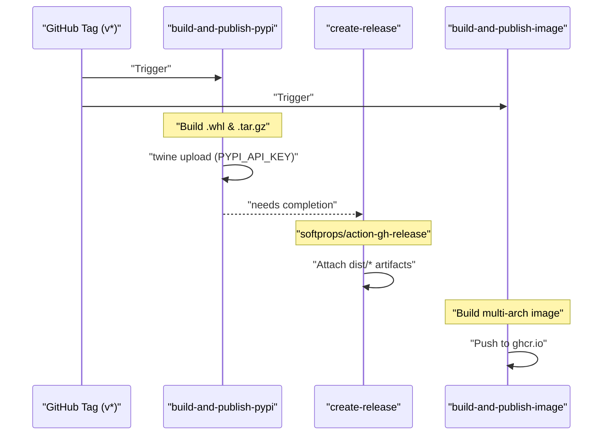
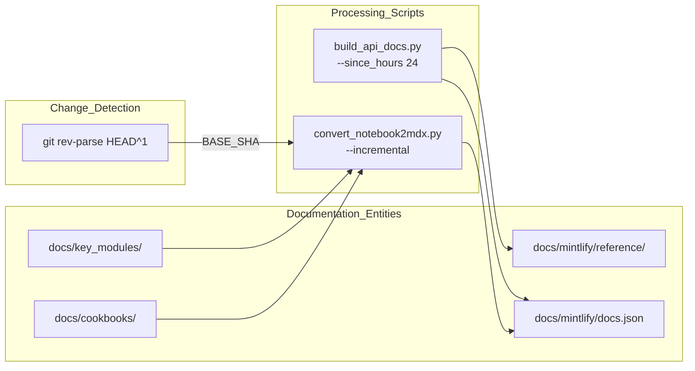

<!-- source: DeepWiki mcp.deepwiki.com · repo camel-ai/camel · page 8.3 CI/CD Pipelines · fetched 2026-10-29 -->

# CI/CD Pipelines

Relevant source files

The following files were used as context for generating this wiki page:

- [.github/workflows/build_package.yml](.github/workflows/build_package.yml)
- [.github/workflows/codeql.yml](.github/workflows/codeql.yml)
- [.github/workflows/dependency-review.yml](.github/workflows/dependency-review.yml)
- [.github/workflows/documentation.yml](.github/workflows/documentation.yml)
- [.github/workflows/pr-label-automation.yml](.github/workflows/pr-label-automation.yml)
- [.github/workflows/pre_commit.yml](.github/workflows/pre_commit.yml)
- [.github/workflows/publish_release.yml](.github/workflows/publish_release.yml)
- [.github/workflows/pytest_apps.yml](.github/workflows/pytest_apps.yml)
- [.github/workflows/pytest_package.yml](.github/workflows/pytest_package.yml)
- [.github/workflows/scorecard.yml](.github/workflows/scorecard.yml)
- [.github/workflows/test_minimal_dependency.yml](.github/workflows/test_minimal_dependency.yml)
- [camel/configs/__init__.py](camel/configs/__init__.py)
- [camel/models/__init__.py](camel/models/__init__.py)
- [camel/models/model_factory.py](camel/models/model_factory.py)
- [camel/types/enums.py](camel/types/enums.py)
- [camel/types/unified_model_type.py](camel/types/unified_model_type.py)
- [docs/key_modules/models.md](docs/key_modules/models.md)
- [docs/mintlify/key_modules/models.mdx](docs/mintlify/key_modules/models.mdx)

## Purpose and Scope

This document details the Continuous Integration and Continuous Deployment (CI/CD) infrastructure for the CAMEL-AI repository. The system consists of multiple GitHub Actions workflows that handle code quality enforcement, automated testing, security scanning, documentation generation, and multi-target release automation. These pipelines ensure that every contribution meets the framework's standards for reliability, security, and documentation accuracy.

---

## Workflow Architecture Overview

The CI/CD system is organized around event-driven workflows triggered by pushes, pull requests, tags, or schedules. A key security feature across all workflows is the use of `step-security/harden-runner` to audit outbound network calls.

### Pipeline Flow Diagram

```mermaid
graph TB
    subgraph "Trigger_Events"
        PushMaster["push to master/qa"]
        PushTag["push tag v*"]
        PullRequest["pull_request"]
        Schedule["schedule (cron)"]
        WorkflowDispatch["workflow_dispatch"]
    end
    
    subgraph "Quality_and_Testing"
        BuildPackage["build_package.yml<br/>Build & Import Test"]
        PytestPackage["pytest_package.yml<br/>Core Unit Tests"]
        PytestApps["pytest_apps.yml<br/>Apps & Examples"]
        MinimalDep["test_minimal_dependency.yml<br/>Base Integration"]
    end
    
    subgraph "Security_and_Scanning"
        CodeQL["codeql.yml<br/>Static Analysis"]
        Scorecard["scorecard.yml<br/>Supply Chain"]
        DepReview["dependency-review.yml<br/>Vulnerability Scan"]
    end
    
    subgraph "Deployment_and_Release"
        Documentation["documentation.yml<br/>Incremental Docs"]
        PublishRelease["publish_release.yml<br/>PyPI/Docker/GitHub"]
    end
    
    PushMaster --> BuildPackage
    PushMaster --> PytestPackage
    PushMaster --> Documentation
    PushMaster --> CodeQL
    
    PullRequest --> BuildPackage
    PullRequest --> PytestPackage
    PullRequest --> PytestApps
    PullRequest --> DepReview
    
    PushTag --> PublishRelease
    
    Schedule --> CodeQL
    Schedule --> Scorecard
    
    WorkflowDispatch --> Documentation
    WorkflowDispatch --> PublishRelease
```

**Sources:** [.github/workflows/build_package.yml:1-116](), [.github/workflows/pytest_package.yml:1-308](), [.github/workflows/publish_release.yml:1-140](), [.github/workflows/documentation.yml:1-130]()

---

## Release Pipeline: `publish_release.yml`

The release workflow orchestrates a multi-target deployment triggered by version tags (e.g., `v0.2.0`). It automates the distribution of the CAMEL package to PyPI, GitHub Releases, and the GitHub Container Registry (GHCR).

### Multi-Target Deployment Flow

### Job Details

1.  **PyPI Publication**: Uses `uv` to set up a Python 3.10 environment, installs `[all, dev, docs]` extras, builds the package using `python -m build`, and uploads via `twine` [[.github/workflows/publish_release.yml:14-61]]().
2.  **GitHub Release**: Automatically generates release notes and detects pre-releases by checking if the tag contains an "a" (e.g., `v1.0.0a1`) [[.github/workflows/publish_release.yml:84-98]]().
3.  **Docker Image**: Builds multi-architecture images (`linux/amd64`, `linux/arm64`) using the Dockerfile at `.container/minimal_build/Dockerfile` and pushes to `ghcr.io` [[.github/workflows/publish_release.yml:101-141]]().

**Sources:** [.github/workflows/publish_release.yml:1-140]()

---

## Testing Infrastructure

### Core Package Tests: `pytest_package.yml`

This is the primary gatekeeper for code quality, running two distinct jobs: `pytest_package_fast_test` and `pytest_package_llm_test`.

*   **Fast Test Mode**: Executes the suite with the `--fast-test-mode` flag and excludes `heavy_dependency` markers to ensure quick feedback loops. It also ignores specific data generation and environment tests to maintain speed [[.github/workflows/pytest_package.yml:102-118]]().
*   **LLM Test Mode**: Executes tests that require live LLM interactions, utilizing a vast array of secrets for providers defined in `ModelPlatformType` such as OpenAI, Anthropic, Gemini, and ZhipuAI [[.github/workflows/pytest_package.yml:133-152]](), [[camel/types/enums.py:64-105]]().

### Build Verification: `build_package.yml`

Ensures the package can be built and installed in a clean environment.
*   **Process**: Creates a virtual environment using `uv`, installs the core package, builds a wheel via `python -m build`, and then attempts to install that wheel in a *separate* `test_venv` to verify `import camel` works without dev dependencies [[.github/workflows/build_package.yml:80-103]]().

**Sources:** [.github/workflows/pytest_package.yml:1-308](), [.github/workflows/build_package.yml:1-116](), [camel/types/enums.py:33-177]()

---

## Documentation Pipeline: `documentation.yml`

The documentation workflow implements an incremental build system to manage the conversion of Jupyter notebooks and the generation of API references for the Mintlify-based documentation.

### Incremental Logic and Data Flow

### Key Functions
*   **Notebook Conversion**: Processes notebooks in `docs/cookbooks`, `docs/get_started`, and `docs/key_modules` using `pandoc` and `convert_notebook2mdx.py`. The script updates `docs/mintlify/docs.json` to reflect the structure [[.github/workflows/documentation.yml:47-88]]().
*   **API Reference**: Uses `build_api_docs.py` with an `--incremental` flag to update the `docs/mintlify/reference` directory based on code changes within the last 24 hours [[.github/workflows/documentation.yml:103-112]]().
*   **Auto-Commit**: Changes are pushed back to the repository by `camel-docs-bot` with a `[skip ci]` tag to prevent recursion [[.github/workflows/documentation.yml:114-130]]().

**Sources:** [.github/workflows/documentation.yml:1-130](), [docs/key_modules/models.md:1-81]()

---

## Security and Compliance

### Static Analysis and Supply Chain
*   **CodeQL**: Performs semantic analysis for Python and JavaScript/TypeScript to identify vulnerabilities.
*   **OSSF Scorecard**: Evaluates the repository against security best practices (e.g., pinned dependencies, branch protection) and uploads results in SARIF format.
*   **Dependency Review**: Scans pull requests for new dependencies with known vulnerabilities or incompatible licenses.

### Runner Hardening
All workflows utilize `step-security/harden-runner` to restrict and audit network egress, mitigating potential supply chain attacks during the build process [[.github/workflows/publish_release.yml:21-24](), [.github/workflows/build_package.yml:19-22](), [.github/workflows/pytest_package.yml:27-30]]().

**Sources:** [.github/workflows/publish_release.yml:21-24](), [.github/workflows/build_package.yml:19-22](), [.github/workflows/pytest_package.yml:27-30]()

---

## Environment and Secrets Management

The CI/CD system relies on a comprehensive set of GitHub Secrets to authenticate with external model providers and services during testing. These secrets are injected as environment variables into the `pytest` runner, allowing the `ModelFactory` to instantiate backends for integration testing [[camel/models/model_factory.py:78-128]]().

| Secret Category | Key Secrets |
| :--- | :--- |
| **Model Platforms** | `OPENAI_API_KEY`, `ANTHROPIC_API_KEY`, `GEMINI_API_KEY`, `GROQ_API_KEY`, `ZHIPUAI_API_KEY`, `MISTRAL_API_KEY`, `DEEPSEEK_API_KEY`, `CEREBRAS_API_KEY`, `TOGETHER_API_KEY`, `SAMBA_API_KEY` |
| **Infrastructure** | `NEO4J_PASSWORD`, `FIRECRAWL_API_KEY`, `HF_TOKEN`, `NOTION_TOKEN`, `GOOGLE_CLIENT_ID`, `JINA_API_KEY` |
| **Deployment** | `PYPI_API_KEY`, `PAT_TOKEN`, `GITHUB_TOKEN` |

**Sources:** [.github/workflows/pytest_package.yml:38-101](), [.github/workflows/publish_release.yml:50](), [camel/models/model_factory.py:71-143]()

---

