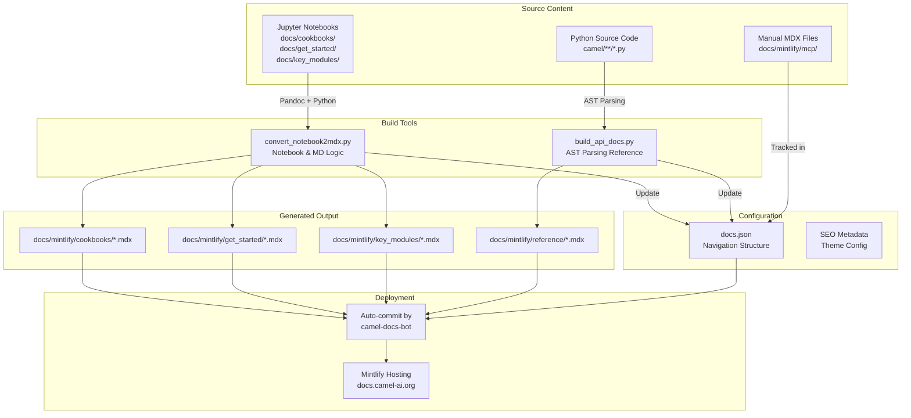
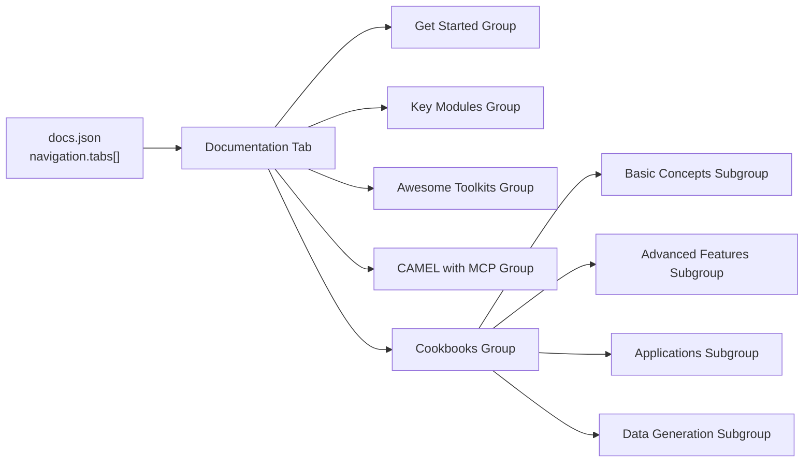
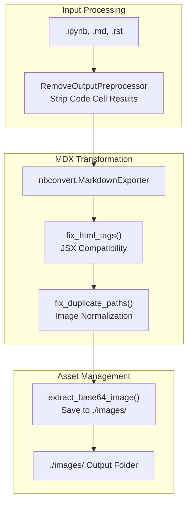

<!-- source: DeepWiki mcp.deepwiki.com · repo camel-ai/camel · page 8.4 Documentation System · fetched 2026-10-29 -->

# Documentation System

<details>
<summary>Relevant source files</summary>

The following files were used as context for generating this wiki page:

- [.pre-commit-config.yaml](.pre-commit-config.yaml)
- [.style.yapf](.style.yapf)
- [docs/cookbooks/loong/index.rst](docs/cookbooks/loong/index.rst)
- [docs/cookbooks/mcp/agents_with_sql_mcp.ipynb](docs/cookbooks/mcp/agents_with_sql_mcp.ipynb)
- [docs/cookbooks/mcp/camel_aci_mcp_cookbook.ipynb](docs/cookbooks/mcp/camel_aci_mcp_cookbook.ipynb)
- [docs/cookbooks/mcp/index.rst](docs/cookbooks/mcp/index.rst)
- [docs/cookbooks/multi_agent_society/azure_openai_claude_society.ipynb](docs/cookbooks/multi_agent_society/azure_openai_claude_society.ipynb)
- [docs/cookbooks/multi_agent_society/azure_openai_claude_society.md](docs/cookbooks/multi_agent_society/azure_openai_claude_society.md)
- [docs/cookbooks/multi_agent_society/index.rst](docs/cookbooks/multi_agent_society/index.rst)
- [docs/mintlify/convert_notebook2mdx.py](docs/mintlify/convert_notebook2mdx.py)
- [docs/mintlify/cookbooks/multi_agent_society/azure_openai_claude_society.mdx](docs/mintlify/cookbooks/multi_agent_society/azure_openai_claude_society.mdx)
- [docs/mintlify/docs.json](docs/mintlify/docs.json)
- [docs/mintlify/get_started/introduction.mdx](docs/mintlify/get_started/introduction.mdx)
- [docs/mintlify/get_started/setup.mdx](docs/mintlify/get_started/setup.mdx)
- [docs/mintlify/reference/camel.agents._utils.mdx](docs/mintlify/reference/camel.agents._utils.mdx)
- [docs/mintlify/reference/camel.agents.chat_agent.mdx](docs/mintlify/reference/camel.agents.chat_agent.mdx)
- [docs/mintlify/reference/camel.configs.avian_config.mdx](docs/mintlify/reference/camel.configs.avian_config.mdx)
- [docs/mintlify/reference/camel.configs.cerebras_config.mdx](docs/mintlify/reference/camel.configs.cerebras_config.mdx)
- [docs/mintlify/reference/camel.configs.orcarouter_config.mdx](docs/mintlify/reference/camel.configs.orcarouter_config.mdx)
- [docs/mintlify/reference/camel.memories.agent_memories.mdx](docs/mintlify/reference/camel.memories.agent_memories.mdx)
- [docs/mintlify/reference/camel.memories.base.mdx](docs/mintlify/reference/camel.memories.base.mdx)
- [docs/mintlify/reference/camel.memories.blocks.chat_history_block.mdx](docs/mintlify/reference/camel.memories.blocks.chat_history_block.mdx)
- [docs/mintlify/reference/camel.memories.context_creators.score_based.mdx](docs/mintlify/reference/camel.memories.context_creators.score_based.mdx)
- [docs/mintlify/reference/camel.models.avian_model.mdx](docs/mintlify/reference/camel.models.avian_model.mdx)
- [docs/mintlify/reference/camel.models.cerebras_model.mdx](docs/mintlify/reference/camel.models.cerebras_model.mdx)
- [docs/mintlify/reference/camel.models.orcarouter_model.mdx](docs/mintlify/reference/camel.models.orcarouter_model.mdx)
- [docs/mintlify/reference/camel.toolkits.excel_toolkit.mdx](docs/mintlify/reference/camel.toolkits.excel_toolkit.mdx)
- [docs/mintlify/reference/camel.toolkits.message_integration.mdx](docs/mintlify/reference/camel.toolkits.message_integration.mdx)
- [docs/mintlify/reference/camel.types.enums.mdx](docs/mintlify/reference/camel.types.enums.mdx)
- [docs/mintlify/reference/camel.types.unified_model_type.mdx](docs/mintlify/reference/camel.types.unified_model_type.mdx)
- [test/models/test_model_manager.py](test/models/test_model_manager.py)

</details>


The CAMEL-AI documentation system provides automated generation and deployment of user-facing documentation from Jupyter notebooks and Python source code. The system uses Mintlify as the documentation platform, with automated pipelines that convert notebooks to MDX format and extract API references from the codebase. All documentation updates are triggered automatically via GitHub Actions on pushes to `master` or `qa` branches.

For information about the testing infrastructure that validates code examples, see [8.2 Testing Infrastructure](). For details on the CI/CD pipelines themselves, see [8.3 CI/CD Pipelines]().

## Documentation Architecture



**Title:** Documentation Build Pipeline Architecture

The documentation system consists of three content sources, two build tools, and automated deployment. Source notebooks are converted to MDX via `convert_notebook2mdx.py`, while Python modules generate API references through `build_api_docs.py`. Both tools update `docs.json` to maintain the navigation structure. The `camel-docs-bot` commits all changes, triggering Mintlify deployment.

**Sources:** [docs/mintlify/docs.json:1-150](), [docs/mintlify/convert_notebook2mdx.py:19-22]()

## Mintlify Configuration Structure

The `docs.json` file at [docs/mintlify/docs.json:1-150]() defines the complete documentation structure for the Mintlify platform:

| Configuration Section | Purpose | Key Fields |
|----------------------|---------|------------|
| **Branding** | Visual identity | `logo`, `favicon`, `colors`, `theme` |
| **Navigation** | Document hierarchy | `tabs`, `groups`, `pages` |
| **Navbar** | Header links | `navbar.links`, `navbar.primary` |
| **Styling** | Code block appearance | `styling.codeblocks` |

### Navigation Structure



**Title:** Mintlify Navigation Hierarchy

The navigation is organized into functional tabs. The Documentation tab contains groups like "Get Started" [docs/mintlify/docs.json:47-53](), "Key Modules" [docs/mintlify/docs.json:54-74](), and "Cookbooks" [docs/mintlify/docs.json:93-180](). Cookbooks are further subdivided into thematic subgroups such as "Basic Concepts" [docs/mintlify/docs.json:95-103]() and "Advanced Features" [docs/mintlify/docs.json:104-121]().

**Sources:** [docs/mintlify/docs.json:41-180]()

### Theme and Branding Configuration

The documentation uses a purple primary color (`#5603fc`) and specifies different logos for light and dark modes:

```json
{
  "colors": {
    "primary": "#5603fc",
    "light": "#5603fc",
    "dark": "#5603fc"
  },
  "logo": {
    "light": "images/CAMEL_Icon.png",
    "dark": "images/CAMEL_Icon_White.png",
    "href": "https://camel-ai.org "
  }
}
```

**Sources:** [docs/mintlify/docs.json:5-15]()

## Notebook-to-MDX Conversion System

The `convert_notebook2mdx.py` script transforms Jupyter notebooks (`.ipynb`), Markdown (`.md`), and RestructuredText (`.rst`) files into Mintlify-compatible MDX files [docs/mintlify/convert_notebook2mdx.py:19-22]().

### Conversion Logic and Data Flow



**Title:** Notebook to MDX Transformation Pipeline

The conversion process includes a `RemoveOutputPreprocessor` that strips execution results from code cells to ensure clean documentation [docs/mintlify/convert_notebook2mdx.py:38-49](). It then applies `fix_html_tags` to handle JSX syntax requirements in MDX, such as self-closing `img` tags [docs/mintlify/convert_notebook2mdx.py:52-78]().

### Image and Path Handling
The system implements specialized logic to prevent duplicate path segments in image references through `fix_duplicate_paths` [docs/mintlify/convert_notebook2mdx.py:81-122](). Base64 encoded images embedded in notebooks are extracted and saved as physical files in an `images` directory relative to the generated MDX [docs/mintlify/convert_notebook2mdx.py:154-184]().

**Sources:** [docs/mintlify/convert_notebook2mdx.py:38-184]()

## API Documentation Generation

API documentation is generated by inspecting the `camel` package and producing MDX files for each module.

### Generated API Reference Structure

The API reference files follow a consistent format with anchor-based navigation, as seen in the `ChatAgent` documentation [docs/mintlify/reference/camel.agents.chat_agent.mdx:245-253]():

```mdx
<a id="camel.agents.chat_agent.ChatAgent"></a>

## ChatAgent

```python
class ChatAgent(BaseAgent):
```

Class for managing conversations of CAMEL Chat Agents.
```

Each entity (class, method, function) receives a unique anchor ID following the pattern `camel.module.entity`, enabling deep linking. For example, the `StreamContentAccumulator` in `chat_agent` is anchored at `camel.agents.chat_agent.StreamContentAccumulator` [docs/mintlify/reference/camel.agents.chat_agent.mdx:11-17]().

### Type and Enum Documentation
The system automatically documents complex types like `ModelType` [docs/mintlify/reference/camel.types.enums.mdx:3-9]() and `UnifiedModelType` [docs/mintlify/reference/camel.types.unified_model_type.mdx:3-9](). This includes their methods (e.g., `is_openai()`, `token_limit()`) and how they interact with TikToken for token counting [docs/mintlify/reference/camel.types.unified_model_type.mdx:59-68]().

**Sources:** [docs/mintlify/reference/camel.agents.chat_agent.mdx:1-253](), [docs/mintlify/reference/camel.types.enums.mdx:1-110](), [docs/mintlify/reference/camel.types.unified_model_type.mdx:1-91]()

## Specialized Toolkit Documentation

The system generates detailed documentation for toolkits, including complex integrations like `ToolkitMessageIntegration`.

### Toolkit Message Integration
The `ToolkitMessageIntegration` class allows standard tools to send status updates to users during execution [docs/mintlify/reference/camel.toolkits.message_integration.mdx:40-57](). The documentation system captures how this class modifies tool signatures to include `message_title` and `message_description` [docs/mintlify/reference/camel.toolkits.message_integration.mdx:80-96]().

### File and Data Toolkits
Toolkits like `ExcelToolkit` are documented with their full functional range, including methods for extracting content from `.xlsx`, `.xls`, and `.csv` files and converting them to Markdown tables [docs/mintlify/reference/camel.toolkits.excel_toolkit.mdx:5-17](). Security validations for file paths are also highlighted [docs/mintlify/reference/camel.toolkits.excel_toolkit.mdx:37-53]().

**Sources:** [docs/mintlify/reference/camel.toolkits.message_integration.mdx:1-100](), [docs/mintlify/reference/camel.toolkits.excel_toolkit.mdx:5-72]()

## Documentation Maintenance and Quality

The documentation quality is maintained through automated checks integrated into the pre-commit and CI pipelines.

### Linting and Style Checks
The `.pre-commit-config.yaml` file defines several hooks to ensure documentation quality:
*   **Ruff**: Used for linting and formatting, though specifically excluded from `docs/` and `examples/usecases/` to prevent conflicts with generated content [ .pre-commit-config.yaml:2-9]().
*   **Codespell**: Automatically checks for typos in the repository, excluding the `docs/` directory to avoid false positives in generated MDX [ .pre-commit-config.yaml:31-36]().
*   **Gitleaks**: Scans for accidental secrets in the codebase, excluding the `docs/` folder [ .pre-commit-config.yaml:39-43]().

### Incremental Builds and Automation
The system is designed for incremental updates. The `docs.json` navigation is programmatically updated by the build scripts as new notebooks are added to the `cookbooks/` or `key_modules/` directories [docs/mintlify/docs.json:93-171]().

**Sources:** [ .pre-commit-config.yaml:1-51](), [docs/mintlify/docs.json:1-171]()

---

