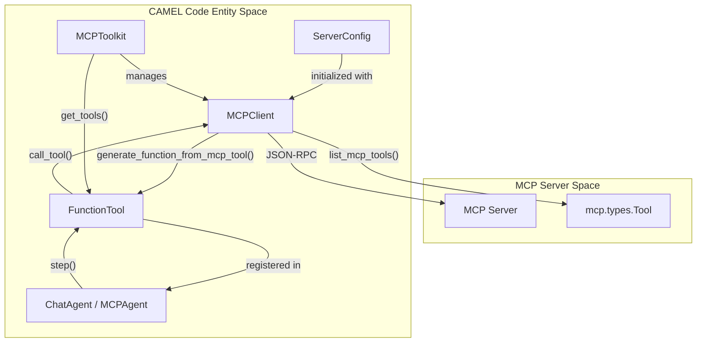
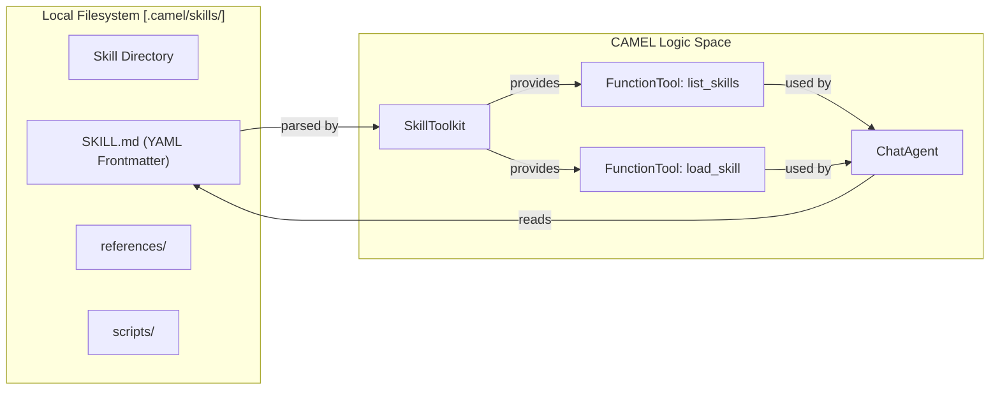

<!-- source: DeepWiki mcp.deepwiki.com · repo camel-ai/camel · page 8.5 MCP Server and Agent Services · fetched 2026-10-29 -->

# MCP Server and Agent Services

Relevant source files

The following files were used as context for generating this wiki page:

- [.camel/skills/skill-creator/SKILL.md](.camel/skills/skill-creator/SKILL.md)
- [.camel/skills/skill-creator/references/output-patterns.md](.camel/skills/skill-creator/references/output-patterns.md)
- [.camel/skills/skill-creator/references/workflows.md](.camel/skills/skill-creator/references/workflows.md)
- [.camel/skills/skill-creator/scripts/init_skill.py](.camel/skills/skill-creator/scripts/init_skill.py)
- [.camel/skills/skill-creator/scripts/package_skill.py](.camel/skills/skill-creator/scripts/package_skill.py)
- [.camel/skills/skill-creator/scripts/quick_validate.py](.camel/skills/skill-creator/scripts/quick_validate.py)
- [camel/agents/mcp_agent.py](camel/agents/mcp_agent.py)
- [camel/toolkits/edgeone_pages_mcp_toolkit.py](camel/toolkits/edgeone_pages_mcp_toolkit.py)
- [camel/toolkits/google_drive_mcp_toolkit.py](camel/toolkits/google_drive_mcp_toolkit.py)
- [camel/toolkits/mcp_toolkit.py](camel/toolkits/mcp_toolkit.py)
- [camel/toolkits/notion_mcp_toolkit.py](camel/toolkits/notion_mcp_toolkit.py)
- [camel/toolkits/origene_mcp_toolkit.py](camel/toolkits/origene_mcp_toolkit.py)
- [camel/toolkits/playwright_mcp_toolkit.py](camel/toolkits/playwright_mcp_toolkit.py)
- [camel/toolkits/skill_toolkit.py](camel/toolkits/skill_toolkit.py)
- [camel/utils/mcp_client.py](camel/utils/mcp_client.py)
- [camel/verifiers/math_verifier.py](camel/verifiers/math_verifier.py)
- [docs/mintlify/reference/camel.agents.mcp_agent.mdx](docs/mintlify/reference/camel.agents.mcp_agent.mdx)
- [docs/mintlify/reference/camel.configs.crynux_config.mdx](docs/mintlify/reference/camel.configs.crynux_config.mdx)
- [docs/mintlify/reference/camel.models.crynux_model.mdx](docs/mintlify/reference/camel.models.crynux_model.mdx)
- [docs/mintlify/reference/camel.toolkits.function_tool.mdx](docs/mintlify/reference/camel.toolkits.function_tool.mdx)
- [docs/mintlify/reference/camel.toolkits.mcp_toolkit.mdx](docs/mintlify/reference/camel.toolkits.mcp_toolkit.mdx)
- [docs/mintlify/reference/camel.toolkits.microsoft_outlook_mail_toolkit.mdx](docs/mintlify/reference/camel.toolkits.microsoft_outlook_mail_toolkit.mdx)
- [docs/mintlify/reference/camel.utils.mcp_client.mdx](docs/mintlify/reference/camel.utils.mcp_client.mdx)
- [examples/toolkits/edgeone_pages_mcp_toolkit.py](examples/toolkits/edgeone_pages_mcp_toolkit.py)
- [examples/toolkits/google_drive_mcp_toolkit.py](examples/toolkits/google_drive_mcp_toolkit.py)
- [examples/toolkits/mcp/mcp_arxiv_toolkit/client.py](examples/toolkits/mcp/mcp_arxiv_toolkit/client.py)
- [examples/toolkits/mcp/mcp_arxiv_toolkit/client_sync.py](examples/toolkits/mcp/mcp_arxiv_toolkit/client_sync.py)
- [examples/toolkits/mcp/mcp_origene_toolkit/client.py](examples/toolkits/mcp/mcp_origene_toolkit/client.py)
- [examples/toolkits/mcp/mcp_toolkit.py](examples/toolkits/mcp/mcp_toolkit.py)
- [examples/toolkits/notion_mcp_tookit.py](examples/toolkits/notion_mcp_tookit.py)
- [examples/toolkits/playwright_mcp_toolkit.py](examples/toolkits/playwright_mcp_toolkit.py)
- [examples/toolkits/skill_toolkit.py](examples/toolkits/skill_toolkit.py)
- [test/toolkits/test_mcp_toolkit.py](test/toolkits/test_mcp_toolkit.py)
- [test/toolkits/test_skill_toolkit.py](test/toolkits/test_skill_toolkit.py)
- [test/utils/test_mcp_client.py](test/utils/test_mcp_client.py)
- [test/utils/test_mcp_server.py](test/utils/test_mcp_server.py)

The Model Context Protocol (MCP) integration in CAMEL-AI allows agents to interact with a vast ecosystem of external tools and services through a standardized interface. This system is divided into two primary directions: consuming MCP tools from external servers via `MCPToolkit` and specialized agents, and managing reusable agent skills via the `SkillToolkit`.

## Core MCP Client Architecture

The CAMEL MCP implementation centers around the `MCPClient` and `MCPToolkit`. These components handle the lifecycle of connections to MCP servers, whether they are local (via `stdio`) or remote (via `HTTP/SSE` or `WebSocket`).

### Unified MCP Client
The `MCPClient` class [camel/utils/mcp_client.py:190-201]() provides a unified interface that automatically detects the required transport protocol based on the `ServerConfig`. It supports:
*   **STDIO**: Local processes communicating over standard input/output [camel/utils/mcp_client.py:74]().
*   **SSE (Server-Sent Events)**: HTTP-based streaming [camel/utils/mcp_client.py:75]().
*   **STREAMABLE_HTTP**: Standard HTTP transport [camel/utils/mcp_client.py:76]().
*   **WEBSOCKET**: Full-duplex persistent connections [camel/utils/mcp_client.py:77]().

### MCP Toolkit
The `MCPToolkit` [camel/toolkits/mcp_toolkit.py:79-89]() manages multiple `MCPClient` instances. It aggregates tools from different servers into a single collection of `FunctionTool` objects that any CAMEL agent can use. It supports loading configurations from JSON files or dictionaries [camel/toolkits/mcp_toolkit.py:127-128]().

**MCP Tool Data Flow**
The following diagram illustrates how an MCP tool is discovered, transformed into a CAMEL-compatible `FunctionTool`, and executed.

Title: MCP Tool Transformation and Execution Flow

Sources: [camel/utils/mcp_client.py:80-157](), [camel/utils/mcp_client.py:190-213](), [camel/toolkits/mcp_toolkit.py:79-131](), [camel/agents/mcp_agent.py:105-143]().

## Specialized MCP Agents

While a standard `ChatAgent` can use MCP tools via `MCPToolkit.get_tools()`, the `MCPAgent` [camel/agents/mcp_agent.py:105-127]() is optimized for registry-based tool discovery and handling.

### MCPAgent Implementation
The `MCPAgent` extends `ChatAgent` and introduces specific handling for MCP registries. It uses a specialized system message `SYS_MSG_CONTENT` [camel/agents/mcp_agent.py:64-89]() to instruct the model on how to format tool calls if the model does not natively support OpenAI-style function calling.

Key features include:
*   **Registry Integration**: Can be initialized with `registry_configs` to pull tools from managed MCP directories [camel/agents/mcp_agent.py:135-137]().
*   **Automatic Connection**: Manages the `connect()` and `disconnect()` lifecycle of the underlying `mcp_toolkit` [camel/agents/mcp_agent.py:175-183]().
*   **Schema Enforcement**: Uses `ensure_strict_json_schema` [camel/toolkits/mcp_toolkit.py:57-63]() to ensure MCP tool definitions meet the strict requirements of LLM providers like OpenAI.

Sources: [camel/agents/mcp_agent.py:105-183](), [camel/toolkits/mcp_toolkit.py:57-63]().

## Configuration and Transport Detection

The `ServerConfig` [camel/utils/mcp_client.py:80-98]() class uses Pydantic validators to determine the `TransportType` based on provided fields.

| Configuration Field | Detected Transport | Description |
| :--- | :--- | :--- |
| `command` | `STDIO` | Path to executable (e.g., "npx", "python") [camel/utils/mcp_client.py:174](). |
| `url` (ws/wss) | `WEBSOCKET` | Connection to a websocket endpoint [camel/utils/mcp_client.py:177](). |
| `url` (http/https) | `STREAMABLE_HTTP` | Standard web transport [camel/utils/mcp_client.py:183](). |
| `prefer_sse=True` | `SSE` | Forces Server-Sent Events for HTTP URLs [camel/utils/mcp_client.py:181](). |

Sources: [camel/utils/mcp_client.py:160-188]().

## Skill System and .camel/skills/

The `SkillToolkit` [camel/toolkits/skill_toolkit.py:27-31]() allows agents to discover and load specialized instructions and assets from a local filesystem structure, typically located in `.camel/skills/`.

### Skill Structure and Contract
A skill is defined as a directory containing a mandatory `SKILL.md` file with YAML frontmatter [.camel/skills/skill-creator/SKILL.md:31-41](). The standard directory structure includes:
*   `SKILL.md`: Required frontmatter (name, description) and core instructions [.camel/skills/skill-creator/SKILL.md:37]().
*   `scripts/`: Optional deterministic helpers [.camel/skills/skill-creator/SKILL.md:38]().
*   `references/`: Optional guidance loaded on-demand [.camel/skills/skill-creator/SKILL.md:39]().
*   `assets/`: Optional templates or static files [.camel/skills/skill-creator/SKILL.md:40]().

### Skill Discovery and Loading
The `SkillToolkit` manages the lifecycle of these skills. It initially exposes metadata and only loads the full body upon an agent's request to minimize context window usage [camel/toolkits/skill_toolkit.py:113-122]().

1.  `list_skills`: Scans the `working_directory` to find available skills and their descriptions [camel/toolkits/skill_toolkit.py:141-150]().
2.  `load_skill`: Reads the content of a `SKILL.md` file and provides it as context to the agent [camel/toolkits/skill_toolkit.py:28-31]().

Title: Skill System Architecture

Sources: [camel/toolkits/skill_toolkit.py:27-50](), [.camel/skills/skill-creator/SKILL.md:31-65](), [camel/toolkits/skill_toolkit.py:141-151]().

## Schema Adaptation
A critical component of the MCP service is the `ensure_strict_json_schema` function [camel/toolkits/mcp_toolkit.py:57-63](). MCP servers often provide loose JSON schemas, but modern LLM APIs (especially OpenAI's `strict` mode) require specific constraints:
1.  `additionalProperties: false` for all objects [camel/toolkits/mcp_toolkit.py:95]().
2.  All properties must be listed in the `required` array [camel/toolkits/mcp_toolkit.py:113]().
3.  Recursive resolution of `$ref` definitions to inline schemas [camel/toolkits/mcp_toolkit.py:168-187]().

The `MCPToolkit` applies these mutations to ensure tool definitions are valid for the target model backends [camel/toolkits/mcp_toolkit.py:57-189]().

Sources: [camel/toolkits/mcp_toolkit.py:57-189]().

---

