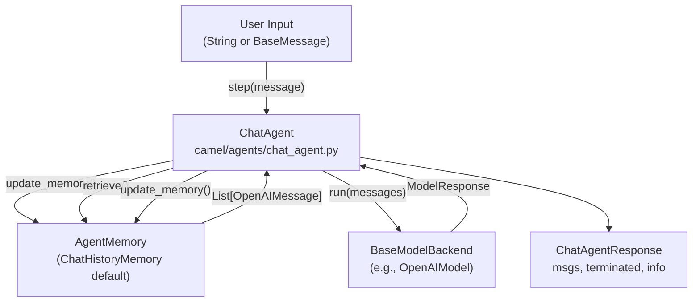
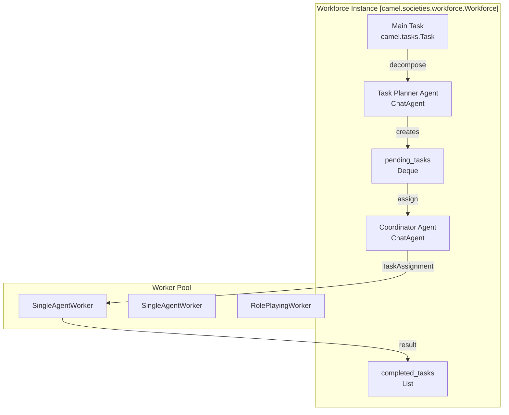

<!-- source: DeepWiki mcp.deepwiki.com · repo camel-ai/camel · page 9 Examples and Applications · fetched 2026-10-29 -->

# Examples and Applications

Relevant source files

The following files were used as context for generating this wiki page:

- [apps/agents/agents.py](apps/agents/agents.py)
- [apps/agents/test/test_agents.py](apps/agents/test/test_agents.py)
- [apps/common/auto_zip.py](apps/common/auto_zip.py)
- [apps/common/test/test_archive_1.zip](apps/common/test/test_archive_1.zip)
- [apps/common/test/test_auto_zip.py](apps/common/test/test_auto_zip.py)
- [apps/data_explorer/data_explorer.py](apps/data_explorer/data_explorer.py)
- [apps/data_explorer/downloader.py](apps/data_explorer/downloader.py)
- [apps/data_explorer/loader.py](apps/data_explorer/loader.py)
- [apps/data_explorer/test/test_data_explorer.py](apps/data_explorer/test/test_data_explorer.py)
- [apps/dilemma/database_connection.py](apps/dilemma/database_connection.py)
- [apps/dilemma/dilemma.py](apps/dilemma/dilemma.py)
- [apps/dilemma/requirements.txt](apps/dilemma/requirements.txt)
- [docs/cookbooks/applications/finance_discord_bot.ipynb](docs/cookbooks/applications/finance_discord_bot.ipynb)
- [docs/cookbooks/basic_concepts/agents_message.ipynb](docs/cookbooks/basic_concepts/agents_message.ipynb)
- [docs/cookbooks/basic_concepts/agents_prompting.ipynb](docs/cookbooks/basic_concepts/agents_prompting.ipynb)
- [docs/cookbooks/basic_concepts/create_your_first_agent.ipynb](docs/cookbooks/basic_concepts/create_your_first_agent.ipynb)
- [docs/cookbooks/basic_concepts/create_your_first_agents_society.ipynb](docs/cookbooks/basic_concepts/create_your_first_agents_society.ipynb)
- [docs/cookbooks/data_generation/data_gen_with_real_function_calls_and_hermes_format.ipynb](docs/cookbooks/data_generation/data_gen_with_real_function_calls_and_hermes_format.ipynb)
- [docs/cookbooks/data_generation/self_instruct_data_generation.ipynb](docs/cookbooks/data_generation/self_instruct_data_generation.ipynb)
- [docs/cookbooks/data_generation/sft_data_generation_and_unsloth_finetuning_Qwen2_5_7B.ipynb](docs/cookbooks/data_generation/sft_data_generation_and_unsloth_finetuning_Qwen2_5_7B.ipynb)
- [docs/cookbooks/data_generation/sft_data_generation_and_unsloth_finetuning_mistral_7b_instruct.ipynb](docs/cookbooks/data_generation/sft_data_generation_and_unsloth_finetuning_mistral_7b_instruct.ipynb)
- [docs/cookbooks/data_generation/sft_data_generation_and_unsloth_finetuning_tinyllama.ipynb](docs/cookbooks/data_generation/sft_data_generation_and_unsloth_finetuning_tinyllama.ipynb)
- [docs/cookbooks/data_processing/agent_with_chunkr_for_pdf_parsing.ipynb](docs/cookbooks/data_processing/agent_with_chunkr_for_pdf_parsing.ipynb)
- [docs/cookbooks/data_processing/ingest_data_from_websites_with_Firecrawl.ipynb](docs/cookbooks/data_processing/ingest_data_from_websites_with_Firecrawl.ipynb)
- [docs/cookbooks/data_processing/video_analysis.ipynb](docs/cookbooks/data_processing/video_analysis.ipynb)
- [docs/cookbooks/multi_agent_society/workforce_judge_committee.ipynb](docs/cookbooks/multi_agent_society/workforce_judge_committee.ipynb)
- [docs/cookbooks/multi_agent_society/workforce_judge_committee.md](docs/cookbooks/multi_agent_society/workforce_judge_committee.md)
- [docs/mintlify/cookbooks/multi_agent_society/workforce_judge_committee.mdx](docs/mintlify/cookbooks/multi_agent_society/workforce_judge_committee.mdx)
- [examples/test/test_unstructured_io_example.py](examples/test/test_unstructured_io_example.py)
- [test/loaders/test_unstructured_io.py](test/loaders/test_unstructured_io.py)

This page demonstrates practical usage patterns for CAMEL-AI through concrete examples and applications. It covers single-agent scenarios, multi-agent orchestration, toolkit integration, and advanced patterns. Examples range from basic `ChatAgent` usage to complex multi-agent systems with failure recovery and specialized web applications.

For foundational concepts about agents and their architecture, see [Core Agent System](#2). For toolkit system details, see [Toolkit Ecosystem](#4). For multi-agent coordination mechanisms, see [Workforce Orchestration](#2.5).

---

## Single Agent Examples

The `ChatAgent` class provides the foundation for single-agent applications. Examples demonstrate progressive complexity from basic conversation to tool-calling, streaming, and structured output generation.

### Basic Conversation Pattern

The simplest usage involves creating a `ChatAgent` with a system message and calling `step()` with user input. In the context of video analysis, an agent is initialized with a `VIDEO_DESCRIPTION` prompt template and a model created via `ModelFactory` [docs/cookbooks/data_processing/video_analysis.ipynb:160-188]().

**Diagram: Basic ChatAgent Step Flow**

For details, see [Single Agent Examples](#9.1).

Sources: [apps/agents/agents.py:224-250](), [docs/cookbooks/data_processing/video_analysis.ipynb:160-188]()

---

## Multi-Agent and Workforce Examples

The `Workforce` system orchestrates multiple workers to handle complex tasks through decomposition, parallel processing, and intelligent failure recovery. A prime example is the **Hackathon Judge Committee**, where a `Workforce` manages specialized `ChatAgent` instances acting as judges with unique personas [docs/mintlify/cookbooks/multi_agent_society/workforce_judge_committee.mdx:82-114]().

### Workforce Architecture Pattern

**Diagram: Workforce System Architecture**

Practical applications include hackathon judge committees and automated research societies. For details, see [Multi-Agent and Workforce Examples](#9.2).

Sources: [docs/mintlify/cookbooks/multi_agent_society/workforce_judge_committee.mdx:74-80](), [apps/agents/test/test_agents.py:41-86]()

---

## Toolkit Integration Examples

Toolkits extend agent capabilities through specialized functions. Examples show integration patterns for document processing, web automation, and media analysis.

### Specialized Data Processing

CAMEL supports complex data processing tasks like OCR and structured extraction through integrated toolkits and loaders like `UnstructuredIO` [test/loaders/test_unstructured_io.py:19-25]().

| Application | Toolkits/Services Used | Code Reference |
|-----------|----------|----------|
| **PDF/URL Parsing** | `UnstructuredIO` | [test/loaders/test_unstructured_io.py:69-78]() |
| **PDF Extraction** | `Chunkr` | [docs/cookbooks/data_processing/agent_with_chunkr_for_pdf_parsing.ipynb:10-20]() |
| **Video Download** | `VideoDownloaderToolkit` | [docs/cookbooks/data_processing/video_analysis.ipynb:144-150]() |
| **Web Search** | `SearchToolkit` | [docs/mintlify/cookbooks/multi_agent_society/workforce_judge_committee.mdx:147-151]() |

For details, see [Toolkit Integration Examples](#9.3).

Sources: [test/loaders/test_unstructured_io.py:29-59](), [docs/cookbooks/data_processing/video_analysis.ipynb:144-150]()

---

## Advanced Patterns

Advanced patterns involve dynamic role-playing, complex web applications, and large-scale synthetic data generation.

### Gradio Web Applications

CAMEL includes several functional web applications built with Gradio:

*   **Agent Society App**: A interface for collaborative chats between agents using `RolePlaying` [apps/agents/agents.py:24-33]().
*   **Data Explorer**: A tool to browse and analyze CAMEL datasets (AI Society, Code, Misalignment) [apps/data_explorer/data_explorer.py:116-166]().
*   **Dilemma Tool**: A UI for comparing agent solutions [apps/dilemma/dilemma.py:15-26]().

### Data Generation Pipelines

CAMEL facilitates the creation of synthetic datasets through the **Self-Instruct Pipeline**, automating instruction generation for LLMs like Qwen [docs/cookbooks/data_generation/self_instruct_data_generation.ipynb:41-48]().

**Diagram: Data Exploration Pipeline**

For details, see [Advanced Patterns](#9.4).

Sources: [apps/data_explorer/loader.py:96-140](), [apps/common/auto_zip.py:25-30](), [docs/cookbooks/data_generation/self_instruct_data_generation.ipynb:41-48]()

---

