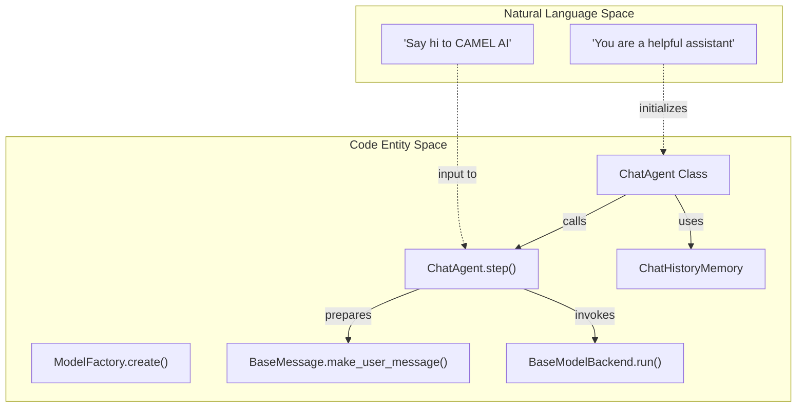
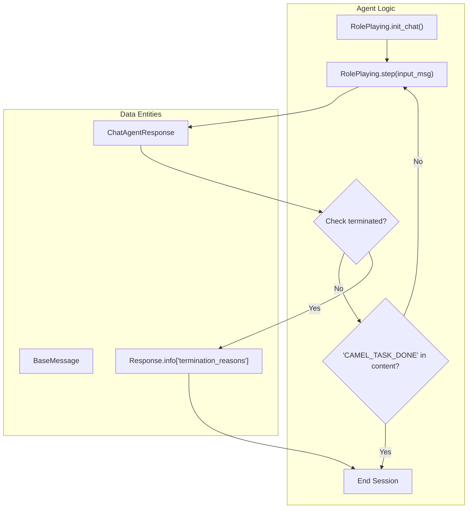

<!-- source: DeepWiki mcp.deepwiki.com · repo camel-ai/camel · page 9.1 Single Agent Examples · fetched 2026-10-29 -->

# Single Agent Examples

<details>
<summary>Relevant source files</summary>

The following files were used as context for generating this wiki page:

- [camel/prompts/role_description_prompt_template.py](camel/prompts/role_description_prompt_template.py)
- [examples/ai_society/role_playing_multi_lingual.py](examples/ai_society/role_playing_multi_lingual.py)
- [examples/code/role_playing.py](examples/code/role_playing.py)
- [examples/models/mistral_model_example.py](examples/models/mistral_model_example.py)
- [examples/models/role_playing_with_mistral.py](examples/models/role_playing_with_mistral.py)
- [examples/observability/agentops_track_roleplaying_with_function.py](examples/observability/agentops_track_roleplaying_with_function.py)
- [examples/role_description/role_generation.py](examples/role_description/role_generation.py)
- [examples/role_description/role_playing_with_role_description.py](examples/role_description/role_playing_with_role_description.py)
- [examples/structured_response/json_format_reponse_with_tools.py](examples/structured_response/json_format_reponse_with_tools.py)
- [examples/structured_response/json_format_response.py](examples/structured_response/json_format_response.py)
- [examples/tasks/task_generation.py](examples/tasks/task_generation.py)
- [examples/test/test_ai_society_example.py](examples/test/test_ai_society_example.py)
- [examples/test/test_code_example.py](examples/test/test_code_example.py)
- [examples/test/test_role_description_example.py](examples/test/test_role_description_example.py)
- [examples/test/test_single_agent.py](examples/test/test_single_agent.py)
- [examples/vision/image_crafting.py](examples/vision/image_crafting.py)
- [examples/vision/multi_condition_image_crafting.py](examples/vision/multi_condition_image_crafting.py)
- [examples/vision/multi_turn_image_refining.py](examples/vision/multi_turn_image_refining.py)
- [examples/workforce/hackathon_judges.py](examples/workforce/hackathon_judges.py)
- [examples/workforce/multiple_single_agents.py](examples/workforce/multiple_single_agents.py)
- [examples/workforce/role_playing_with_agents.py](examples/workforce/role_playing_with_agents.py)
- [test/agents/test_role_assignment_agent.py](test/agents/test_role_assignment_agent.py)
- [test/models/test_mistral_model.py](test/models/test_mistral_model.py)
- [test/prompts/test_role_description_prompt_template.py](test/prompts/test_role_description_prompt_template.py)
- [test/workforce/test_workforce_single_agent.py](test/workforce/test_workforce_single_agent.py)

</details>


This page presents practical examples of using `ChatAgent` for single-agent scenarios, demonstrating common usage patterns including basic conversation, tool calling, multimodal interactions, and structured task processing. These examples showcase how to leverage `ChatAgent` for various tasks without multi-agent coordination.

For comprehensive documentation of `ChatAgent`'s architecture, initialization parameters, and the `step()` method, see [ChatAgent](#2.1). For multi-agent coordination and workforce patterns, see [Workforce Orchestration](#2.5).

---

## Basic ChatAgent Usage

The simplest `ChatAgent` usage involves creating an agent with a system message and interacting with it through the `step()` method. This method accepts either a string or a `BaseMessage` object and returns a `ChatAgentResponse` containing the response messages, termination status, and metadata.

```python
from camel.agents import ChatAgent
from camel.models import ModelFactory
from camel.types import ModelPlatformType, ModelType

# Create a model backend
model = ModelFactory.create(
    model_platform=ModelPlatformType.MISTRAL,
    model_type=ModelType.MISTRAL_8B,
)

# Initialize agent with system message
agent = ChatAgent(
    system_message="You are a helpful assistant.",
    model=model
)

# Interact with the agent
response = agent.step("Say hi to CAMEL AI.")
print(response.msgs[0].content)
```

### Execution Flow Diagram

The following diagram illustrates the interaction between high-level user code and the underlying code entities during a single step.

**Title: ChatAgent Step Execution Flow**

**Sources:** [examples/models/mistral_model_example.py:25-42](), [camel/agents/chat_agent.py:363-465](), [test/models/test_mistral_model.py:41-49]()

---

## Tool Calling and Function Integration

`ChatAgent` supports tool calling by passing a list of tools to the constructor. These tools can be CAMEL `BaseToolkit` methods or custom `FunctionTool` instances. The agent automatically manages the loop of calling the tool and feeding the output back into the model.

| Toolkit Example | Implementation | Purpose |
| :--- | :--- | :--- |
| `SearchToolkit` | `tools=[SearchToolkit().search_wiki]` | Web search and information gathering. |
| `OpenAIImageToolkit` | `tools=OpenAIImageToolkit().get_tools()` | DALL-E image generation capabilities. |
| `FunctionTool` | `FunctionTool(search_toolkit.search_duckduckgo)` | Wrapping arbitrary Python functions as tools. |

**Sources:** [examples/workforce/multiple_single_agents.py:25-36](), [examples/vision/image_crafting.py:39-43](), [examples/workforce/hackathon_judges.py:75-78]()

---

## Multimodal Interactions (Vision)

`ChatAgent` can process images by using `BaseMessage.make_user_message()` with the `image_list` parameter. This allows agents to describe images or generate new ones based on visual input.

```python
from camel.messages import BaseMessage
from PIL import Image

# Load image
img = Image.open("path/to/image.png")

# Create message with image
user_msg = BaseMessage.make_user_message(
    role_name="User", 
    content="What's in the image?", 
    image_list=[img]
)

# Agent processes image and text
response = camel_agent.step(user_msg)
```

**Sources:** [examples/models/mistral_model_example.py:60-70](), [examples/vision/multi_condition_image_crafting.py:48-57]()

---

## Role-Playing Logic

While `RolePlaying` is a multi-agent society class, it utilizes `ChatAgent` instances internally. The interaction loop demonstrates how single agents handle termination signals like `CAMEL_TASK_DONE` and access termination reasons.

**Title: Single Agent Role-Playing Interaction Loop**

**Sources:** [examples/code/role_playing.py:56-92](), [examples/ai_society/role_playing_multi_lingual.py:50-86](), [examples/code/role_playing.py:61-78]()

---

## Advanced Response Handling

Agents provide detailed metadata in the `ChatAgentResponse` object, which is critical for debugging and flow control.

| Feature | Implementation | Purpose |
| :--- | :--- | :--- |
| **Termination Status** | `response.terminated` | Boolean flag indicating if the session should end. |
| **Termination Reasons** | `response.info['termination_reasons']` | Accessing why the model stopped (e.g., `stop_sequence`). |
| **Tool Call IDs** | `assistant_message.tool_calls[0].id` | Tracking unique identifiers for tool executions. |
| **Stream Mode** | `info={"stream_accumulate_mode": "delta"}` | Identifying incremental updates in streaming responses. |

**Sources:** [examples/code/role_playing.py:61-78](), [test/models/test_mistral_model.py:96-107](), [test/workforce/test_workforce_single_agent.py:72-80]()

---

## Specialized Persona Generation

`ChatAgent` is frequently used to simulate specific personas, which is particularly useful for evaluation tasks like hackathon judging or misalignment testing.

```python
def make_judge(persona: str, criteria: str) -> ChatAgent:
    msg_content = f"You are a judge. Persona: {persona}. Criteria: {criteria}"
    sys_msg = BaseMessage.make_assistant_message(
        role_name="Hackathon Judge",
        content=msg_content,
    )
    return ChatAgent(system_message=sys_msg)
```

**Sources:** [examples/workforce/hackathon_judges.py:25-57](), [examples/misalignment/single_agent.py:20-32]()

---

