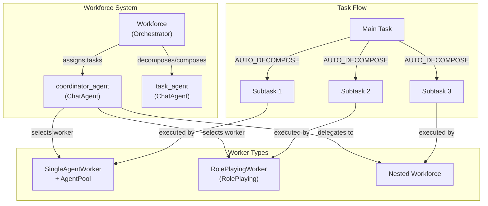
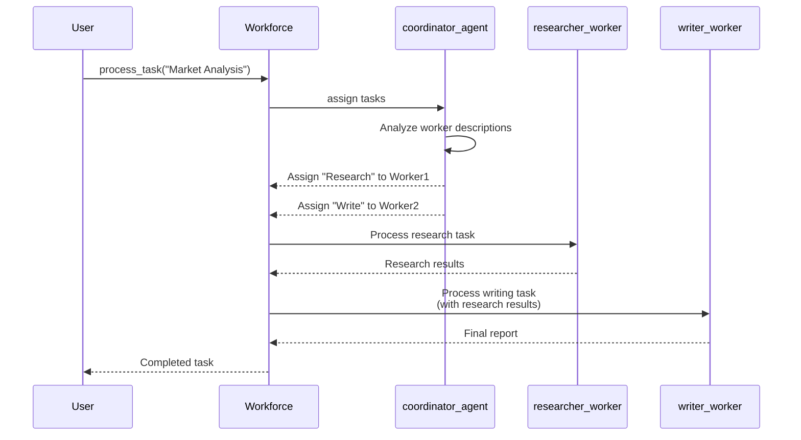
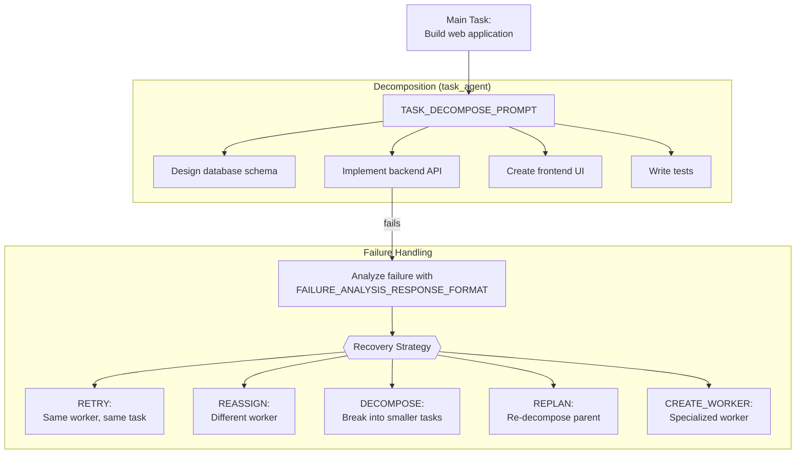
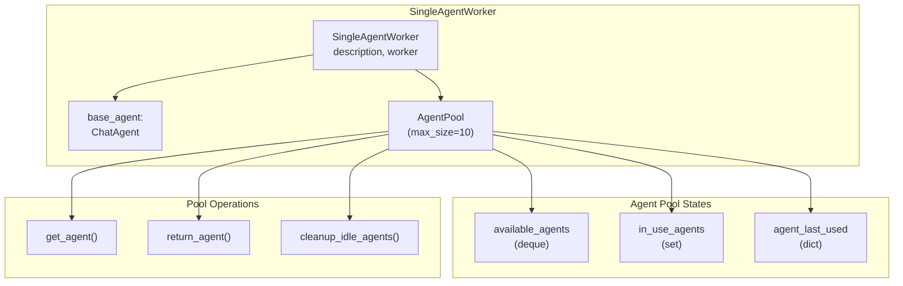
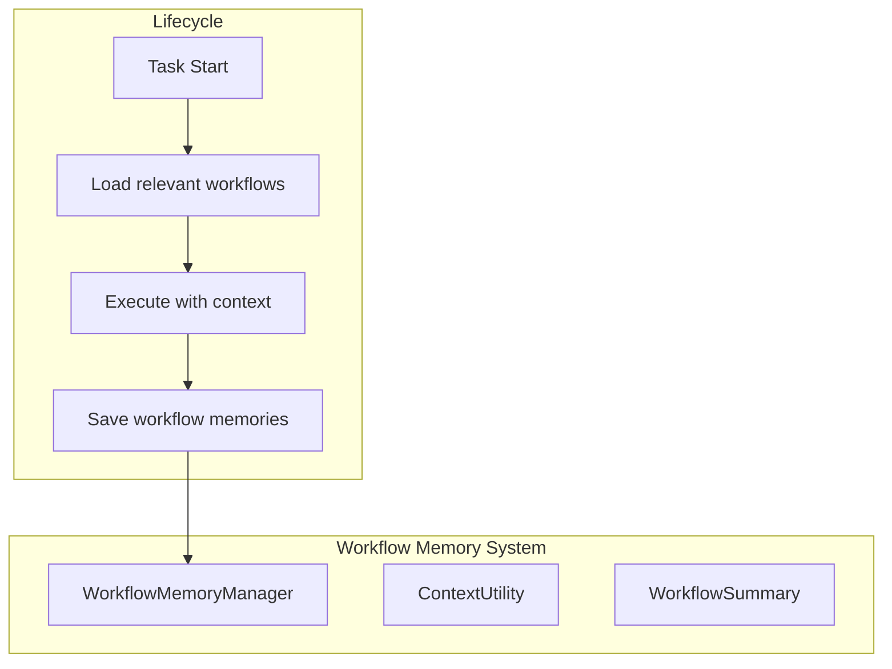
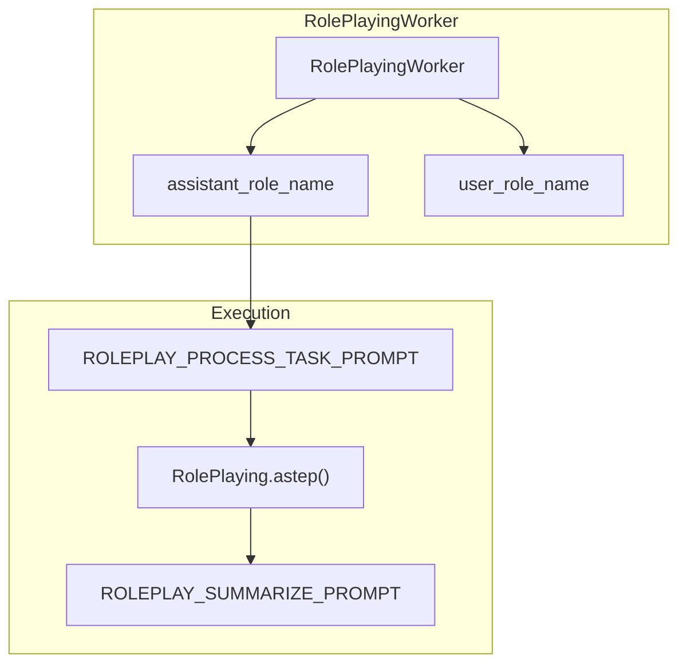
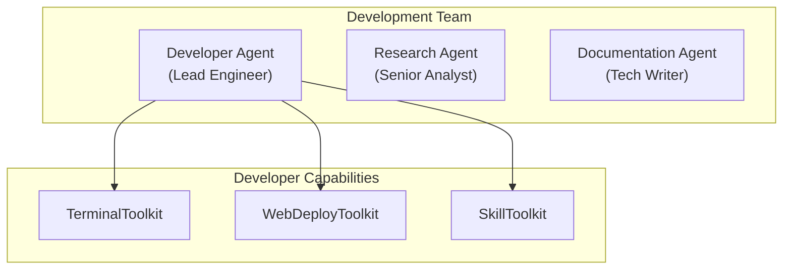

<!-- source: DeepWiki mcp.deepwiki.com · repo camel-ai/camel · page 9.2 Multi-Agent and Workforce Examples · fetched 2026-10-29 -->

# Multi-Agent and Workforce Examples

Relevant source files

The following files were used as context for generating this wiki page:

- [camel/societies/workforce/__init__.py](camel/societies/workforce/__init__.py)
- [camel/societies/workforce/prompts.py](camel/societies/workforce/prompts.py)
- [camel/societies/workforce/role_playing_worker.py](camel/societies/workforce/role_playing_worker.py)
- [camel/societies/workforce/single_agent_worker.py](camel/societies/workforce/single_agent_worker.py)
- [camel/societies/workforce/task_channel.py](camel/societies/workforce/task_channel.py)
- [camel/societies/workforce/utils.py](camel/societies/workforce/utils.py)
- [camel/societies/workforce/worker.py](camel/societies/workforce/worker.py)
- [camel/societies/workforce/workforce.py](camel/societies/workforce/workforce.py)
- [camel/tasks/task.py](camel/tasks/task.py)
- [examples/ai_society/role_playing.py](examples/ai_society/role_playing.py)
- [examples/ai_society/role_playing_multiprocess.py](examples/ai_society/role_playing_multiprocess.py)
- [examples/ai_society/role_playing_with_critic.py](examples/ai_society/role_playing_with_critic.py)
- [examples/ai_society/role_playing_with_human.py](examples/ai_society/role_playing_with_human.py)
- [examples/benchmarks/browsecomp_workforce.py](examples/benchmarks/browsecomp_workforce.py)
- [examples/code/role_playing_multiprocess.py](examples/code/role_playing_multiprocess.py)
- [examples/misalignment/role_playing_multiprocess.py](examples/misalignment/role_playing_multiprocess.py)
- [examples/misalignment/role_playing_with_human.py](examples/misalignment/role_playing_with_human.py)
- [examples/toolkits/async_browser_toolkit.py](examples/toolkits/async_browser_toolkit.py)
- [examples/workforce/eigent.py](examples/workforce/eigent.py)
- [examples/workforce/human_in_the_loop/simple_hotkey_demo.py](examples/workforce/human_in_the_loop/simple_hotkey_demo.py)
- [examples/workforce/pipeline_workflow_example.py](examples/workforce/pipeline_workflow_example.py)
- [examples/workforce/workforce_multitask_with_skip.py](examples/workforce/workforce_multitask_with_skip.py)
- [examples/workforce/workforce_shared_memory_validation.py](examples/workforce/workforce_shared_memory_validation.py)
- [test/workforce/test_workforce.py](test/workforce/test_workforce.py)

This page demonstrates practical usage patterns for CAMEL's multi-agent orchestration system, focusing on the `Workforce` class and its worker types. These examples show how to coordinate multiple agents to solve complex tasks through task decomposition, parallel processing, and intelligent failure recovery.

For single-agent patterns without orchestration, see [Single Agent Examples](9.1). For toolkit integration in multi-agent contexts, see [Toolkit Integration Examples](9.3). For advanced customization patterns like custom model backends and agent pooling, see [Advanced Patterns](9.4).

---

## Architecture Overview

The Workforce system implements a coordinator-planner-worker architecture where specialized agents handle task assignment, decomposition, and execution.

Title: Workforce Orchestration System Architecture

Sources: [camel/societies/workforce/workforce.py:176-213]()

The `Workforce` class uses three specialized `ChatAgent` instances internally:
- `coordinator_agent`: Assigns tasks to workers via `ASSIGN_TASK_PROMPT`. [camel/societies/workforce/workforce.py:182-185](), [camel/societies/workforce/prompts.py:52-85]()
- `task_agent`: Decomposes tasks via `TASK_DECOMPOSE_PROMPT` and composes results via `TASK_COMPOSE_PROMPT`. [camel/societies/workforce/workforce.py:186-187](), [camel/societies/workforce/prompts.py:162-200]()
- `new_worker_agent`: Template for dynamically created workers when failures occur. [camel/societies/workforce/workforce.py:206-213]()

---

## Basic Multi-Agent Coordination

### Multiple SingleAgentWorkers

The simplest multi-agent pattern uses multiple `SingleAgentWorker` instances coordinated by a `Workforce`. Each worker has a specialized role and toolset.

Title: Basic Workforce Task Assignment Sequence

Sources: [camel/societies/workforce/workforce.py:176-213](), [camel/societies/workforce/single_agent_worker.py:220-225]()

**Key Points:**
- Each `SingleAgentWorker` wraps a `ChatAgent` with specialized capabilities. [camel/societies/workforce/single_agent_worker.py:220-225]()
- The `coordinator_agent` analyzes worker `description` fields to make assignments using `ASSIGN_TASK_PROMPT`. [camel/societies/workforce/prompts.py:52-85]()
- Workers operate in parallel when tasks have no dependencies. [camel/societies/workforce/worker.py:151-182]()

---

## Execution Modes

The `Workforce` supports two execution modes.

| Mode | Description | Use Case | Failure Handling |
|------|-------------|----------|------------------|
| `AUTO_DECOMPOSE` | LLM-driven task decomposition | Complex, ambiguous tasks | Intelligent recovery (retry, reassign, decompose, replan, create_worker) |
| `PIPELINE` | Predefined task graph | Structured workflows | Simple retry, allows failures to propagate |

Sources: [camel/societies/workforce/workforce.py:142-146](), [camel/societies/workforce/workforce.py:330-335]()

### AUTO_DECOMPOSE Mode

In `AUTO_DECOMPOSE` mode (default), the workforce uses its `task_agent` to break down complex tasks and apply sophisticated recovery strategies.

Title: Auto-Decomposition and Failure Recovery Flow

Sources: [camel/societies/workforce/workforce.py:1489-1520](), [camel/societies/workforce/prompts.py:202-268]()

The recovery strategy selection process uses `StructuredOutputHandler` for reliable parsing. [camel/societies/workforce/workforce.py:1489-1505]()

**Recovery Strategy Details:**

| Strategy | Enum Value | Implementation |
|----------|------------|----------------|
| Retry | `RecoveryStrategy.RETRY` | Re-queue same task to same worker. [camel/societies/workforce/utils.py:75]() |
| Reassign | `RecoveryStrategy.REASSIGN` | Use `ASSIGN_TASK_PROMPT` to pick a new worker. [camel/societies/workforce/utils.py:75]() |
| Decompose | `RecoveryStrategy.DECOMPOSE` | Apply `TASK_DECOMPOSE_PROMPT` to failed task. [camel/societies/workforce/utils.py:75]() |
| Replan | `RecoveryStrategy.REPLAN` | Re-decompose the parent task. [camel/societies/workforce/utils.py:75]() |
| Create Worker | `RecoveryStrategy.CREATE_WORKER` | Use `CREATE_NODE_PROMPT` to spawn new worker. [camel/societies/workforce/utils.py:75]() |

---

## Worker Types in Practice

### SingleAgentWorker with AgentPool

`SingleAgentWorker` wraps a `ChatAgent` and provides an `AgentPool` for efficient reuse and scaling. [camel/societies/workforce/single_agent_worker.py:54-72]()

Title: AgentPool Management and State

Sources: [camel/societies/workforce/single_agent_worker.py:54-162]()

### Workflow Memory

`SingleAgentWorker` supports workflow memory management to save and load past conversation context. [camel/societies/workforce/single_agent_worker.py:41-43]()

Title: Workflow Memory Lifecycle

Sources: [camel/societies/workforce/single_agent_worker.py:41-46]()

### RolePlayingWorker

`RolePlayingWorker` wraps the `RolePlaying` society for multi-turn dialogues between an assistant and a user agent to solve a task. [camel/societies/workforce/role_playing_worker.py:38-64]()

Title: RolePlayingWorker Dialogue Flow

Sources: [camel/societies/workforce/role_playing_worker.py:103-161]()

---

## Real-World Applications

### Development Automation (Eigent)

A complex development team with specialized agents and extensive toolkits. [examples/workforce/eigent.py:116-152]()

Title: Eigent Development Team Capabilities

Sources: [examples/workforce/eigent.py:116-152]()

### Multi-Process Role-Playing

Large-scale data generation using multi-processing and role-playing societies. [examples/ai_society/role_playing_multiprocess.py:29-55]()

**Key Components:**
- `multiprocessing` for parallel session execution. [examples/ai_society/role_playing_multiprocess.py:15]()
- `RolePlaying` session initialization with specific `TaskType`. [examples/ai_society/role_playing_multiprocess.py:48-55]()
- Custom termination logic based on message content and turn counts. [examples/ai_society/role_playing_multiprocess.py:119-140]()

---

## Summary

This page covered multi-agent coordination using CAMEL's Workforce system:

- **Basic coordination** with `SingleAgentWorker`. [camel/societies/workforce/single_agent_worker.py:220-225]()
- **Execution modes**: `AUTO_DECOMPOSE` vs. `PIPELINE`. [camel/societies/workforce/workforce.py:142-146]()
- **Worker types**: `AgentPool` scaling and `RolePlaying` collaboration. [camel/societies/workforce/single_agent_worker.py:54-72](), [camel/societies/workforce/role_playing_worker.py:38-64]()
- **Failure recovery**: Automatic strategies like retry, reassign, and decompose. [camel/societies/workforce/utils.py:75]()

**Key Classes:**
- `Workforce`: [camel/societies/workforce/workforce.py:176-213]()
- `SingleAgentWorker`: [camel/societies/workforce/single_agent_worker.py:220-225]()
- `RolePlayingWorker`: [camel/societies/workforce/role_playing_worker.py:38-64]()
- `Task`: [camel/tasks/task.py:216-225]()

---

