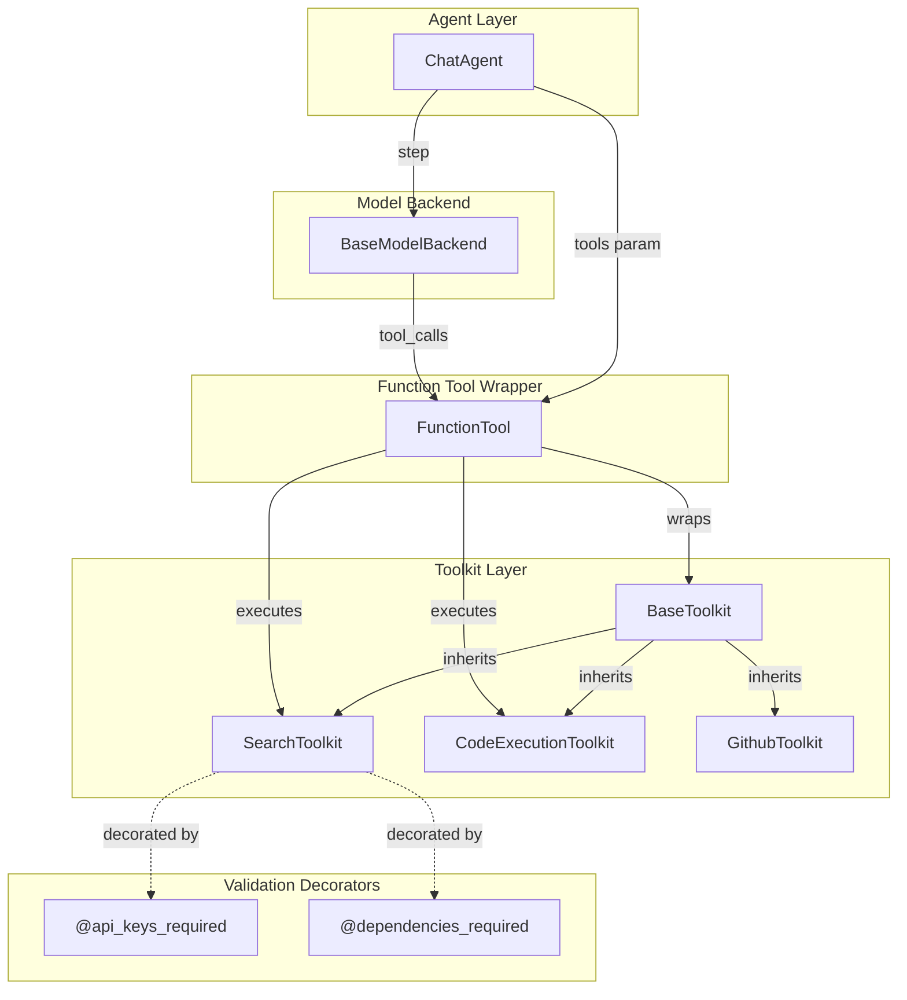
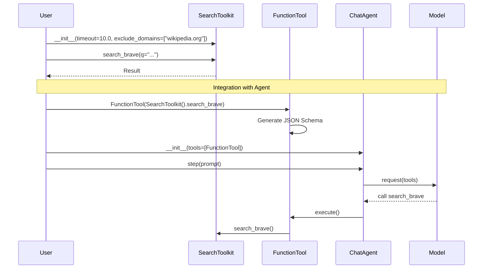
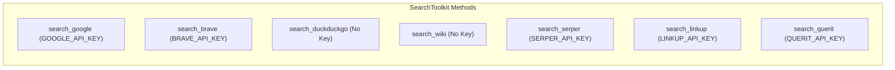
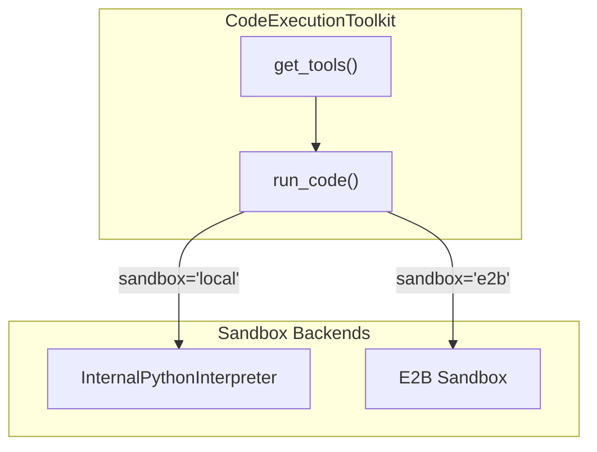

<!-- source: DeepWiki mcp.deepwiki.com · repo camel-ai/camel · page 9.3 Toolkit Integration Examples · fetched 2026-10-29 -->

# Toolkit Integration Examples

<details>
<summary>Relevant source files</summary>

The following files were used as context for generating this wiki page:

- [camel/toolkits/search_toolkit.py](camel/toolkits/search_toolkit.py)
- [docs/cookbooks/data_processing/index.rst](docs/cookbooks/data_processing/index.rst)
- [docs/mintlify/reference/camel.toolkits.github_toolkit.mdx](docs/mintlify/reference/camel.toolkits.github_toolkit.mdx)
- [docs/mintlify/reference/camel.toolkits.math_toolkit.mdx](docs/mintlify/reference/camel.toolkits.math_toolkit.mdx)
- [docs/mintlify/reference/camel.toolkits.search_toolkit.mdx](docs/mintlify/reference/camel.toolkits.search_toolkit.mdx)
- [docs/reference/camel.toolkits.github_toolkit.md](docs/reference/camel.toolkits.github_toolkit.md)
- [docs/reference/camel.toolkits.search_toolkit.md](docs/reference/camel.toolkits.search_toolkit.md)
- [examples/toolkits/arxiv_toolkit.py](examples/toolkits/arxiv_toolkit.py)
- [examples/toolkits/code_execution_toolkit.py](examples/toolkits/code_execution_toolkit.py)
- [examples/toolkits/e2b_custom_provider_example.py](examples/toolkits/e2b_custom_provider_example.py)
- [examples/toolkits/google_scholar_toolkit.py](examples/toolkits/google_scholar_toolkit.py)
- [examples/toolkits/notion_toolkit.py](examples/toolkits/notion_toolkit.py)
- [examples/toolkits/openapi_toolkit.py](examples/toolkits/openapi_toolkit.py)
- [examples/toolkits/querit_search_example.py](examples/toolkits/querit_search_example.py)
- [examples/toolkits/role_playing_with_functions.py](examples/toolkits/role_playing_with_functions.py)
- [examples/toolkits/search_google_with_exclusion.py](examples/toolkits/search_google_with_exclusion.py)
- [examples/toolkits/search_toolkit.py](examples/toolkits/search_toolkit.py)
- [examples/usecases/mistral_OCR/README.md](examples/usecases/mistral_OCR/README.md)
- [examples/usecases/mistral_OCR/requirements.txt](examples/usecases/mistral_OCR/requirements.txt)
- [examples/usecases/pptx_toolkit_usecase/README.md](examples/usecases/pptx_toolkit_usecase/README.md)
- [examples/usecases/pptx_toolkit_usecase/app_pptx.py](examples/usecases/pptx_toolkit_usecase/app_pptx.py)
- [examples/usecases/pptx_toolkit_usecase/assets/CAMEL_logo.jpg](examples/usecases/pptx_toolkit_usecase/assets/CAMEL_logo.jpg)
- [examples/usecases/pptx_toolkit_usecase/requirements.txt](examples/usecases/pptx_toolkit_usecase/requirements.txt)
- [examples/usecases/pptx_toolkit_usecase/slides_templates/urban_monochrome.pptx](examples/usecases/pptx_toolkit_usecase/slides_templates/urban_monochrome.pptx)
- [examples/usecases/youtube_ocr/README.md](examples/usecases/youtube_ocr/README.md)
- [examples/usecases/youtube_ocr/app.py](examples/usecases/youtube_ocr/app.py)
- [examples/usecases/youtube_ocr/requirements.txt](examples/usecases/youtube_ocr/requirements.txt)
- [test/toolkits/test_search_functions.py](test/toolkits/test_search_functions.py)

</details>


## Purpose and Scope

This page demonstrates practical patterns for integrating toolkits with CAMEL-AI agents. It covers toolkit instantiation, configuration, usage with `ChatAgent`, and combining multiple toolkits. Specifically, it details search integration, terminal automation, and sandbox execution. For single-agent patterns without toolkits, see [Single Agent Examples](9.1). For advanced toolkit patterns like custom toolkits and agent pooling, see [Advanced Patterns](9.4).

## Toolkit Integration Architecture

The toolkit system provides a standardized interface for extending agent capabilities. All toolkits inherit from `BaseToolkit` and expose their methods as `FunctionTool` objects that agents can invoke.

### Architecture Diagram



**Sources:** [camel/toolkits/base.py:21-33](), [camel/toolkits/search_toolkit.py:33-40](), [camel/toolkits/code_execution.py:19-20](), [camel/toolkits/github_toolkit.py:8-9]()

## Basic Toolkit Integration

### Instantiation and Configuration

Toolkits are instantiated with configuration parameters and converted to `FunctionTool` objects for agent use. The `SearchToolkit` can be configured with timeouts and domain exclusions [camel/toolkits/search_toolkit.py:41-57]().



**Sources:** [camel/toolkits/search_toolkit.py:41-57](), [examples/toolkits/search_toolkit.py:22-38]()

### Integration with ChatAgent

The standard pattern passes toolkit functions to `ChatAgent`. The `ChatAgent` uses these tools to interact with external environments based on user prompts.

| Component | File Path | Role |
|-----------|-----------|------|
| `SearchToolkit` | [camel/toolkits/search_toolkit.py:33-40]() | Provides web search methods. |
| `FunctionTool` | [camel/toolkits/function_tool.py:22-22]() | Wraps methods for LLM compatibility. |
| `ChatAgent` | [camel/agents/chat_agent.py:19-19]() | Orchestrates tool calling and reasoning. |
| `CodeExecutionToolkit` | [camel/toolkits/code_execution.py:19-20]() | Provides sandboxed code execution. |

**Example from codebase:**
```python
# [examples/toolkits/search_toolkit.py:30-34]
agent = ChatAgent(
    system_message="""You are a helpful assistant that can use brave search
        engine to answer questions.""",
    tools=[FunctionTool(SearchToolkit().search_brave)],
)
```

**Sources:** [examples/toolkits/search_toolkit.py:30-34](), [camel/toolkits/search_toolkit.py:33-40]()

## SearchToolkit Integration Examples

`SearchToolkit` provides integrations for multiple search engines (Google, Brave, DuckDuckGo, Wikipedia, Linkup, Querit, etc.) with consistent interfaces.

### Multi-Engine Integration Diagram



**Sources:** [camel/toolkits/search_toolkit.py:64-69](), [camel/toolkits/search_toolkit.py:114-118](), [camel/toolkits/search_toolkit.py:153-161](), [examples/toolkits/querit_search_example.py:46-49]()

### Specialized Search Patterns

#### Domain Exclusion
The `SearchToolkit` allows excluding specific domains, which is particularly useful for forcing an agent to find alternative sources [examples/toolkits/search_google_with_exclusion.py:31-35]().

#### Wikipedia Integration
The `search_wiki` method handles ambiguity and missing pages gracefully using the `wikipedia` library [camel/toolkits/search_toolkit.py:114-145]().

#### Querit Search and Content Fetching
Querit allows both searching and fetching full page content in markdown or text formats, enabling RAG-style workflows [examples/toolkits/querit_search_example.py:98-102]().

```python
# [examples/toolkits/querit_search_example.py:148-151]
agent = ChatAgent(
    system_message="...",
    tools=[
        FunctionTool(toolkit.search_querit),
        FunctionTool(toolkit.fetch_querit_content),
    ],
)
```

**Sources:** [camel/toolkits/search_toolkit.py:114-145](), [examples/toolkits/querit_search_example.py:98-151](), [examples/toolkits/search_google_with_exclusion.py:31-35]()

## Code Execution and Sandbox Integration

`CodeExecutionToolkit` allows agents to write and run code. It supports different sandboxes, including local execution and cloud-based E2B sandboxes.

### Execution Flow



**Sources:** [examples/toolkits/code_execution_toolkit.py:19-25](), [examples/toolkits/code_execution_toolkit.py:80-86]()

### Cloud-based Sandbox (E2B)
For enhanced security and isolated environments, agents can use the E2B sandbox by setting the `sandbox` parameter to `"e2b"` [examples/toolkits/code_execution_toolkit.py:85]().

**Sources:** [examples/toolkits/code_execution_toolkit.py:80-90]()

## Combining Multiple Toolkits

Agents can be equipped with tools from different toolkits to solve complex tasks. For example, a math tutor agent might use `CodeExecutionToolkit` for calculations and `SearchToolkit` for looking up formulas.

### Multi-Toolkit Integration Pattern

```python
# [examples/toolkits/code_execution_toolkit.py:24-25]
toolkit = CodeExecutionToolkit(verbose=True)
tools = toolkit.get_tools()

# Combining with other toolkits
from camel.toolkits import SearchToolkit
all_tools = tools + SearchToolkit().get_tools()

agent = ChatAgent(
    system_message="You are a research engineer.",
    tools=all_tools,
)
```

**Sources:** [examples/toolkits/code_execution_toolkit.py:24-44](), [examples/toolkits/search_toolkit.py:30-34]()

## Configuration and Safety

### API Key Management
Toolkits use the `@api_keys_required` decorator to ensure necessary environment variables (e.g., `SERPER_API_KEY`, `LINKUP_API_KEY`) are set before execution [camel/toolkits/search_toolkit.py:59-63]().

### Dependency Validation
The `@dependencies_required` decorator prevents runtime errors by checking for optional third-party packages like `wikipedia` or `linkup` [camel/toolkits/search_toolkit.py:113](), [camel/toolkits/search_toolkit.py:147]().

**Sources:** [camel/toolkits/search_toolkit.py:59-63](), [camel/toolkits/search_toolkit.py:113-147]()

---

