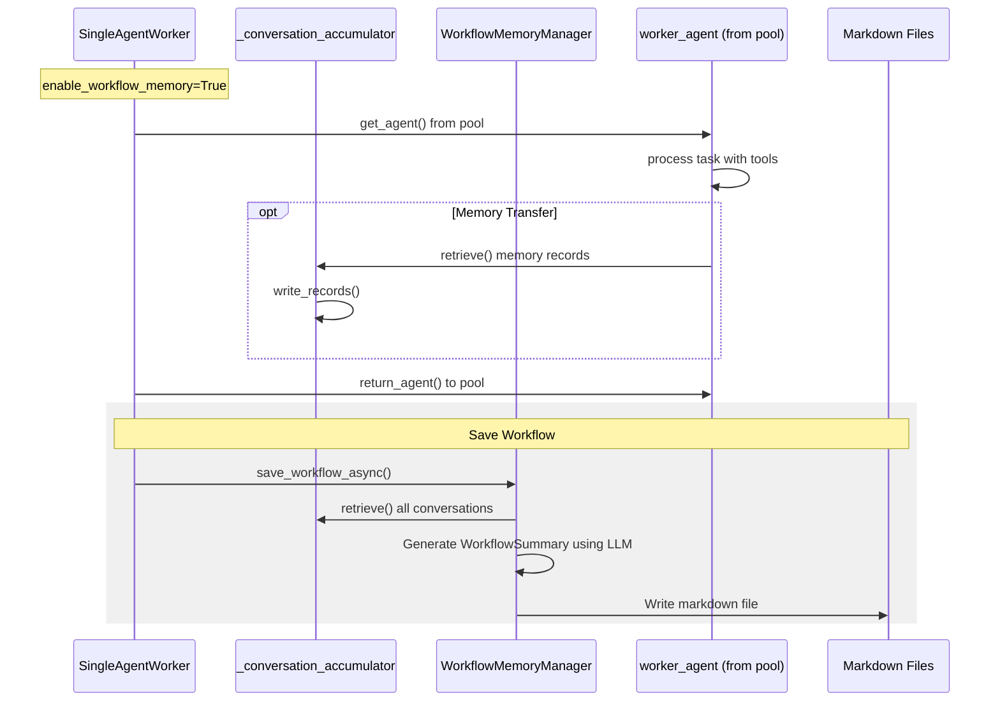
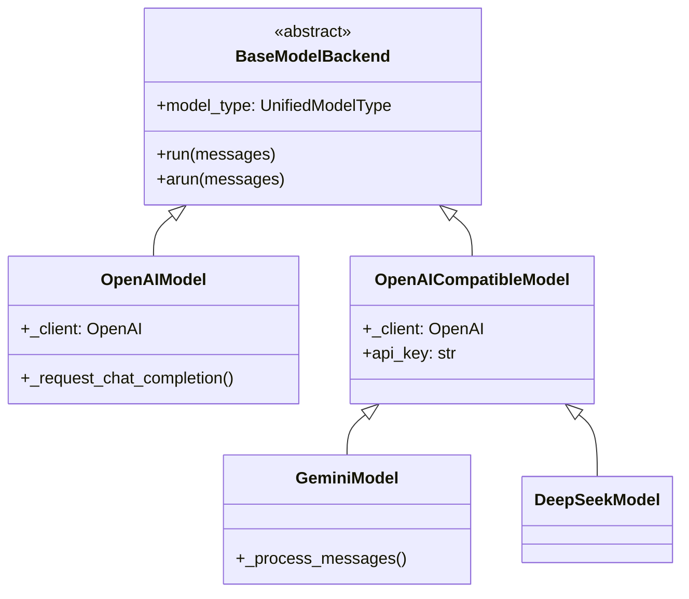
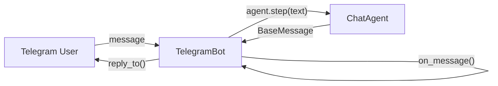

<!-- source: DeepWiki mcp.deepwiki.com · repo camel-ai/camel · page 9.4 Advanced Patterns · fetched 2026-10-29 -->

# Advanced Patterns

<details>
<summary>Relevant source files</summary>

The following files were used as context for generating this wiki page:

- [apps/agents/agents.py](apps/agents/agents.py)
- [apps/agents/test/test_agents.py](apps/agents/test/test_agents.py)
- [apps/common/auto_zip.py](apps/common/auto_zip.py)
- [apps/common/test/test_archive_1.zip](apps/common/test/test_archive_1.zip)
- [apps/common/test/test_auto_zip.py](apps/common/test/test_auto_zip.py)
- [apps/data_explorer/data_explorer.py](apps/data_explorer/data_explorer.py)
- [apps/data_explorer/downloader.py](apps/data_explorer/downloader.py)
- [apps/data_explorer/loader.py](apps/data_explorer/loader.py)
- [apps/data_explorer/test/test_data_explorer.py](apps/data_explorer/test/test_data_explorer.py)
- [apps/dilemma/database_connection.py](apps/dilemma/database_connection.py)
- [apps/dilemma/dilemma.py](apps/dilemma/dilemma.py)
- [apps/dilemma/requirements.txt](apps/dilemma/requirements.txt)
- [camel/bots/__init__.py](camel/bots/__init__.py)
- [camel/bots/discord/__init__.py](camel/bots/discord/__init__.py)
- [camel/bots/discord/discord_app.py](camel/bots/discord/discord_app.py)
- [camel/bots/discord/discord_installation.py](camel/bots/discord/discord_installation.py)
- [camel/bots/discord/discord_store.py](camel/bots/discord/discord_store.py)
- [camel/bots/slack/__init__.py](camel/bots/slack/__init__.py)
- [camel/bots/slack/models.py](camel/bots/slack/models.py)
- [camel/bots/slack/slack_app.py](camel/bots/slack/slack_app.py)
- [camel/bots/telegram_bot.py](camel/bots/telegram_bot.py)
- [docs/cookbooks/advanced_features/agents_tracking.ipynb](docs/cookbooks/advanced_features/agents_tracking.ipynb)
- [docs/cookbooks/advanced_features/agents_with_graph_rag.ipynb](docs/cookbooks/advanced_features/agents_with_graph_rag.ipynb)
- [docs/cookbooks/advanced_features/agents_with_human_in_loop_and_tool_approval.ipynb](docs/cookbooks/advanced_features/agents_with_human_in_loop_and_tool_approval.ipynb)
- [docs/cookbooks/advanced_features/agents_with_rag.ipynb](docs/cookbooks/advanced_features/agents_with_rag.ipynb)
- [docs/cookbooks/advanced_features/critic_agents_and_tree_search.ipynb](docs/cookbooks/advanced_features/critic_agents_and_tree_search.ipynb)
- [docs/cookbooks/applications/roleplaying_scraper.ipynb](docs/cookbooks/applications/roleplaying_scraper.ipynb)
- [docs/cookbooks/data_generation/data_model_generation_and_structured_output_with_qwen.ipynb](docs/cookbooks/data_generation/data_model_generation_and_structured_output_with_qwen.ipynb)
- [docs/mintlify/cookbooks/advanced_features/agents_tracking.mdx](docs/mintlify/cookbooks/advanced_features/agents_tracking.mdx)
- [docs/mintlify/cookbooks/data_processing/agent_with_chunkr_for_pdf_parsing.mdx](docs/mintlify/cookbooks/data_processing/agent_with_chunkr_for_pdf_parsing.mdx)
- [docs/mintlify/cookbooks/mcp/agents_with_sql_mcp.mdx](docs/mintlify/cookbooks/mcp/agents_with_sql_mcp.mdx)
- [docs/mintlify/cookbooks/mcp/camel_aci_mcp_cookbook.mdx](docs/mintlify/cookbooks/mcp/camel_aci_mcp_cookbook.mdx)
- [examples/bots/discord_bot_installation_management.py](examples/bots/discord_bot_installation_management.py)
- [examples/test/test_unstructured_io_example.py](examples/test/test_unstructured_io_example.py)
- [test/bots/test_discord_app.py](test/bots/test_discord_app.py)
- [test/bots/test_slack_app.py](test/bots/test_slack_app.py)
- [test/bots/test_telegram_bot.py](test/bots/test_telegram_bot.py)
- [test/loaders/test_unstructured_io.py](test/loaders/test_unstructured_io.py)

</details>


This page covers advanced usage patterns in CAMEL-AI that enable sophisticated agent orchestration, custom model integration, efficient resource management, and extensibility. These patterns go beyond basic single-agent and multi-agent examples to demonstrate production-grade techniques for building scalable AI systems.

---

## Agent Pooling for Efficient Resource Management

Agent pooling enables efficient reuse of pre-initialized agents, avoiding the overhead of creating fresh agent instances for each task. This pattern is particularly valuable in high-throughput workforce scenarios where `SingleAgentWorker` instances need to handle concurrent requests.

### AgentPool Architecture

```mermaid
graph TB
    subgraph "AgentPool Lifecycle"
        [BaseAgent] -- "clone(with_memory=False)" --> [Pool]
        
        subgraph "Pool State"
            [Available]
            [InUse]
            [LastUsed]
        end
        
        [Pool] --> [Available]
        [Pool] --> [InUse]
        [Pool] --> [LastUsed]
    end
    
    subgraph "Worker Usage"
        [Worker] -- "get_agent()" --> [Pool]
        [Pool] -- "check available" --> [Available]
        [Available] -- "popleft() if available" --> [WorkerAgent]
        [Available] -- "create_fresh if needed" --> [WorkerAgent]
        
        [WorkerAgent] -- "process task" --> [TaskExec]
        [TaskExec] -- "return_agent()" --> [Pool]
        [Pool] -- "reset() + append" --> [Available]
    end
    
    subgraph "Cleanup Strategy"
        [Monitor] -- "every cleanup_interval" --> [IdleCheck]
        [IdleCheck] -- "if exceeded" --> [Remove]
        [Remove] -- [Available]
    end
    
    subgraph "Statistics"
        [Stats] -- [Metrics]
    end
```

**Sources:** [camel/societies/workforce/single_agent_worker.py:42-185]()

### Using Agent Pooling in SingleAgentWorker

The `SingleAgentWorker` class utilizes an `AgentPool` to manage multiple instances of its underlying `ChatAgent`.

```python
from camel.agents import ChatAgent
from camel.societies.workforce import SingleAgentWorker

# Create a worker with agent pooling enabled
worker = SingleAgentWorker(
    description="Research specialist with pooling",
    worker=base_agent,
    use_agent_pool=True,          # Enable pooling
    pool_initial_size=2,          # Start with 2 agents
    pool_max_size=10,             # Allow up to 10 agents
    auto_scale_pool=True,         # Auto-scale based on demand
)
```

**Key Parameters:**
- `use_agent_pool`: Boolean to enable/disable pooling. [camel/societies/workforce/single_agent_worker.py:221-221]()
- `pool_initial_size`: Number of agents to pre-warm. [camel/societies/workforce/single_agent_worker.py:222-222]()
- `pool_max_size`: Upper limit for the pool. [camel/societies/workforce/single_agent_worker.py:223-223]()
- `idle_timeout`: Time in seconds before an idle agent is purged. [camel/societies/workforce/single_agent_worker.py:225-225]()

**Sources:** [camel/societies/workforce/single_agent_worker.py:187-271]()

---

## Workflow Memory Patterns

Workflow memory allows agents to persist and retrieve context across different task sessions. This is managed by the `WorkflowMemoryManager` and the `ContextUtility`.

### Workflow Memory Flow



**Sources:** [camel/societies/workforce/single_agent_worker.py:336-495](), [camel/societies/workforce/single_agent_worker.py:601-747]()

### Enabling Workflow Memory

Workflow memory is enabled via the `enable_workflow_memory` flag in `SingleAgentWorker`. It relies on `ContextUtility` for session management.

```python
from camel.societies.workforce import SingleAgentWorker
from camel.utils import ContextUtility

# Shared context across workers
shared_context = ContextUtility.get_workforce_shared()

worker = SingleAgentWorker(
    description="Data analyst",
    worker=agent,
    enable_workflow_memory=True,
    context_utility=shared_context,
)
```

**Sources:** [camel/societies/workforce/single_agent_worker.py:220-273]()

---

## Custom Model Backend Integration

CAMEL-AI supports a wide range of model providers through the `BaseModelBackend` interface.

### BaseModelBackend Hierarchy



**Sources:** [camel/models/base_model.py:218-276](), [camel/models/openai_model.py:68-106](), [camel/models/openai_compatible_model.py:58-94]()

### Model-Specific Preprocessing
Backends often require specific message adaptations. For instance, `OpenAIModel` adapts messages for `o1` models by converting system messages to user messages. [camel/models/openai_model.py:213-257]()
`GeminiModel` handles consecutive tool calls and preserves "thought" signatures. [camel/models/gemini_model.py:120-233]()

---

## Chat Bots (Discord/Telegram/Slack)

CAMEL-AI provides integration wrappers to deploy agents as interactive bots on popular communication platforms.

### Telegram Bot Implementation
The `TelegramBot` class wraps a `ChatAgent` to handle incoming messages via the `telebot` library. It uses `infinity_polling()` to maintain a persistent connection. [camel/bots/telegram_bot.py:27-61]()



**Key Implementation Details:**
- `on_message()` calls `self.chat_agent.reset()` to clear previous context for each interaction. [camel/bots/telegram_bot.py:63-69]()
- It uses the `step()` method of the `ChatAgent` to generate responses. [camel/bots/telegram_bot.py:74-74]()

**Sources:** [camel/bots/telegram_bot.py:27-76](), [camel/bots/__init__.py:14-34]()

---

## Observability and Tracing

CAMEL-AI integrates with third-party observability tools like **AgentOps** and **Langfuse** to track agent performance, tool usage, and costs.

### AgentOps Integration
AgentOps can be initialized to track both single-agent and multi-agent sessions. It captures tool calls and LLM interactions automatically when initialized before tool imports. [docs/mintlify/cookbooks/advanced_features/agents_tracking.mdx:76-84]()

```python
import agentops
import os
from camel.agents import ChatAgent
from camel.models import ModelFactory

# Initialize AgentOps
agentops.init(os.getenv("AGENTOPS_API_KEY"))

# Tools imported after init are tracked
from camel.toolkits import SearchToolkit

# Run Agent
agent = ChatAgent(system_message=sys_msg, tools=SearchToolkit().get_tools())
response = agent.step("What is CAMEL-AI?")
agentops.end_session("Success")
```

**Sources:** [docs/mintlify/cookbooks/advanced_features/agents_tracking.mdx:13-124](), [docs/cookbooks/advanced_features/agents_tracking.ipynb:10-243]()

---

## Gradio Web Applications

CAMEL-AI includes pre-built Gradio applications for agent interaction and data exploration.

### Agents Web App (`apps/agents/agents.py`)
This app provides a UI for `RolePlaying` sessions. It uses a `State` class (inheriting from Pydantic's `BaseModel`) to manage session data, message history, and UI states. [apps/agents/agents.py:45-85]()

**Key Functions:**
- `role_playing_start()`: Initializes the `RolePlaying` session based on UI inputs like assistant/user roles and task prompt. [apps/agents/agents.py:165-232]()
- `cleanup_on_launch()`: Resets the UI and state for a new session. [apps/agents/agents.py:145-162]()

### Data Explorer (`apps/data_explorer/data_explorer.py`)
Used to visualize and explore the CAMEL dataset. It uses `AutoZip` to load JSON chat histories from compressed files. [apps/data_explorer/loader.py:96-141]()

**Sources:** [apps/agents/agents.py:15-101](), [apps/data_explorer/data_explorer.py:15-114](), [apps/data_explorer/loader.py:32-93]()

---

## Model Context Protocol (MCP) Integration

CAMEL supports the Model Context Protocol, allowing agents to connect to external MCP servers for tool execution.

### SQL MCP Pattern
An agent can interact with an SQL database via an `MCPToolkit` connected to a local Python-based MCP server.

```python
# Example configuration in mcp_config.json
{
    "mcpServers": {
        "sql_server": {
            "type": "script",
            "command": "python",
            "args": ["sql_server_mcp.py"],
            "transport": "stdio"
        }
    }
}
```

**Sources:** [docs/mintlify/cookbooks/mcp/agents_with_sql_mcp.mdx:1-100]()

---

## Pipeline Workflow Patterns

The `PipelineTaskBuilder` enables declarative workflow construction with automatic dependency management, supporting sequential and parallel task execution.

```python
from camel.societies.workforce import PipelineTaskBuilder

builder = PipelineTaskBuilder()
builder.add("Task 1: Search")
builder.add_parallel_tasks(["Task 2a: Summarize", "Task 2b: Analyze"])
builder.sync_after_parallel("Task 3: Final Report")

tasks = builder.build()
```

**Sources:** [camel/societies/workforce/utils.py:420-605]()

---

