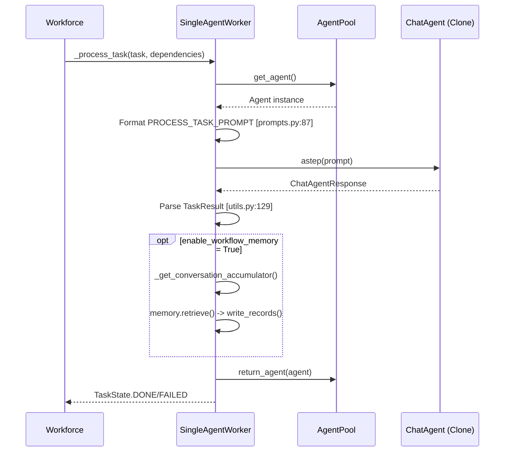
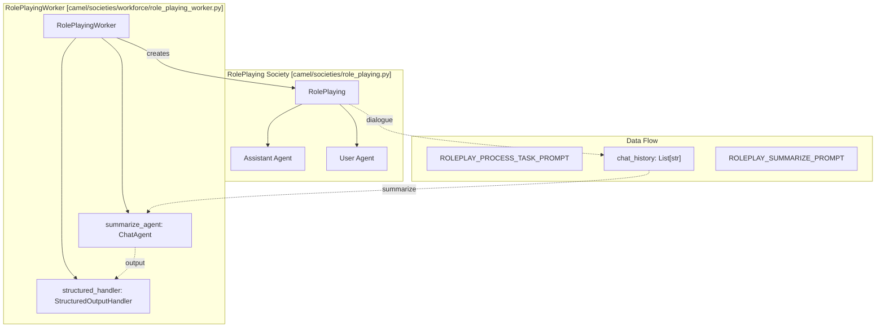
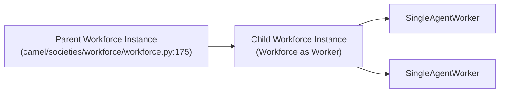
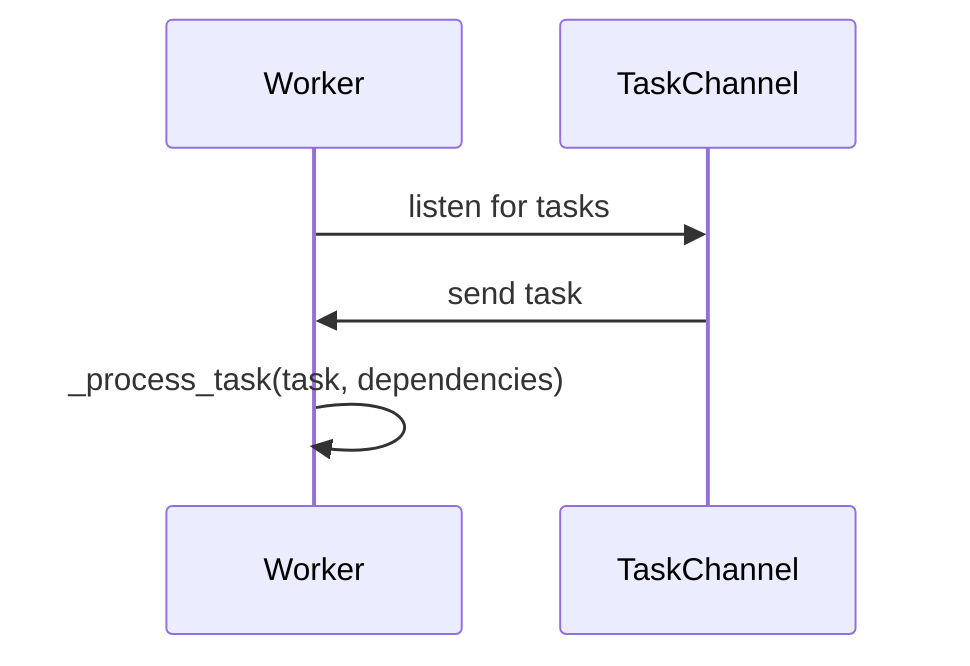

<!-- source: DeepWiki mcp.deepwiki.com · repo camel-ai/camel · extra page Worker Types · fetched 2026-10-29 -->

# Worker Types

<details>
<summary>Relevant source files</summary>

The following files were used as context for generating this wiki page:

- [camel/societies/workforce/__init__.py](camel/societies/workforce/__init__.py)
- [camel/societies/workforce/events.py](camel/societies/workforce/events.py)
- [camel/societies/workforce/prompts.py](camel/societies/workforce/prompts.py)
- [camel/societies/workforce/role_playing_worker.py](camel/societies/workforce/role_playing_worker.py)
- [camel/societies/workforce/single_agent_worker.py](camel/societies/workforce/single_agent_worker.py)
- [camel/societies/workforce/utils.py](camel/societies/workforce/utils.py)
- [camel/societies/workforce/worker.py](camel/societies/workforce/worker.py)
- [camel/societies/workforce/workforce.py](camel/societies/workforce/workforce.py)
- [camel/societies/workforce/workforce_callback.py](camel/societies/workforce/workforce_callback.py)
- [camel/societies/workforce/workforce_logger.py](camel/societies/workforce/workforce_logger.py)
- [camel/societies/workforce/workforce_metrics.py](camel/societies/workforce/workforce_metrics.py)
- [camel/tasks/task.py](camel/tasks/task.py)
- [docs/mintlify/reference/camel.messages.base.mdx](docs/mintlify/reference/camel.messages.base.mdx)
- [docs/mintlify/reference/camel.models.modelscope_model.mdx](docs/mintlify/reference/camel.models.modelscope_model.mdx)
- [docs/mintlify/reference/camel.models.qwen_model.mdx](docs/mintlify/reference/camel.models.qwen_model.mdx)
- [docs/mintlify/reference/camel.societies.workforce.role_playing_worker.mdx](docs/mintlify/reference/camel.societies.workforce.role_playing_worker.mdx)
- [docs/mintlify/reference/camel.societies.workforce.single_agent_worker.mdx](docs/mintlify/reference/camel.societies.workforce.single_agent_worker.mdx)
- [docs/mintlify/reference/camel.societies.workforce.structured_output_handler.mdx](docs/mintlify/reference/camel.societies.workforce.structured_output_handler.mdx)
- [docs/mintlify/reference/camel.societies.workforce.utils.mdx](docs/mintlify/reference/camel.societies.workforce.utils.mdx)
- [docs/mintlify/reference/camel.societies.workforce.workflow_memory_manager.mdx](docs/mintlify/reference/camel.societies.workforce.workflow_memory_manager.mdx)
- [docs/mintlify/reference/camel.societies.workforce.workforce.mdx](docs/mintlify/reference/camel.societies.workforce.workforce.mdx)
- [docs/mintlify/reference/camel.societies.workforce.workforce_callback.mdx](docs/mintlify/reference/camel.societies.workforce.workforce_callback.mdx)
- [docs/mintlify/reference/camel.societies.workforce.workforce_logger.mdx](docs/mintlify/reference/camel.societies.workforce.workforce_logger.mdx)
- [docs/mintlify/reference/camel.societies.workforce.workforce_metrics.mdx](docs/mintlify/reference/camel.societies.workforce.workforce_metrics.mdx)
- [docs/mintlify/reference/camel.tasks.task.mdx](docs/mintlify/reference/camel.tasks.task.mdx)
- [docs/mintlify/reference/camel.toolkits.context_summarizer_toolkit.mdx](docs/mintlify/reference/camel.toolkits.context_summarizer_toolkit.mdx)
- [docs/mintlify/reference/camel.toolkits.task_planning_toolkit.mdx](docs/mintlify/reference/camel.toolkits.task_planning_toolkit.mdx)
- [docs/mintlify/reference/camel.utils.context_utils.mdx](docs/mintlify/reference/camel.utils.context_utils.mdx)
- [examples/workforce/eigent.py](examples/workforce/eigent.py)
- [examples/workforce/pipeline_workflow_example.py](examples/workforce/pipeline_workflow_example.py)
- [examples/workforce/workforce_callbacks_example.py](examples/workforce/workforce_callbacks_example.py)
- [test/workforce/test_workforce_callbacks.py](test/workforce/test_workforce_callbacks.py)

</details>


This document describes the three primary worker node types within the Workforce system: `SingleAgentWorker`, `RolePlayingWorker`, and nested `Workforce` instances. These worker types define the fundamental execution units that process tasks within a Workforce orchestration.

For a broader understanding of Workforce orchestration, refer to [Workforce Orchestration](#2.5). For workflow memory specifics, see [Workflow Memory](#2.5.2).

---

## Overview

Worker nodes are essential building blocks in Workforce execution. The Workforce orchestrates task assignment and recovery by delegating task processing to these workers. The supported worker types are:

| Worker Type | Purpose | Key Feature |
|-------------|---------|-------------|
| `SingleAgentWorker` | Executes tasks via an individual agent | Implements efficient agent pooling |
| `RolePlayingWorker` | Facilitates multi-agent dialogues | Coordinates assistant-user roleplay sessions |
| Nested `Workforce` | Enables hierarchical delegation | Embeds sub-workforces as child nodes |

All worker types extend the abstract `Worker` base class defined in `camel/societies/workforce/worker.py` [camel/societies/workforce/worker.py:34-42](), implementing the async method `_process_task()` to handle task processing [camel/societies/workforce/worker.py:63-77]().

Sources: [camel/societies/workforce/single_agent_worker.py:71-77](), [camel/societies/workforce/role_playing_worker.py:38-64](), [camel/societies/workforce/workforce.py:175-186]()

---

## SingleAgentWorker

### Architecture and Design

`SingleAgentWorker` encapsulates a single `ChatAgent` instance to process tasks. To efficiently support concurrency and avoid memory interference, it employs an `AgentPool` that manages multiple clones of the base agent. Each task acquires a pooled agent instance to process the request independently.

Key components:

- **Base Agent (`base_agent`)**: The prototype agent instance cloned for task handling.
- **AgentPool**: Manages cloned agents for concurrency, recycling idle agents and scaling dynamically.
- **Conversation Accumulator (`_conversation_accumulator`)**: Optionally accumulates conversation history across tasks for workflow memory.
- **WorkflowMemoryManager (`_workflow_manager`)**: Manages saving and loading of workflow memories.

```mermaid
graph TB
    subgraph "SingleAgentWorker [camel/societies/workforce/single_agent_worker.py]"
        SAW["SingleAgentWorker"]
        BaseAgent["base_agent: ChatAgent"]
        Pool["AgentPool"]
        Accumulator["_conversation_accumulator: ChatAgent"]
        WorkflowMgr["_workflow_manager: WorkflowMemoryManager"]
    end
    
    subgraph "AgentPool Internals [camel/societies/workforce/single_agent_worker.py:54]"
        Available["_available_agents: deque"]
        InUse["_in_use_agents: set"]
        Stats["_total_borrows<br/>_pool_hits<br/>_agents_cleaned"]
    end
    
    subgraph "Task Execution Space"
        Task1["Task (id='task_1')"]
        Agent1["ChatAgent.clone()"]
        Agent2["ChatAgent.clone()"]
    end
    
    SAW --> BaseAgent
    SAW --> Pool
    SAW --> Accumulator
    SAW --> WorkflowMgr
    
    Pool --> Available
    Pool --> InUse
    Pool --> Stats
    
    Task1 -.->|get_agent()| Agent1
    Agent1 -.->|return_agent()| Pool
    Agent1 -.->|memory records| Accumulator
```

**SingleAgentWorker Architecture**

Sources: [camel/societies/workforce/single_agent_worker.py:73-185](), [camel/societies/workforce/single_agent_worker.py:221-334]()

---

### Initialization Parameters

`SingleAgentWorker` constructor signature:

```python
SingleAgentWorker(
    description: str,
    worker: ChatAgent,
    use_agent_pool: bool = True,
    pool_initial_size: int = 1,
    pool_max_size: int = 10,
    auto_scale_pool: bool = True,
    use_structured_output_handler: bool = True,
    context_utility: Optional[ContextUtility] = None,
    enable_workflow_memory: bool = False,
)
```

| Parameter | Type | Default | Description |
|-----------|------|---------|-------------|
| `description` | str | required | Human-readable description for the worker node |
| `worker` | ChatAgent | required | Base agent instance to clone in the pool |
| `use_agent_pool` | bool | True | Enables agent pooling for concurrency efficiency |
| `pool_initial_size` | int | 1 | Number of agents prepopulated in pool |
| `pool_max_size` | int | 10 | Maximum pool size to prevent unlimited clones |
| `auto_scale_pool` | bool | True | Allows pool to dynamically add clones when needed |
| `use_structured_output_handler` | bool | True | Use regex-based structured output extraction |
| `context_utility` | ContextUtility or None | None | Shared context utility instance for workflow sessions |
| `enable_workflow_memory` | bool | False | Accumulates conversations for workflow saving |

Sources: [camel/societies/workforce/single_agent_worker.py:221-262](), [docs/mintlify/reference/camel.societies.workforce.single_agent_worker.mdx:73-92]()

---

### AgentPool Mechanism

The `AgentPool` class provides concurrency control and resource reuse for cloned agents:

- **Get Agent**: `get_agent()` asynchronously fetches an available agent clone or creates a new one if under `max_size` [camel/societies/workforce/single_agent_worker.py:118-140]().
- **Return Agent**: `return_agent(agent)` resets the agent's memory and returns it to the pool [camel/societies/workforce/single_agent_worker.py:141-161]().
- **Cleanup**: Periodic cleanup removes idle agents unused beyond `idle_timeout` seconds (default 180s) [camel/societies/workforce/single_agent_worker.py:162-184]().
- **Statistics**: `get_stats()` returns metrics such as total borrows, pool hits, and agents cleaned.

The pool runs `_periodic_cleanup()` periodically on a fixed timer (default 60s) to free resources in the background [camel/societies/workforce/single_agent_worker.py:81-87]().

---

### Task Processing Flow

Tasks processed by `SingleAgentWorker` follow this sequence:



Process highlights:

- The pooled agent clone receives a JSON-structured task prompt using `PROCESS_TASK_PROMPT` [camel/societies/workforce/prompts.py:87]() and executes an async step.
- The response is parsed into a structured `TaskResult` using regex or native structured output depending on configuration.
- If workflow memory accumulation is enabled, conversation history is aggregated into the accumulator agent.
- The used agent clone is returned to the pool for reuse.

Sources: [camel/societies/workforce/single_agent_worker.py:336-565](), [camel/societies/workforce/single_agent_worker.py:124-140]()

---

### Workflow Memory Support

`SingleAgentWorker` can optionally accumulate conversation histories across tasks, enabling workflow memory saving and reuse.

Supporting methods:

| Method | Description |
|--------|-------------|
| `save_workflow_memories()` | Saves current workflow memory synchronously [camel/societies/workforce/single_agent_worker.py:601-645]() |
| `save_workflow_memories_async()` | Same operation asynchronously for parallel execution efficiency [camel/societies/workforce/single_agent_worker.py:647-688]() |
| `load_workflow_memories()` | Loads relevant workflow memories via intelligent metadata-based selection [camel/societies/workforce/single_agent_worker.py:690-730]() |

Internally, `WorkflowMemoryManager` handles these operations [camel/societies/workforce/single_agent_worker.py:321-334]().

Sources: [camel/societies/workforce/single_agent_worker.py:601-730](), [docs/mintlify/reference/camel.societies.workforce.single_agent_worker.mdx:162-214]()

---

## RolePlayingWorker

### Architecture and Design

`RolePlayingWorker` runs a multi-turn conversation between two agent roles—the assistant and the user—to collaboratively solve a task. This worker internally creates a fresh `RolePlaying` society instance per task.

Additional components:

- **Summarizer Agent**: After roleplay dialogue, a summarizer agent generates a concise final task result summary.
- **Structured Output Handler**: Optionally parses structured outputs from summarizer responses.



**RolePlayingWorker Architecture**

Sources: [camel/societies/workforce/role_playing_worker.py:38-99](), [camel/societies/workforce/role_playing_worker.py:103-253]()

---

### Initialization Parameters

Constructor signature:

```python
RolePlayingWorker(
    description: str,
    assistant_role_name: str,
    user_role_name: str,
    assistant_agent_kwargs: Optional[Dict] = None,
    user_agent_kwargs: Optional[Dict] = None,
    summarize_agent_kwargs: Optional[Dict] = None,
    chat_turn_limit: int = 20,
    use_structured_output_handler: bool = True,
)
```

- `assistant_role_name`, `user_role_name`: Role identifiers for participating agents.
- `chat_turn_limit`: Maximum dialogue turns in roleplay.
- `use_structured_output_handler`: Controls regex-based output parsing from summarizer.

Sources: [camel/societies/workforce/role_playing_worker.py:66-99](), [docs/mintlify/reference/camel.societies.workforce.role_playing_worker.mdx:38-40]()

---

### Multi-Turn Dialogue Process

The typical task processing steps:

1. **Prompt Generation:** Format `ROLEPLAY_PROCESS_TASK_PROMPT` with the current task, its parent, dependencies, and additional info [camel/societies/workforce/prompts.py:128-161]().
2. **RolePlaying Session:** Instantiate a new `RolePlaying` society session with assistant and user roles [camel/societies/workforce/role_playing_worker.py:138-143]().
3. **Dialogue Loop:** Execute asynchronous dialogue steps via `role_play_session.astep()` up to `chat_turn_limit` [camel/societies/workforce/role_playing_worker.py:149-186]().
4. **Termination Check:** Exit when either agent signals termination or detects the special token `"CAMEL_TASK_DONE"` in outputs.
5. **Summarization:** Send the entire multi-turn chat history to the summarizer agent using `ROLEPLAY_SUMMARIZE_PROMPT` [camel/societies/workforce/role_playing_worker.py:202-212]().
6. **Result Parsing:** Extract final `TaskResult` including content and failure flag using structured output handler or direct parsing [camel/societies/workforce/role_playing_worker.py:230-244]().

This roleplay approach leverages the collaboration of two agents to produce richer task solutions for complex tasks.

Sources: [camel/societies/workforce/role_playing_worker.py:129-196](), [camel/societies/workforce/role_playing_worker.py:202-253]()

---

## Worker Composition Patterns

### Multiple SingleAgentWorkers

Workforces often assign distinct `SingleAgentWorker` instances specialized on different roles or skills. The coordinator agent dynamically assigns tasks based on worker capabilities and descriptions.

Example: See [Eigent example](examples/workforce/eigent.py#116-200) where workers handle distinct technical roles [examples/workforce/eigent.py:116-200]().

---

### Nested Workforce

The `Workforce` class, inheriting from `BaseNode`, can be nested within a parent Workforce as a child node. This allows hierarchical task delegation, modular sub-team orchestration, and complex workflows involving sub-workforces.



The nested Workforce acts as a worker node itself with its own children workers.

Sources: [camel/societies/workforce/workforce.py:175-191](), [docs/mintlify/reference/camel.societies.workforce.workforce.mdx:72]()

---

## Worker Lifecycle

### Registration and Initialization

Workers are registered with a Workforce via the `children` parameter or dynamically added. Each worker receives:

- A `TaskChannel` instance for async task communication [camel/societies/workforce/worker.py:94-95]().
- A streaming callback handler for real-time outputs [camel/societies/workforce/worker.py:97-107]().

---

### Task Execution Lifecycle

The `Worker.start()` method listens on its `TaskChannel` for incoming tasks, invoking `_process_task()` implemented in concrete workers:



The specific `_process_task()` implementation defines the execution logic:

- `SingleAgentWorker` uses a pooled agent.
- `RolePlayingWorker` initiates multi-agent dialogue.
- Nested `Workforce` delegates to its children.

Sources: [camel/societies/workforce/worker.py:109-200]()

---

### Resource Management and Cleanup

**SingleAgentWorker**
- The `AgentPool` asynchronously cleans up idle cloned agents after a configurable timeout (default 180s) [camel/societies/workforce/single_agent_worker.py:162-184]().
- The cleanup coroutine is canceled on worker reset or shutdown [camel/societies/workforce/single_agent_worker.py:280-287]().

**RolePlayingWorker**
- Creates a fresh `RolePlaying` instance per task.
- Agents and session memory are garbage collected after task completion.

No explicit cleanup coroutine is maintained due to ephemeral session creation.

Sources: [camel/societies/workforce/single_agent_worker.py:162-184](), [camel/societies/workforce/single_agent_worker.py:273-287]()

---

## Configuration Comparison

| Feature | SingleAgentWorker | RolePlayingWorker |
|---------|-------------------|-------------------|
| **Concurrency Model** | Supports agent pooling and concurrent clones | Sequential multi-turn dialogue sessions |
| **Memory Persistence** | Optional accumulated workflow memory support | Per-session only, no accumulation |
| **Toolkits Support** | Full ChatAgent toolkits supported | Both assistant and user can use toolkits |
| **Workflow Memory Save/Load** | Supported (sync and async) | Not supported |
| **Best Usage** | Specialized single tasks with efficiency | Collaborative problem-solving with roleplay |

Sources: [camel/societies/workforce/single_agent_worker.py:73-89](), [camel/societies/workforce/role_playing_worker.py:38-64]()

---

## Usage Examples

### Basic SingleAgentWorker Example

```python
from camel.agents import ChatAgent
from camel.societies.workforce import SingleAgentWorker

agent = ChatAgent(system_message="You are a researcher.")
worker = SingleAgentWorker(
    description="Research specialist",
    worker=agent,
    pool_max_size=5
)
```

Sources: [camel/societies/workforce/single_agent_worker.py:221-262](), [docs/mintlify/reference/camel.societies.workforce.single_agent_worker.mdx:73-92]()

---

### RolePlayingWorker Multi-Turn Example

```python
from camel.societies.workforce import RolePlayingWorker

worker = RolePlayingWorker(
    description="A team of researcher and analyst",
    assistant_role_name="Researcher",
    user_role_name="Analyst",
    chat_turn_limit=10
)
```

Sources: [camel/societies/workforce/role_playing_worker.py:66-99](), [docs/mintlify/reference/camel.societies.workforce.role_playing_worker.mdx:38-40]()

---

# Summary

This section detailed the three worker node types in CAMEL Workforce orchestration:

- `SingleAgentWorker` for efficient single-agent task processing with pooled agents and optional workflow memory.
- `RolePlayingWorker` to run roleplay dialogues between assistant and user agents for complex collaborative reasoning.
- Nested `Workforce` nodes enabling hierarchical task management patterns.

Their distinct architectures and APIs provide flexible building blocks to construct diverse AI agent workflows.

---

# References

- AgentPool, SingleAgentWorker classes and logic: `camel/societies/workforce/single_agent_worker.py` [54-185](), [221-730]()
- RolePlayingWorker and dialogue methods: `camel/societies/workforce/role_playing_worker.py` [38-99](), [103-262]()
- Workforce node and nesting: `camel/societies/workforce/workforce.py` [175-191]()
- Task processing prompts: `camel/societies/workforce/prompts.py` [87-125](), [128-161]()
- Utility and parsing methods: `camel/societies/workforce/utils.py`
- Worker base lifecycle: `camel/societies/workforce/worker.py` [34-77](), [90-107](), [109-200]()
- Examples: `examples/workforce/eigent.py` [116-200]()

---

