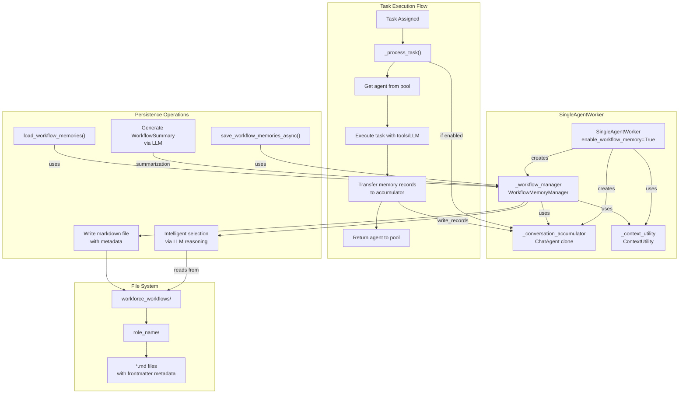
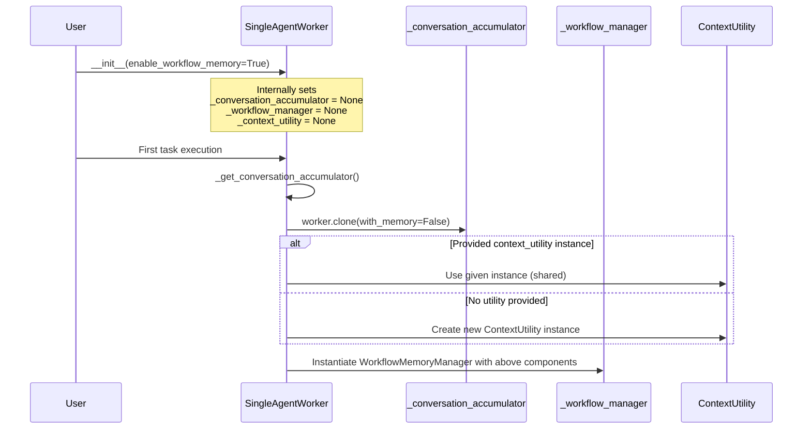
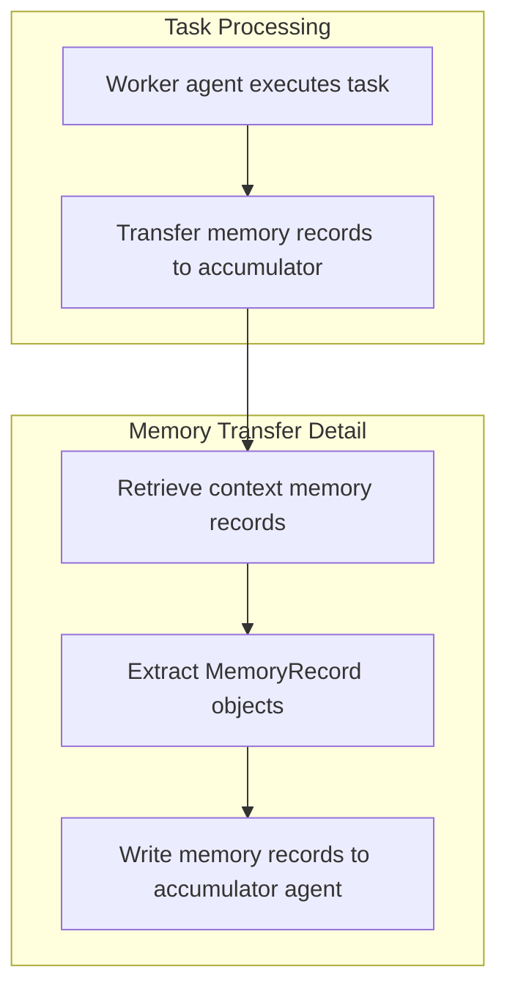
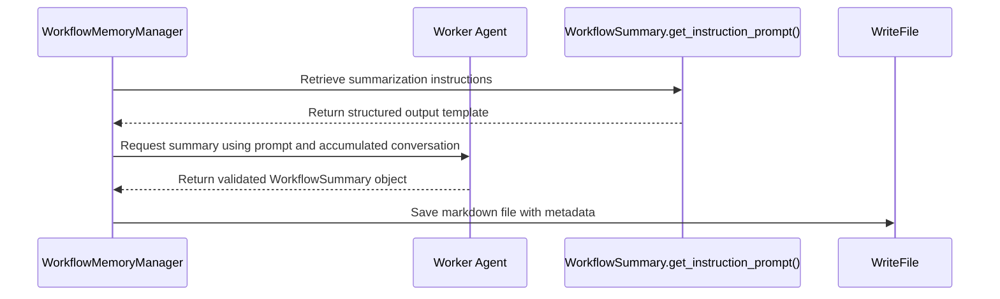
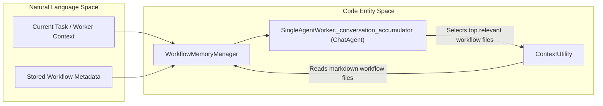

<!-- source: DeepWiki mcp.deepwiki.com · repo camel-ai/camel · extra page Workflow Memory · fetched 2026-10-29 -->

# Workflow Memory

<details>
<summary>Relevant source files</summary>

The following files were used as context for generating this wiki page:

- [camel/benchmarks/browsecomp.py](camel/benchmarks/browsecomp.py)
- [camel/societies/workforce/workflow_memory_manager.py](camel/societies/workforce/workflow_memory_manager.py)
- [camel/storages/vectordb_storages/tidb.py](camel/storages/vectordb_storages/tidb.py)
- [camel/toolkits/context_summarizer_toolkit.py](camel/toolkits/context_summarizer_toolkit.py)
- [camel/utils/context_utils.py](camel/utils/context_utils.py)
- [docs/mintlify/reference/camel.messages.base.mdx](docs/mintlify/reference/camel.messages.base.mdx)
- [docs/mintlify/reference/camel.models.modelscope_model.mdx](docs/mintlify/reference/camel.models.modelscope_model.mdx)
- [docs/mintlify/reference/camel.models.qwen_model.mdx](docs/mintlify/reference/camel.models.qwen_model.mdx)
- [docs/mintlify/reference/camel.societies.workforce.role_playing_worker.mdx](docs/mintlify/reference/camel.societies.workforce.role_playing_worker.mdx)
- [docs/mintlify/reference/camel.societies.workforce.single_agent_worker.mdx](docs/mintlify/reference/camel.societies.workforce.single_agent_worker.mdx)
- [docs/mintlify/reference/camel.societies.workforce.structured_output_handler.mdx](docs/mintlify/reference/camel.societies.workforce.structured_output_handler.mdx)
- [docs/mintlify/reference/camel.societies.workforce.utils.mdx](docs/mintlify/reference/camel.societies.workforce.utils.mdx)
- [docs/mintlify/reference/camel.societies.workforce.workflow_memory_manager.mdx](docs/mintlify/reference/camel.societies.workforce.workflow_memory_manager.mdx)
- [docs/mintlify/reference/camel.societies.workforce.workforce.mdx](docs/mintlify/reference/camel.societies.workforce.workforce.mdx)
- [docs/mintlify/reference/camel.societies.workforce.workforce_callback.mdx](docs/mintlify/reference/camel.societies.workforce.workforce_callback.mdx)
- [docs/mintlify/reference/camel.societies.workforce.workforce_logger.mdx](docs/mintlify/reference/camel.societies.workforce.workforce_logger.mdx)
- [docs/mintlify/reference/camel.societies.workforce.workforce_metrics.mdx](docs/mintlify/reference/camel.societies.workforce.workforce_metrics.mdx)
- [docs/mintlify/reference/camel.tasks.task.mdx](docs/mintlify/reference/camel.tasks.task.mdx)
- [docs/mintlify/reference/camel.toolkits.context_summarizer_toolkit.mdx](docs/mintlify/reference/camel.toolkits.context_summarizer_toolkit.mdx)
- [docs/mintlify/reference/camel.toolkits.task_planning_toolkit.mdx](docs/mintlify/reference/camel.toolkits.task_planning_toolkit.mdx)
- [docs/mintlify/reference/camel.utils.context_utils.mdx](docs/mintlify/reference/camel.utils.context_utils.mdx)
- [examples/workforce/workforce_workflow_memory_example.py](examples/workforce/workforce_workflow_memory_example.py)
- [test/models/test_cerebras_model.py](test/models/test_cerebras_model.py)
- [test/toolkits/test_context_summarizer_toolkit.py](test/toolkits/test_context_summarizer_toolkit.py)
- [test/utils/test_context_utils.py](test/utils/test_context_utils.py)
- [test/workforce/test_workflow_memory.py](test/workforce/test_workflow_memory.py)

</details>


## Purpose and Scope

Workflow Memory is a specialized system within the CAMEL Workforce framework that allows agents to capture, persist, and reuse knowledge from past task executions. Specifically designed for `SingleAgentWorker` instances, the system accumulates conversations during task runs, generates structured workflow summaries via LLM-driven analysis, and persistently saves them as markdown files organized by agent role. Future executions can intelligently load these saved workflows to provide relevant context, improving task efficiency and continuity.

This page explains the architecture and implementation of the Workflow Memory system, focusing on these key aspects:

- The `WorkflowMemoryManager` that handles the saving and loading of workflow memories.
- The structured generation of `WorkflowSummary` data models.
- Intelligent selection and loading of past workflows using agent-driven reasoning.
- Session management and file handling provided by `ContextUtility`.

For broader memory concepts, refer to **2.2 Agent Memory System**; for workforce details, see **2.5 Workforce Orchestration**; and for task lifecycle, see **2.4 Task Management**.

---

## System Architecture

The workflow memory mechanism is tightly integrated with the `SingleAgentWorker` class and relies on three primary components:
- A conversation accumulator agent that collects memory records during task processing.
- A workflow memory manager that orchestrates summarization, saving, and loading of workflows.
- A context utility for managing sessions, directories, and markdown file operations.

Other supporting Pydantic models track configuration and metadata.

### Architecture Diagram: Workflow Memory Architecture



---

### Core Components and Models

| Component                  | Type                      | Purpose                                                                                 | Location                                             |
|----------------------------|---------------------------|-----------------------------------------------------------------------------------------|------------------------------------------------------|
| `_conversation_accumulator`| `ChatAgent`               | Accumulates conversation memory records across all task executions by the worker       | `single_agent_worker.py` : 132-140                    |
| `_workflow_manager`        | `WorkflowMemoryManager`   | Handles workflow saving/loading, summarization, and metadata management                 | `single_agent_worker.py` : 142-150                    |
| `_context_utility`         | `ContextUtility`          | Manages session directories, markdown file operations, and shared workforce sessions    | `single_agent_worker.py` : 122-130                    |
| `WorkflowMetadata`         | Pydantic Model            | Tracks workflow file versioning, timestamps, and context info                           | `workforce/utils.py` : 27-40                          |
| `WorkflowConfig`           | Pydantic Model            | Central configuration for workflow memory management                                    | `workforce/utils.py` : 41-53                          |
| `WorkflowSummary`          | Pydantic Model            | Structured schema defining the fields for workflow summaries                             | `utils/context_utils.py` : 32-135                     |

Sources:  
[camel/societies/workforce/single_agent_worker.py:122-151](),  
[camel/societies/workforce/utils.py:27-53](),  
[camel/utils/context_utils.py:32-135]()

---

## Enabling Workflow Memory in `SingleAgentWorker`

Workflow memory tracking is **disabled by default** and must be explicitly enabled when constructing a `SingleAgentWorker`:

```python
enable_workflow_memory: bool = False
```
[camel/societies/workforce/single_agent_worker.py:108]()

When enabled, the worker lazily initializes the following on the first relevant operation:

- `_conversation_accumulator`: A fresh clonable `ChatAgent` instance without existing memory, used to accumulate workflow conversation history.
- `_workflow_manager`: An instance of `WorkflowMemoryManager`, responsible for workflow persistence.
- `_context_utility`: A `ContextUtility` instance managing session folders and file operations.

The `context_utility` parameter allows workers within the same workforce session to share storage locations to keep workflow files logically grouped.

### Initialization Sequence Diagram: Lazy Initialization



Sources: [camel/societies/workforce/single_agent_worker.py:122-151]() and [camel/societies/workforce/single_agent_worker.py:107-108]()

---

## Conversation Accumulation Process During Task Execution

When a task is being processed by a `SingleAgentWorker` with workflow memory enabled, after the worker agent completes execution steps and produces conversation history, relevant memory records (messages and tool calls) are extracted and transferred to the shared `_conversation_accumulator`. This operation ensures that complete task execution contexts accumulate in a central location per worker.

### Memory Transfer Flow Diagram



This process aggregates knowledge from all task runs, preparing for efficient summarization and storage.

Sources: [camel/societies/workforce/single_agent_worker.py:108](), [camel/societies/workforce/single_agent_worker.py:132-140]()

---

## Saving Workflow Summaries

The accumulated conversation is not just stored verbatim; instead, a structured summary is generated to compactly represent the workflow. This summary is suitable for reuse by future agents.

### Workflow Summary Structured Model

The `WorkflowSummary` Pydantic model defines the schema for these summaries. It captures multiple fields:

| Field Name                    | Description                                                                                               | Constraints / Examples                                                                     |
|-------------------------------|-----------------------------------------------------------------------------------------------------------|--------------------------------------------------------------------------------------------|
| `agent_title`                 | Concise role/identity describing the agent's specialization (≤ 5 words), e.g., "data_analyst"            | Lowercase with underscores; used for organizing workflows by role                           |
| `task_title`                  | Short generic title of the main task (≤ 10 words)                                                        | Avoid product or case-specific names                                                       |
| `task_description`            | One-paragraph summary describing user request outcome (≤ 80 words), no implementation details            | Example: "Extract study authors and emails from papers and create Notion tables"            |
| `tools`                      | Bullet list of tool/function calls used with their utility                                               | E.g., "- ArxivToolkit: retrieved author info for email extraction"                         |
| `steps`                      | Numbered high-level actions the agent took to complete the task                                           | Start with verbs; generic enough to be repeatable                                           |
| `failure_and_recovery_strategies` | Optional list of issues encountered, fixes, and verification                                        | E.g., missing dependencies resolved by pip install                                         |
| `notes_and_observations`      | Optional critical extra info for future execution (non-trivial details)                                  | E.g., user preferences for status updates                                                  |
| `tags`                       | 3-10 categorization tags (lowercase, hyphenated) for semantic matching                                  | Examples: "data-analysis", "web-scraping", "report-generation"                             |

This structured model guides the summarization prompt and shapes the saved workflow markdown content [camel/utils/context_utils.py:32-135]()

---

### LLM Prompt-Driven Summarization Process

The `WorkflowMemoryManager` uses the following procedure to save workflow memories:

1. Retrieve accumulated conversations from the `_conversation_accumulator`.
2. Generate a prompt based on the static method `WorkflowSummary.get_instruction_prompt()`.
3. Ask the agent to produce a structured output conforming to `WorkflowSummary` schema.
4. Parse and validate the output to ensure compliance.
5. Save the structured summary to markdown files with embedded metadata to disk.

This encapsulates unstructured conversation into a standardized reusable artifact.

### Sequence Diagram: Workflow Summary Generation



Sources:  
[camel/utils/context_utils.py:137-160](),  
[camel/societies/workforce/single_agent_worker.py:162-180]()

---

### Role Name Handling for File Organization

To store workflow markdown files in logically organized folders, the system uses the agent's role name (e.g., the worker description).

However, some role names are generic and non-informative (e.g., "assistant", "user"). The helper function `is_generic_role_name()` detects such names and triggers fallback logic to extract a more specific role descriptor from the agent’s metadata (such as `agent_title` generated during summarization).

This improves workflow discoverability and organization.

Source: [camel/societies/workforce/utils.py:3-26]()

---

## Loading Workflow Memories

### Intelligent Workflow Selection

When loading workflows for subsequent task sessions, the system offers two loading modes:

- **Legacy pattern matching:** Loads workflows matching filename patterns.
- **Smart agent-based selection:** Uses an LLM agent to semantically select the most relevant saved workflows based on metadata similarity with the current task context.

Smart selection uses metadata fields such as `agent_title`, `task_title`, `tags` to guide retrieval.

### Loading Flow Diagram: Intelligent Workflow Selection



Sources: [camel/societies/workforce/single_agent_worker.py:182-215](), [camel/utils/context_utils.py:216-233]()

---

### Parameters for Loading Workflows

- **`max_workflows`** (default = 3): Limits the number of workflows loaded to avoid overload.
- **`use_smart_selection`** (default = True): Enables intelligent LLM-driven workflow selection.
- **`pattern`**: Legacy filename pattern for matching files if smart selection is disabled.
- **`session_id`** (optional): Targets specific sessions stored by `ContextUtility` for more granular loading.

This flexibility allows adapting to different usage scenarios and workflow management policies.

Source: [camel/societies/workforce/single_agent_worker.py:182-215]()

---

## File System Organization and Markdown Generation

### Directory and Filename Management

Workflows are saved under the base folder `"workforce_workflows/"`, followed by role-specific subfolders derived from sanitized role names or agent titles. Filenames correspond to the sanitized `task_title` of the workflow.

The `ContextUtility.sanitize_workflow_filename()` method ensures filenames:
- Are lowercased
- Replace spaces with underscores
- Remove special characters (only alphanumeric and underscores allowed)
- Are truncated to a max length (default controlled by constant `MAX_WORKFLOW_FILENAME_LENGTH`)

If sanitization produces an empty string, a fallback `"agent"` name is used.

This strategy prevents filesystem errors and enforces naming consistency.

Source: [camel/utils/context_utils.py:102-128]()

---

### Markdown Content Generation

The saved workflow is stored as a markdown file with frontmatter metadata for fast loading and search indexing.

`ContextUtility.structured_output_to_markdown()` converts the `WorkflowSummary` Pydantic object into a well-structured markdown format containing:

- YAML frontmatter with metadata (e.g., agent title, tags, timestamps)
- Sectioned content according to the workflow summary fields (tools, steps, recovery strategies, notes)

This format is both human-readable and machine-accessible for retrieval and further processing.

Source: [camel/utils/context_utils.py:187-215]()

---

## Implementation Details

### Workforce Session Management

`ContextUtility` supports shared session directories among multiple workers within a workforce instance. Invoking `ContextUtility.reset_shared_sessions()` clears cached session instances, enabling test isolation or fresh environment startup.

This shared session mechanism aids in grouping workflows from the same workforce run in consistent folders.

Source: [camel/utils/context_utils.py:34-50](), [camel/societies/workforce/single_agent_worker.py:90-91](), [test/workforce/test_workflow_memory.py:46-61]()

---

### Integration with Recovery Strategies

The `WorkflowSummary` model includes an optional field `failure_and_recovery_strategies` where agents document encountered task failures, diagnostics, fixes, and verifications for those recoveries.

This structured approach makes workflow memories valuable not only for task reuse but also for learning error-handling best practices by future agents.

Source: [camel/utils/context_utils.py:85-93](), [camel/societies/workforce/utils.py:128-153]()

---

# Summary

The CAMEL framework's Workflow Memory system is a sophisticated LLM-augmented persistence layer embedded within the `SingleAgentWorker` class. By accumulating rich conversation histories during task execution, generating concise yet structured workflow summaries, and intelligently managing workflow files via the `WorkflowMemoryManager` and `ContextUtility`, CAMEL enables effective knowledge reuse across agent lifecycles and sessions. This facilitates improved efficiency, transparency, and continuous learning in multi-agent workforce environments.

---

# References

- `camel/societies/workforce/single_agent_worker.py:93-110,122-151`  
- `camel/societies/workforce/utils.py:27-53`  
- `camel/utils/context_utils.py:32-135,137-160,102-128,187-215`  
- `camel/societies/workforce/utils.py:3-26,128-153`  
- `camel/societies/workforce/single_agent_worker.py:162-180,182-215`  
- `test/workforce/test_workflow_memory.py:46-61`

---

