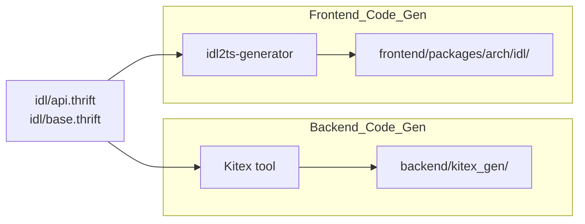
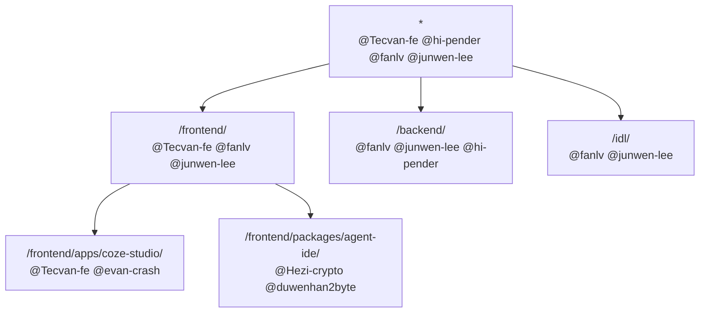

<!-- source: DeepWiki mcp.deepwiki.com · repo coze-dev/coze-studio · page 1.1 Repository Structure · fetched 2026-10-29 -->

# Repository Structure

<details>
<summary>Relevant source files</summary>

The following files were used as context for generating this wiki page:

- [.gitattributes](.gitattributes)
- [.github/CODEOWNERS](.github/CODEOWNERS)
- [.gitignore](.gitignore)
- [README.md](README.md)

</details>


## Purpose and Scope

This document details the physical organization of the Coze Studio monorepo, covering the top-level directory structure and their relationships. It describes the layout of `frontend/`, `backend/`, `idl/`, `common/`, `docker/`, and `helm/` directories, along with key configuration files at the repository root.

For detailed information about the frontend package organization and layered architecture, see [Package Organization](#4.2). For backend service architecture, see [Backend Architecture](#2.2). For infrastructure deployment configurations, see [Infrastructure Stack](#2.3).

---

## Root Directory Structure

The Coze Studio monorepo is organized into seven primary top-level directories and several important root-level folders and files:

```
coze-studio/
├── frontend/          # Frontend codebase with 170+ packages
├── backend/           # Go-based microservices (Go 1.24+)
├── idl/               # Thrift interface definitions
├── common/            # Cross-platform shared utilities
├── docker/            # Docker containerization configs
├── helm/              # Kubernetes deployment charts
├── scripts/           # Setup and utility scripts
├── docs/              # Markdown documentation for the project
├── .github/           # GitHub workflows and CI/CD automation
├── bin/               # Build output binaries
├── .gitattributes     # Git merge strategies for lock files
├── .gitignore         # Ignore patterns for Git
└── rush.json          # Rush.js monorepo configuration for frontend packages
```

### Directory Overview Table

| Directory    | Primary Language            | Purpose                                                                           | Code Owners                                 |
|--------------|----------------------------|-----------------------------------------------------------------------------------|---------------------------------------------|
| `frontend/`  | TypeScript / React          | Web applications and UI packages organized as a Rush.js monorepo                  | [@Tecvan-fe](), [@fanlv](), [@junwen-lee]() |
| `backend/`   | Go (1.24+)                 | Microservices and API implementations built with Domain-Driven Design             | [@fanlv](), [@junwen-lee](), [@hi-pender]() |
| `idl/`       | Thrift                     | Interface Definition Language files defining API contracts shared across services | Backend team (same as `backend/`)            |
| `common/`    | Mixed (Go, TS)             | Shared utilities usable by both frontend and backend                             | [@Tecvan-fe](), [@fanlv](), [@junwen-lee]() |
| `docker/`    | Dockerfiles, Compose YAML  | Docker containerization configuration for all system components                   | Backend team (same as `backend/`)            |
| `helm/`      | YAML                      | Helm charts for Kubernetes deployment of the platform                            | Backend team (same as `backend/`)            |
| `scripts/`   | Shell, Python              | Scripts for setup, environment initialization, and database migration             | Core maintainers                             |
| `docs/`      | Markdown                   | Technical and user documentation                                                  | [@Tecvan-fe](), [@fanlv]()                   |
| `.github/`   | YAML, Scripts              | CI/CD workflows, issue templates, contributing guides                            | Repository maintainers                       |
| `bin/`       | Binaries                   | Compiled binaries from builds                                                    | -                                           |
| Configuration Files | Various              | Control Git merge behavior, ignore unwanted files, manage monorepo tool versions   | Repository maintainers                       |

**Sources:** [.github/CODEOWNERS:1-5](), [README.md:11-12](), [.gitignore:26-53](), [.gitattributes:1-16](), [rush.json]()

---

## Directory Relationships Diagram

The following diagram illustrates the main directories, their inter-relationships, and the flow from IDL definitions through backend and frontend, unified under containerization and deployment layers.

```mermaid
graph TB
    subgraph "Contract & Shared Layer"
        IDL["idl/<br/>Thrift definitions (api.thrift, base.thrift, domain-specific)"]
        Common["common/<br/>Cross-platform shared utilities"]
    end
    
    subgraph "Application Layer"
        Frontend["frontend/<br/>TypeScript React Monorepo (Rush.js)"]
        Backend["backend/<br/>Go microservices (DDD architecture)"]
    end
    
    subgraph "Infrastructure & Deployment"
        Docker["docker/<br/>Docker Compose configs"]
        Helm["helm/<br/>Kubernetes Helm charts"]
        Scripts["scripts/<br/>Setup & migration scripts"]
    end
    
    subgraph "Documentation & CI/CD"
        Docs["docs/<br/>Project documentation"]
        GitHub[".github/<br/>CI workflows, issue templates"]
    end
    
    subgraph "Artifacts & Configurations"
        Bin["bin/<br/>Compiled binaries"]
        GitIgnore[".gitignore/.gitattributes<br/>Version control configs"]
        RushConfig["rush.json<br/>Rush.js monorepo setup"]
    end
    
    IDL -->|Code Generation (kitex_gen)| Backend
    IDL -->|IDL-to-TS generator| Frontend
    Common --> Frontend
    Common --> Backend
    Frontend -->|Builds with Rush.js + pnpm| Bin
    Backend -->|Go build outputs| Bin
    Scripts --> Docker
    Docker --> Helm
    Helm --> Backend
    Helm --> Frontend
    
    Docs --> GitHub
```

**Sources:** [.github/CODEOWNERS:1-20](), [.gitignore:21-63](), [README.md:55-63](), [.gitattributes:1-16]()

---

## Frontend Directory

The `frontend/` directory contains the entire TypeScript/React application, organized as a Rush.js monorepo with over 170 interdependent packages. It uses `pnpm` as the package manager with Rush orchestration.

### Key frontend subdirectories:

```
frontend/
├── apps/                    # Application entry points (e.g., coze-studio)
│   └── coze-studio/        
├── packages/                # Feature libraries and domain-specific packages
│   ├── agent-ide/           # Agent IDE environment, plugin framework
│   ├── studio/              # Bot management UI and related plugins
│   ├── workflow/            # Visual workflow editor (FlowGram integration)
│   ├── project-ide/         # Project-level IDE tooling
│   ├── arch/                # Architecture-layer packages (bot-api, logger, i18n)
│   ├── foundation/          # Core services like auth and global stores
│   ├── common/              # Generic shared business logic (chat, uploader)
│   ├── components/          # UI components (bot-semi, icons, virtual-list)
│   ├── data/                # Domain-focused functionality (knowledge, memory)
│   └── community/           # Community-driven feature sets
├── infra/                   # Infrastructure tooling
│   ├── idl/                 # TypeScript codegen pipeline for IDL files
│   └── plugins/             # Build tooling plugins (e.g., Rsbuild extensions)
└── config/                  # Shared configs (eslint, tsconfig, prettier, stylelint)
    ├── eslint-config/       
    └── ts-config/           
```

### Package Organization and Rush.js

- The frontend leverages Rush.js for workspace management, supporting fast incremental builds and dependency graph resolution.
- `rush.json` controls the workspace settings, including allowed project tags and pnpm version (currently pnpm 8.15.8).
- Packages are tagged by team ownership and layered in dependency tiers from level-1 (core) through level-4 (apps/clients).
- Rush uses subspaces (in `common/config/subspaces/`) to optimize the dependency graph into smaller scopes to boost build and install performance.

**Sources:** [.github/CODEOWNERS:3-111](), [.gitignore:51-54](), [rush.json]()

---

## Backend Directory

The `backend/` directory houses the Go microservices built with Go 1.24+, architected according to Domain-Driven Design (DDD) principles.

### Backend structure:

| Component          | Path                 | Purpose                                             |
|--------------------|----------------------|-----------------------------------------------------|
| Entry Point        | `backend/main.go`    | Server bootstrap using Hertz HTTP framework        |
| API Handlers       | `backend/api/`       | HTTP handlers, middleware, and request/response models |
| Domain Layer       | `backend/domain/`    | Core business logic entities and service implementations |
| Application Layer  | `backend/application/` | Use-case implementations managing domain logic flows|
| Cross-Domain       | `backend/crossdomain/` | Cross-cutting concerns (e.g., tracing, metrics)     |
| Infrastructure     | `backend/infra/`     | Adapters for Redis, MySQL, Milvus, Elasticsearch, etc.|
| Configuration      | `backend/conf/`      | YAML configurations for models, environment (ignored)|
| Build Artifacts    | `backend/**/output*` | Compiled Go binaries and intermediate build outputs |
| Static Assets      | `backend/static/`    | Possibly static files served by backend             |

The backend depends on code generated from Thrift IDL files located in `idl/` via Kitex tooling (`kitex_gen/`), ensuring strong API contract enforcement and multi-language compatibility.

**Sources:** [.gitignore:26-59](), [.github/CODEOWNERS:275-278]()

---

## IDL Directory

The `idl/` directory contains Thrift IDL files defining the interfaces and data models shared between frontend and backend.

- Contains core files such as `api.thrift` and `base.thrift`, plus domain-specific Thrift files.
- These interface definitions serve as the "single source of truth" for client-server communication.
- Kitex tooling generates Go code backend under `backend/kitex_gen/`.
- An `idl2ts-generator` tool generates TypeScript definitions used by the frontend packages under `frontend/packages/arch/idl/`.

### IDL generation pipeline



**Sources:** [.github/CODEOWNERS:26, 278](), [.gitattributes:7-8]()

---

## Docker and Helm Directories

### `docker/`

- Contains Dockerfiles and `docker-compose.yml` files that define the containerized topology of the Coze Studio platform:
  - Services include MySQL, Redis, Elasticsearch (with smartcn plugin), MinIO, Milvus, NSQ, Coze backend server, Coze frontend web server, and Nginx reverse proxy.
- Also includes `.env.example` for environment variable references.
- Supports development and production deployment setups.
  
### `helm/`

- Contains Kubernetes deployment manifests under `helm/charts/opencoze/`.
- Helm charts orchestrate services for production-grade deployments on Kubernetes, including database configuration, storage classes, and service types (LoadBalancer).
- Integrates OceanBase operator and supports configuring distributed message queues and vector databases.

### `scripts/`

- Contains scripts for environment setup and data migrations:
  - `setup/server.sh`: Builds the backend services.
  - `setup/db_migrate_apply.sh`: Runs database schema migrations using Atlas.
  - `setup/python.sh`: Sets up Python virtual environments required for document parsing nodes inside workflows.

**Sources:** [.gitignore:8-10, 47](), [README.md:55-63]()

---

## Root Configuration Files and Version Control

### `.gitattributes`

- Specifies merge strategies for lock and generated files to avoid conflicts during large-scale monorepo merges:
  - `pnpm-lock.yaml` uses `merge=ours`
  - Other shrinkwrap files use binary merge to prevent automatic merges
- Keeps Rush JSON configs safe from being corrupted due to comments.

### `.gitignore`

- Excludes build outputs, node_modules, binary executables, IDE config files, and sensitive environment files (`.env`, `.env.debug`, `.env.oceanbase`).
- Ignores backend temporary outputs and static assets.
- Excludes Rush cache directories and TypeScript build metadata files.

### `rush.json`

- Core Rush.js configuration specifying:
  - Rush version and pnpm version compatibility
  - Allowed project tags
  - List of frontend packages and their containing folders
  - Autoinstallers for plugins and linting tools
  - Settings supporting subspace optimizations for dependency graph partitioning.

**Sources:** [.gitattributes:1-16](), [.gitignore:1-63](), [rush.json]()

---

## Ownership Model

Code ownership and maintainership is enforced via the `.github/CODEOWNERS` file:



- Ownership mapping ensures that code review and changes follow team boundaries for frontend, backend, and shared components.
- Critical or cross-cutting areas like the IDL or common utilities have designated owners for stability.

**Sources:** [.github/CODEOWNERS:1-12]()

---

# Summary

The Coze Studio repository is a large-scale monorepo carefully organized to support both frontend (TypeScript/React) and backend (Go/D-DD) development. It adopts:

- A layered architecture with a contract-first approach using Thrift IDL (`idl/`).
- A Rush.js managed frontend monorepo (`frontend/`) with extensive modularity into apps, feature packages, and architectural layers.
- A robust Go backend (`backend/`) with DDD separation into API, domain, application, and infrastructure layers.
- Infrastructure-as-code for containerization with Docker and scalable deployments on Kubernetes via Helm charts.
- Shared cross-platform utilities in `common/` and automation scripts in `scripts/`.
- Proper Git and tooling configurations for safe merges, consistent builds, and team ownership.

This structure supports the development of a rich conversational AI platform with AI agents, workflows, plugins, knowledge bases, and more, facilitating efficient incremental builds, testing, and deployment.

---

# References

- `.github/CODEOWNERS` (lines 1-80)
- `.gitignore` (lines 1-63)
- `.gitattributes` (lines 1-16)
- `README.md` (lines 1-100)
- `rush.json` (Rush workspace configuration)
- `idl/` (Thrift files and generation)
- `frontend/` package layout
- `backend/` main service layout
- `docker/` and `helm/` Kubernetes charts
- `scripts/` setup and migration tools

---

**End of page 1.1 "Repository Structure".**

---

