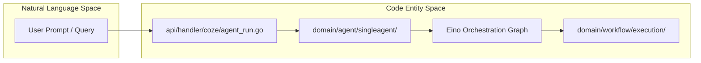

<!-- source: DeepWiki mcp.deepwiki.com · repo coze-dev/coze-studio · page 1.2 Technology Stack · fetched 2026-10-29 -->

# Technology Stack

<details>
<summary>Relevant source files</summary>

The following files were used as context for generating this wiki page:

- [.nvmrc](.nvmrc)
- [Makefile](Makefile)
- [README.md](README.md)
- [backend/Dockerfile](backend/Dockerfile)

</details>


This document describes the core technologies, frameworks, and tools used throughout the Coze Studio monorepo. It covers the frontend TypeScript/JavaScript ecosystem, backend Go services, interface definition layer, infrastructure components, and development tooling.

## Overview

Coze Studio employs a polyglot technology stack with clear separation between frontend and backend layers, unified through Thrift IDL definitions. The repository uses **Rush.js** for monorepo orchestration, enabling incremental builds and dependency management across all packages.

```mermaid
graph TB
    subgraph "Frontend Layer"
        Node["Node.js (lts/iron)"]
        Rush["Rush.js / pnpm"]
        React["React 18"]
        FlowGram["FlowGram Engine"]
        Zustand["Zustand State"]
    end
    
    subgraph "Backend Layer"
        Go["Go 1.24"]
        Hertz["Hertz HTTP Framework"]
        Eino["Eino AI Orchestration"]
        GORM["GORM ORM"]
    end
    
    subgraph "Infrastructure"
        Docker["Docker / Docker Compose"]
        Helm["Kubernetes Helm Charts"]
        Atlas["Atlas Schema Migration"]
        Python["Python 3 (Virtualenv)"]
    end

    %% Mapping technologies to specific code markers
    Rush -.-> RushJson["rush.json"]
    React -.-> AppEntry["apps/coze-studio/src/index.tsx"]
    FlowGram -.-> WorkflowPkg["packages/workflow/"]
    Zustand -.-> StorePkg["packages/agent-ide/bot-editor-context-store.ts"]
    Go -.-> GoMod["backend/go.mod"]
    Hertz -.-> ServerEntry["backend/main.go"]
    Eino -.-> AgentDomain["backend/domain/agent/"]
    GORM -.-> InfraOrm["backend/infra/orm/"]
    Docker -.-> DockerCompose["docker/docker-compose.yml"]
    Helm -.-> HelmCharts["helm/charts/opencoze/"]
    Atlas -.-> AtlasMigration["docker/atlas/migrations/"]
    Python -.-> PythonScripts["backend/infra/coderunner/impl/script/sandbox.py"]
```



**Sources:** [.nvmrc:1](), [README.md:18-28](), [Makefile:91-94](), [backend/Dockerfile:1-77]()

---

## Frontend Technology Stack

The frontend is implemented using **TypeScript** and **JavaScript** with the structure managed by **Rush.js** in a monorepo layout for efficient builds and dependency management.

### Core Technologies and Frameworks

- **TypeScript / JavaScript**: Strongly typed frontend code to improve maintainability.
- **Rush.js**: Monorepo orchestrator that manages the dependency graph, incremental builds, and workspace settings across numerous packages.
- **React 18**: The primary UI framework powering all frontend interfaces, including the agent IDE and studio environments.
- **Rsbuild / Rspack**: Custom build pipeline tools focused on fast incremental builds and optimized bundling.
- **Zustand**: A lightweight state management library used extensively for component and application state in complex frontend sections like the Bot Editor context.
- **FlowGram**: A powerful visual workflow engine enabling drag-and-drop editing and execution of workflows within Coze Studio.

### Package and Build Management

- **Rush.js Workspaces** segment the frontend code into multiple packages under directories such as `apps/` and `packages/`.
- Packages follow a tiered dependency system from level-1 (foundations) up to level-4 (application-specific).
- **pnpm** workspace is integrated with Rush.js for fast package installs and dependency resolution.
- Autoinstallers handle tools like `rush-commitlint` and `rush-lint-staged`.

Frontend codebases leverage type-safe API consumption generated from the shared Thrift IDL schemas, facilitating seamless frontend-backend integration.

**Sources:** [README.md:27-28](), [Makefile:31-33](), [.nvmrc:1]()

---

## Backend Technology Stack

The backend is implemented using **Go 1.24**, with a Domain-Driven Design (DDD) architecture to maintain clear separation of concerns and extensibility.

### Core Technologies and Frameworks

- **Go 1.24**: The primary programming language for backend services, chosen for performance and concurrency.
- **Hertz HTTP Framework**: High-performance HTTP server framework used to implement RESTful APIs and middleware in the backend (`main.go` serves as the entrypoint).
- **Eino AI Orchestration Framework**: Provides AI model abstraction, retrieval-augmented generation (RAG) pipelines, and agent lifecycle orchestration encapsulated primarily within the `domain/agent/` packages.
- **GORM**: Go ORM used for relational database access and migrations (MySQL/OceanBase).
- **Python 3 (Virtualenv)**: Python scripts and virtual environments are embedded within the docker container for document parsers and sandboxed code execution, interacting tightly with the Go backend.

### Backend Build and Running

The backend builds into a statically-linked Go binary using `go build -ldflags="-s -w"` to reduce size:

```dockerfile
# Key Dockerfile snippet for backend
RUN go build -ldflags="-s -w" -o /app/opencoze main.go
```

This binary is then included in a minimal Alpine-based runtime image with Python and supporting libraries installed.

**Sources:** [backend/Dockerfile:1-77](), [README.md:27-28](), [Makefile:123-130]()

---

## AI Orchestration and Execution

The essential AI orchestration within the backend is handled by the **Eino Framework** and the domain agent services.



- User queries go through HTTP API handlers (e.g., `agent_run.go`).
- Agent business logic in `singleagent` manages agent session and execution.
- Eino orchestrates model calls, plugins, and workflows.
- Workflow execution manages complex automation flows.

This design cleanly separates concerns and allows workflow, AI, and plugin extensions.

**Sources:** [README.md:27-28](), [Makefile:123-130]()

---

## Infrastructure and Deployment Stack

Coze Studio uses containerization and cloud-native infrastructure for deployment.

### Containerization and Orchestration

- **Docker & Docker Compose**: Used for local development and one-command startup of all dependencies including database, cache, search, and services.
- **Kubernetes & Helm Charts**: Helm charts within `helm/charts/opencoze/` provide production-ready Kubernetes manifests for full-stack deployment.
- **Atlas**: Database schema management and SQL migration tool integrating with MySQL/OceanBase.

### Supporting Infrastructure Components

| Component                | Technology                   | Role                                                  |
|-------------------------|-----------------------------|-------------------------------------------------------|
| Relational Database      | MySQL 8.4.5 / OceanBase     | Store agents, workflows, users, resources              |
| Distributed Cache       | Redis                       | Session caching, transient data                        |
| Search Engine           | Elasticsearch               | Full-text search for knowledge bases                   |
| Vector Database / Index | Milvus / OceanBase          | Vector similarity search for RAG and AI embeddings    |
| Object Storage          | MinIO / Amazon S3           | Storage of uploaded files and document artifacts       |
| Messaging Queues        | NSQ / RocketMQ / NATS / Pulsar | Event bus and asynchronous messaging                 |
| Reverse Proxy           | Nginx                       | Web traffic routing and TLS termination                |

### Backend Dockerfile Summary

The backend Dockerfile installs Go build dependencies, builds the Go app statically, then creates a slim runtime image with Python 3 virtual environment. It installs necessary Python libraries for document parsing and sandboxing.

```dockerfile
# Summary of backend Docker build steps
FROM golang:1.24-alpine AS builder
WORKDIR /app
RUN apk add --no-cache git gcc libc-dev
COPY backend/go.mod backend/go.sum ./
RUN go mod download
COPY backend/ ./
RUN go build -ldflags="-s -w" -o /app/opencoze main.go

FROM alpine:3.22.0
RUN apk add --no-cache python3 python3-dev pax-utils deno
RUN python3 -m venv /app/.venv
COPY --from=builder /app/opencoze /app/opencoze
COPY backend/infra/document/parser/impl/builtin/*.py /app/
COPY backend/infra/coderunner/impl/script/sandbox.py /app/
ENV PATH="/app/.venv/bin:${PATH}"
CMD ["/app/opencoze"]
```

**Sources:** [Makefile:9-16](), [backend/Dockerfile:1-77]()

---

## Interface Definition Layer (IDL)

Coze Studio uses **Apache Thrift IDL** to define data structures and API service contracts between frontend and backend.

- Thrift files are stored in the `idl/` directory with API, base, and domain-specific IDL definitions.
- Backend Go code is generated by the **Kitex** codegen tool from IDL.
- Frontend TypeScript declarations and client SDKs are generated using `idl2ts`, ensuring type-safe API usage.
- This arrangement enforces consistent, strongly-typed data contracts across the system.

**Sources:** [README.md:27-28](), [Makefile:105-108]() (implied from the repo structure)

---

## Development Tooling and Workflow

The repository provides a comprehensive `Makefile` to automate common build, setup, and deployment tasks:

| Make Target | Description                                               |
|-------------|-----------------------------------------------------------|
| `make fe`  | Build the frontend application code                       |
| `make server` | Compile and start the Go backend server with env setup |
| `make middleware` | Start all required Docker middleware containers   |
| `make python` | Set up Python virtual environment and dependencies     |
| `make sync_db` | Run database schema migration via Atlas                 |
| `make clean` | Stop all containers and clean up volumes                 |

Key environment and build scripts are located in `scripts/setup/`.

Node.js version is pinned to **lts/iron** via `.nvmrc` file, ensuring consistent frontend build environments.

**Sources:** [Makefile:1-158](), [.nvmrc:1]()

---

# Summary Table: Technologies and Their Roles in Coze Studio

| Technology             | Purpose                                  | Relevant Code / Files                                  |
|-----------------------|-----------------------------------------|-------------------------------------------------------|
| TypeScript / JavaScript| Frontend implementation                  | `apps/coze-studio/src/`, `packages/`                  |
| Rush.js & pnpm        | Monorepo package management & builds    | `rush.json`, `package.json` in frontend packages      |
| React 18              | UI framework                            | React components under `apps/coze-studio/`            |
| Rsbuild / Rspack      | Frontend build tooling                   | Build scripts indicated by `scripts/build_fe.sh`      |
| Zustand               | Frontend state management                | State stores under `packages/agent-ide/bot-editor-context-store.ts` |
| Go 1.24               | Backend implementation                   | `backend/` directory, `main.go`                        |
| Hertz HTTP Framework  | Backend HTTP server & routing           | `backend/main.go`, handlers in `backend/api/handler/` |
| Eino                  | AI orchestration framework               | Business logic under `backend/domain/agent/`          |
| GORM                  | ORM for DB interaction                   | `backend/infra/orm/`                                   |
| Apache Thrift IDL     | Interface definition                     | `idl/*.thrift` files, Kitex-generated Go/TS code       |
| Docker & Docker Compose| Containerization and local orchestration | `docker/docker-compose.yml`, `backend/Dockerfile`    |
| Kubernetes & Helm     | Production orchestration & deployment    | `helm/charts/opencoze/`                                |
| Atlas Migration Tool  | Database schema management and migrations| `docker/atlas/migrations/`, Makefile targets          |
| Python 3 (Virtualenv) | Auxiliary scripting & sandboxing         | Python scripts under `backend/infra/coderunner/impl/script/` |

---

This technology stack underpins Coze Studio's goal to provide a scalable, extensible platform for rapid AI agent development combining modern frontend interfaces and robust backend services.

**Sources:** [.nvmrc:1](), [README.md:1-89](), [Makefile:1-158](), [backend/Dockerfile:1-77]()

---

