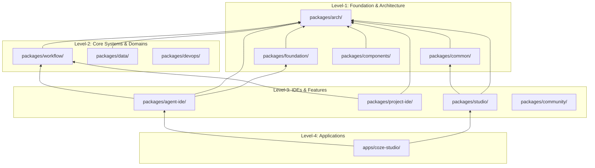
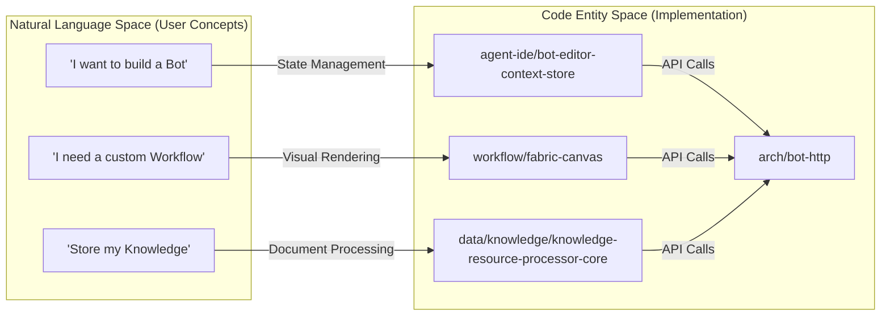
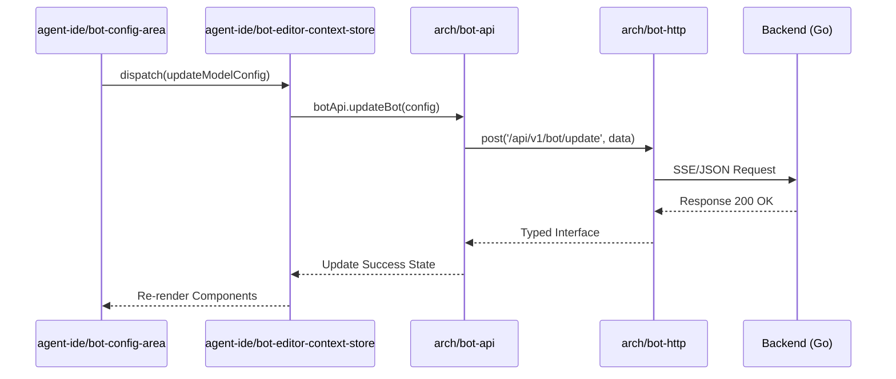

<!-- source: DeepWiki mcp.deepwiki.com · repo coze-dev/coze-studio · page 2.1 Frontend Architecture · fetched 2026-10-29 -->

# Frontend Architecture

Relevant source files

The following files were used as context for generating this wiki page:

- [.claude/agents/frontend-infrastructure-expert.md](.claude/agents/frontend-infrastructure-expert.md)
- [.dockerignore](.dockerignore)
- [.github/CODEOWNERS](.github/CODEOWNERS)

## Purpose and Scope

This document details the layered frontend architecture of Coze Studio, a monorepo focused on creating conversational AI agents with rich frontend development environments and integrated backend services. The frontend uses a **Rush.js-managed monorepo** with a strict dependency tier system to ensure modularity and encapsulation while enabling cross-team ownership and efficient development.

The architecture segments the frontend into:

- Application entry points (apps)
- Specialized IDEs (agent-ide, project-ide)
- Core business systems (workflow, studio, data)
- Foundational infrastructure packages (arch, foundation, common, components, devops, community)

This page explains how these layers interact, their implementation responsibilities, key classes/functions, data flow, and the team ownership model.

---

## Layered Architecture and Dependency Tiers

The frontend organizes code into four immutable dependency tiers:

- Higher tiers may depend on lower tiers but never the reverse.
- This prevents circular dependencies and clarifies package responsibilities.

### Dependency Tier System Diagram

---

### Tier Definitions

| Tier           | Directory                            | Responsibility                                                                 |
| -------------- | ---------------------------------- | ------------------------------------------------------------------------------ |
| **Level-4**    | `apps/`                            | Application entry points; bootstrap, routing, global app state                 |
| **Level-3**    | `packages/agent-ide/`, `project-ide/`, `studio/`, `community/` | Large feature sets and UI frameworks such as IDE shells and community features  |
| **Level-2**    | `packages/workflow/`, `data/`, `devops/` | Domain engines and services: workflow canvas, knowledge management, devops tools |
| **Level-1**    | `packages/arch/`, `foundation/`, `common/`, `components/` | Core platform infrastructure and shared utilities, types, UI components         |

**Sources:**

- [.github/CODEOWNERS:1-150]()
- [README.md:27-27]()

---

## Core Systems Implementation

### Agent IDE System (Level-3)

The `agent-ide` package forms the foundational environment for building, configuring, and running AI agents.

- **Bot State Management:** `bot-editor-context-store` is a global Zustand store managing bot editor state, synchronizing UI components (editor panels, chat, config) [frontend/packages/agent-ide/bot-editor-context-store:1-120]().

- **Configuration Panels:** `bot-config-area`, `tool`, and `tool-config` components define agent model settings, plugin integration modules, and tool configurations [frontend/packages/agent-ide/bot-config-area:1-80](), [frontend/packages/agent-ide/tool:1-150]().

- **Chat and Debugging:** The `chat-debug-area` and `chat-background` modules provide isolated chat environments with debug capabilities, event logging, and message controls [frontend/packages/agent-ide/chat-debug-area:1-100]().

- **Audit and Compliance:** Packages `bot-audit-adapter` and `bot-audit-base` encapsulate validation logic, user auditing, and compliance checks on bot configurations [frontend/packages/agent-ide/bot-audit-adapter:1-60]().

### Workflow System (Level-2)

The visual workflow engine enables drag-and-drop design of conversational logic, nodes, and flows.

- **Canvas Rendering:** Built atop `fabric-canvas` package, enabling scalable vector graphics for editable workflow diagrams [frontend/packages/workflow/fabric-canvas:1-100]().

- **Node and Adapter Systems:** Different nodes like LLM nodes, Code nodes, and Tool nodes are modeled with `nodes` and integrated via `nodes-adapter` for standardized behavior [frontend/packages/workflow/nodes:1-90](), [frontend/packages/workflow/nodes-adapter:1-60]().

- **State and Variables:** Centralized flow variables are managed via the `variable` package, supporting reactive updates and persistence [frontend/packages/workflow/variable:1-75]().

- **Testing Infrastructure:** `test-run-next` provides execution tracing, replay, and visualization for workflow tests [frontend/packages/workflow/test-run-next:1-150]().

### Data & Knowledge System (Level-2)

Supports Retrieval-Augmented Generation and AI agent memory with long-term persistence.

- **Knowledge Management:** `knowledge-modal-base` and `knowledge-resource-processor-core` handle document ingestion, processing, and indexing into searchable knowledge bases [frontend/packages/data/knowledge/knowledge-modal-base:1-80]().

- **Memory Persistence:** Packages like `database` and `database-creator` offer local and server-synced storage for agent states and memories [frontend/packages/data/memory/database:1-120]().

---

## Foundational Packages (Level-1)

### Architecture Layer (`arch/`)

Core underpinning components providing abstractions and infrastructure services:

- **Communication:**  
  - `bot-api`: Strongly typed API interfaces wrapping HTTP calls  
  - `bot-http`: Actual HTTP client implementation integrating with backend REST/SSE endpoints [frontend/packages/arch/bot-api:1-40](), [frontend/packages/arch/bot-http:1-60]().

- **Environment Management:**  
  - `bot-env` and `bot-env-adapter`: Handle platform-specific environment variables, feature flags, and runtime configuration [frontend/packages/arch/bot-env:1-70](), [frontend/packages/arch/bot-env-adapter:1-50]().

- **Observability and Logging:**  
  - `logger`, `slardar-adapter`, `report-events` support telemetry, structured logs, and performance reporting [frontend/packages/arch/logger:1-40](), [frontend/packages/arch/slardar-adapter:1-30]().

- **State & Type Definitions:**  
  - `bot-store`: Primary shared global state management utilities  
  - `bot-typings`: Common interfaces and TypeScript type declarations consumed by other layers [frontend/packages/arch/bot-store:1-90](), [frontend/packages/arch/bot-typings:1-20]().

### Foundation, Common & Components Layers

- **Foundation:** `space-store` manages user workspace and project context switching; `local-storage` handles persistence to browsers or IndexedDB [frontend/packages/foundation/space-store:1-100](), [frontend/packages/foundation/local-storage:1-60]().

- **Common:**  
  Includes UI logic modules like `chat-area` which encapsulate chat interface behavior and hooks, `uploader` modules for file uploads, and several business component utilities [frontend/packages/common/chat-area:1-120](), [frontend/packages/common/uploader-adapter:1-70]().

- **Components:** Provides a shared UI component library with wrappers around Semi Design UI (`bot-semi`), custom icons (`bot-icons`), virtual list views (`virtual-list`), and utilities like `json-viewer` and `scroll-view` [frontend/packages/components/bot-semi:1-100](), [frontend/packages/components/json-viewer:1-50]().

---

## Team Ownership and DevOps

### Code Ownership Model

Ownership is formalized using the repository `.github/CODEOWNERS` configuration:

- **Infrastructure & Core:**  
  Owned primarily by `@Tecvan-fe`, `@leeight`, `@soonco` for core arch, config, and build infra such as `arch/bot-api`, `config/eslint-config` [ .github/CODEOWNERS:3-40 ]().

- **Feature Teams:**  
  Teams like `@evan-crash`, `@duwenhan2byte`, `@Hezi-crypto` manage agent-ide and studio packages [ .github/CODEOWNERS:6-8, 40-70 ]().

- **Workflow Team:**  
  Owners include `@zxhfighter` and `@xiamidaxia` for workflow system packages [ .github/CODEOWNERS:59-60 ]().

### DevOps and Tooling Assistance

The `.claude/agents/frontend-infrastructure-expert.md` agent supports:

- Bundler configuration and performance tuning (rspack, webpack)  
- Managing dependency graphs and monorepo configuration issues (rush.json)  
- ESLint and TypeScript options maintenance for strong typing and lint rules  
- Consistent, scalable frontend infrastructure maintenance [ .claude/agents/frontend-infrastructure-expert.md:8-30 ]().

---

## Data Flow and Implementation

### Bridge Diagram: Natural Language to Code Entities

This diagram maps user-level concepts (Natural Language Space) to concrete code elements (Code Entity Space) within the frontend packages.

---

### Interaction Flow: Agent IDE to Backend API

This sequence shows the frontend data flow from a UI component updating bot configuration through typed APIs to backend response.

- The UI triggers store actions to update bot configuration.  
- The store calls the typed API wrapper in `arch/bot-api`.  
- The HTTP client in `arch/bot-http` sends requests to backend REST endpoints.  
- Backend processes and replies confirming success.  
- State updates propagate back to UI for reactive rendering.

---

# Summary

The Coze Studio frontend is architected as a strict, layered monorepo managed by Rush.js, with a four-tier dependency system ensuring clean separations. 

- **Level-4** apps contain entry points.  
- **Level-3** consists of feature-rich IDEs and community packages.  
- **Level-2** comprises domain engines like workflow and data management.  
- **Level-1** provides foundational core services, UI components, and shared utilities.

This layered architecture supports maintainability, scalability, and clear team ownership. Robust typed API clients and consistent state management patterns enable seamless frontend-backend integration.

---

**Sources:**

- [.github/CODEOWNERS:1-272]()
- [.claude/agents/frontend-infrastructure-expert.md:1-32]()
- [frontend/packages/agent-ide/bot-editor-context-store:1-120]()
- [frontend/packages/agent-ide/bot-config-area:1-80]()
- [frontend/packages/agent-ide/tool:1-150]()
- [frontend/packages/agent-ide/chat-debug-area:1-100]()
- [frontend/packages/agent-ide/bot-audit-adapter:1-60]()
- [frontend/packages/workflow/fabric-canvas:1-100]()
- [frontend/packages/workflow/nodes:1-90]()
- [frontend/packages/workflow/nodes-adapter:1-60]()
- [frontend/packages/workflow/variable:1-75]()
- [frontend/packages/workflow/test-run-next:1-150]()
- [frontend/packages/data/knowledge/knowledge-modal-base:1-80]()
- [frontend/packages/data/memory/database:1-120]()
- [frontend/packages/arch/bot-api:1-40]()
- [frontend/packages/arch/bot-http:1-60]()
- [frontend/packages/arch/bot-env:1-70]()
- [frontend/packages/arch/bot-env-adapter:1-50]()
- [frontend/packages/arch/logger:1-40]()
- [frontend/packages/arch/slardar-adapter:1-30]()
- [frontend/packages/arch/bot-store:1-90]()
- [frontend/packages/arch/bot-typings:1-20]()
- [frontend/packages/foundation/space-store:1-100]()
- [frontend/packages/foundation/local-storage:1-60]()
- [frontend/packages/common/chat-area:1-120]()
- [frontend/packages/common/uploader-adapter:1-70]()
- [frontend/packages/components/bot-semi:1-100]()
- [frontend/packages/components/json-viewer:1-50]()

---

