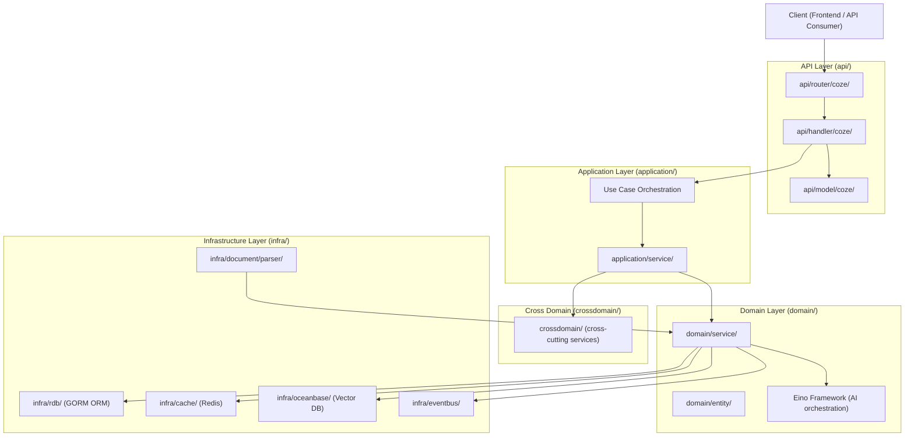
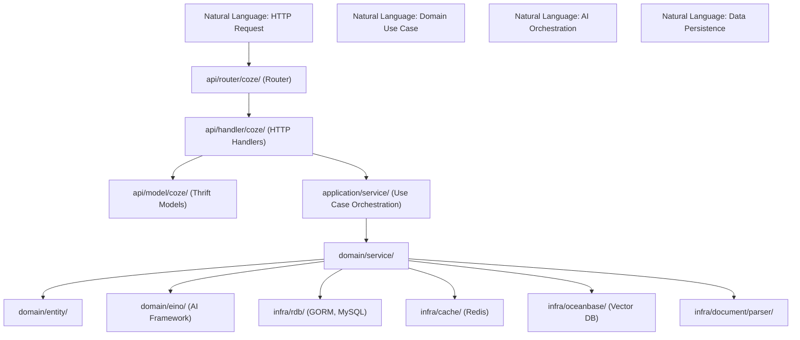

<!-- source: DeepWiki mcp.deepwiki.com · repo coze-dev/coze-studio · page 2.2 Backend Architecture · fetched 2026-10-29 -->

# Backend Architecture

<details>
<summary>Relevant source files</summary>

The following files were used as context for generating this wiki page:

- [backend/.hz](backend/.hz)
- [backend/Dockerfile](backend/Dockerfile)
- [backend/README.md](backend/README.md)
- [backend/api/handler/coze/base.go](backend/api/handler/coze/base.go)
- [backend/api/model/base/base.go](backend/api/model/base/base.go)

</details>


This document describes the Go-based backend architecture of **Coze Studio**, structured around **Domain-Driven Design (DDD)** principles. It details the layered organization, key components, integration with the **Hertz** HTTP framework for efficient API handling, and the incorporation of the **Eino** AI orchestration framework. The backend supports scalable development of AI agents with modular separation of concerns.

## Overview

The Coze Studio backend is developed in **Go 1.24**, serving as the core platform for conversational AI agents, workflows, plugins, knowledge bases, and related services. It exposes HTTP API endpoints built on the **Hertz** framework, while business logic is implemented according to DDD patterns across clearly defined layers.

The main directory structure reflects the DDD boundaries:

| Directory       | Role                                                                      |
|-----------------|---------------------------------------------------------------------------|
| `api/`          | HTTP handlers, request/response models, router definitions.               |
| `application/`  | Use case orchestration, application logic bridging domain and infra.      |
| `domain/`       | Core business logic, entities, aggregates, domain services.               |
| `crossdomain/`  | Services that span multiple domains or cross-cutting concerns.            |
| `infra/`        | Infrastructure adapters: DB, caches, search, external APIs, file parsing. |
| `pkg/`          | General utilities, helpers, and reusable packages.                        |
| `types/`        | Shared type definitions used across layers.                              |

This structure enforces a separation of concerns, where each layer only depends on layers beneath it or specific interfaces, enabling maintainability and testability.

Sources: [backend/Dockerfile:2-17](), [backend/.hz:3-6](), [backend/api/handler/coze/base.go:17-34]()

## Layered Architecture & Data Flow

The backend request handling follows a layered path: from HTTP reception in the API layer, to use case orchestration in application, business rules in domain, and finally to infrastructure for persistence or external calls.



- **Client** sends HTTP requests.
- **Router** dispatches to HTTP handlers (`api/handler/coze`).
- Handlers parse requests into Thrift-generated models (`api/model/coze`).
- Handlers invoke Use Case orchestration in `application/service`.
- Domain services (`domain/service`) implement business logic with entities (`domain/entity`).
- AI business logic is orchestrated via the **Eino** framework integrated within the domain layer.
- Persistence, caching, vector search, event bus messaging, and document parsing are handled by infrastructure adapters.

Sources: [backend/.hz:4-6](), [backend/api/handler/coze/base.go:17-34](), [backend/api/model/coze/api.go:1-200]()

## API Layer

The `api/` directory contains all HTTP interface elements, built on the **Hertz** HTTP framework, which is designed for high performance and scalable API services.

### Router

- Defined under `api/router/coze/` (auto-generated by `hz`).
- The router maps incoming HTTP requests to specific handlers based on routes.

### Handlers

- Located in `api/handler/coze/`.
- Responsible for:
  - Input binding and validation (using Thrift-generated models).
  - Calling appropriate application layer services.
  - Formatting and sending back HTTP responses.
  - Centralized error handling through utilities in `httputil`.

### Models

- Implemented in `api/model/coze/`.
- Generated via Thrift from the IDL files defining all data contracts between client and server.
- Include request and response structures for multiple domain services such as intelligence, conversation, memory, plugin development, etc.

**Example:** `internalServerErrorResponse` and `invalidParamRequestResponse` functions provide standardized error response flows in handlers [backend/api/handler/coze/base.go:27-33]().

Sources: [backend/.hz:1-7](), [backend/api/handler/coze/base.go:17-34](), [backend/api/model/coze/api.go:1-200]()

## Application Layer

The `application/` layer contains use case orchestration logic. It acts as a bridge between the API handlers and the domain services:

- It translates the incoming requests to domain-specific commands or queries.
- Coordinates domain services and cross-domain interactions.
- Implements transactional integrity and business workflow control.
- Contains service classes per domain, e.g., `agent`, `conversation`, `workflow`, etc.

By centralizing use case logic here, the application layer keeps API handling simple and domain logic clean.

Sources: [backend/api/handler/coze/base.go:17-34](), inferred from layered structure

## Domain Layer

The heart of the system, the domain layer contains pure business logic:

- **Entities** and **Aggregates** define core business models.
- **Domain Services** implement business rules, AI orchestration, and domain workflows.
- Includes multiple domain packages such as `agent`, `conversation`, `knowledge`, `memory`, `plugin`, and `workflow`.
- **Eino AI Framework** is integrated here, enabling complex orchestration of LLMs, prompt chains, and tool usage for AI agents.

This layer depends only on domain concepts, promoting ubiquitous language and isolated unit testability.

Sources: [README.md:22-35](), [backend/api/model/coze/api.go:53-159](), implied domain package usage

## Cross-Domain Layer

The `crossdomain/` package holds services or logic that cut across multiple domains, such as:

- Shared business operations that span domains.
- Cross-cutting concerns such as logging, auditing, or domain synchronization logic.
- Integration points that combine domain services.

This facilitates separation of concerns and reuse when domain boundaries require collaboration.

Sources: inferred from structure and naming conventions

## Infrastructure Layer

The `infra/` layer provides concrete implementations of external system interactions and technical details:

- **Database Adapters**: An ORM layer using **GORM** for relational DB interactions [backend/Dockerfile:52]() in `infra/rdb/`.
- **Cache**: Redis adapter in `infra/cache/`.
- **Vector Stores**: Connectors to Milvus, OceanBase, VikingDB in `infra/oceanbase/` and related sub-packages.
- **Document Parsing**: Python- and Deno-based parsing scripts for PDF, DOCX, sandboxed execution in `infra/document/parser/` [backend/Dockerfile:33-43,50-52]() and [backend/Dockerfile:68-69]().
- **Eventbus**: Support for message queues (NSQ, RocketMQ, Kafka, Pulsar, NATS) in `infra/eventbus/`.
- **Embedding Providers**: Integration with Ark, OpenAI, Ollama, Gemini, HTTP embedding APIs.
- **Other adapters**: Id generation, image storage (VolcEngine), search (Elasticsearch), and storage (MinIO, S3-compatible).

This abstraction isolates domain logic from third-party details and allows easy swapping of infrastructure components.

Sources: [backend/Dockerfile:28-43](), [backend/Dockerfile:50-52](), [backend/Dockerfile:68-69]()

## Utilities

The `pkg/` directory hosts general-purpose utilities that are used across multiple parts of the backend:

- Common helper methods
- Logging utilities
- Configuration loaders
- Error wrappers and helpers

These support cross-layer infrastructure and improve code reuse.

## Types

Shared type definitions, constants, and enumerations that need to be consistent across layers are located in the `types/` directory.

---

## Hertz HTTP Framework Integration

The backend uses the **Hertz** HTTP framework for its API layer. Hertz provides:

- A fast HTTP server designed for high concurrency.
- Middleware support for logging, authentication, metrics, and error handling.
- Request routing and context management.

The `hz` tool automates handler, router, and model generation from templates or Thrift IDL, reducing boilerplate and improving consistency [backend/.hz:1-7]().

**Example Flow in Handler**

```go
func FooHandler(ctx context.Context, c *app.RequestContext) {
    var req model.FooRequest
    if err := c.BindAndValidate(&req); err != nil {
        invalidParamRequestResponse(c, "Invalid request parameters")
        return
    }
    result, err := application.FooUseCase(ctx, req)
    if err != nil {
        internalServerErrorResponse(ctx, c, err)
        return
    }
    c.JSON(http.StatusOK, result)
}
```

The handlers use Thrift-generated models for requests and responses, simplifying serialization and API consistency.

Sources: [backend/api/handler/coze/base.go:17-34](), [backend/.hz:1-7]()

---

## Eino AI Framework Integration

Within the domain layer, the backend leverages the **Eino** AI framework to orchestrate AI agents' behavior:

- Eino provides a framework to design and execute prompt graphs, tooling chains, and LLM interactions.
- Core domain services use Eino to implement agent execution, multi-agent coordination, and complex workflows.
- Supports RAG document pipelines, plugin invocation, and dynamic memory integration as part of AI orchestration.

By embedding Eino closely to domain logic, Coze Studio enables rich AI capabilities while adhering to clean architecture principles.

Sources: [README.md:25-35](), inferred from domain descriptions

---

## Backend Build and Deployment

The backend builds as a standalone Go binary (`opencoze`) in a multi-stage Dockerfile [backend/Dockerfile:1-76]():

- **Build Stage**:
  - Based on `golang:1.24-alpine`.
  - Installs build dependencies and compiles the Go application.
- **Final Stage**:
  - Runs on lightweight `alpine:3.22.0`.
  - Includes Python runtime with necessary libraries for document parsing.
  - Includes Deno runtime for sandboxed script execution.
  - Copies Python parser and sandbox scripts into `/app/`.
  - Establishes a virtual environment for Python module dependencies.
  - Exposes port `8888` for the API server.
  - Sets the default command to run the compiled Go binary.

This containerization enables consistent deployment across environments.

Sources: [backend/Dockerfile:2-17](), [backend/Dockerfile:21-76]()

---

## Summary Diagram Connecting Natural Language Layer to Code Entities



This diagram maps the real code entities to the conceptual natural language ideas of the backend system.

Sources: All above

---

## Conclusion

The Coze Studio backend features a robust Go-based architecture strictly following DDD principles. Its layered design segregates API, application logic, domain behavior, cross-cutting concerns, infrastructure adapters, and utilities. The use of **Hertz** enables high-performance HTTP serving, while **Eino** embeds advanced AI orchestration capabilities at the domain level. Containerization through a multi-stage Dockerfile ensures reproducible builds and deployment.

This modular architecture facilitates maintainable growth of conversational AI functionalities, supporting rich agent behaviors, plugin ecosystems, knowledge management, and complex workflows.

---

# References to Source Files

- [backend/.hz:1-7]()
- [backend/Dockerfile:2-76]()
- [backend/api/handler/coze/base.go:17-34]()
- [backend/api/model/coze/api.go:1-200]()
- [README.md:22-35]()

---

