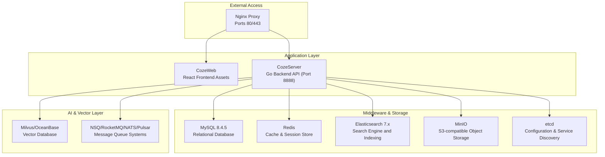
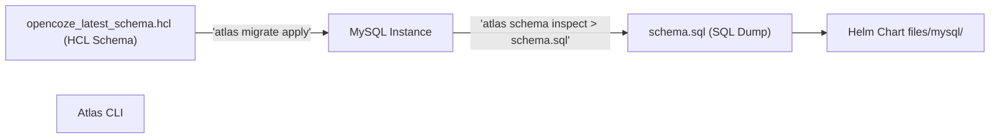

<!-- source: DeepWiki mcp.deepwiki.com · repo coze-dev/coze-studio · page 2.3 Infrastructure Stack · fetched 2026-10-29 -->

# Infrastructure Stack

<details>
<summary>Relevant source files</summary>

The following files were used as context for generating this wiki page:

- [.dockerignore](.dockerignore)
- [Makefile](Makefile)
- [backend/Dockerfile](backend/Dockerfile)

</details>


This document details the deployment infrastructure for Coze Studio, covering Docker containerization, Kubernetes orchestration via Helm charts, and the local development topology. The infrastructure stack enables the deployment and operation of the frontend application, backend services, and all required middleware including MySQL, Redis, Elasticsearch, MinIO, Milvus, etcd, message queues, and Nginx.

## Overview

The infrastructure stack provides a consistent environment from local development to production. It manages the lifecycle of the Go-based backend and the React-based frontend, along with a suite of infrastructure services that support data persistence, caching, full-text search, object storage, vector search, messaging, and ingress routing.

| Component                  | Location                   | Purpose                                        |
|----------------------------|----------------------------|------------------------------------------------|
| Docker Compose             | `/docker/docker-compose.yml` | Defines service topology for local/testing environment |
| Dockerfiles                | `/backend/Dockerfile`       | Multi-stage container image builds for backend application and Python environment |
| Helm Charts               | `/helm/charts/opencoze/`    | Kubernetes manifests for production deployment |
| Schema Management         | `/docker/atlas/`            | Database schema migration and version management via Atlas CLI |

### Infrastructure Service Topology



This topology illustrates how external clients access the system via an Nginx reverse proxy, which routes requests to either the frontend assets or backend API server. The backend interacts with multiple middleware components for persistence, caching, indexing, vector search, messaging, and configuration.

**Sources:** [Makefile:75-78](), [backend/Dockerfile:72-76](), [Makefile:119-121]()

## Docker Containerization

### Backend Multi-Stage Build

The backend service is packaged using a multi-stage Docker build to optimize image size and runtime dependencies:

1. **Build Stage:** Uses the `golang:1.24-alpine` image to compile the `opencoze` binary.

2. **Final Stage:** Uses `alpine:3.22.0` as a minimal base image. It installs runtime dependencies such as Python3 (with development headers), deno runtime, and utilities (`bind-tools`, `file`, `pax-utils`). 

3. **Python Environment:** Creates a Python virtual environment (`/app/.venv`) and installs critical Python packages like `pdfplumber` and `python-docx` for document parsing, `numpy` for numerical computations, and HTTP libraries (`httpx`, `h11`). These are used for document processing and sandboxed execution of code snippets.

4. **Files copied:** The compiled Go binary (`/app/opencoze`) and Python scripts such as `parse_pdf.py`, `parse_docx.py`, and `sandbox.py` are deployed into the image. Execution permissions are set to ensure these scripts can run.

5. **Final Entrypoint:** The container exposes port 8888 to serve the Go backend API.

This approach separates build dependencies from runtime and bundles a fully isolated Python environment seamlessly alongside the Go service for extensibility and document parsing features.

```dockerfile
# Key commands summarized from backend/Dockerfile
FROM golang:1.24-alpine AS builder
# ... build opencoze binary ...
FROM alpine:3.22.0
RUN apk add python3 python3-dev deno bind-tools file pax-utils
RUN python3 -m venv /app/.venv
RUN pip install pdfplumber python-docx numpy httpx h11
COPY --from=builder /app/opencoze /app/opencoze
COPY backend/infra/document/parser/impl/builtin/parse_pdf.py /app/parse_pdf.py
COPY backend/infra/document/parser/impl/builtin/parse_docx.py /app/parse_docx.py
COPY backend/infra/coderunner/impl/script/sandbox.py /app/sandbox.py
CMD ["/app/opencoze"]
```

### Docker Ignore Optimizations

The `.dockerignore` file filters unnecessary files from the Docker build context to improve build times and reduce image size. It excludes:

- All `node_modules` folders and their contents, avoiding hefty frontend dependencies.

- Build artifacts like `dist/`, `build/`, and Rush.js caches.

- Git metadata and configuration files including `.gitignore`, `.eslintrc*`, and `.prettierrc*`.

- Test files (`__tests__`, `.test.*`, `.spec.*`).

- Editor and IDE files like `.vscode/`, `.idea/`, and swap files.

This ensures that only essential source code and configuration files are sent to the Docker daemon during builds.

**Sources:** [backend/Dockerfile:1-77](), [.dockerignore:1-36]()

## Service Topology (Docker Compose)

Coze Studio uses Docker Compose to orchestrate multiple infrastructure services during local development and testing. The main service roles and images commonly deployed include:

| Service       | Image/Version           | Function                                               |
|---------------|------------------------|-------------------------------------------------------|
| `mysql`       | `mysql:8.4.5`          | Primary relational database, initialized with schema  |
| `redis`       | `redis:latest`         | In-memory cache and session store                      |
| `elasticsearch` | `elasticsearch:7.17.x`| Full-text search engine with language plugin `smartcn`|
| `minio`       | `minio/minio`           | S3 compatible object storage for file uploads         |
| `etcd`        | `quay.io/coreos/etcd`   | Cluster configuration and service coordination         |
| `milvus`      | `milvusdb/milvus`        | Vector similarity search and embedding database       |
| `nsq`         | `nsqio/nsq`              | Lightweight default message queue system               |
| `coze-server` | built from `/backend/`  | The main Go backend API server container               |
| `coze-web`    | Nginx + React frontend  | Serves built frontend assets with reverse proxy        |

Each service runs in its isolated container. Docker Compose profiles enable selective startup, e.g., starting only the middleware stack or the full web environment. Health checks and dependency ordering ensure reliable startup sequencing.

### Database Migration Using Atlas CLI

Database schema management is handled through [Atlas](https://atlasgo.io), which provides schema version control and migrations from HCL files to SQL and database updates.



- The `dump_sql_schema` Makefile target exports the current MySQL schema to an SQL file.

- The SQL dump file is copied into the Helm chart directory for Kubernetes deployment.

- Makefile targets like `sync_db` and `sql_init` manage applying migrations and initializing the database.

This flow ensures synchronization between schema definitions, live databases, and packaged deployment manifests.

**Sources:** [Makefile:48-60](), [Makefile:95-103]()

## Kubernetes Deployment (Helm Chart)

Coze Studio supports Kubernetes-based production deployment via the `opencoze` Helm chart located at `/helm/charts/opencoze/`. This chart translates the Docker Compose container topology into Kubernetes objects with configuration and scalable deployment options.

### Key Helm Chart Characteristics

- **Deployments & StatefulSets:** Kubernetes `Deployment` resources manage the lifecycle of the stateless backend API (`coze-server`) and the nginx-based frontend assets (`coze-web`). Stateful services like `mysql` and `redis` use `StatefulSets` with persistent storage.

- **Init Containers:** Database initialization uses init containers to apply the Atlas migrations (`schema.sql`) before normal start.

- **ConfigMaps/Secrets:** Configuration environment variables are templated into container environments, supporting all infrastructure components including message queues, vector DB, etcd, and others.

- **Storage Classes:** Persistent volumes for MySQL, Redis, MinIO, and Milvus support configuration of different Kubernetes storage classes.

- **Ingress & Services:** Supports configuring Kubernetes `Service` types (ClusterIP, LoadBalancer) and ingress rules for external access.

### Infrastructure Service Alternatives

The Helm chart and deployment are designed with pluggable backends and messaging layers:

- **Vector Databases:** Supports either Milvus or OceanBase for vector similarity storage. OceanBase integration uses the OceanBase Operator and alternative docker-compose files (`docker-compose-oceanbase.yml`).

- **Message Queues:** Can toggle between NSQ, RocketMQ, NATS, or Pulsar message buses via `eventbus` backend adapters, configured in Helm values.

This modular design allows flexible adoption according to deployment environments and scale.

**Sources:** [Makefile:12-13](), [Makefile:102-103](), [Makefile:119-121]()

## Local Development Workflow

The `Makefile` abstracts infrastructure setup commands for developers, encapsulating service startup, Python environment setup, and database schema sync:

| Command        | Action                                                           |
|----------------|------------------------------------------------------------------|
| `make middleware` | Starts all infrastructure middleware containers using Docker Compose profiles. Starts MySQL, Redis, Elasticsearch, MinIO, etc [Makefile:61-63]() |
| `make python`  | Initializes local Python virtual environment with needed libs for document parsing [Makefile:91-93]()  |
| `make web`     | Starts the full stack including the frontend Nginx container [Makefile:75-77]() |
| `make sync_db` | Applies Atlas HCL migrations to local MySQL database container [Makefile:48-50]() |
| `make dump_db` | Dumps current database schema back to HCL and SQL migration files [Makefile:52-55]() |
| `make setup_es_index` | Executes Elasticsearch index setup scripts, essential for knowledge base search features [Makefile:109-112]() |
| `make oceanbase_debug` | Starts development stack with OceanBase vector and relational database variant [Makefile:117-121]() |

This workflow provides quick provisioning for development and debugging without requiring cluster access.

**Sources:** [Makefile:1-158]()

---

This page has covered the detailed infrastructure components, containerization practices, service topology, Helm-based production deployment, and local development workflows, forming the foundation for all Coze Studio platform deployments. The modular architecture and container-friendly design enable flexible scaling and easy extensibility with alternative infrastructure products.

# Callouts

- Search for `docker-compose.yml` in `/docker` for the exact service definitions.
- Consult `backend/Dockerfile` for build details and integrated runtime environment.
- Review `/helm/charts/opencoze/values.yaml` to customize Kubernetes deployment parameters.
- Use the `Makefile` targets for local environment management and migrations.

---

**Sources:**

- [Makefile:1-158]()
- [backend/Dockerfile:1-77]()
- [.dockerignore:1-36]()

---

