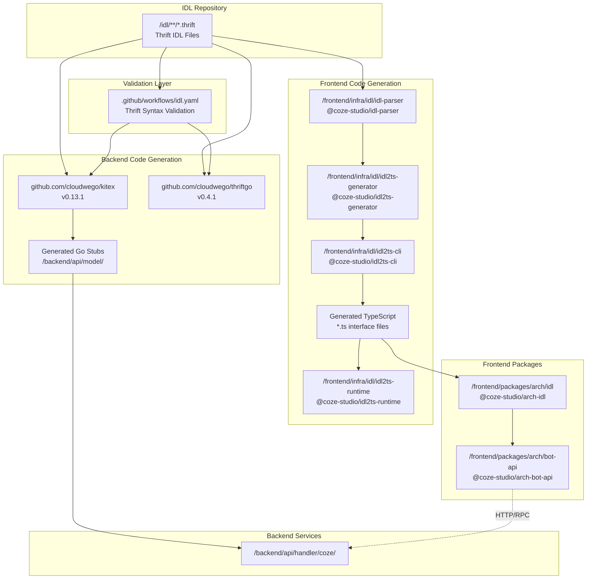
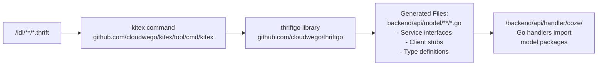
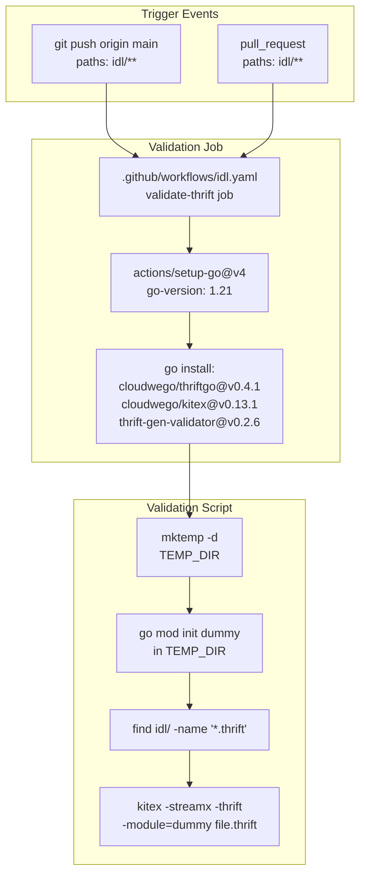

<!-- source: DeepWiki mcp.deepwiki.com · repo coze-dev/coze-studio · page 2.4 Interface Definition Layer · fetched 2026-10-29 -->

# Interface Definition Layer

<details>
<summary>Relevant source files</summary>

The following files were used as context for generating this wiki page:

- [.gitattributes](.gitattributes)
- [.github/workflows/idl.yaml](.github/workflows/idl.yaml)
- [backend/api/model/coze/api.go](backend/api/model/coze/api.go)

</details>


## Purpose and Scope

The Interface Definition Layer (IDL) serves as the contract definition layer between frontend and backend services in the Coze Studio monorepo. This layer uses Apache Thrift to define service interfaces, data structures, and API contracts, enabling type-safe communication across the TypeScript frontend and Go backend.

This document covers the IDL architecture, Thrift file organization, code generation processes for both frontend and backend, validation workflows, and the communication flow between services.

## IDL Architecture Overview

The IDL layer acts as a single source of truth for API contracts, generating code artifacts for both frontend and backend from shared Thrift definitions.

**Diagram: IDL-Driven Architecture**



**Sources:** [.github/workflows/idl.yaml:1-71](), [backend/api/model/coze/api.go:1-25]()

## Thrift IDL File Structure

All Thrift interface definitions reside in the `/idl/` directory at the repository root. These files define service interfaces, request/response structures, enumerations, and data types using Apache Thrift Interface Definition Language syntax.

The structure typically includes:

- **api.thrift**: The main entry point that references other service and data definition thrift files representing the overall Coze API.

- **base.thrift**: Contains common base types, error codes, and primitives shared across domain-specific files.

- **Domain-specific files**: Such as `agent.thrift`, `workflow.thrift`, `knowledge.thrift`, `conversation.thrift`, etc. These correspond to bounded contexts or modules in the backend business logic.

This clear separation makes maintenance manageable and aligns IDL files with the domain-driven design (DDD) approach used in backend services.

**Sources:** [.github/workflows/idl.yaml:6-8](), [.github/workflows/idl.yaml:50-56]()

## Backend Code Generation with Kitex

The backend leverages CloudWeGo's Kitex framework and `thriftgo` to generate Go RPC service stubs and model structures. The generated code is placed under `backend/api/model/`.

### Code Generation Process

Kitex is invoked on each Thrift file in the `/idl/` directory, generating Go source code for:

- Service interfaces for RPC servers and clients.
- Data type structs corresponding to Thrift structs, enums, and typedefs.
- Serialization and deserialization methods.

Generated code provides strongly typed APIs that backend handlers use for implementing business logic.

**Diagram: Backend Kitex Code Generation Flow**



### Kitex Command Details

An example Kitex command from the validation workflow:

```bash
kitex -streamx -thrift ignore_initialisms=false -module=dummy "$thrift_file"
```

- `-streamx`: Enables streaming RPC support.
- `-thrift ignore_initialisms=false`: Keeps original capitalizations in identifiers (e.g., `UserID` not `UserId`).
- `-module`: Module path used in import statements in generated Go code.
- `"$thrift_file"`: The Thrift source file processed.

### Generated Go Structures and Services

The generated `backend/api/model/coze/api.go` file aggregates domain services with client constructors, for example:

- `IntelligenceService` interface and `NewIntelligenceServiceClientFactory()` constructor.
- `ConversationService`, `MessageService`, `AgentRunService`, `MemoryService`, `PluginDevelopService`, and others.

Each service client wraps the corresponding generated client allowing backend code to invoke RPC calls easily.

**Sources:** [.github/workflows/idl.yaml:30-34](), [.github/workflows/idl.yaml:52](), [backend/api/model/coze/api.go:1-103]()

## Frontend Code Generation with idl2ts

The frontend uses a custom TypeScript code generation pipeline (`idl2ts`) to convert Thrift IDL types into TypeScript interfaces and type definitions. This maintains type safety and synchronized API contracts between frontend and backend layers.

### idl2ts Toolchain Packages

| Package | Location | Purpose |
|---------|----------|---------|
| `idl-parser` | `/frontend/infra/idl/idl-parser/` | Parses Thrift IDL files into an abstract syntax tree (AST). |
| `idl2ts-generator` | `/frontend/infra/idl/idl2ts-generator/` | Transforms the AST into TypeScript code strings. |
| `idl2ts-cli` | `/frontend/infra/idl/idl2ts-cli/` | CLI tool to drive the parsing and generation process. |
| `idl2ts-runtime` | `/frontend/infra/idl/idl2ts-runtime/` | Provides runtime helper functions and type guards for generated types. |

### Generated TypeScript Artifacts

The output is a collection of `.ts` files containing:

- `interface <StructName>` for Thrift structs with all typed fields.
- `enum <EnumName>` for enumeration types.
- Type aliases for typedefs.
- Utility type guard functions named `is<Type>(value: unknown): value is Type` for runtime type checking.

These interfaces and types are packaged in the frontend into the `@coze-studio/arch-idl` package and consumed by the `@coze-studio/arch-bot-api` package to define API function signatures and data shapes.

This approach ensures that the frontend accurately reflects any backend API schema changes directly from the shared Thrift sources.

**Sources:** [.github/workflows/idl.yaml:1-71]()

## IDL Validation Pipeline

To maintain correctness and consistency, the repository enforces automated validation of all Thrift files on code pushes and pull requests targeting the `main` branch.

### Validation Workflow Overview

- Triggered on `push` and `pull_request` events with path filters on `idl/**`.
- Uses GitHub Actions with a dedicated `validate-thrift` job.
- Sets up Go environment (1.21 version).
- Installs necessary tools:
  - `thriftgo` for IDL parsing.
  - `kitex` for code generation.
  - `thrift-gen-validator` for additional validation.
- Runs a shell script that:
  - Creates a temporary working directory.
  - Initializes a dummy Go module.
  - Iterates over all `.thrift` files under `/idl/`.
  - Invokes the `kitex` command on each file.
  - Captures errors; fails the workflow on any error.
  - Cleans up working directory after validation.

**Diagram: IDL Validation Workflow**



This process guarantees that no invalid Thrift files are merged, aligning IDL correctness with continuous integration best practices.

**Sources:** [.github/workflows/idl.yaml:1-71]()

## IDL Version Management

The IDL layer uses clearly pinned versions of code generation and validation tools for reproducibility and stability:

| Tool                  | Version | Go Module                                    | Purpose                    |
|-----------------------|---------|----------------------------------------------|----------------------------|
| `thriftgo`             | v0.4.1  | `github.com/cloudwego/thriftgo`               | Thrift parsing and AST      |
| `kitex`                | v0.13.1 | `github.com/cloudwego/kitex/tool/cmd/kitex`  | RPC code generation         |
| `thrift-gen-validator` | v0.2.6  | `github.com/cloudwego/thrift-gen-validator`  | Additional syntax validation|

These pinned versions are installed explicitly in the CI workflow, ensuring consistent generation across all environments.

**Sources:** [.github/workflows/idl.yaml:30-34]()

---

# Summary

The Interface Definition Layer centralizes API contract definition using the Apache Thrift IDL language and a robust toolchain:

- `/idl/` directory holds structured Thrift files dividing base, API, and domain-specific definitions.
- Backend Go code generation uses Kitex and thriftgo to produce RPC service code and structs.
- Frontend TypeScript generation uses the custom idl2ts toolchain to provide type-safe interfaces synchronized with backend definitions.
- Continuous validation enforces correctness through a CI workflow that iterates all `.thrift` files and verifies code generation completes without errors.
- All generated code artifacts are integrated into frontend and backend packages to ensure seamless request, response, and data model consistency.

This architecture supports maintainable, strongly typed RPC-based communication that bridges frontend development and backend service implementation with a single source of truth.

**Sources:**  
- [.github/workflows/idl.yaml:1-71]()  
- [backend/api/model/coze/api.go:1-103]()

---

