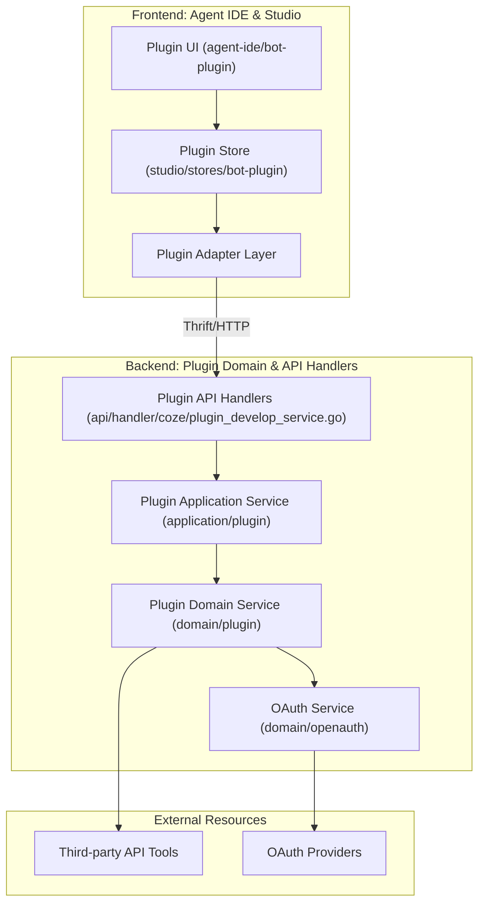
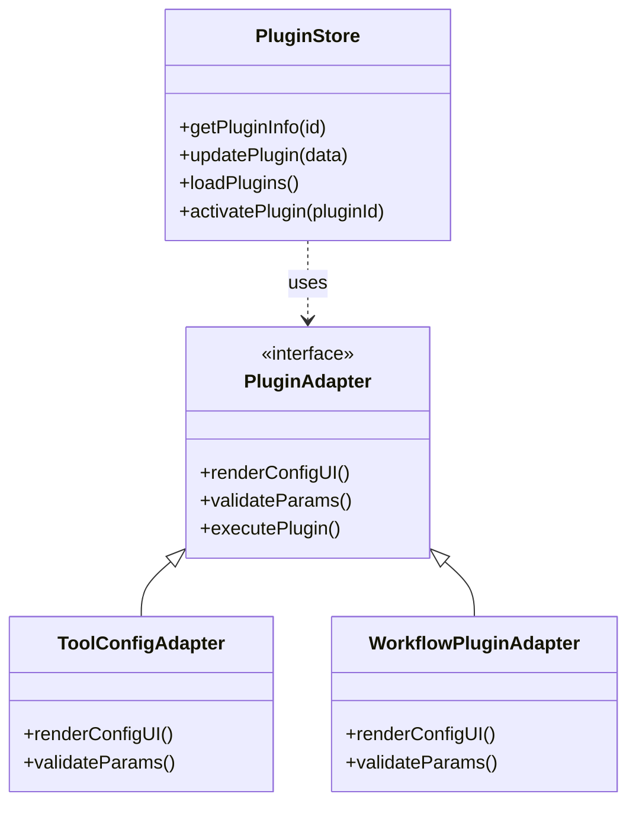
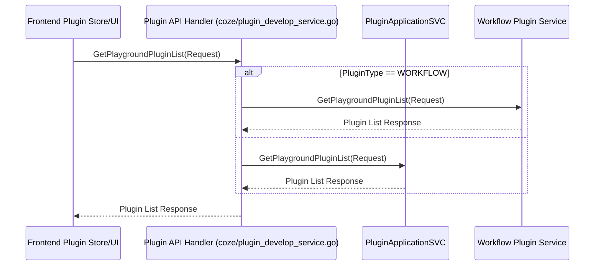

<!-- source: DeepWiki mcp.deepwiki.com · repo coze-dev/coze-studio · page 2.5 Plugin and Extension System · fetched 2026-10-29 -->

# Plugin and Extension System

Relevant source files

The following files were used as context for generating this wiki page:

- [.github/CODEOWNERS](.github/CODEOWNERS)
- [backend/api/handler/coze/open_apiauth_service.go](backend/api/handler/coze/open_apiauth_service.go)
- [backend/api/handler/coze/plugin_develop_service.go](backend/api/handler/coze/plugin_develop_service.go)

This document provides a detailed technical overview of the plugin architecture within Coze Studio, specifically covering the integration in the agent-ide and studio frontend packages, the backend plugin domain, the adapter patterns employed, OAuth-based secure plugin configuration, and the plugin store mechanics.

---

## Architecture Overview

Coze Studio’s plugin and extension system is designed for modularity, security, and extensibility. It supports third-party integrations, workflow automation, and AI-powered tool invocation through a layered architecture split between frontend and backend:

- The **frontend** (agent-ide and studio packages) manages plugin UI, user interactions, and plugin lifecycle.
- The **backend** (plugin domain and application layers) manages registration, secure credential storage (with AES encryption for OAuth tokens), business logic, and API routing.

### System-Level Plugin Architecture

**Explanation:**

- Frontend components such as plugin UI components and plugin state stores interact with backend API handlers over HTTP/thrift.
- The backend application service coordinates plugin logic, such as metadata management and API proxying.
- The domain service encapsulates core business logic, including integration with OAuth token management.
- OAuth tokens are managed securely through the OAuth domain and consumed to authenticate third-party API calls.

Sources: [backend/api/handler/coze/plugin_develop_service.go:21-32](), [backend/api/handler/coze/plugin_develop_service.go:34-132]()

---

## Backend Plugin Domain

The backend contains the core plugin management domain which handles plugin metadata, API definitions, OAuth authentication, and plugin lifecycle operations.

### Key Components

| Component                  | Description                                                       | Location                                  |
|----------------------------|-----------------------------------------------------------------|-------------------------------------------|
| Plugin API Handlers        | HTTP handlers exposing plugin APIs for frontend interaction.    | `backend/api/handler/coze/plugin_develop_service.go`  |
| Plugin Application Service | Business logic orchestrator coordinating plugin-related workflows.| `backend/application/plugin/`            |
| Plugin Domain Service      | Core domain logic, including plugin metadata, APIs, and OAuth.  | `backend/domain/plugin/`                  |
| OAuth Domain Service       | Manages OAuth credentials, token encryption, and authorization. | `backend/domain/openauth/`                |

Sources: [backend/api/handler/coze/plugin_develop_service.go:34-132](), [backend/api/handler/coze/plugin_develop_service.go:221-242]()

### Plugin Metadata Registration

Plugins are registered with metadata including:

- Name
- Description
- Icon URL
- Authentication type (OAuth, API Key, etc.)
- Space and optional project scope
- Plugin type (usually `PLUGIN` or `WORKFLOW`)

The `RegisterPluginMeta` API validates these fields for correctness before persisting. Key validations include:

- Icon and URL length and presence checks
- Valid authentication type enumeration
- Correct plugin type (currently supports only standard plugins here)

The registration request is handled by `RegisterPluginMeta` method in `plugin_develop_service.go` which delegates to `PluginApplicationSVC.RegisterPluginMeta` [backend/api/handler/coze/plugin_develop_service.go:81-132]()

### Plugin API and Information Retrieval

- Frontend retrieves plugin API lists and metadata via APIs such as `GetPluginAPIs` and `GetPluginInfo`.
- API update notifications and OAuth status checks are available through dedicated API endpoints for frontend to manage plugin lifecycle states and OAuth authorization verification.

Sources: [backend/api/handler/coze/plugin_develop_service.go:134-242]()

---

## Authentication and Security

### OAuth Token Management

Plugins that require OAuth-based authentication store credentials securely using AES encryption.

- **AES Key Configuration**: The AES key is configured in the environment (`PLUGIN_OAUTH_AES_KEY`) and used to encrypt/decrypt OAuth tokens transparently.
- **Token Storage**: Encrypted tokens are stored in the backend database, preventing plaintext exposure.
- **OAuth Status API**: The `GetOAuthStatus` API allows frontend to check whether OAuth tokens are valid or present without leaking credential material.

### Plugin Edit Locking

To coordinate plugin editing in multi-user environments, the system provides locking semantics to prevent concurrent conflicting edits:

- The `CheckAndLockPluginEdit` API verifies if a plugin is locked and attempts to acquire a lock.
- This mechanism ensures data integrity during plugin configuration phases.

These APIs promote secure, consistent plugin management workflows.

Sources: [backend/api/handler/coze/plugin_develop_service.go:219-263]()

---

## Frontend Plugin System

The frontend organizes plugin-related functionalities into modular packages aligned with the agent-ide and studio ecosystems.

### Core Packages and Roles

| Package                               | Description                                                | Ownership / Maintainers                      |
|-------------------------------------|------------------------------------------------------------|---------------------------------------------|
| `agent-ide/bot-plugin/`              | Plugin core integration components used in agent-ide IDE. | @Hezi-crypto, @duwenhan2byte                |
| `studio/stores/bot-plugin/`          | Plugin state management and store for Studio environment.  | @Hezi-crypto, @catee                         |
| `agent-ide/tool-config/`             | Plugin tool configuration UI components and logic.         | @haozhenfei, @catee                         |
| `agent-ide/debug-tool-list/`         | Debug UI and runtime tool list for plugin testing/debugging.| @Hezi-crypto, @evan-crash                    |

Sources: [.github/CODEOWNERS:7-8](), [.github/CODEOWNERS:42](), [.github/CODEOWNERS:91]()

### Adapter Pattern Implementation

The frontend plugin system employs a robust adapter pattern to abstract plugin types (plugins, workflows, tools) and runtime environments.

- **PluginStore** acts as centralized state management for plugin metadata and runtime status.
- Different adapters implement the plugin interface to render UI and handle config/validation for specific plugin types.
- This separation allows extension and modification without altering the core plugin store or front UI code.

Sources: [.github/CODEOWNERS:42]()

---

## Plugin Store and Discovery API Flow

### Discovery Workflow

1. The frontend issues a request to `GetPlaygroundPluginList` API endpoint with filters like space ID, plugin type (workflow or standard plugin), pagination, etc.
2. On the backend, if the request targets workflow plugins only, it delegates to the workflow service; otherwise, it uses the plugin domain’s application service.
3. The service returns a filtered list of plugin metadata and status.
4. The frontend updates its plugin store to reflect available plugins for the current context.

Sources: [backend/api/handler/coze/plugin_develop_service.go:34-77]()

---

## Development and Debugging Tools

### Debug Tools in agent-ide

- The `debug-tool-list` package provides runtime inspection and manual interaction interfaces for plugins.
- Developers can observe API calls output/input, trigger calls manually, and monitor plugin state transitions.
- This eases plugin development and integration testing.

### Mock External Integrations

- Mock sets for plugin APIs enable offline testing scenarios.
- The mockset management backend allows creation of representative API response datasets enabling plugin behavior validation without live service calls.

Sources: [.github/CODEOWNERS:91]()

---

# Summary

Coze Studio’s plugin and extension system is a comprehensive infrastructure designed for secure, modular, and flexible integration of external tools and workflows. It achieves this through:

- A clear separation between frontend plugin UI and backend plugin business logic.
- Use of adapter patterns to abstract plugin interactions.
- Secure OAuth token encryption and management.
- A well-defined plugin store architecture supporting discovery and activation.
- Developer tooling for effective plugin lifecycle management.

This design facilitates extensibility and secure collaborative development around conversational AI agents within the Coze ecosystem.

---

Sources:  
- [backend/api/handler/coze/plugin_develop_service.go:21-263]()  
- [backend/api/handler/coze/open_apiauth_service.go:19-170]()  
- [.github/CODEOWNERS:7-8,42,91]()

---

