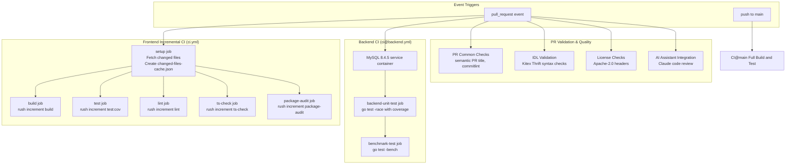

<!-- source: DeepWiki mcp.deepwiki.com · repo coze-dev/coze-studio · page 3 CI/CD System · fetched 2026-10-29 -->

# CI/CD System

<details>
<summary>Relevant source files</summary>

The following files were used as context for generating this wiki page:

- [.github/workflows/ci.yml](.github/workflows/ci.yml)
- [.github/workflows/ci@backend.yml](.github/workflows/ci@backend.yml)
- [.github/workflows/ci@main.yml](.github/workflows/ci@main.yml)
- [.github/workflows/common-pr-checks.yml](.github/workflows/common-pr-checks.yml)

</details>


## Purpose and Scope

The CI/CD System automates code validation, testing, and quality enforcement for the Coze Studio monorepo through GitHub Actions workflows. It ensures that all pull requests undergo multiple parallel validation checks before merging, and performs comprehensive validation on main branch pushes.

This page provides a high-level overview of the core CI/CD workflows located in `.github/workflows/`. For detailed implementation and technical specifics of each validation pipeline, please refer to the respective child pages:

- **Frontend CI Workflows (3.1)** — Incremental Rush.js builds, tests, lint, type checking using file change detection.
- **Backend CI Workflows (3.2)** — Go unit tests with race condition detection, benchmarking, and MySQL integration.
- **Pull Request Validation (3.3)** — Enforcing semantic PR titles and commit messages.
- **License and Compliance (3.4)** — Apache-2.0 license header enforcement and dependency license auditing.
- **IDL Validation (3.5)** — Thrift IDL syntax checks via Kitex tooling.
- **AI Assistant Integration (3.6)** — Claude AI assisted code review triggered by `@claude` mentions.

## Workflow Architecture

### Primary Workflows Summary

Coze Studio’s CI/CD leverages multiple specialized GitHub Actions workflows to optimize efficiency by separating concerns based on language stack, technology, and validation type.

| Workflow Name       | File                                 | Trigger                    | Path Filters                      | Purpose                        |
|---------------------|------------------------------------|----------------------------|----------------------------------|--------------------------------|
| `CI`                | `.github/workflows/ci.yml`          | Pull request on main       | `frontend/**`, `idl/**`, `common/**`, `rush.json` | Incremental frontend CI covering changed files |
| `CI@main`            | `.github/workflows/ci@main.yml`     | Push to main branch        | `frontend/**`, `idl/**`, `common/**`, `rush.json` | Full frontend build & test on main |
| `Backend Tests`      | `.github/workflows/ci@backend.yml`  | Pull requests & pushes     | `backend/**`, `docker/atlas/**`  | Full backend test suite with MySQL |
| `PR Common Checks`   | `.github/workflows/common-pr-checks.yml` | Pull request events        | General repo paths                | PR title format and commit lint |

**Runtime Environment Versions:**

- Node.js: 22.16.0  
- Go: 1.24  
- GitHub Runner: ubuntu-latest  

These are configured via workflow matrices and environment variables in the workflows [[.github/workflows/ci.yml:23-26]()] [[.github/workflows/ci@backend.yml:21-26]()] [[.github/workflows/ci@main.yml:24-26]()].

### Overall Workflow Interaction Diagram



This orchestration illustrates how jobs fan out from the initial trigger events and the setup job artifact (changed files cache) is shared among the incremental frontend jobs. The backend pipeline runs alongside using its own MySQL infrastructure. PR quality checks are also run in parallel to catch style and title issues early [[.github/workflows/ci.yml:18-128]()] [[.github/workflows/ci@backend.yml:24-126]()] [[.github/workflows/common-pr-checks.yml:16-46]()].

## Change Detection and Incremental Strategy

### Setup Job Details

The `setup` job in `ci.yml` identifies all files changed in the PR relative to the base branch. It filters out autogenerated changelog files under `common/changes/` to avoid unnecessary validations [[.github/workflows/ci.yml:41-67]()]. The filtered list is serialized as a JSON array in `changed-files-cache.json` and uploaded as an artifact for downstream jobs [[.github/workflows/ci.yml:60-64]()].

**Filtering Logic Sample:**

```bash
for file in $all_files; do
  if [[ ! "$file" =~ ^common/changes/.* ]]; then
    # include in filtered list
  fi
done
```

This allows subsequent incremental Rush jobs (`rush increment`) to operate only on affected projects based on changed files passed with the `-p` flag [[.github/workflows/ci.yml:123-127]()].

### Incremental Jobs

After the setup job completes, the following jobs run in parallel:

- **build**: Runs `rush increment build` to compile changed packages.
- **test**: Runs `rush increment test:cov` for incremental tests with coverage.
- **lint**: Runs `rush increment lint` for code style checks.
- **ts-check**: Runs type checking on changed projects.
- **package-audit**: Checks package dependencies and advisories.

Each job downloads the cached `changed-files-cache.json` artifact, restoring the minimal working set [[.github/workflows/ci.yml:113-116]()].

## Backend CI Strategy

The backend pipeline validates the Go backend services with a full integration style test approach.

### MySQL Service Setup

The `backend-unit-test` job spins up a MySQL 8.4.5 container and loads the defined database schema from `docker/volumes/mysql/schema.sql` [[.github/workflows/ci@backend.yml:46-78]()]. It waits actively for MySQL port readiness before initializing.

### Go Test Execution

Tests are run across all Go modules in the repository using a dynamically generated `go.work` workspace. The race detector (`-race`) is enabled along with coverage profiling [[.github/workflows/ci@backend.yml:80-88]()].

```bash
go test -race -v -coverprofile=coverage.out -gcflags="all=-l -N" ...
```

Coverage is uploaded to Codecov with appropriate environment tags [[.github/workflows/ci@backend.yml:90-97]()].

### Benchmark Tests

A separate job runs benchmarks with memory allocations profiled using `go test -bench=. -benchmem` to monitor performance regressions [[.github/workflows/ci@backend.yml:103-125]()].

## Pull Request Validation

### PR Title and Commit Message Checks

The `PR Common Checks` workflow validates each PR's title against semantic versioning conventions using `commitlint` integrated as a Rush autoinstaller [[.github/workflows/common-pr-checks.yml:37-45]()].

If a PR title contains "WIP" or "wip", validation is skipped to allow work-in-progress branches [[.github/workflows/common-pr-checks.yml:38]()].

This ensures consistency in commit history and supports automated release note generation.

## License and Compliance

License headers for Apache-2.0 are enforced across source files using the `license-eye` tool configured via `.licenserc.yaml` (details in child page 3.4). Dependencies are also audited for license compliance, with safe ignores for generated code such as Kitex and GORM-generated files.

## IDL Validation

Thrift IDL files are validated syntactically using Kitex's `thrift-gen-validator` tool in a dedicated `idl.yaml` workflow. The validation runs iteratively over all files in the `idl/` directory within an isolated dummy Go module environment. This guarantees backward-compatible IDL changes before code generation.

## AI Assistant Integration

The repository integrates Anthropic's Claude AI chatbot for automated code review and developer assistance via @claude mentions in issue comments or pull request review comments.

The `claude.yml` workflow triggers on comment and review events, leveraging the `anthropics/claude-code-action@beta` GitHub Action. It operates under scoped permissions and is configured with a specialized frontend-infrastructure-expert agent persona (detailed in child page 3.6).

---

# References to Child Pages

For detailed technical documentation and configuration examples of each subsystem in the CI/CD pipeline, please see:

- [Frontend CI Workflows](#3.1)
- [Backend CI Workflows](#3.2)
- [Pull Request Validation](#3.3)
- [License and Compliance](#3.4)
- [IDL Validation](#3.5)
- [AI Assistant Integration](#3.6)

---

## Sources

- [.github/workflows/ci.yml:1-128]()  
- [.github/workflows/ci@backend.yml:1-126]()  
- [.github/workflows/ci@main.yml:1-77]()  
- [.github/workflows/common-pr-checks.yml:1-49]()

---

